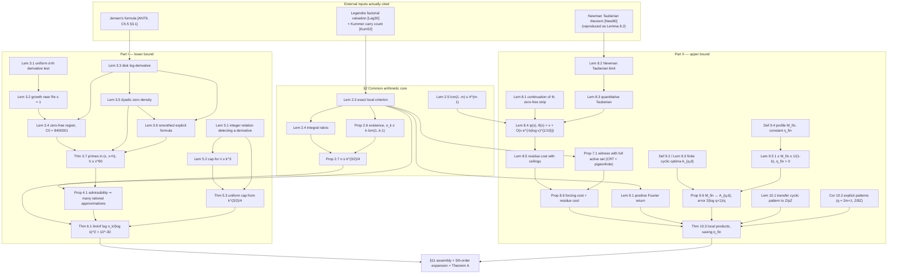

# Faithful Proof Playbook — Erdős Problem 1063

**Source manuscript.** *Two-sided bounds for the least binomial divisibility defect: on a problem of Erdős and Selfridge* (42 pages, author placeholders `[AUTHOR NAME]` / `[AFFILIATION]` / `[EMAIL]`), obtained as `Erdos1063_Proof(1).pdf` from Google Drive file id `1FqKMQYDmq4mDVNR1n-9a1lqR5rgm43gG`.
**Target Lean file.** `FormalConjectures/ErdosProblems/1063.lean` (google-deepmind/formal-conjectures).
**Regenerated.** 2026-09-20. This file *replaces* an earlier playbook that contained fabricated attributions; see §12 (Errata).

---

## 0. How this document was produced, and what "faithful" means here

Rules applied while writing:

1. **Every numbered statement below was read off the manuscript text** (page-annotated text extraction of all 42 pages). Constants, exponents and hypotheses are copied, not reconstructed.
2. **No external result is credited to the paper unless the paper cites it.** The manuscript cites exactly four load-bearing external items (Legendre's factorial valuation, Kummer's carry count, Jensen's formula, Newman's Tauberian theorem) and says explicitly that two more ([New80] as a PNT proof, [Hoh30]) are "see-also". Names such as Kusmin–Landau, van der Corput, Weyl differencing, Borel–Carathéodory, Turán, Fejér, Siegel, Bombieri–Pila, Vinogradov, Selberg, Perron, Mellin **do not occur anywhere in the manuscript**; where the paper's own argument resembles such a classical technique this is marked as *resemblance, not attribution*.
3. **Referee/blocker annotations embedded in the manuscript are reproduced verbatim.** They are the difference between "proved here" and "asserted here", and a formalizer must see them.
4. The text extraction garbles ligatures (`fi`, `ffi`, `ff`) and the letter `ő`; these have been normalized silently. Two OCR artefacts are flagged inline where they could mislead.

> [!IMPORTANT]
> The manuscript's own verification claim is: *"The main result of this paper was obtained with the assistance of the Danus system, an automated proof-search and verification system. Every result was accepted by the system's independent verification service, and the assembled paper was re-verified as a whole; the verification is by machine referee, **not by formal proof assistant**."* (Remark 1.2). It further carries an unresolved blocker at the head of the paper: *"[prime/blocker] Compilation and the required compile-verification gate have not been run. No compiled PDF or verified compilation is asserted."*

---

## 1. The problem and the main theorem

### 1.1 Definition (admissible endpoints; Definition 1.1)

Let $k \ge 2$. An integer $n \ge 2k$ is **admissible** if **exactly $k-1$** of
$$n,\; n-1,\; \dots,\; n-k+1$$
divide $\binom{n}{k}$. When admissible integers exist, $n_k$ denotes their least member.

This is Erdős problem #1063 [Blo26], attributed to Erdős–Selfridge [ES83], and Problem B31 in Guy [Guy04].

### 1.2 Theorem A (verbatim content)

For $0 < b < 1$ let $M_{\mathrm{fin}}(b)$ be the supremum of $\sum_{j \bmod q} h(j)$ over integers $q \ge 2$ and even functions $h : \mathbb{Z}/q\mathbb{Z} \to [0,\infty)$ satisfying
$$h(0) = 1, \qquad \widehat{h}(a) := \frac{1}{q}\sum_{j \bmod q} h(j) e^{-2\pi i a j / q} \ge 0 \quad (a \in \mathbb{Z}),$$
and
$$h(j) > 0,\; j \ne 0 \;\Longrightarrow\; \frac{\min(j \bmod q,\, (-j) \bmod q)}{q} > 1 - b .$$
Define the finite nonnegative constant
$$\eta_{\mathrm{fin}} \;=\; \int_0^1 \log M_{\mathrm{fin}}(b) \sum_{m \ge 1} \frac{1}{(m+b)^2}\, db ,$$
the integral being improper at $1$. For sufficiently large $k$ put
$$L = \log k, \qquad \ell = \log L, \qquad w = \log \ell + \log 2 - \tfrac12,$$
and let $x > 1$ be the unique solution of $x - \log x = \ell + \log 2 - \tfrac12$. Then, unconditionally:

**(1)**
$$\exp\!\big(10^{-30}(\log k)^2\big) \;<\; n_k \;\le\; \exp\!\left(\frac{k}{L}\left[x + \frac12 + \frac1x - \eta_{\mathrm{fin}} + O\!\left(\frac{\ell}{L}\right)\right]\right).$$

**(2)**
$$\liminf_{k \to \infty} \frac{\log n_k}{(\log k)^2} \;\ge\; \frac{1}{8000000\,(32768 \cdot 8400001)^2} \;>\; 10^{-30}.$$

**(3)** The upper exponent divided by $k/L$ has the expansion
$$\ell + \log \ell + \log 2 - \eta_{\mathrm{fin}} + \sum_{j=1}^{5} \frac{P_j(w)}{\ell^{j}} + O\!\left(\frac{(1+|w|)^6}{\ell^6}\right),$$
with
$$P_1 = w+1,\quad P_2 = -\frac{w^2}{2},\quad P_3 = \frac{w^3}{3}-\frac{w^2}{2},\quad P_4 = -\frac{w^4}{4}+\frac{5w^3}{6}-\frac{w^2}{2},\quad P_5 = \frac{w^5}{5}-\frac{13w^4}{12}+\frac{3w^3}{2}-\frac{w^2}{2},$$
so that in particular the bracket is $\ell + \log\ell + \log 2 - \eta_{\mathrm{fin}} + \frac{w+1}{\ell} - \frac{w^2}{2\ell^2} + O\!\big((\log\ell)^3/\ell^3\big)$.

Every upper bound remains valid after omitting $-\eta_{\mathrm{fin}}$. All implied constants are absolute; all logarithms natural; integer remainders least nonnegative. Lemma 9.5 gives $\eta_{\mathrm{fin}} > 0$, so the leading form is
$$\exp\!\big(10^{-30}(\log k)^2\big) \;<\; n_k \;\le\; \exp\!\left(\frac{k}{\log k}\big[\log\log k + \log\log\log k + \log 2 - \eta_{\mathrm{fin}} + o(1)\big]\right).$$

**Explicitly not asserted:** any matching asymptotic; any numerical eventual threshold ($x_0$, $T_0$, the "sufficiently large $k$").

### 1.3 Prior state of the art, as recorded by the manuscript

| Source | Claim | Manuscript's own comment |
|---|---|---|
| [Mon85] Monier | $n_k \le k!$ $(k \ge 3)$ | historical comparison |
| Cambie, via [Blo26] | $n_k \le k \cdot \mathrm{lcm}(2,\dots,k-1) \le e^{(1+o(1))k}$ | the bound the Lean `better_upper` asks to beat |
| [Blo26] forum comment, 26 June 2026 | $n_k \ge \max\{2k, \prod_{p^a \| k} p^{a + \lfloor \log_p(k/2)\rfloor}\}$ | "this quantity is $k^{1+o(1)}$ for prime $k$, and no super-polynomial lower bound was previously recorded" |
| [EPAD26] AI-generated page, 25 July 2026 | $n_k \le \exp(C k \log\log k / \log k)$, $C$ unspecified | "It gives no lower bound and states that its proof has not been posted to the problem catalogue." |
| OEIS A389360 | $n_k$ through $k=59$; companion internal computation to $k=78$ | **"[cite/blocker] OEIS A389360 and the asserted b-file coverage through $k = 59$ remain unverified (the sequence database was unreachable during verification). [deferred: to reference_verify]"** — and: "These computations are not used in the proofs." |

---

## 2. Status board: proved vs. asserted (verbatim annotations)

| Location | Annotation (verbatim) |
|---|---|
| Front matter | `[author/blocker] No author, affiliation, or email was supplied. [acknowledged: The author placeholders are retained; authorship information remains required.]` |
| Front matter | `[prime/blocker] Compilation and the required compile-verification gate have not been run. No compiled PDF or verified compilation is asserted.` |
| §1, related work | `[cite/blocker] OEIS A389360 … remain unverified … [deferred: to reference_verify]` |
| Remark 1.2 | `[acknowledged: No verification statement has been invented.]` — machine referee, not proof assistant |
| §3 preamble | "Newman's Tauberian proof of the prime number theorem [New80] and Hoheisel's short-interval theorem [Hoh30] **are intended as see-also references.**" |
| Lemma 3.2 proof | `[addressed-partial: The growth reduction is written out | deferred: A proof of the uniform derivative test is required.]` `[addressed: The uniform derivative test is now proved above.]` |
| Lemma 3.4 proof | `[addressed-partial: … | deferred: Proofs of its derivative test and the disk expansion are required.]` `[addressed: Both required estimates are now proved above.]` |
| Lemma 3.4 statement | "No numerical value of $T_0$ is asserted." |
| Lemma 3.6 proof | `[addressed-partial: The contour calculation is retained | deferred: A proof of the disk expansion is required.]` `[addressed: The fixed-disk expansion is now proved above.]` |
| Theorem 3.7 | "No numerical value of $x_0$ is asserted." |
| Proposition 4.1 | "**The prime-count premise is an assumption.**" (discharged later by Theorem 3.7 inside Theorem 6.1) |
| Theorem 5.3 | "This is an unconditional rational-point estimate." |
| Theorem 6.1 | "No numerical eventual threshold or matching asymptotic is asserted." |
| Definition 9.4 | "The support condition in this definition is strict." |
| Proposition 9.6 | "This right-limit assertion does not assert equality at $t_d$." |
| Lemma 10.1 | "Neither modulus is required to be prime." |
| Theorem 10.3 | "The estimate uses products of explicitly constructed local functions; **no estimate for the optimum over other functions is asserted or assumed.**" |
| Conjecture 11.1 | `[math/blocker] The certificate-cost theorems supporting this motivation were not supplied; the calibration is a conjecture, not a consequence proved here. [addressed-partial: Conjectural status retained | deferred: The supporting certificate-cost proofs were not included in this round.]` |

---

## 3. Architecture

Two logically independent halves share one arithmetic input (Lemma 2.3).



**Method paragraph, as the paper states it:** "The common arithmetic input is an exact local description of the unique non-divisor. Counting prime powers in factorials gives the carry criterion in Lemma 2.3. This is the valuation mechanism usually associated with Legendre's formula [Leg30] and Kummer's carry count [Kum52]."

---

## 4. Part 0 — content of the references the proof actually rests on

Only four external mathematical facts are used. Each is stated here so the playbook is self-contained, together with where the manuscript uses it and the current formal-library situation.

### 4.1 Legendre's factorial valuation [Leg30]

**Statement.** For a prime $p$ and $n \ge 1$,
$$v_p(n!) = \sum_{i \ge 1} \left\lfloor \frac{n}{p^i} \right\rfloor = \frac{n - s_p(n)}{p-1},$$
$s_p(n)$ the base-$p$ digit sum.

**Mechanism.** Count multiples of $p$, then of $p^2$, … each element contributes once per level it survives.

**Use in the paper.** Inside Lemma 2.3, in the specialized interval form: for $q = p^a$,
$$\#\{0 \le i < k : q \mid n-i\} = \left\lfloor \frac{k}{q} \right\rfloor + \mathbf{1}_{\{n \bmod q \,<\, k \bmod q\}},$$
which, summed over levels, yields the key identity (2.1)
$$v_p\!\binom{n}{k} = a_p - B_p(n,k), \qquad a_p = \max_{0 \le i < k} v_p(n-i).$$
It is also used through $\lfloor k/q\rfloor - \lfloor r/q \rfloor - \lfloor s/q \rfloor = \mathbf{1}_{\{r \bmod q \ge k \bmod q\}}$ (with $s = k-1-r$) to compute $\beta_{p,r}$.

**Formal status (checked 2026-09-20 via Mathlib docs search; declaration signatures not compile-checked).** `padicValNat_factorial` and `sub_one_mul_padicValNat_factorial` in `Mathlib.NumberTheory.Padics.PadicVal`; multiplicity form `Nat.Prime.multiplicity_factorial` in `Mathlib/Data/Nat/Multiplicity.lean`.

### 4.2 Kummer's carry count [Kum52]

**Statement.** $v_p\binom{m+n}{n}$ equals the number of carries when $n$ and $m$ are added in base $p$.

**Mechanism.** Legendre gives $v_p\binom{m+n}{n} = \frac{s_p(n)+s_p(m)-s_p(n+m)}{p-1}$, and each carry lowers the digit sum by exactly $p-1$.

**Use in the paper.** Cited (§1, Method) as the mechanism behind Lemma 2.3. The paper does not invoke a carry-counting statement verbatim; it re-derives what it needs in floor-function form. So for formalization, Lemma 2.3 is provable from the Legendre/floor identities alone — Kummer is orientation.

**Formal status.** `Nat.Prime.multiplicity_choose` (carries form) and `padicValNat_choose`, in `Mathlib/Data/Nat/Multiplicity.lean`.

### 4.3 Jensen's formula [Ahl79, Chapter 5, Section 3.1]

**Statement.** If $f$ is holomorphic on a neighbourhood of $|z| \le r$, $f(0) \ne 0$, with zeros $a_1,\dots,a_n$ in $|z| < r$ (with multiplicity), then
$$\log|f(0)| + \sum_{j=1}^{n} \log\frac{r}{|a_j|} = \frac{1}{2\pi}\int_0^{2\pi} \log\big|f(re^{i\theta})\big|\, d\theta .$$

**Mechanism.** Divide out Blaschke factors to get a zero-free function of the same boundary modulus, then apply the mean value property to the harmonic $\log|F|$.

**Uses in the paper (all three).**
* Lemma 3.3 proof (line 578): on circles of radius $R \uparrow 4a$ avoiding zeros, to get $m\log(R/3a) \le B$, i.e. the zero count $m \le B/\log(4/3)$.
* Lemma 3.5 proof (line 684): on disks of radius $1$ centred at $11/10 + it$, bounding the number of zeros in radius $3/4$ by $C\log(|t|+3)$.
* Lemma 3.6 proof (line 980 region): the same disk bound anchors the short-interval explicit formula error.

**Formal status.** `Mathlib.Analysis.Complex.JensenFormula` exists (analytic and meromorphic versions). Not to be confused with `Mathlib.Analysis.Convex.Jensen`.

### 4.4 Newman's Tauberian theorem [New80]

**Statement (the paper's Lemma 8.2, attributed in its title).** Let $f : [0,\infty) \to \mathbb{C}$ be locally integrable with $|f(t)| \le M$, and $g(z) = \int_0^\infty f(t)e^{-zt}\,dt$ for $\operatorname{Re} z > 0$. If $g$ extends holomorphically to an open set containing $\{\operatorname{Re} z \ge 0\}$, then $\int_0^T f(t)\,dt \to g(0)$.

**Mechanism.** Compare $g$ with the truncated transform $g_T$ on a contour consisting of the arc $|z| = R$, $\operatorname{Re} z > 0$, and a left piece pushed into $\operatorname{Re} z < 0$, inserting Newman's kernel $e^{Tz}\big(1 + z^2/R^2\big)/z$, which is $O(1/R)$-small on $|z| = R$ and kills the boundary contribution; let $T \to \infty$, then $R \to \infty$.

**Uses in the paper.** Lemma 8.2 is the qualitative statement; Lemma 8.3 is the *quantitative* version the paper actually needs (explicit width/height trade-off), and Lemma 8.4 applies it with $d = 9$ to $f(t) = e^{-t}\vartheta(e^t) - 1$, whose transform is $g(z) = \frac{\Phi(1+z)}{1+z} - \frac1z$.

**Formal status.** No Newman-Tauberian declaration was found in Mathlib. Mathlib/adjacent work has the Wiener–Ikehara route; the Prime Number Theorem itself is formalized in the external *PrimeNumberTheoremAnd* project (Kontorovich–Tao), not in core Mathlib. **A quantitative PNT with error $x\exp(-b(\log x)^{1/10})$, a zero-free region, and a zero-density estimate are all unavailable in any formal library today.** This is the single largest formalization obstacle in Part II (and, through §3, in Part I).

### 4.5 Problem-defining sources (context, not machinery)

* **[ES83] Erdős–Selfridge, Problem 6447 (Amer. Math. Monthly 1983, 710)** — the origin of the question. The companion fact that for $n \ge 2k$, $k \ge 2$, *at least one* of the $n-i$ fails to divide $\binom{n}{k}$ is the last paragraph of the paper's Lemma 2.3 proof: every prime divisor of $k$ has $B_p(n,k) > 0$ (its level $p$ is counted), so an active prime exists and $n-r$ does fail. (This is the Lean file's `variants.exists_exception`.)
* **[Mon85] Monier (Amer. Math. Monthly 92 (1985) 435–436)** — solution of 6447, recording $n_k \le k!$ for $k \ge 3$.
* **[Blo26] erdosproblems.com/1063 + forum thread** — catalogue entry recording $n_2 = 4$, $n_3 = 6$, $n_4 = 9$, $n_5 = 12$ (these are the Lean file's `variants.small_values`), Cambie's $n_k \le k\,\mathrm{lcm}(2,\dots,k-1)$, and the 26 June 2026 lower-bound comment quoted in §1.3.
* **[Guy04] Guy, Unsolved Problems in Number Theory, Problem B31.**

### 4.6 Explicitly *not* used

* **[Hoh30] Hoheisel**, *Primzahlprobleme in der Analysis* — the paper says it and [New80]-as-PNT-proof "are intended as see-also references". Classical content, for orientation only: there is $\theta < 1$ with $\pi(x + x^{\theta}) - \pi(x) \sim x^\theta/\log x$; the paper's Theorem 3.7 is a self-contained explicit analogue with $\theta_0 = 1 - \frac{1}{8192 \cdot 8400001}$, proved from its own Lemmas 3.1–3.6.
* No other analytic-number-theory result is imported. All zero-free/zero-density/explicit-formula input is built inside §3.

---

## 5. §2 — the common arithmetic core

### Notation 2.1
$\vartheta(y) = \sum_{p\le y}\log p$, $\pi(y) = \#\{p \le y\}$; $p$ always prime; empty products $=1$; natural logarithms.

### Setup 2.2 (local parameters)
For integers $k \ge 2$, $n \ge 2k$, $0 \le r < k$:
$$s = k-1-r,\quad T_r = \max(r,s),\quad h_p = \lfloor \log_p k \rfloor,\quad H_{p,r} = \lfloor \log_p T_r \rfloor,$$
$$\beta_{p,r} = v_p\!\binom{k-1}{r}, \qquad B_p(n,k) = \#\{a \ge 1 : p^a \le k,\ n \bmod p^a \ge k \bmod p^a\}.$$
A prime $p \le k$ is **active at $(n,k)$** if $B_p(n,k) > 0$.

### Lemma 2.3 (local divisibility criterion) — *the hinge of the whole paper*
$$\beta_{p,r} = \#\{a \ge 1 : p^a \le k,\ r \bmod p^a \ge k \bmod p^a\}, \qquad \beta_{p,r} \ge v_p(k).$$
$n-r$ is the **unique** non-divisor among $n, n-1, \dots, n-k+1$ **iff** for every prime $p \le k$ exactly one of:
1. $B_p(n,k) = 0$;
2. $\beta_{p,r} > 0$ and $p^{H_{p,r} + \beta_{p,r}} \mid n-r$.

In case (2), $B_p(n,k) = \beta_{p,r} > 0$. Also $H_{p,r} \ge h_p - 1$.

**Proof narrative.** Counting multiples of $q = p^a$ in $k$ consecutive integers gives $\lfloor k/q\rfloor + \mathbf 1_{\{n \bmod q < k \bmod q\}}$. With $a_p = \max_{0\le i<k} v_p(n-i)$: every $k$ consecutive integers contain a multiple of $p^{h_p}$, so $a_p \ge h_p$; above level $h_p$ at most one member is divisible; Legendre's factorial valuation then gives **(2.1)** $v_p\binom nk = a_p - B_p(n,k)$. Primes $p > k$ have $B_p = 0$ and never obstruct. For $\beta_{p,r}$: from $k\binom{k-1}{r} = \frac{k!}{r!s!}$ and $r+s = k-1$ one gets $\lfloor k/q\rfloor - \lfloor r/q\rfloor - \lfloor s/q\rfloor = \mathbf 1_{\{r \bmod q \ge k \bmod q\}}$; summing over levels gives the formula, and integrality of $\binom{k-1}{r}$ gives $\beta_{p,r} \ge v_p(k)$.
*Forward direction:* at an active prime, $n-r$ must be the unique member of largest valuation; if $a = v_p(n-r) \le H_{p,r}$ then the index at distance $p^a$ from $r$ still lies in $\{0,\dots,k-1\}$ and duplicates the valuation — contradiction; so $a > H_{p,r}$, and since $v_p(n-i) = v_p(r-i)$ for $i \ne r$ with maximum $H_{p,r}$, one gets $a - B_p \ge H_{p,r}$, then $a \ge h_p$, hence $n \equiv r$ at every level $\le k$, hence $B_p = \beta_{p,r}$ and $p^{H_{p,r}+\beta_{p,r}} \mid n-r$.
*Converse:* the two alternatives give $v_p(n-r) \ge H_{p,r} + \beta_{p,r} \ge h_p$, so $B_p = \beta_{p,r}$, every other member has valuation $\le H_{p,r}$, and $v_p\binom nk = v_p(n-r) - \beta_{p,r} \ge H_{p,r}$; only $n-r$ fails. Finally every prime divisor of $k$ is active, so failure genuinely occurs.

### Lemma 2.4 (integral ratios from inactive primes)
If $1 \le d < k$ and every prime dividing $(k-1)(k-2)\cdots(k-d)$ has $B_p(n,k) = 0$, then $\dfrac{n(n-1)\cdots(n-d+1)}{(k-1)(k-2)\cdots(k-d)} \in \mathbb{Z}_{>0}$.
*Mechanism:* at a denominator prime and level $q = p^a \le k$, inactivity gives $n \bmod q < k \bmod q$, hence $n \bmod q \le (k-1)\bmod q$; comparing the counts $\lfloor d/q\rfloor + \mathbf 1_{\{a_0 \le e\}}$ vs $\lfloor d/q\rfloor + \mathbf 1_{\{b-1\le e\}}$ ($e = d \bmod q$) shows the numerator dominates at every level.

### Lemma 2.5 (elementary lcm bound)
$L_m := \mathrm{lcm}(1,\dots,m) \le 4^{m-1}$.
*Mechanism:* $L_m / L_{\lceil m/2\rceil}$ is squarefree and divides $\binom{m}{\lfloor m/2\rfloor}$ (a prime power $Q = p^e$ with $s < Q \le m$ contributes exactly $1$ to the factorial valuation); strong induction with $\binom{2n}{n}\le 4^n$ and $\binom{2n+1}{n}\le 4^n$.
*Used only in Lemma 8.4*, to get the crude $0 \le \vartheta(x) \le x\log 4$ needed to make Newman's theorem applicable.

### Proposition 2.6 (existence; Cambie-type witness)
The admissible set is infinite; $n_2 = 4$ and $2k \le n_k \le k\,\mathrm{lcm}(1,2,\dots,k-1)$ for $k \ge 3$.
*Mechanism:* with $W = \mathrm{lcm}(1,\dots,k-1)$ and $N = ukW$, apply Lemma 2.3 at $r = 0$: for $p \mid k$, $\beta_{p,0} = v_p(k)$, $H_{p,0} = \lfloor\log_p(k-1)\rfloor$ and $p^{H_{p,0}+\beta_{p,0}} \mid N$; for $p \le k$, $p \nmid k$, every level $p^a \le k$ is $\le k-1$, divides $W$, so $N \bmod p^a = 0 < k \bmod p^a$, i.e. inactive. $\binom 42 = 6$ settles $n_2 = 4$.

### Proposition 2.7 (elementary lower bound)
Every admissible $n$ satisfies $n \ge k^{3/2}/4$. More precisely, for $k \ge 3$ either $n \ge k^2/4$, or all of:
1. $k = p^a$ for an odd prime $p$;
2. $t = \frac{n}{k-1}$ and $\frac{n(n-1)}{(k-1)(k-2)}$ are positive integers;
3. $k-2 \mid t(t-1)$ and $n \ge (k-1)\sqrt{k-2}$.

*Mechanism:* with $m = n-r$, $T = \max(r,k-1-r)$, $A = \{p \le k : B_p > 0\}$: every $p \in A$ contributes $p^{H_{p,r}+\beta_{p,r}} \ge p^{H_{p,r}+1} > T$ and these divide $m$ with distinct bases; two active primes force $n \ge (T+1)^2 \ge (k+1)^2/4 > k^2/4$. If $n < k^2/4$ then $|A| = 1$, so $k = p^a$; $p = 2$ would give $n \ge 2^{2a-1} = k^2/2$, contradiction; hence $p$ odd, $p \nmid (k-1)(k-2)$, Lemma 2.4 at $d = 1,2$ produces the integers $t$ and $R_2$, and $R_2 = \frac{t[t(k-1)-1]}{k-2}$ reduces mod $k-2$ to $k-2 \mid t(t-1)$, giving $t^2 \ge k-2$ and $n = t(k-1) \ge (k-1)\sqrt{k-2} \ge k^{3/2}/4$.

> This $k^{3/2}/4$ floor is exactly the left endpoint of the range that Theorem 5.3 must cover, which is why the constant matters.

---

## 6. Part I — the super-polynomial lower bound (§3–§6)

**Shape of the argument.** For an admissible $n$ that is *too small*, Proposition 4.1 manufactures **many** good rational approximations $|n/u - v/w| < \Delta$ with $u$ ranging over a short block just below $k$; Theorem 5.3 proves that **few** such $u$ can exist. The two counts collide, which excludes $n \le \exp(\eta(\log M)^2)$.

### 6.1 §3: primes in short intervals, with explicit exponent

Everything here is self-contained; no analytic number theory is imported.

**Lemma 3.1 (uniform derivative test).** For $a,L,d\in\mathbb Z$, $L \ge 1$, $d\ge 2$, $C \ge 1$, $\lambda>0$, $f \in C^d([a,a+L],\mathbb R)$ with $\lambda \le |f^{(d)}| \le C\lambda$, $e(t)=\exp(2\pi i t)$, $S = \sum_{n=a}^{a+L-1} e(f(n))$, $K = 64(C+1)$, $\alpha_d = (2^d-2)^{-1}$, $b_d = 1 - 2^{2-d}$:
$$|S| \le K\big(L\lambda^{\alpha_d} + L^{b_d}\lambda^{-\alpha_d}\big).$$
*Mechanism:* base case $d = 2$ via summation by parts with $w(t) = (e(t)-1)^{-1} = -\tfrac12 - \tfrac i2\cot(\pi t)$ on ranges where $f'$ stays $\delta$-away from integers (this is a first-derivative/monotone-phase estimate; the paper attaches no name to it), then induction in $d$ by Cauchy–Schwarz on shifted sums, $|S|^2 \le 2L^2/H + (4L/H)\sum_{h<H}\sum_n z_{n+h}\overline{z_n}$, applying the inductive bound to the difference phases $f(x+h)-f(x)$ whose $(d-1)$-st derivative has modulus between $h\lambda$ and $Ch\lambda$.

**Lemma 3.2 (growth near the line one).** There are absolute $C>0$, $T_0 > e^{e}$ such that for $T = |t| \ge T_0$, $H = \log T$, $J = \log H$, $N_0 = \exp(64H/J)$: for $N_0 \le N \le 2T$ and $I \subseteq [N,2N]$,
$$\Big|\sum_{m \in I \cap \mathbb Z} m^{-it}\Big| \le N e^{-H^{9/10}}, \qquad\text{and}\qquad |\zeta(\sigma+it)| \le C H^{66} \;\; (1 - J^2/H \le \sigma \le 2).$$
*Mechanism:* apply Lemma 3.1 to $f(x) = -\frac{t\log x}{2\pi}$ with $r = \lfloor H/\log N\rfloor + 1$, $\lambda = \frac{T(r-1)!}{2\pi(3N)^r}$; then dyadic decomposition plus the continuation identity $\zeta(s) = \sum_{m\le K} m^{-s} + \frac{K^{1-s}}{s-1} - s\int_K^\infty \{u\}u^{-s-1}du$.

**Lemma 3.3 (disk logarithmic derivative).** $F$ holomorphic near $|z-z_0|\le 4a$, $|F| \le M$, $F(z_0)\ne 0$, zeros $\rho_j$ in $|z-z_0|\le 3a$ listed with multiplicity, $B = \log(M/|F(z_0)|)$. Then $m \le B/\log(4/3)$ and for $|z - z_0| \le 2a$, $F(z)\ne0$:
$$\Big|\frac{F'(z)}{F(z)} - \sum_{j=1}^m \frac{1}{z-\rho_j}\Big| \le \frac{200B}{a}.$$
*Mechanism:* **Jensen's formula [Ahl79]** for the zero count; then divide out $P(z) = \prod_j \frac{z-\rho_j}{z_0-\rho_j}$, put $h = \log(G/G(z_0))$ with $\operatorname{Re} h \le D = B + m\log 3$, apply the Schwarz-type bound to $g = h/(2D-h)$ ($|g|\le1$, $g(z_0)=0$) and Cauchy's estimate. (This is the standard "bounded-real-part ⇒ bounded modulus" device; the paper does not name it.)

**Lemma 3.4 (explicit zero-free region).** With
$$C_0 = 8400001 \;(= 6E_0+1,\ E_0 = 1400000), \qquad c_z = \frac{1}{16C_0},$$
there is an absolute $T_0 > e^e$ with $\zeta(s) \ne 0$ whenever $|\operatorname{Im} s| \ge T_0$ and $\operatorname{Re} s \ge 1 - c_z \frac{\log\log|\operatorname{Im} s|}{\log|\operatorname{Im} s|}$. **No numerical value of $T_0$ is asserted.**
*Mechanism:* $3 + 4\cos v + \cos 2v = 2(1+\cos v)^2 \ge 0$ giving $|\zeta(\sigma)|^3|\zeta(\sigma+it)|^4|\zeta(\sigma+2it)| \ge 1$; Lemma 3.2 for the modulus bound $\max_{|s-z_0|\le 4a}|\zeta| \le H^{68}$ with $a = J^2/(100H)$, $z_0 = 1+2a+it$; Lemma 3.3 to expand $\zeta'/\zeta$ over nearby zeros with error $\le E_0 H/J$; then the standard contradiction at $\sigma = 1 + \kappa J/H$, $\kappa = 1/(2C_0)$.

**Lemma 3.5 (uniform dyadic zero density).** $N_\zeta(\sigma,T) \le C T^{8(1-\sigma)}(\log T)^{20}$ for $T \ge T_0$, $9/10 \le \sigma < 1$.
*Mechanism:* Jensen again for $O(\log T)$ zeros per unit ordinate; a mean-value inequality $\int_J |P|^2 \le C[T + N\log 2N]\sum|a_n|^2$ for Dirichlet polynomials, via $|\log(n/m)| \ge |n-m|/(2N)$; zero-detection through a well-separated sample of ordinates.

**Lemma 3.6 (smoothed explicit formula).** With $\Lambda$ von Mangoldt, $w(v) = v^6(1-v)^6$ on $[0,1]$, $I_w = \int_0^1 w$, $f(u) = w((u-x)/h)$, $W(s) = \int_x^{x+h} f(u)u^{s-1}du$: for $x \ge x_0$, $T \ge T_0$, $0 < h \le x$ there exist $\sigma_0 \in [3/4,4/5]$ and $T' \in [T,T+1]$ with no zero on the boundary of the rectangle $\sigma_0 \le \operatorname{Re} s \le 1 + 1/\log x$, $|\operatorname{Im} s| \le T'$, and
$$\Big|\sum_{n\ge1}\Lambda(n)f(n) - hI_w + \sum_{\substack{\operatorname{Re}\rho>\sigma_0\\ |\operatorname{Im}\rho|<T'}} W(\rho)\Big| \le Ch\Big[x^{-1/5}T^3\log T + T\log x\Big(\frac{x}{hT}\Big)^6 + (\log T)^3\Big(\frac{x}{hT}\Big)^6\Big].$$
*Mechanism:* six integrations by parts (the weight's first five derivatives vanish at both endpoints) give $|W(\sigma+it)| \le Chx^{\sigma-1}(1+|t|h/x)^{-6}$; Mellin/Fourier inversion turns $\sum \Lambda(n)f(n)$ into $\frac{1}{2\pi i}\int_{(c)}\Phi(s)W(s)ds$ with $c = 1 + 1/\log x$; shift to the left edge, picking up $W(1) = hI_w$ at the pole and $-mW(\rho)$ at zeros; choices of $\sigma_0, T'$ avoid zeros using the local expansion from Lemma 3.3.

**Theorem 3.7 (explicit short-interval exponent).** With
$$C_0 = 8400001, \qquad \epsilon_0 = \frac{1}{4096\,C_0}, \qquad \theta_0 = 1 - \frac{\epsilon_0}{2},$$
there is an absolute $x_0 > 1$ such that for $x \ge x_0$ and $x^{\theta_0} \le h \le x$, the interval $(x, x+h)$ contains at least $\dfrac{h}{4\log x}$ primes. Both $\theta_0$ and $1/4$ are explicit rationals; **no numerical $x_0$ is asserted**.
*Mechanism:* combine Lemma 3.4 ($1-\beta \ge c_z \log\log|\gamma| / \log|\gamma|$), the dyadically summed density bound $Z(\sigma,U) \le CU^{8(1-\sigma)}(\log U)^{21}$, and Lemma 3.6, balancing $T$ against $h$; internal constants $c_z = 1/(16C_0)$, $b = c_z/2 = 1/(32C_0)$, $\epsilon_0 = b/128$.

### 6.2 §4: admissibility ⇒ many rational approximations

**Proposition 4.1 (transfer from short intervals).** Fix $\beta,\gamma,\theta,c$ with
$$0 < 4\gamma < \beta < \tfrac12, \qquad 0 \le \theta < 1, \qquad c>0, \qquad \beta < (1-\gamma)(1-\theta),$$
and **assume** (premise, discharged later): there is $x_0>1$ such that for $x \ge x_0$ and $x^\theta \le h \le x$, $(x,x+h)$ has at least $ch/\log x$ primes. For large $k$ put
$$L = \lfloor k^{1-\beta}\rfloor,\quad M = k - L,\quad V = \lfloor M^\gamma \rfloor,\quad \Delta = 2M^{-\beta},$$
$$B_{k,L,V} = \{u \in \mathbb{Z}: M < u < k,\ u = wp,\ 1 \le w \le V,\ p \text{ prime}\}.$$
Then $|B_{k,L,V}| \ge \frac{c\gamma}{2}L$, and for every admissible $n$ the number of $u \in (M,k)$ admitting $v \in \mathbb{Z}$, $1 \le w \le V$ with $\big|\frac nu - \frac vw\big| < \Delta$ is at least
$$\frac{c\gamma}{2}L - \frac{\log n}{(1-\gamma)\log M}.$$
(For $\beta = 1/10,\gamma=1/100$ the hypotheses hold iff $\theta < 89/99$; for any $\theta$, $\beta = \frac{1-\theta}{4}$, $\gamma = \beta/10$ work.)

**Proof narrative.** Each $u = wp \in B_{k,L,V}$ has $p > M/V > \sqrt k$, so the representation is unique and $|B| = \sum_{w\le V} \#\{p : M/w < p < k/w\}$; the premise applies with $x = M/w$, $h = L/w$ because $h/x^\theta \ge k^{(1-\gamma)(1-\theta)-\beta}(1+o(1)) \to \infty$; then $\sum_{w \le V} 1/w > \gamma \log M$ gives the count. For admissible $n$ with failing index $r$ and $m = n-r$: $p > L$ forces $\lfloor k/p\rfloor = w$ and $k \bmod p = k - u \in (0,L)$; since $p > \sqrt k$ there is only one level, so by **Lemma 2.3** an active $p$ must divide $m$ — at most $\log n / \log(M/V)$ of the (distinct) primes can be active. For every remaining (inactive) $u$, $n \bmod p < k-u < L$, so $v = \lfloor n/p\rfloor$ gives $0 \le \frac nu - \frac vw < \frac{L}{M} < \Delta$.

### 6.3 §5: the opposing count (rational-point cap)

**Lemma 5.1 (integer relation detecting a derivative).** Let $r,m,H,V \ge 1$ with $m \ge 2r$; $x_1,\dots,x_m$ distinct in $\{0,\dots,H\}$; $1 \le b_i \le V$. There is an integer vector $c$ with $b_i \mid c_i$, $\sum_i c_i P(x_i) = 0$ for all $\deg P < r$, $B := \sum_i c_i \binom{x_i}{r} \in \mathbb{Z}\setminus\{0\}$, and $\max_i |c_i| \le 3mV^2 4^H$. Put $K = 3m^2V^24^H$. If $D>0$, $E,\delta \ge 0$ and $f \in C^{r+1}([0,H])$ satisfy $D/2 \le f^{(r)} \le D$, $|f^{(r+1)}| \le E$, $|f(x_i) - a_i/b_i| \le \delta$ for integers $a_i$, then
$$K\Big(\delta + \frac{DH^r}{r!}\Big) < 1 \qquad\text{and}\qquad K\Big(\delta + \frac{EH^{r+1}}{(r+1)!}\Big) < \frac D2$$
**cannot both hold.**
*Mechanism:* pigeonhole on the map $z \mapsto \big(\sum_i z_i b_i \binom{x_i}{j}\big)_{j<r}$ over $z \in \{0,\dots,N\}^m$, $N = 2A+1$, $A = mV2^H$: $(N+1)^m \ge N^{2r} > (2NA)^r$ forces a collision, and $d_i = b_i(z_i - z_i')$ annihilates all polynomials of degree $< r$ (binomial polynomials form a basis). The first inequality forces an integer quantity built from $\sum c_i a_i/b_i$ to vanish; Taylor expansion at order $r+1$ then contradicts $f^{(r)} \ge D/2$ under the second inequality.

**Lemma 5.2 (cap for $n \ge k^3$).** Fix $0<\beta\le 1/4$, $0<\epsilon<1$, $\eta = \beta\epsilon/100000$. With $H = \lfloor k^{1-\beta}\rfloor$, $M = k-H$, $V = \lfloor M^{\beta/10}\rfloor$, $\Delta = 2M^{-\beta}$: uniformly for $k^3 \le n \le \exp(\eta(\log M)^2)$, at most $\epsilon H$ integers $u \in (M,k]$ satisfy $|n/u - v/w| < \Delta$ with $1 \le w \le V$.
*Mechanism:* apply Lemma 5.1 to $F(t) = (-1)^r n/(M+t)$, choosing $r$ minimal with $D = \frac{n\,r!}{M^{r+1}} \le M^{-\beta}$ (so $3 \le r \le 3\eta\log M$ and $rM^{-1-\beta} < D \le M^{-\beta}$), balancing $Z = \Delta^{(2r-1)/(3r-2)}V^{2r/(3r-2)}$, $\lambda = (Z/D)^{1/r}$, $q = \lfloor\lambda\rfloor$, $h = \lceil 8r/\epsilon\rceil$. Split $\{1,\dots,H\}$ into residue classes mod $q$ and then into blocks of $h+1$ positions; on each complete block $2r$ approximations would contradict Lemma 5.1 with $m = 2r$, so each block has $\le 2r-1$, giving $\frac{(2r-1)H}{h+1} + qh \le \frac{\epsilon H}{4} + o(H) \le \epsilon H$.

**Theorem 5.3 (uniform cap).** Fix $0<\beta\le\frac1{10}$, $0<\epsilon<1$, $\eta = \frac{\beta\epsilon}{100000}$; same $H,M,V,\Delta$. Uniformly for **real** $n$ with
$$\frac{k^{3/2}}{4} \le n \le \exp\big(\eta(\log M)^2\big),$$
at most $\epsilon H$ integers $u \in (M,k]$ admit $1 \le w \le V$, $v \in \mathbb{Z}$ with $|n/u - v/w| < \Delta$. Unconditional.
*Mechanism:* Lemma 5.2 covers $n \ge k^3$. For $\frac{k^{3/2}}{4} \le n \le k^3$ the scaling choice of $r$ degenerates, so the paper fixes $r = 3$ (hence $m = 6$), $D = 6n/M^4$, $Z = \Delta^{5/7}V^{6/7}$, $\lambda = (Z/D)^{1/3}$, and runs the same block argument with a fixed block length $h = \lceil 24/\epsilon\rceil$.

### 6.4 §6: assembly (Theorem 6.1)

$$\boxed{\ \beta_0 = \frac{1}{32768 \cdot 8400001}, \qquad \liminf_{k\to\infty}\frac{\log n_k}{(\log k)^2} \ \ge\ \frac{\beta_0^2}{8000000} \ >\ 10^{-30}\ }$$
hence $n_k > \exp(10^{-30}(\log k)^2)$ for all sufficiently large $k$; **no numerical threshold asserted.**

**Chain of constants (exactly as in the proof).**
1. Proposition 2.7 → existence and $n_k \ge k^{3/2}/4$.
2. Set $\beta = \beta_0$, $\gamma = \beta/10$. Theorem 3.7 supplies Proposition 4.1's premise with $c = 1/4$ and $\theta = \theta_0 = 1-4\beta$. *(Consistency: $\theta_0 = 1 - \epsilon_0/2$ with $\epsilon_0 = 1/(4096C_0)$ forces $\beta = \epsilon_0/8 = 1/(32768\,C_0) = \beta_0$.)*
3. Hypotheses check: $0 < 4\gamma < \beta < 1/10$ and $(1-\gamma)(1-\theta) - \beta = \beta\big(3 - \frac{2\beta}{5}\big) > 0$.
4. Proposition 4.1 gives at least $\kappa_0 H - \frac{\log n}{(1-\gamma)\log M}$ approximations with $\kappa_0 = \frac{c\gamma}{2} = \frac{\beta}{80}$.
5. Fix $0 < \epsilon < \kappa_0$, $\eta = \beta\epsilon/100000$. Theorem 5.3 allows at most $\epsilon H$ for $\frac{k^{3/2}}{4}\le n \le \exp(\eta(\log M)^2)$. Since $\log M / H \to 0$ and $\kappa_0 - \epsilon > 0$ is fixed, the two counts contradict ⇒ no admissible $n$ in that window ⇒ $n_k > \exp(\eta(\log M)^2)$.
6. $\liminf \log n_k/(\log k)^2 \ge \eta$ for each fixed $\epsilon<\kappa_0$; taking the supremum over $\epsilon$ gives $\frac{\beta\kappa_0}{100000} = \frac{\beta^2}{8000000}$.
7. Numerics: $32768\cdot 8400001 < 3\cdot10^{11}$, so $8000000(32768\cdot8400001)^2 < 7.2\cdot10^{29} < 10^{30}$.

---

## 7. Part II — the constructive upper bound (§7–§10)

**Shape of the argument.** Choose the exceptional index $r$ in advance. Force all active primes by a modulus $G^{\max}_{k,r}$ (CRT-style), then choose a multiplier $a$ — first by pigeonhole (§7), later by a Fourier-positivity "return" (§9) — so that every large inactive prime lands in a safe residue. Cost $= \log G + \log(\text{multiplier})$; §8 evaluates both costs; §9–§10 improve the multiplier cost by the fixed amount $\eta_{\mathrm{fin}}\cdot \frac kL$; §11 optimizes $r$.

### 7.1 Proposition 7.1 (a witness with the full active set)

For $k \ge 8$, $0 \le r < k$:
$$A^{\max}_{k,r} = \{p \le k : \beta_{p,r} > 0\}, \qquad F^{\max}_{k,r} = \prod_{p \in A^{\max}_{k,r}} p^{H_{p,r}+\beta_{p,r}}, \qquad G^{\max}_{k,r} = k\,F^{\max}_{k,r}\!\!\prod_{\substack{p \le \sqrt k \\ \beta_{p,r}=0}}\!\! p^{h_p},$$
and for $\sqrt k < p \le k$ with $\beta_{p,r} = 0$, $w_{p,r} = \min(r \bmod p,\ (k-1-r)\bmod p)$,
$$Q^{\max}_{k,r} = \prod_{\substack{\sqrt k < p \le k\\ \beta_{p,r}=0}} \left\lceil \frac{p}{w_{p,r}+1} \right\rceil .$$
Then there is an integer $n$ with $2k \le n \le r + G^{\max}_{k,r}Q^{\max}_{k,r}$ whose unique non-divisor is $n-r$ and whose active set is exactly $A^{\max}_{k,r}$; the least such endpoint $\nu^{\max}_{k,r}$ satisfies
$$F^{\max}_{k,r} + r \ \le\ \nu^{\max}_{k,r} \ \le\ G^{\max}_{k,r}Q^{\max}_{k,r} + r .$$
If $\sqrt k \le r < (k-1)/2$ and $m = \#\{p \in (\sqrt k, r] : \beta_{p,r}=0\}$, the log of those factors of $Q^{\max}_{k,r}$ is $\le m\log 2 + 2m\log\frac{er}{m}$ (zero if $m=0$).

**Proof narrative.** $k \mid F$, so $G \ge k^2$ (7.1). For $p > \sqrt k$ inactive, write $b = k \bmod p$, $u = r \bmod p$, $v = s \bmod p = b-1-u$, $w = \min(u,v)$; then $[u-w,u+w] \subseteq [0,b-1]$ (7.2) — the "safe window". Form, for $j \in \{0,\dots,Q\}$, the vector with coordinate $\lfloor (jG \bmod p)/(w_{p,r}+1)\rfloor$; there are at most $Q$ vectors and at most $\lceil p/(w_{p,r}+1)\rceil$ values per coordinate, so two indices collide; $a = j_2 - j_1 \in [1,Q]$ makes every $aG \bmod p$ land within $\pm w_{p,r}$. Set $n = aG + r$. Active primes: $n \equiv r \pmod{p^{H_{p,r}+\beta_{p,r}}}$ by construction. Small inactive primes: the extra $p^{h_p}$ gives $B_p = 0$. Large inactive primes: $n \equiv u + e_p$ with $0 \le u+e_p \le b-1$, so $B_p = 0$. Lemma 2.3 concludes. The $m\log2 + 2m\log(er/m)$ bound uses $\lceil x\rceil \le 2x$, distinctness of the residues $u_p$ and $v_p$ (two equal residues would make $pq > k$ divide a positive integer $< k$), and $\log(m!) \ge m\log m - m$.

### 7.2 §8 costs

**Lemma 8.1.** For $\operatorname{Re} s > 1$, $\Phi(s) = \sum_p p^{-s}\log p$, $g(z) = \frac{\Phi(1+z)}{1+z} - \frac1z$. There are absolute $0 < a \le 1/4$, $C>0$ such that for every $R \ge 1$, $g$ continues holomorphically to a neighbourhood of $-\frac{a}{[\log(R+3)]^9} \le \operatorname{Re} z \le 0$, $|\operatorname{Im} z| \le R$, with $|g| \le C[\log(R+3)]^9$; and $\zeta(s) \ne 0$ for $\operatorname{Re} s \ge 1 - \frac{a}{[\log(|\operatorname{Im} s|+4)]^9}$.

**Lemma 8.2 = Newman's Tauberian theorem** (see §4.4).

**Lemma 8.3 (quantitative Tauberian).** Same setting with strip width $a[\log(R+3)]^{-d}$ and bound $C[\log(R+3)]^d$: for large $T$,
$$\Big|\int_0^T f - g(0)\Big| \le C' e^{-bT^{1/(d+1)}},$$
with $b, C'$ and the threshold depending only on $a,d,C,M$. (Variant: width $aR^{-5}$, bound $CR^5$ ⇒ $C'(\log T/T)^{1/5}$.)
*Mechanism:* Newman's contour with $R \asymp \exp(bT^{1/(d+1)})$, trading the horizontal decay $e^{-T\delta}$, $\delta = a[\log(R+3)]^{-d}$, against the $1/R$ arc loss.

**Lemma 8.4 (quantitative PNT).** With $\psi(x) = \sum_{p^a \le x}\log p$, there are absolute $b, C>0$, $x_0>e$ with
$$|\vartheta(x)-x| + |\psi(x)-x| \le Cx\exp\!\big(-b(\log x)^{1/10}\big) \quad (x \ge x_0),$$
and consequently, for each fixed $B>0$, $\sum_{u<p<v}\log p = (1+o(1))(v-u)$ uniformly for $x/2 \le u < v \le x$, $v-u \ge x/(\log x)^B$.
*Mechanism:* $f(t) = e^{-t}\vartheta(e^t)-1$ is bounded (using **Lemma 2.5**: $\vartheta(x) \le x\log 4$), its Laplace transform is $g$ from Lemma 8.1; Lemma 8.3 with $d = 9$ gives $\big|\int_0^T f - g(0)\big| \le C_1e^{-b_0T^{1/10}}$; a monotonicity/squeeze argument on $[x,(1+\epsilon/2)x]$ converts the integral smallness into $|\vartheta(x)-x| \le C_2xe^{-(b_0/4)(\log x)^{1/10}}$; prime powers contribute $\le \sqrt x \log x$.

**Lemma 8.5 (residue cost with ceilings).** Fix $0<c_0<c_1$; $L = \log k$, $\ell = \log L$. Uniformly for integers $c_0\frac{k}{L\ell} \le u \le c_1\frac{k}{L\ell}$, with
$$Q = \prod_{\substack{\sqrt k < p \le k\\ k \bmod p > u}} \left\lceil \frac{p}{\min(u+1,\ (k\bmod p)-u)} \right\rceil,$$
$$\log Q = \vartheta(k) - \pi(k)\log u + O_{c_0,c_1}\!\big(u\ell^2/L\big) = \frac kL\big(\log(k/u) - 1\big) + O_{c_0,c_1}\!\big(u\ell^2/L\big).$$
*Mechanism:* partial summation with Lemma 8.4 gives $\pi(x) = \frac{x}{\log x} + \frac{x}{\log^2x} + O(\frac{x}{\log^3 x})$ (8.4); the "bad" set $B = \{p : u<p\le k,\ k \bmod p \le 2u\}$ has $|B| = O(u\ell/L)$; ceiling losses total $O(u\ell/L)$ via $\sum_{u<p\le k}1/p = O(\ell/L)$; the distinct small values $(k \bmod p) - u$ contribute $\le M_1\log(u/M_1)+M_1 = O(u\ell^2/L)$.

**Proposition 8.6 (the two costs).** Fix $0<c_0<c_1$; uniformly for $c_0\frac{k}{L\ell} \le r \le c_1\frac{k}{L\ell}$:
$$\log G^{\max}_{k,r} = 2r\log(k/r) + r + O_{c_0,c_1}(r/L), \qquad \log Q^{\max}_{k,r} = \frac kL\big(\log(k/r)-1\big) + O_{c_0,c_1}(r\ell^2/L),$$
and $\nu^{\max}_{k,r} \le G^{\max}_{k,r}Q^{\max}_{k,r} + r$.
*Mechanism:* Step 1 uses $\log F^{\max}_{k,r} = 2\log\big(k\binom{k-1}{r}\big) - \vartheta(k) + \vartheta(s) + O(\sqrt k L)$ (8.5) with Lemma 8.4; Step 2 is Lemma 8.5 with $u = r$.

### 7.3 §9 positive Fourier returns and the profile $M_{\mathrm{fin}}$

**Lemma 9.1 (positive Fourier return).** With $G = G^{\max}_{k,r}$, $P = \{p : \sqrt k < p \le k,\ \beta_{p,r}=0\}$, $R_{k,r} = \prod_{p\in P}\mathbb{Z}/p\mathbb{Z}$, characters $\chi_a$ and normalized transform $\widehat f(a) = |R_{k,r}|^{-1}\sum_z f(z)\chi_a(z)$: if $f : R_{k,r}\to\mathbb{R}$ is nonnegative, even, $f(0)=1$, all $\widehat f(a) \ge 0$, and
$$f(z) > 0 \Rightarrow (z_p + r)\bmod p < k \bmod p \quad (p \in P),$$
then $\rho = |R_{k,r}|^{-1}\sum_z f(z) > 0$ and there is $1 \le a \le \lfloor 1/\rho\rfloor$ with $n = aG+r \ge 2k$ having $n-r$ as unique non-divisor; in particular $n_k \le G\lfloor 1/\rho\rfloor + r$. Products of eligible local functions are eligible, with multiplicative means; and if $\mathbb{Z}/p\mathbb{Z}$ partitions into $c_p$ cells all of whose ordered differences are safe, an eligible local function of mean $\ge 1/c_p$ exists.
*Mechanism (the "return"):* with $N = \lfloor 1/\rho\rfloor$,
$$\sum_{i,j=0}^{N} f((i-j)G) = \sum_a \widehat f(a)\Big|\sum_{j=0}^N \chi_a(jG)\Big|^2 \ \ge\ \rho(N+1)^2 \ >\ N+1,$$
so the off-diagonal cannot vanish identically: some $1 \le a \le N$ has $f(aG) > 0$. The partition claim uses the autocorrelation $f_p(x) = |A|^{-1}\#\{(u,v)\in A^2 : u-v\equiv x\}$ of a largest cell, whose transform is $\frac{1}{p|A|}\big|\sum_{u\in A}e^{-2\pi iau/p}\big|^2 \ge 0$ and whose mean is $|A|/p \ge 1/c_p$.

**Definition 9.2 / Lemma 9.3 (finite cyclic optima).** $A_{q,d}$ = max of $\sum_j h(j)$ over even $h \ge 0$ on $\mathbb{Z}/q\mathbb{Z}$ with $h(0)=1$, $\widehat h \ge 0$, and $h(j)=0$ whenever $0 < \min(j, -j \bmod q) < d$. The max exists and is computable by finite linear optimization with explicit algebraic coefficients ($\cos(2\pi aj/q)$); $1 \le A_{q,d} \le q$, $A_{q,1} = q$, and $A_{q,d}$ is nonincreasing in $d$. *Mechanism:* $|h(j)| \le \sum_a \widehat h(a) = h(0) = 1$ makes the feasible set a compact polytope; a maximizing vertex exists.

**Definition 9.4.** $u(b) = \log M_{\mathrm{fin}}(b)$, $D(b) = \sum_{m\ge1}(m+b)^{-2}$, $\eta_{\mathrm{fin}} = \int_0^1 u(b)D(b)\,db$. "The support condition in this definition is strict."

**Lemma 9.5 (profile bounds).** $M_{\mathrm{fin}}$ is nondecreasing, $1 \le M_{\mathrm{fin}}(b) \le \frac{1}{1-b}$, and $M_{\mathrm{fin}} \equiv 1$ on $(0,1/2]$; $\frac14 \le D(b) \le 2$ with uniform convergence; $\eta_{\mathrm{fin}}$ is finite and **strictly positive**; $\int_0^1 u(b)\,db \le 1$.
*Mechanism:* for a pattern with smallest nonzero support distance $d$, take $S = \{0,\dots,d-1\}$: $d = \sum_{a,b\in S}h(a-b) \ge \frac1q\big(\sum_j h(j)\big)d^2$ gives $\sum_j h(j) \le q/d < \frac{1}{1-b}$. Positivity: on $\mathbb{Z}/2\mathbb{Z}$ the constant $1$ is eligible for every $b > 1/2$, so $\eta_{\mathrm{fin}} \ge \log 2\int_{1/2}^1 D(b)\,db > 0$.

**Proposition 9.6 (profile = limit of finite optima).** For coprime $q \ge 2$, $1 \le d \le \lfloor q/2\rfloor$, $t_d = 1 - d/q$:
$$M_{\mathrm{fin}}(b) \le A_{q,d}\ (0<b\le t_d), \qquad M_{\mathrm{fin}}(b) \ge A_{q,d}\ (t_d < b < 1),$$
and quantitatively $M_{\mathrm{fin}}(t_d+\epsilon) \le \frac{A_{q,d}}{1-2qA_{q,d}\epsilon}$ for $0 \le \epsilon < \min\big(\frac dq, \frac{1}{2qA_{q,d}}\big)$; hence $\lim_{b\downarrow t_d}M_{\mathrm{fin}}(b) = A_{q,d}$ (**no equality at $t_d$ asserted**). For prime $q \ge 3$, with $t_0 = 1$ and $\eta_q = \sum_{d=1}^{\lfloor q/2\rfloor}\log A_{q,d}\int_{t_d}^{t_{d-1}}D(b)\,db$:
$$0 \le \eta_{\mathrm{fin}} - \eta_q \le \frac{2(\log q + 1)}{q},$$
each integral being $\sum_{m\ge1}\big(\frac{1}{m+t_d} - \frac{1}{m+t_{d-1}}\big)$. **So $\eta_{\mathrm{fin}}$ is an explicitly computable limit of finite LP values.**
*Mechanism:* sample an arbitrary eligible pattern against the tent kernel $K_q(u) = \max(1-q\|u\|,0)$ (Fourier coefficients $\frac1q\big(\frac{\sin(\pi n/q)}{\pi n/q}\big)^2 \ge 0$), giving a Fourier-positive $u_j$ on $\mathbb{Z}/q\mathbb{Z}$ with $\sum_j u_j = S$; move the mass within cyclic distance $<d$ to the origin (each change adds $\frac{2u_j}{q}[1-\cos(2\pi aj/q)] \ge 0$ to the transform); the moved mass is $C \le 1+2q\epsilon S$, and $v/C$ is feasible for $A_{q,d}$.

### 7.4 §10 the spectral improvement

**Lemma 10.1 (transfer a cyclic pattern to $\mathbb{Z}/p\mathbb{Z}$).** Given even $h \ge 0$ on $\mathbb{Z}/q\mathbb{Z}$, $h(0)=1$, $\widehat h \ge 0$, noncentral support at cyclic distance $\ge d$, $S = \sum_j h(j)$; odd $p \ge 3$, $r \ge 0$, $R = r+1$, with
$$p \ge 8qR, \qquad (1-d/q)p + 2r + 2 \le b < p,$$
and $0<\epsilon\le1/2$, $\xi = \frac{\epsilon}{8S}$, $\gamma = \frac{S}{R\sin^2(\pi\xi)}$: there is an explicit even $f : \mathbb{Z}/p\mathbb{Z}\to[0,1]$ with $f(0)=1$, nonnegative normalized Fourier coefficients, $f(x)>0 \Rightarrow (x+r)\bmod p < b$, and mean
$$\frac{((1-\epsilon)S+\epsilon)R + \gamma}{p(1+\gamma)} \ \ge\ \frac{(1-\epsilon)SR}{p(1+\gamma)}, \qquad \gamma \le \frac{16S^3}{R\epsilon^2}.$$
*Mechanism:* put the weights on rounded centres $s_j = \lfloor jp/q + 1/2\rfloor$, smear each by the triangular autocorrelation $B_R$ of $\{0,\dots,r\}$ (transform $\ge0$), damp with $\omega^\epsilon_j = (1-\epsilon)\omega_j + \epsilon\mathbf 1_{j=0}$, and add a spike $\gamma\mathbf 1_{x=0}$ whose flat transform $\gamma/p$ absorbs the negative tail at high frequencies ($|a| > \xi p$), while at low frequencies the rounding error $\le \pi|a|S_\epsilon/p \le \pi\epsilon/8 < \epsilon/2$ keeps $H_p(a) > 0$.

**Corollary 10.2 (explicit eligible patterns).** For $m \ge 2$, $q = 2m+1$, $c_m = \cos(\pi/q)$: $h(j) = \frac{c_m + \cos(2\pi mj/q)}{1+c_m}$ is eligible with $d = 2$ and mass $S_m = \frac{qc_m}{1+c_m}$, where $m < S_m < m+\frac12$ and $S_2 = \sqrt5$. On $\mathbb{Z}/8\mathbb{Z}$, $h(0)=1$, $h(3)=h(5)=2-\sqrt2$, $h(4)=3-2\sqrt2$ (else $0$) is eligible with $d = 3$ and mass $8-4\sqrt2 > \sqrt5$.

**Theorem 10.3 (local products with a spectral saving).** Fix $0<c_0<c_1$; $L = \log k$, $\ell = \log L$, $A = k/L$. Uniformly for integers $c_0A/\ell \le r \le c_1A/\ell$, with $P = \{p : \sqrt k<p\le k,\ \beta_{p,r}=0\}$, there is a product $f = \prod_{p\in P}f_p$ of eligible local functions whose mean $\rho$ satisfies
$$\log(1/\rho) \ \le\ A\big[\log(k/r) - 1 - \eta_{\mathrm{fin}}\big] + O_{c_0,c_1}(A\ell/L).$$
Consequently there is an admissible $n$ with
$$\log n \ \le\ \frac kL\Big[x + \frac12 + \frac1x - \eta_{\mathrm{fin}} + O(\ell/L)\Big], \qquad x - \log x = \ell + \log 2 - \tfrac12 .$$
The final error constant is absolute. **"The estimate uses products of explicitly constructed local functions; no estimate for the optimum over other functions is asserted or assumed."**

*Proof narrative (four steps).*
1. **Dyadic bands.** Using $\vartheta(2Y)-\vartheta(Y) = Y + o(Y) > 0$ (from Lemma 8.4) fix $C_* \ge \max(64Y_0,128)$, split the primes into bands $P_j \asymp k/2^{j+1}$ down to $P_J \ge C_*R$, and attach to each band a finite modulus $q_j$ and a profile value approximating $M_{\mathrm{fin}}$ there (Proposition 9.6 controls the approximation error).
2. **Baseline.** Every prime gets the partition/autocorrelation function of Lemma 9.1 with $c_p = \lceil p/(w_p+1)\rceil$; the product of the $c_p$ is exactly $Q^{\max}_{k,r}$, because $(k-1-r)\bmod p = b_p-1-d_p$ at inactive primes.
3. **Upgrade.** Where the band profile beats the baseline, Lemma 10.1 (with $\epsilon = L^{-2}$, $\gamma_p \le 16q_j^3L^4/R = O(L^7\ell^3/R) = o(L^{-2})$) supplies a better local function; summing $\log(\mu_pc_p) \ge W_j(b_p/p)-\delta_j-2\epsilon-\Gamma$ over $p \in P$ gives a total gain $\ge A\eta_{\mathrm{fin}} - O(A\ell/L)$. Hence $\log(1/\rho) \le \log Q^{\max}_{k,r} - A\eta_{\mathrm{fin}} + O(A\ell/L)$, and Proposition 8.6 turns $\log Q^{\max}_{k,r}$ into $A(v-1)+O(A\ell/L)$, $v = \log(k/r)$.
4. **Choice of $r$.** Minimize the real function $2r\log(k/r) + r + A[\log(k/r)-1-\eta_{\mathrm{fin}}]$: derivative $2\log(k/r)-1-A/r$ vanishes at $r = A/(2x)$ with $x = \log(k/r) - \frac12$, i.e. exactly $x - \log x = \ell + \log 2 - \frac12$; second derivative $(A-2r)/r^2 > 0$. Take $r = \lfloor A/(2x)\rfloor$ (then $A/(4\ell) \le r \le A/\ell$, so Step 1–3 apply with $c_0 = 1/4$, $c_1 = 1$). Lemma 9.1 gives an admissible $n \le G\lfloor1/\rho\rfloor + r$, and with $\log G = 2rv+r+O(r/L)$, $v = x + \frac12 + O(1/r)$:
$$2rv + r = A(1 + 1/x) + O(\ell), \qquad A(v-1-\eta_{\mathrm{fin}}) = A(x - \tfrac12 - \eta_{\mathrm{fin}}) + O(\ell),$$
summing to $\log n \le A\big[x + \frac12 + \frac1x - \eta_{\mathrm{fin}}\big] + O(A\ell/L)$.

---

## 8. §11 — assembly, the fifth-order expansion, calibration

**Proof of Theorem A.** Theorem 6.1 gives existence, the liminf coefficient and the eventual lower inequality; Theorem 10.3 constructs the admissible $n$ realizing the upper bound and minimality gives $n_k \le n$; Lemma 9.5 gives finiteness and nonnegativity of $\eta_{\mathrm{fin}}$.

**The expansion is pure finite algebra.** Put $t = 1/\ell$, $w = \log\ell+\log2-\frac12$ and
$$a_1 = w,\quad a_2 = w - \frac{w^2}{2},\quad a_3 = w - \frac{3w^2}{2} + \frac{w^3}{3},\quad a_4 = w - 3w^2 + \frac{11w^3}{6} - \frac{w^4}{4},\quad a_5 = w - 5w^2 + \frac{35w^3}{6} - \frac{25w^4}{12} + \frac{w^5}{5},$$
$y = \ell + w + \sum_{j=1}^5 a_jt^j$. Then $z = y/\ell - 1$ satisfies $y - \log y - (\ell + \log 2 - \frac12) = O((1+|w|)^6t^6)$ via the truncated $\log(1+z)$ series; since $z - \log z$ has derivative $\ge 1/2$ between $x$ and $y$, the mean value theorem gives $x = y + O((1+|w|)^6t^6)$ (11.1). Expanding $1/x$ by the truncated geometric series (11.2) and adding $\frac12$ produces $P_1,\dots,P_5$, with initial term $\ell + w + \frac12 = \ell+\log\ell+\log 2$. Since $L = e^\ell$, the analytic error $O(\ell/L)$ is $o((1+|w|)^6/\ell^6)$ and is absorbed. $\eta_{\mathrm{fin}} \ge 0$ permits omitting $-\eta_{\mathrm{fin}}$.

**Conjecture 11.1 (not proved).** With $c_{\mathrm{ent}} = \sum_{j\ge1}\frac{\log(1+1/j)}{j} \approx 1.258$, the conjecture is $\log n_k \asymp c_{\mathrm{ent}}\frac{k}{\log k}$. Carries `[math/blocker]`: the supporting certificate-cost theorems were not supplied.

**Remark 11.2 (the gap).** Lower scale $(\log k)^2$ vs. upper scale $k\log\log k/\log k$ for $\log n_k$. Neither argument is tight; the spectral saving and the fifth-order terms refine the *constructed* upper bound only.

---

## 9. Consequences for `1063.lean`

The Lean statement asks for `upper_bound : ℕ → ℝ` with $(n_k) =O[\text{atTop}]\ \text{upper\_bound}$ and $\text{upper\_bound} = o[\text{atTop}]\ k\cdot\mathrm{lcm}(1,\dots,k-1)$.

* **Answer matching Theorem A exactly:**
  ```lean
  fun k => Real.exp ((k : ℝ) / Real.log k *
    (Real.log (Real.log k) + Real.log (Real.log (Real.log k)) + Real.log 2))
  ```
  The $O$-side is Theorem A(1) *and needs $\eta_{\mathrm{fin}} > 0$* (Lemma 9.5) to absorb the positive $\frac{w+1}{\ell}$ correction; the $o$-side is $\mathrm{lcm}(1,\dots,k-1) = e^{\psi(k-1)} = e^{(1+o(1))k}$ against an exponent $O(k\log\log k/\log k) = o(k)$.
* **Slack version avoiding the $\eta_{\mathrm{fin}} > 0$ dependence:** `fun k => Real.exp (2 * k * Real.log (Real.log k) / Real.log k)`.
* Other theorems in the same file map onto the manuscript as: `variants.exists_exception` ← final paragraph of Lemma 2.3's proof; `variants.small_values` ← [Blo26]/[Guy04] data (the paper proves only $n_2 = 4$, in Proposition 2.6); `variants.monier_upper_bound` ← [Mon85]; `variants.cambie_upper_bound` ← Proposition 2.6; `variants.exp_upper_bound` ← Lemma 2.5 + Proposition 2.6.

---

## 10. Formalization difficulty map

| Block | Difficulty | Notes |
|---|---|---|
| Lemma 2.3, 2.4, 2.5, Prop 2.6, 2.7 | **Feasible** | Pure floor/valuation combinatorics; Mathlib has Legendre (`padicValNat_factorial`) and Kummer (`Nat.Prime.multiplicity_choose`). Prop 2.7's case analysis is finite. |
| Prop 7.1, Lemma 9.1, Def 9.2/Lemma 9.3, Lemma 9.5 | **Feasible with effort** | Finite pigeonhole, finite Fourier analysis on $\prod\mathbb{Z}/p\mathbb{Z}$, compact-polytope LP. Mathlib has finite abelian Fourier theory. |
| Prop 9.6, Lemma 10.1, Cor 10.2 | **Moderate** | Tent kernel and explicit trigonometric identities; all finite/elementary but fiddly. |
| §3 entirely (3.1–3.7) | **Hard / research-level** | Needs exponential-sum derivative tests, an explicit zero-free region, a zero-density estimate and a smoothed explicit formula — none exist in Mathlib. Jensen's formula is available (`Mathlib.Analysis.Complex.JensenFormula`). |
| Lemma 8.1–8.4 | **Hard** | Newman's theorem is not in Mathlib; the quantitative PNT with $\exp(-b(\log x)^{1/10})$ error is beyond current formal libraries (PNT itself lives in the external *PrimeNumberTheoremAnd* project). |
| Lemma 5.1, 5.2, Thm 5.3, Thm 6.1 | **Moderate–hard** | Lemma 5.1 is a clean pigeonhole + Taylor argument; 5.2/5.3/6.1 are long chains of explicit inequalities with many "eventually" clauses — heavy but elementary. |
| §11 expansion | **Feasible but tedious** | Finite Taylor/geometric-series algebra with explicit remainders. |

> [!WARNING]
> Any Lean development should treat the **numerical thresholds as existential**: the manuscript deliberately asserts no value for $T_0$, $x_0$, or the "sufficiently large $k$" in Theorems 3.7, 6.1, 10.3 and A.

---

## 11. Constant reference table

| Symbol | Value / definition | Source |
|---|---|---|
| $E_0$ | $1400000$ | Lemma 3.4 proof |
| $C_0$ | $8400001 = 6E_0+1$ | Lemma 3.4 |
| $c_z$ | $1/(16C_0)$ | Lemma 3.4 |
| $b$ | $c_z/2 = 1/(32C_0)$ | Theorem 3.7 proof |
| $\epsilon_0$ | $b/128 = 1/(4096C_0)$, $0<\epsilon_0<1/100$ | Theorem 3.7 |
| $\theta_0$ | $1 - \epsilon_0/2$ | Theorem 3.7 |
| prime density | $\ge h/(4\log x)$, i.e. $c = 1/4$ | Theorem 3.7 |
| $\beta_0$ | $1/(32768\cdot8400001) = \epsilon_0/8$ | Theorem 6.1 |
| $\gamma$ | $\beta/10$ | Theorem 6.1 |
| $\kappa_0$ | $c\gamma/2 = \beta/80$ | Theorem 6.1 |
| $\eta$ | $\beta\epsilon/100000$, $0<\epsilon<\kappa_0$ | Lemma 5.2, Thm 5.3, Thm 6.1 |
| final liminf | $\beta_0^2/8000000 = 1/[8000000(32768\cdot8400001)^2] > 10^{-30}$ | Theorem 6.1 |
| $L,\ \ell,\ A$ | $\log k$, $\log L$, $k/L$ | §8, §10 |
| $w$ | $\log\ell+\log2-\frac12$ | Theorem A |
| $x$ | unique root $>1$ of $x-\log x = \ell+\log2-\frac12$; $x = \ell+O(\log\ell)$ | Thm 10.3, §11 |
| $r$ (optimal) | $\lfloor A/(2x)\rfloor$, so $A/(4\ell)\le r\le A/\ell$ | Thm 10.3 Step 4 |
| $\eta_{\mathrm{fin}}$ | $\int_0^1 \log M_{\mathrm{fin}}(b)\sum_{m\ge1}(m+b)^{-2}db$; $0 < \eta_{\mathrm{fin}} \le 2$; $\eta_{\mathrm{fin}} = \lim_{q\to\infty}\eta_q$, error $\le \frac{2(\log q+1)}{q}$ | Def 9.4, Lem 9.5, Prop 9.6 |

---

## 12. Errata — what the previous version of this playbook got wrong

The file this replaces asserted an "external foundations" layer that the manuscript does not contain. Checked by full-text search of the manuscript (0 occurrences of each name):

| Previous claim | Reality |
|---|---|
| `EXT-VAN-DER-CORPUT`: "Kusmin–Landau & Weyl–van der Corput $d$-th derivative test" as an external input to Lemma 3.1 | Neither "Kusmin", "Landau", "Weyl" nor "van der Corput" occurs in the manuscript. Lemma 3.1 is **proved in the paper** from scratch (summation by parts + Cauchy–Schwarz induction). |
| `EXT-JENSEN-BOREL-CARATHEODORY`: Jensen + Borel–Carathéodory | Jensen's formula *is* cited (3×, [Ahl79]). "Borel"/"Carathéodory" do not occur; Lemma 3.3 proves its bounded-real-part step inline. |
| `EXT-HOHEISEL` feeding Theorem 3.7 | The paper states Hoheisel is a **see-also reference only**; Theorem 3.7 is proved from Lemmas 3.4–3.6. |
| `EXT-SIEGEL-BOMBIERI-PILA` feeding Lemma 5.1 | No such names appear; Lemma 5.1 is an explicit pigeonhole/Taylor argument proved in the paper. |
| `EXT-TURAN-POSITIVE-FOURIER` / "Fejér tent kernel" | "Turán"/"Fejér" do not occur. The tent kernel $K_q(u)=\max(1-q\|u\|,0)$ is introduced and analysed inside Proposition 9.6. |
| `EXT-NEWMAN-TAUBERIAN` as an external input | Correct in substance — but note the paper **reproduces** the theorem as its own Lemma 8.2 and needs the *quantitative* Lemma 8.3, which is the paper's own. |
| DAG edge "LEM-2.5 (stated; unused downstream)" | Lemma 2.5 **is** used: it supplies $\vartheta(x)\le x\log4$ in the proof of Lemma 8.4. |

Additionally, the previous version presented all bounds as established without reproducing the manuscript's own blocker annotations (compilation gate not run, OEIS unverified, Conjecture 11.1 unsupported, machine-referee-not-proof-assistant). Those are now in §2.
