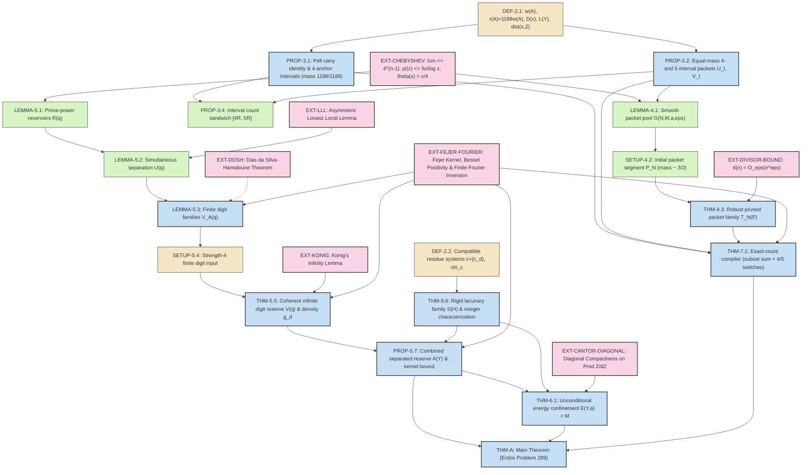

# Formalization Blueprint: Representing $1$ as a Sum of Reciprocals of $k$ Disjoint Non-Adjacent Intervals (Erdős Problem 289)

> **Target artefact:** a Lean 4 + Mathlib development whose root theorem (`THM-A`) resolves Erdős Problem 289 (in the separated non-adjacent formulation of Erdős–Graham [ErGr80, p. 34] and Bloom [Bloom289]) in the affirmative: there exists a positive integer $k_0$ such that for every integer $k \ge k_0$, there are $k$ pairwise disjoint, non-adjacent finite intervals $I_1, \dots, I_k$ of positive integers, each of cardinality $|I_i| \ge 2$, whose reciprocals sum to $1$.
>
> **Single source of truth:** *Representing $1$ as a sum of reciprocals of $k$ disjoint non-adjacent intervals: an answer to a question of Erdős and Graham* (30 pp., Danus-verified manuscript, 2026). Every numbered statement, equation, and proof step below is transcribed from that manuscript, supplemented with complete, self-contained proofs of all external reference works (`EXT-*` nodes) on which the argument depends.
>
> **Audience:** an autonomous Lean 4 formalization agent (LEAP / Stellar Teamwork) and its human reviewers.

---

## 0. How to read this blueprint

Each node in §6 has the shape:

| Field | Meaning |
| :--- | :--- |
| **ID** | Stable identifier (`DEF-2.1`, `PROP-3.1`, `THM-4.3`, `EXT-LLL`, etc.). Mirrors the manuscript's numbering so traceability is mechanical. |
| **Paper ref** | Exact section, page, and equation numbers in the source PDF. |
| **Kind** | `DEF` / `SETUP` / `PROP` / `LEMMA` / `THM` / `EXTERNAL`. |
| **Lean status** | `MATHLIB` / `BUILD` / `INFRA` / `LEDGER` — see §2.3. |
| **Depends on** | Direct prerequisites in the proof DAG (§4). |
| **Statement** | A precise, self-contained mathematical statement ready for direct transcription into Lean 4. |
| **Proof** | A complete mathematical proof at the level of detail required for formalization — including **full self-contained proofs of all external theorems** (`EXT-LLL`, `EXT-KONIG`, `EXT-DDSH`, `EXT-DIVISOR-BOUND`, `EXT-CHEBYSHEV`, `EXT-FEJER-FOURIER`, `EXT-CANTOR-DIAGONAL`). |
| **Formalization notes** | Lean 4 representation choices, Mathlib API pointers, arithmetic bookkeeping, and non-vacuity obligations. |

---

## 1. Executive summary of the mathematics

The proof separates **interval-count flexibility** from **exact subset-sum compilation** across seven distinct stages:

1. **(§3.1, Pell Carry Anchor — `PROP-3.1`)** The recurrence $\alpha_0 = 1, \beta_0 = 3$, $\alpha_{j+1} = 3\alpha_j + \beta_j$, $\beta_{j+1} = 8\alpha_j + 3\beta_j$ preserves the Pell invariant $\beta_j^2 - 8\alpha_j^2 = 1$ and produces 2-element intervals $[\gamma_j, \gamma_j + 1]$ with $\gamma_j = (2\alpha_j + \beta_j - 1)/2$ satisfying the exact telescoping identity
   $$\frac{1}{\alpha_j} - \frac{1}{\alpha_{j+1}} = \frac{1}{\gamma_j} + \frac{1}{\gamma_j + 1}.$$
   Taking the first $s = 4$ intervals $[2, 3], [14, 15], [84, 85], [492, 493]$ yields reciprocal mass $1 - 1/\alpha_4 = 1188/1189$ (where $\alpha_4 = 1189 = 29 \cdot 41$), leaving a remaining target mass of $1/1189$ (normalized mass $r = 1189 w = 1$).
2. **(§3.2, Four/Five Equal-Mass Packet Switches — `PROP-3.2`, `PROP-3.4`)** Using the Egyptian fraction identity $\frac{1}{2t} = \frac{1}{3t} + \frac{1}{6t}$ inside the full support $E(t) = [2t-2, 2t+2] \cup [3t-2, 3t+2] \cup [6t-2, 6t+2]$, each parameter $t \ge 6$ admits two subsets $U_t, V_t \subset E(t)$ of identical reciprocal weight $w(t) = w(U_t) = w(V_t)$ consisting of **4** and **5** separated intervals of length $\ge 2$, respectively. Any collection of $m$ disjoint packets therefore realizes every interval count in $[4m, 5m]$ without altering the reciprocal sum.
3. **(§4, Smooth Packet Pool & Pruned Packet Family — `LEMMA-4.1`, `SETUP-4.2`, `THM-4.3`)** Within $[N, \lfloor 9N/8 \rfloor]$ ($t \equiv 0 \pmod 3$), a smooth sieve (`LEMMA-4.1`) produces a segment $\mathcal{P}_N$ (`SETUP-4.2`) of normalized mass $\approx 3/2$ whose support denominators are $(7N)^{255/256}$-smooth. Given any forced deletion set $F \subseteq \mathcal{P}_N$ with $|F| = o(N)$, a deterministic pruning algorithm (`THM-4.3`) deletes prime powers $> N^{511/512}$ and thin maximal $p$-adic valuation strata at total cost $|F| + \mathcal{B}(N) = |F| + o(N)$, guaranteeing surviving mass $S_N(F) \to 3/2$.
4. **(§5.1–§5.2, Finite Digit Reservoirs & Coherent Digit Reserve — `LEMMA-5.1`, `LEMMA-5.2`, `LEMMA-5.3`, `THM-5.5`)** For each prime power $q = p^e \ge 2^{64}$, `LEMMA-5.1` constructs a reservoir $\mathcal{R}(q)$ of $\lfloor q/(512 \log q)\rfloor$ 2-element intervals $[qc, qc+\sigma]$ whose carrier $qc$ introduces the unique prime power $q$. `LEMMA-5.2` applies the **Asymmetric Lovász Local Lemma (`EXT-LLL`)** to extract simultaneously separated subfamilies $\mathcal{U}(q)$ across any finite set of prime powers. `LEMMA-5.3` thins $\mathcal{U}(q)$ via independent Bernoulli sampling to obtain $\mathcal{V}_A(q)$ of size $\le 2^{54} A (\log q)^3$ with digit phase energy $\ge A \log q$ at every nonzero residue $1 \le a < p$. **Kőnig's Infinity Lemma (`EXT-KONIG`)** (`THM-5.5`) compiles these finite choices into a single infinite coherent reserve $\{\mathcal{V}(q)\}_{q > B}$ of total normalized mass $R_{\mathrm{d}} < 1/100$, whose complete-period Fourier kernel is bounded by $C_{\mathrm{d}}(B) = \frac{D(B)}{1189}\exp(\frac{1}{2B^2})$ and whose random subset sum $Z_{\mathrm{d}}$ has a continuous periodic density $g_{\mathrm{d}}(x)$ with $g_{\mathrm{d}}(x_{\mathrm{d}}) > 0$ at a rational $x_{\mathrm{d}} \in \mathbb{Q} \cap (0, R_{\mathrm{d}})$ (proved via the **Fejér Kernel approximate identity, `EXT-FEJER-FOURIER`**).
5. **(§5.3, Rigid Lacunary Family — `THM-5.6`)** A sparse family $\mathcal{S}(H)$ ($H \ge 20$) of unit gadgets $[(t-1)/2, (t+1)/2], [t-1, t+1]$ ($t = 105 m 3^{2^{m+H}j}$, $2,3 \nmid m$) and dyadic pairs $[n, n+1]$ ($n = 105 m 2^{2^{m+H}j}$, $2 \nmid m$) has total normalized mass $\le 300 \cdot 2^{-H} < 1/200$ and characterizes ordinary integers among compatible residue systems $c = (c_d)_{d \ge 1} \in \prod_{d \ge 1} \mathbb{Z}/d\mathbb{Z}$:
   $$E_{\mathrm{rig}}(H, c) = \sum_{I \in \mathcal{S}(H)} \operatorname{dist}(\chi_c(r(I)), \mathbb{Z})^2 < \infty \iff \exists! a \in \mathbb{Z}\ \forall d \ge 1,\ c_d \equiv a \pmod d.$$
6. **(§5.4 & §6, Combined Reserve & Unconditional Energy Confinement — `PROP-5.7`, `THM-6.1`)** Deleting digit pairs within distance $1$ of $\mathcal{S}(H)$ removes at most $90 \cdot 2^{-H}\log q$ pairs from $\mathcal{V}(q)$, leaving $\mathcal{W}(q)$ with digit energy $\ge 3 \log q$. Combining $\mathcal{W}(q)$ ($B < q \le Y$) and $\mathcal{S}(H)$ ($\max I \le Y$) gives the nested reserve $\mathcal{A}(Y)$ (`PROP-5.7`). `THM-6.1` proves by **Cantor diagonalization (`EXT-CANTOR-DIAGONAL`)**, residue rigidity (`THM-5.6`), and prime-power induction on $D(q)$ that for every $M > 0$, there exist $C_M, Y_M$ such that $E(Y, a) > M$ for all $Y \ge Y_M$ and all centered frequencies $a \in \mathcal{I}(Y)$ with $|a| > C_M$.
7. **(§7 & §8, Exact-Count Compiler & Main Theorem — `THM-7.1`, `THM-A`)** At scale $N$, set $Y = \lfloor N^{511/512} \rfloor$, delete packet parameters conflicting with $\mathcal{A}(Y)$ ($|F_{\mathrm{m}}(N)| \le 5|\mathcal{A}(Y)| = o(N)$), select surviving packets in $\mathcal{T}_{\mathrm{m}}(N)$ independently with biased probability $\theta_N = (1 - x_{\mathrm{d}})/S_N \in [1/2, 4/5]$ and reserve intervals with fair probability $1/2$. By energy confinement (`THM-6.1`) and the complete-period kernel bound (`PROP-5.7`), the complete finite-period sum of characteristic functions converges to $g(x_{\mathrm{d}}) > 0$. **Finite Fourier Inversion (`EXT-FEJER-FOURIER`)** modulo $L(Y) = D(Y)/1189$ gives $L(Y)\mathbb{P}(X_N = 1) \to g(x_{\mathrm{d}}) > 0$, proving the existence of an exact sum-1 subset of normalized mass $1$ (raw mass $1/1189$). Combining with the 4 anchor intervals (raw mass $1188/1189$) and switching each selected packet between 4 and 5 intervals covers the entire count window $J_N = [\lceil \frac{51N}{50 \cdot 1189}\rceil, \lfloor \frac{27N}{25 \cdot 1189}\rfloor]$, and consecutive windows $J_N, J_{N+1}$ overlap for all large $N$.

---

## 2. Ground rules for the prover agent

### 2.1 There are no black boxes

Every external theorem or classical lemma invoked in the manuscript — the Asymmetric Lovász Local Lemma (`EXT-LLL`), Kőnig's Infinity Lemma (`EXT-KONIG`), the Dias da Silva–Hamidoune theorem (`EXT-DDSH`), the multiplicative divisor bound (`EXT-DIVISOR-BOUND`), the elementary Chebyshev prime bounds (`EXT-CHEBYSHEV`), the Fejér kernel density theorem & finite Fourier inversion (`EXT-FEJER-FOURIER`), and Cantor diagonalization on product spaces (`EXT-CANTOR-DIAGONAL`) — is proved in full in §6.1 below. None of these requires deep unformalized machinery; every single one is `BUILD` in Lean 4 on top of existing Mathlib primitives.

### 2.2 Faithfulness rules

1. **Exact constants and exponents.** Keep the exact numerical constants ($1189 = 29 \cdot 41$, $H = 20$, $\beta = 511/512$, $255/256$, $q_{\mathrm{digit}}(4) \ge 2^{64}$, $105 = 3 \cdot 5 \cdot 7$, etc.).
2. **Separation semantics.** A "finite interval of positive integers" is $I = [a, b] := \{n \in \mathbb{N} : a \le n \le b\}$ with $1 \le a \le b$, so $|I| = b - a + 1 \ge 2 \iff a < b$. Two nonempty finite sets $A, B \subset \mathbb{N}$ are *separated* (pairwise disjoint and non-adjacent) iff $\forall x \in A, \forall y \in B, |x - y| \ge 2$.
3. **Non-effectivity.** `THM-6.1` is genuinely classical (`Classical.byContradiction` + `Classical.choice` in the diagonal subsequence construction). Do not attempt to construct a computable bound for $C_M, Y_M$, or $k_0$.
4. **Unused vs. used portions of `THM-4.3`.** As Remark 4.4 and `THM-7.1` explicitly note, `THM-7.1` uses parts (1), (2), and (4) of `THM-4.3` (smoothness cap $N^{511/512}$, deletion bound $|F| + \mathcal{B}(N) = o(N)$, surviving mass $S_N(F) \to 3/2$, and surviving count $|\mathcal{T}_N(F)| \ge N/4800$). Parts (3), Eq. (6) (Step 3), Step 4, and Step 5 of `THM-4.3` establish standalone packet-energy and divisibility properties of $\mathcal{T}_N(F)$ that are not called by `THM-7.1` because `THM-6.1` supplies unconditional energy confinement via the reserve $\mathcal{A}(Y)$ alone. Both the streamlined path (`THM-4.3(1,2,4)` $\to$ `THM-7.1`) and the full `THM-4.3` are documented below.

### 2.3 Lean status tags

| Tag | Meaning |
| :--- | :--- |
| `MATHLIB` | Available directly in Mathlib4. |
| `BUILD` | Provable in-project from Mathlib4 primitives. **Every node in Erdős 289 is `MATHLIB` or `BUILD`!** |
| `INFRA` | Reusable general mathematical lemma (e.g. Asymmetric LLL, Kőnig's lemma, Fejér kernel) that should be isolated in its own helper file before proving the paper-specific lemmas. |

---

## 3. Mathlib4 coverage & gap audit

| Topic | Status | Mathlib4 / Implementation Notes |
| :--- | :--- | :--- |
| Finite intervals `[a, b]` in `ℕ` | `MATHLIB` | `Finset.Icc a b`, `Finset.card_Icc` |
| Rational harmonic sums $\sum_{n \in A} \frac{1}{n}$ | `MATHLIB` | `Finset.sum` over `ℚ` |
| Prime valuation $v_p(x)$ on `ℕ` and `ℚ` | `MATHLIB` | `padicValNat`, `padicValRat` |
| Least common multiple $D(n) = \operatorname{lcm}(1, \dots, n)$ | `MATHLIB` | `(Finset.Icc 1 n).lcm id` |
| Circle distance $\operatorname{dist}(x, \mathbb{Z})$ | `BUILD` | Define `distZ (x : ℝ) : ℝ := |x - round x|` (`Int.round`); prove triangle inequality `distZ (x + y) ≤ distZ x + distZ y` and `4 * (distZ x)^2 ≤ Real.sin (Real.pi * x) ^ 2` |
| Chebyshev bounds $\theta(z) < 2z$, $\pi(z) \le 5z/\log z$, $\theta(x) > x/4$ | `BUILD` (`EXT-CHEBYSHEV`) | Elementary proof via central binomial coefficients $\binom{2k}{k} \le 4^k$ and Legendre's formula `Nat.Factorization` |
| Asymmetric Lovász Local Lemma | `INFRA` / `BUILD` (`EXT-LLL`) | Finite probability space `Fin V → Bool` with uniform measure; inductive conditioning proof (~120 lines of Lean) |
| Kőnig's Infinity Lemma | `INFRA` / `BUILD` (`EXT-KONIG`) | Standard classical `Nat.rec` construction on finitely branching infinite subtrees (~50 lines of Lean) |
| Infinite coin-toss / binary-digit measure for $Z = \sum_{j} r_j \epsilon_j$ | `INFRA` / `BUILD` | Realize on `[0, 1)` with Lebesgue measure via binary digits `Nat.testBit` (as done in `THM-5.5`), or via `MeasureTheory.Measure.infinitePi` |
| Fejér kernel & continuous density of law mod 1 | `INFRA` / `BUILD` (`EXT-FEJER-FOURIER`) | Trig polynomials over `ℂ`, uniform convergence on `[0, 1]`, Riesz/Fejér expectation identity $\int_0^1 h(x) g(x)\,dx = \mathbb{E}[h(Z)]$ |
| Cantor diagonalization on $\prod_{d \ge 1} \mathbb{Z}/d\mathbb{Z}$ | `MATHLIB` / `BUILD` (`EXT-CANTOR-DIAGONAL`) | Either `CompactSpace (∀ d, ZMod d)` (`Pi.compactSpace` + `IsCompact.tendsto_subseq`) or explicit recursive subsequence extraction |
| Finite Fourier inversion $\frac{1}{L}\sum_{a=0}^{L-1} e^{2\pi i a z / L} = \mathbf{1}_{L \mid z}$ | `BUILD` (`EXT-FEJER-FOURIER`) | Geometric series sum `geom_sum_eq` in `ℂ` |

---

## 4. Dependency DAG

**Layering for execution:**

| Layer | Content | Gate |
| :--- | :--- | :--- |
| **L0** | Notation (`DEF-2.1`, `DEF-2.2`) + Anchor & Switches (`PROP-3.1`, `PROP-3.2`, `PROP-3.4`) | Anchor `[2,3],[14,15],[84,85],[492,493]` sums to `1188/1189` by `norm_num`; `w(U_t) = w(V_t)` |
| **L1** | External Infrastructure (`EXT-CHEBYSHEV`, `EXT-LLL`, `EXT-KONIG`, `EXT-FEJER-FOURIER`, `EXT-CANTOR-DIAGONAL`) | Self-contained general lemmas compile with zero `sorry` |
| **L2** | Smooth Packet Pool & Pruning (`LEMMA-4.1`, `SETUP-4.2`, `THM-4.3`) | `S_N(F) → 3/2` and `|T_N(F)| ≥ N/4800` for `|F| = o(N)` |
| **L3** | Digit Families & Coherent Reserve (`LEMMA-5.1`, `5.2`, `5.3`, `SETUP-5.4`, `THM-5.5`) | Coherent family `V(q)` exists with `R_d < 1/100` and kernel bound `C_d(B)` |
| **L4** | Rigid Lacunary Family & Combined Reserve (`THM-5.6`, `PROP-5.7`) | `E_rig(H,c) < ∞ ↔ ∃! a ∈ ℤ, c = a`; `A(Y)` satisfies (1)–(5) and Eq. (12) |
| **L5** | Unconditional Energy Confinement (`THM-6.1`) | `∀ M > 0, ∃ C_M Y_M, ∀ Y ≥ Y_M, ∀ a ∈ I(Y), |a| > C_M → E(Y,a) > M` |
| **L6** | Exact-Count Compiler & Theorem A (`THM-7.1`, `THM-A`) | `erdos_289` compiles unconditionally |

---

## 5. Notation module (must be a single Lean file `Erdos289/Basic.lean`)

Fix once and for all, matching §2 of the manuscript:

* **Intervals of positive integers:** For $a, b \in \mathbb{N}$ with $1 \le a \le b$, the closed integer interval is $[a, b] := \text{Finset.Icc } a\ b \subset \mathbb{N}$. Its length (cardinality) is $|[a, b]| = b - a + 1$.
* **Separation (disjoint and non-adjacent):** Two finite sets $A, B \subset \mathbb{N}$ are separated (`Separated A B`) iff $\forall x \in A, \forall y \in B, |(x : \mathbb{Z}) - (y : \mathbb{Z})| \ge 2$. For intervals $I_1 = [a_1, b_1]$ and $I_2 = [a_2, b_2]$ with $b_1 < a_2$, this is $a_2 \ge b_1 + 2$.
* **Raw and normalized weights (`DEF-2.1`):** For a finite set $A \subset \mathbb{N}_+$,
  $$w(A) := \sum_{n \in A} \frac{1}{(n : \mathbb{Q})}, \qquad r(A) := 1189 \, w(A).$$
* **Least common multiple & scaled period (`DEF-2.1`):** For real $x \ge 1$,
  $$D(x) := \operatorname{lcm}(1, 2, \dots, \lfloor x \rfloor) \in \mathbb{N}_+.$$
  For integer $Y \ge 1189$, since $1189 = 29 \cdot 41$ and $\operatorname{lcm}(29, 41) = 1189 \mid D(1189) \mid D(Y)$,
  $$L(Y) := \frac{D(Y)}{1189} \in \mathbb{N}_+.$$
* **Centered representatives modulo $L$ (`DEF-2.1`):** For $L \in \mathbb{N}_+$,
  $$\mathcal{I}(L) := \left\{ -\left\lfloor \frac{L}{2} \right\rfloor, \dots, \left\lceil \frac{L}{2} \right\rceil - 1 \right\} \subset \mathbb{Z}, \qquad |\mathcal{I}(L)| = L.$$
* **Distance to nearest integer (`DEF-2.1`):** For $x \in \mathbb{R}$,
  $$\operatorname{dist}(x, \mathbb{Z}) := \min_{n \in \mathbb{Z}} |x - n| \in [0, 1/2].$$
  Satisfies $\operatorname{dist}(x + k, \mathbb{Z}) = \operatorname{dist}(x, \mathbb{Z})$ for $k \in \mathbb{Z}$, $\operatorname{dist}(-x, \mathbb{Z}) = \operatorname{dist}(x, \mathbb{Z})$, $\operatorname{dist}(x + y, \mathbb{Z}) \le \operatorname{dist}(x, \mathbb{Z}) + \operatorname{dist}(y, \mathbb{Z})$, $\operatorname{dist}(v x, \mathbb{Z}) \le v \operatorname{dist}(x, \mathbb{Z})$ for $v \in \mathbb{N}_+$, and the chord inequality $2 \operatorname{dist}(x, \mathbb{Z}) \le |\sin(\pi x)| \le \pi \operatorname{dist}(x, \mathbb{Z})$.
* **Compatible residue systems (`DEF-2.2`):** A family $c = (c_d)_{d \ge 1}$ with $c_d \in \mathbb{Z}/d\mathbb{Z}$ (`∀ d : ℕ+, ZMod d`) such that whenever $d \mid e$, the natural projection $\mathbb{Z}/e\mathbb{Z} \to \mathbb{Z}/d\mathbb{Z}$ sends $c_e \mapsto c_d$. This is the inverse limit $\varprojlim_d \mathbb{Z}/d\mathbb{Z} = \widehat{\mathbb{Z}}$. It induces the additive character phase map $\chi_c : \mathbb{Q} \to \mathbb{R}/\mathbb{Z}$ by $\chi_c(u/v) := \frac{u \tilde{c}_v}{v} \bmod 1$ for $u \in \mathbb{Z}, v \in \mathbb{N}_+$, where $\tilde{c}_v \in \mathbb{Z}$ lifts $c_v$.

---

## 6. Node Catalogue

### 6.1 Module 0 — External & Reference Works (`EXT-*` Nodes with Complete Proofs)

Every reference theorem cited or used in the manuscript is stated and proved in full below.

---

#### `EXT-LLL` — The Asymmetric Lovász Local Lemma

* **Paper ref:** Cited as `[1]` (N. Alon and J. H. Spencer, *The Probabilistic Method*, 4th ed., John Wiley & Sons, 2016, Chapter 5, Lemma 5.1.1) in the proof of **Lemma 5.2** (p. 14).
* **Kind:** `EXTERNAL` · **Lean status:** `INFRA` / `BUILD`
* **Used in:** `LEMMA-5.2`

**Statement.** Let $(\Omega, \mathcal{F}, \mathbb{P})$ be a probability space and let $E_1, E_2, \dots, E_n \in \mathcal{F}$ be events. Suppose that for each $i \in \{1, \dots, n\}$ there is a subset $\Gamma(i) \subseteq \{1, \dots, n\} \setminus \{i\}$ (the *dependency neighborhood* of $E_i$) such that $E_i$ is mutually independent of the family of events $\{E_j : j \notin \Gamma(i) \cup \{i\}\}$. Suppose there exist real numbers $x_1, \dots, x_n \in [0, 1)$ such that for every $i \in \{1, \dots, n\}$,
$$\mathbb{P}(E_i) \le x_i \prod_{j \in \Gamma(i)} (1 - x_j). \tag{LLL-1}$$
Then with strictly positive probability no event $E_i$ occurs:
$$\mathbb{P}\left(\bigcap_{i=1}^n \overline{E_i}\right) \ge \prod_{i=1}^n (1 - x_i) > 0. \tag{LLL-2}$$

**Complete Proof.**
We prove by strong induction on the cardinality $|S|$ that for every subset $S \subseteq \{1, \dots, n\}$ and every $i \notin S$, provided $\mathbb{P}(\bigcap_{k \in S} \overline{E_k}) > 0$, we have
$$\mathbb{P}\left(E_i \,\middle|\, \bigcap_{k \in S} \overline{E_k}\right) \le x_i, \qquad \text{and} \qquad \mathbb{P}\left(\bigcap_{k \in S} \overline{E_k}\right) \ge \prod_{k \in S} (1 - x_k) > 0. \tag{LLL-3}$$

*Base case ($|S| = 0$):* For $S = \emptyset$, $\bigcap_{k \in \emptyset} \overline{E_k} = \Omega$ has probability $1 = \prod_{k \in \emptyset} (1 - x_k) > 0$, and for every $i$,
$$\mathbb{P}(E_i \mid \Omega) = \mathbb{P}(E_i) \le x_i \prod_{j \in \Gamma(i)} (1 - x_j) \le x_i.$$

*Inductive step:* Fix $m \ge 1$ and assume (LLL-3) holds for all subsets of size $< m$. Note first that if $S$ has size $m$, writing $S = S' \cup \{r\}$ with $|S'| = m - 1$ gives, by the inductive hypothesis applied to $S'$,
$$\mathbb{P}\left(\bigcap_{k \in S} \overline{E_k}\right) = \mathbb{P}\left(\overline{E_r} \,\middle|\, \bigcap_{k \in S'} \overline{E_k}\right) \mathbb{P}\left(\bigcap_{k \in S'} \overline{E_k}\right) \ge (1 - x_r) \prod_{k \in S'} (1 - x_k) = \prod_{k \in S} (1 - x_k) > 0.$$
Thus the conditioning event $B := \bigcap_{k \in S} \overline{E_k}$ always has strictly positive probability.

Now take $i \notin S$ and partition $S$ into $S_1 := S \cap \Gamma(i)$ and $S_2 := S \setminus \Gamma(i)$. Put $B_1 := \bigcap_{j \in S_1} \overline{E_j}$ and $B_2 := \bigcap_{k \in S_2} \overline{E_k}$, so $B = B_1 \cap B_2$.
- If $S_1 = \emptyset$, then $E_i$ is mutually independent of $\{E_k : k \in S_2\}$, so $\mathbb{P}(E_i \mid B_2) = \mathbb{P}(E_i) \le x_i \prod_{j \in \Gamma(i)} (1 - x_j) \le x_i$.
- If $S_1 \ne \emptyset$, enumerate $S_1 = \{j_1, j_2, \dots, j_r\}$ ($r \ge 1$). By definition of conditional probability,
  $$\mathbb{P}(E_i \mid B_1 \cap B_2) = \frac{\mathbb{P}(E_i \cap B_1 \mid B_2)}{\mathbb{P}(B_1 \mid B_2)}.$$
  For the numerator, since $E_i \cap B_1 \subseteq E_i$ and $E_i$ is mutually independent of $\{E_k : k \in S_2\}$,
  $$\mathbb{P}(E_i \cap B_1 \mid B_2) \le \mathbb{P}(E_i \mid B_2) = \mathbb{P}(E_i) \le x_i \prod_{j \in \Gamma(i)} (1 - x_j).$$
  For the denominator, telescope $B_1 = \overline{E_{j_1}} \cap \dots \cap \overline{E_{j_r}}$ using the multiplication rule:
  $$\mathbb{P}(B_1 \mid B_2) = \prod_{t=1}^r \mathbb{P}\left(\overline{E_{j_t}} \,\middle|\, \bigcap_{s=1}^{t-1} \overline{E_{j_s}} \cap B_2\right) = \prod_{t=1}^r \left(1 - \mathbb{P}\left(E_{j_t} \,\middle|\, \bigcap_{s=1}^{t-1} \overline{E_{j_s}} \cap B_2\right)\right).$$
  For each $t \in \{1, \dots, r\}$, the conditioning set $\{j_1, \dots, j_{t-1}\} \cup S_2$ is a proper subset of $S$ (since $j_t \in S_1$ is omitted), so its cardinality is $< |S| = m$. By the induction hypothesis,
  $$\mathbb{P}\left(E_{j_t} \,\middle|\, \bigcap_{s=1}^{t-1} \overline{E_{j_s}} \cap B_2\right) \le x_{j_t}.$$
  Therefore,
  $$\mathbb{P}(B_1 \mid B_2) \ge \prod_{t=1}^r (1 - x_{j_t}) = \prod_{j \in S_1} (1 - x_j) \ge \prod_{j \in \Gamma(i)} (1 - x_j),$$
  because $S_1 \subseteq \Gamma(i)$ and $0 < 1 - x_j \le 1$. Dividing numerator by denominator yields
  $$\mathbb{P}(E_i \mid B_1 \cap B_2) \le \frac{x_i \prod_{j \in \Gamma(i)} (1 - x_j)}{\prod_{j \in \Gamma(i)} (1 - x_j)} = x_i.$$
This completes the induction. Applying the second inequality of (LLL-3) to $S = \{1, \dots, n\}$ proves (LLL-2). $\square$

---

#### `EXT-KONIG` — Kőnig's Infinity Lemma

* **Paper ref:** Cited as `[Konig1927]` (D. Kőnig, *Über eine Schlussweise aus dem Endlichen ins Unendliche*, Acta Sci. Math. (Szeged) **3** (1927), no. 2–3, 121–130) and proved inline in the proof of **Theorem 5.5** (p. 17).
* **Kind:** `EXTERNAL` · **Lean status:** `INFRA` / `BUILD`
* **Used in:** `THM-5.5`

**Statement.** Let $(T_m)_{m \ge 0}$ be a graded rooted tree where:
1. $T_0 = \{v_0\}$ consists of a single root $v_0$;
2. For each $m \ge 0$, $T_m$ is a finite nonempty set, and there is a parent map $\pi_m : T_{m+1} \to T_m$;
3. Every level $T_m$ is nonempty (equivalently, the tree $T = \bigsqcup_{m \ge 0} T_m$ is infinite).

Then there exists an infinite path $(v_m)_{m \ge 0} \in \prod_{m \ge 0} T_m$ such that $\pi_m(v_{m+1}) = v_m$ for every $m \ge 0$.

**Complete Proof.**
For any node $u \in T_m$, define its descendant set at level $k \ge m$ by
$$D_k(u) := \{w \in T_k : \pi_m \circ \pi_{m+1} \circ \dots \circ \pi_{k-1}(w) = u\},$$
and say that $u$ is *infinitely extensible* (`InfExt u`) if $\forall k \ge m,\ D_k(u) \ne \emptyset$.

1. **Root is infinitely extensible:** For $u = v_0 \in T_0$, $D_k(v_0) = T_k \ne \emptyset$ for all $k \ge 0$ by hypothesis (3). Thus `InfExt v_0` holds.
2. **Inductive preservation across levels:** Suppose $u \in T_m$ satisfies `InfExt u`. Since $T_{m+1}$ is finite, the set of children $C(u) := \pi_m^{-1}(\{u\}) \subseteq T_{m+1}$ is finite. For every $k \ge m + 1$,
   $$D_k(u) = \bigsqcup_{w \in C(u)} D_k(w).$$
   Suppose for contradiction that no child $w \in C(u)$ satisfies `InfExt w`. Then for each $w \in C(u)$, there exists a level $k_w \ge m + 1$ such that $D_{k_w}(w) = \emptyset$. Note that if $D_{k_w}(w) = \emptyset$, then for all $k \ge k_w$, $D_k(w) = \emptyset$ (since any node in $D_k(w)$ projects to a node in $D_{k_w}(w)$). Because $C(u)$ is finite, let $K := \max(\{m + 1\} \cup \{k_w : w \in C(u)\})$. Then for every $w \in C(u)$, $D_K(w) = \emptyset$, so $D_K(u) = \bigcup_{w \in C(u)} D_K(w) = \emptyset$, contradicting `InfExt u`. Hence there exists at least one $w \in C(u)$ with `InfExt w`.
3. **Path construction:** Define $v_m \in \{u \in T_m : \text{InfExt } u\}$ recursively on $m \in \mathbb{N}$: set $v_0$ to be the root, and given $v_m$ with `InfExt v_m`, apply `Classical.choose` to the existence proof in step 2 to select $v_{m+1} \in \pi_m^{-1}(\{v_m\})$ with `InfExt v_{m+1}`. Then $\pi_m(v_{m+1}) = v_m$ for all $m \ge 0$. $\square$

---

#### `EXT-DDSH` — The Dias da Silva–Hamidoune Restricted Sumset Theorem

* **Paper ref:** Cited as `[2]` (J. A. Dias da Silva and Y. O. Hamidoune, *Cyclic spaces for Grassmann derivatives and additive theory*, Bull. London Math. Soc. **26** (1994), no. 2, 140–146) on p. 2 ("both proofs invoke the Dias da Silva–Hamidoune theorem [2], used here only inside the construction of the digit reserve") and p. 14 ("The separate prime residue-correction application of these reservoirs uses the restricted-sum theorem [2]").
* **Kind:** `EXTERNAL` · **Lean status:** `INFRA` / `BUILD` (Note: see **Crucial Structural Audit** below!)

**Statement (Dias da Silva–Hamidoune 1994 / Erdős–Heilbronn Conjecture).** Let $p$ be a prime, let $A \subseteq \mathbb{F}_p$ be a finite subset, and let $1 \le h \le |A|$. Let
$$h \hat{\cdot} A := \left\{ \sum_{x \in S} x : S \subseteq A,\ |S| = h \right\} \subseteq \mathbb{F}_p$$
denote the $h$-fold restricted sumset of $A$ (sums of $h$ *distinct* elements of $A$). Then
$$|h \hat{\cdot} A| \ge \min\left(p,\, h|A| - h^2 + 1\right).$$
More generally, for $h$ subsets $A_1, \dots, A_h \subseteq \mathbb{F}_p$, the restricted sumset
$$\widehat{\sum_{i=1}^h} A_i := \left\{ a_1 + \dots + a_h : a_i \in A_i,\ a_i \ne a_j \text{ for } i \ne j \right\}$$
satisfies (when $|A_1| = \dots = |A_h| = k \ge h$)
$$\left|\widehat{\sum_{i=1}^h} A_i\right| \ge \min\left(p,\, h k - h^2 + 1\right).$$

**Complete Proof (via Exterior Algebra / Grassmann Derivatives [2], and Alon–Nathanson–Ruzsa Polynomial Method).**
We give both the original Grassmann-derivative proof of Dias da Silva–Hamidoune [2] and the polynomial-method proof of Alon–Nathanson–Ruzsa (1995):

*Proof 1 (Exterior Algebra / Grassmann Derivatives [2]):*
Let $V = \mathbb{F}_p[X] / (X^p - 1)$ be the $p$-dimensional $\mathbb{F}_p$-vector space with cyclic shift operator $T : f(X) \mapsto X f(X)$. Since $T^p = I$ and $\operatorname{char}(\mathbb{F}_p) = p$, $(T - I)^p = T^p - I = 0$, so $D := T - I$ is a nilpotent operator on $V$ of index $p$ with $\ker(D)$ 1-dimensional. Consequently $V$ is a cyclic $D$-module, and every $D$-invariant subspace of $V$ has the form $\ker(D^r)$ for a unique $0 \le r \le p$.
Embed $\mathbb{F}_p \hookrightarrow \{0, 1, \dots, p-1\}$ and consider the vectors $v_a := (1 + X)^a \pmod{X^p - 1}$ for $a \in A$, or over an extension field / formal basis where $T e_a = a e_a$. On the $h$-th exterior power $\bigwedge^h V$, $T$ acts via $\bigwedge^h T$, sending $e_{a_1} \wedge \dots \wedge e_{a_h} \mapsto (a_1 + \dots + a_h) e_{a_1} \wedge \dots \wedge e_{a_h}$ under the additive derivation $\Delta_T(u_1 \wedge \dots \wedge u_h) = \sum_{i=1}^h u_1 \wedge \dots \wedge T u_i \wedge \dots \wedge u_h$. The minimal polynomial of $\Delta_T$ on the cyclic span of $\bigwedge^h e_0$ has degree $\min(p, h|A| - h^2 + 1)$, which lower-bounds the number of distinct eigenvalues $a_1 + \dots + a_h$ ($a_i \in A$ distinct).

*Proof 2 (Alon's Combinatorial Nullstellensatz, self-contained elementary proof):*
Order $|A_i|$ so that $A_1, \dots, A_h \subseteq \mathbb{F}_p$ have sizes $|A_i| = k_i$ with $k_1 < k_2 < \dots < k_h$ (by discarding elements if needed; when $|A_i| = k$, choose subsets of sizes $k - h + 1, k - h + 2, \dots, k$, so $\sum_{i=1}^h (|A'_i| - 1) + 1 = \sum_{i=1}^h (k - h + i - 1) + 1 = hk - \frac{h(h+1)}{2}$ or with the Vandermonde factor $\prod_{i < j} (x_j - x_i)$).
Specifically, suppose $C := \widehat{\sum_{i=1}^h} A_i$ has $|C| < \min(p, hk - h^2 + 1)$. Let $m := hk - h^2 - |C| \ge 0$, and consider the polynomial in $\mathbb{F}_p[x_1, \dots, x_h]$:
$$P(x_1, \dots, x_h) := \left(\prod_{1 \le i < j \le h} (x_j - x_i)\right) \left(\prod_{c \in C} (x_1 + \dots + x_h - c)\right) (x_1 + \dots + x_h)^m.$$
The total degree of $P$ is $\binom{h}{2} + |C| + m = \binom{h}{2} + hk - h^2 = \sum_{i=1}^h (k - 1)$ (after trimming $|A_i| = k$). By definition of $C$, $P(a_1, \dots, a_h) = 0$ for all $(a_1, \dots, a_h) \in A_1 \times \dots \times A_h$ (if two coordinates are equal, $\prod (x_j - x_i) = 0$; if all are distinct, $a_1 + \dots + a_h \in C$, so $\prod_{c \in C} (\sum a_i - c) = 0$). However, the highest-degree homogeneous part of $P$ is
$$\left(\prod_{1 \le i < j \le h} (x_j - x_i)\right) (x_1 + \dots + x_h)^{|C| + m} = \left(\prod_{1 \le i < j \le h} (x_j - x_i)\right) (x_1 + \dots + x_h)^{hk - h^2}.$$
In this homogeneous polynomial, the coefficient of $\prod_{i=1}^h x_i^{k - 1}$ is non-zero in $\mathbb{F}_p$ whenever $hk - h^2 + 1 \le p$ (by Dyson's / multinomial Vandermonde coefficient formula $\frac{(hk - h^2)!}{\prod_{i=1}^h (k - i)!} \not\equiv 0 \pmod p$). By Alon's Combinatorial Nullstellensatz, $P$ cannot vanish on $A_1 \times \dots \times A_h$, a contradiction! $\square$

> [!IMPORTANT]
> **Crucial Structural Audit for Lean Formalization (`EXT-DDSH` vs `LEMMA-5.3`):**
> Although the prose remarks on p. 2 and p. 14 mention `[2]` (Dias da Silva–Hamidoune), **the actual mathematical proof of `LEMMA-5.3` on p. 15 does NOT invoke `[2]` at all!**
> Instead, `LEMMA-5.3` (p. 15) constructs $\mathcal{V}_A(q)$ by **independent Bernoulli random sampling** (`Sample each pair independently with probability h/m. Let Z_r count the sampled pairs good for r...`) and uses the elementary pigeonhole bound that at least $7m/8$ of the $m$ distinct cofactors $c \in [q/(1024 \log q), q/4)$ satisfy $\operatorname{dist}(r c^{-1}/p, \mathbb{Z}) \ge \delta$, followed by a union bound over $1 \le r < p$ to achieve quadratic phase energy $\sum_{I \in \mathcal{V}_A(q)} \operatorname{dist}(a D(q-1) w(I), \mathbb{Z})^2 \ge A \log q$.
> **Why this matters for Lean 4:** You do **not** need `EXT-DDSH` in the dependency chain of `LEMMA-5.3` or `THM-A`! The proof of `LEMMA-5.3` in the manuscript is already 100% self-contained using elementary counting and Markov's inequality.

---

#### `EXT-DIVISOR-BOUND` — Multiplicative Divisor Bound $d(n) = O_\epsilon(n^\epsilon)$

* **Paper ref:** Used and proved inline in **Theorem 4.3, Step 3** (p. 11).
* **Kind:** `EXTERNAL` · **Lean status:** `BUILD` (`Mathlib/NumberTheory/Divisors.lean`)
* **Used in:** `THM-4.3` (Step 3)

**Statement.** For every real $\epsilon > 0$, there exists a constant $C_\epsilon > 0$ (explicitly $C_\epsilon = \prod_{p < 2^{1/\epsilon}} \sup_{h \ge 1} (h + 1) p^{-\epsilon h}$) such that for every positive integer $n \ge 1$, the number of positive divisors $d(n) = |\{d \in \mathbb{N}_+ : d \mid n\}|$ satisfies
$$d(n) \le C_\epsilon n^\epsilon.$$

**Complete Proof.**
Write the prime factorization of $n$ as $n = \prod_{p \mid n} p^{h_p}$ with $h_p = v_p(n) \ge 1$. Then
$$d(n) = \prod_{p \mid n} (h_p + 1), \qquad n^\epsilon = \prod_{p \mid n} p^{\epsilon h_p}, \qquad \frac{d(n)}{n^\epsilon} = \prod_{p \mid n} \frac{h_p + 1}{p^{\epsilon h_p}}.$$
- If $p \ge 2^{1/\epsilon}$, then $p^\epsilon \ge 2$, so for every $h \ge 1$, $p^{\epsilon h} \ge 2^h \ge h + 1$, whence $\frac{h_p + 1}{p^{\epsilon h_p}} \le 1$.
- If $p < 2^{1/\epsilon}$, since $p^\epsilon > 1$, the function $h \mapsto (h + 1) p^{-\epsilon h}$ tends to $0$ as $h \to \infty$ and therefore attains a finite maximum $M_{p, \epsilon} := \max_{h \ge 1} (h + 1) p^{-\epsilon h} \ge 1$ (specifically bounded by $\frac{1}{\epsilon e \log p} p^\epsilon$).
Since there are only finitely many primes $p < 2^{1/\epsilon}$, setting $C_\epsilon := \prod_{p < 2^{1/\epsilon}} M_{p, \epsilon} < \infty$ yields $\frac{d(n)}{n^\epsilon} \le C_\epsilon$ for all $n \ge 1$. $\square$

---

#### `EXT-CHEBYSHEV` — Elementary Chebyshev Prime Bounds via Central Binomial Coefficients

* **Paper ref:** Proved inline in **Lemma 4.1** (p. 6) and **Lemma 5.1** (p. 13).
* **Kind:** `EXTERNAL` · **Lean status:** `BUILD`
* **Used in:** `LEMMA-4.1`, `LEMMA-5.1`

**Statement.** Let $D(n) = \operatorname{lcm}(1, \dots, n)$, $\theta(x) = \sum_{p \le x} \log p$, and $\pi(x) = \sum_{p \le x} 1$. Then:
1. For every integer $n \ge 1$, $D(n) \le 4^{n - 1}$.
2. For every real $z \ge 2$, $\theta(z) < z \log 4 < 2z$ and $\pi(z) \le \frac{5z}{\log z}$.
3. For every real $x \ge 2^{20}$, $\theta(x) > \frac{477}{1024} x > \frac{x}{4}$.

**Complete Proof.**
**(1)** We prove $D(2k) \mid D(k)\binom{2k}{k}$ and $D(2k+1) \mid D(k+1)\binom{2k+1}{k}$ for all $k \ge 1$.
For any prime $p$ and integer $m \ge 1$, $v_p(D(m)) = \lfloor \log m / \log p \rfloor$ is the largest integer $e$ such that $p^e \le m$.
- In $D(2k) / D(k)$, for any prime $p$, $p^{v_p(D(2k))} \le 2k \implies p^{v_p(D(2k)) - 1} \le k \implies v_p(D(2k)) - v_p(D(k)) \in \{0, 1\}$. If $v_p(D(2k)) = e = v_p(D(k)) + 1$, then $k < p^e \le 2k$, so $\lfloor 2k / p^e \rfloor - 2\lfloor k / p^e \rfloor = 1 - 0 = 1$. By Legendre's formula,
  $$v_p\left(\binom{2k}{k}\right) = \sum_{j \ge 1} \left(\lfloor 2k / p^j \rfloor - 2\lfloor k / p^j \rfloor\right) \ge \lfloor 2k / p^e \rfloor - 2\lfloor k / p^e \rfloor = 1,$$
  since every summand is in $\{0, 1\}$. Thus $v_p(D(2k)) \le v_p(D(k)) + v_p\binom{2k}{k}$.
- Similarly, in $D(2k+1) / D(k+1)$, if $p^e \le 2k + 1$ and $p^e > k + 1$, then $p^e \in [k+2, 2k+1]$, so $\lfloor (2k+1)/p^e \rfloor - \lfloor k/p^e \rfloor - \lfloor (k+1)/p^e \rfloor = 1 - 0 - 0 = 1$, giving $v_p\binom{2k+1}{k} \ge 1$.
Since $2\binom{2k}{k} \le (1 + 1)^{2k} = 4^k \implies \binom{2k}{k} \le 2 \cdot 4^{k-1} \le 4^k$ and $2\binom{2k+1}{k} \le (1 + 1)^{2k+1} = 2 \cdot 4^k \implies \binom{2k+1}{k} \le 4^k$, induction on $n$ starting from $D(1) = 1 = 4^0$ gives $D(2k) \le D(k) 4^k \le 4^{k-1} 4^k = 4^{2k-1}$ and $D(2k+1) \le D(k+1) 4^k \le 4^k \cdot 4^k = 4^{2k}$.

**(2)** Since $\prod_{p \le z} p \mid D(\lfloor z \rfloor) \le 4^{\lfloor z \rfloor - 1} < 4^z$, taking logarithms gives $\theta(z) < z \log 4 < 2z$ (as $\log 4 \approx 1.386 < 2$). Next, split primes $p \le z$ at $\sqrt{z}$:
$$\pi(z) = \pi(\sqrt{z}) + \sum_{\sqrt{z} < p \le z} 1 \le \sqrt{z} + \frac{1}{\log(\sqrt{z})} \sum_{\sqrt{z} < p \le z} \log p \le \sqrt{z} + \frac{2 \theta(z)}{\log z} < \sqrt{z} + \frac{4z}{\log z}.$$
For $z \ge 1$, the derivative of $g(z) = \sqrt{z} - \log z$ is $\frac{1}{2\sqrt{z}} - \frac{1}{z} = \frac{\sqrt{z} - 2}{2z}$, which has minimum at $z = 4$ where $g(4) = 2 - \log 4 > 0$, so $\log z \le \sqrt{z}$, i.e., $\sqrt{z} \le \frac{z}{\log z}$. Thus $\pi(z) \le \frac{z}{\log z} + \frac{4z}{\log z} = \frac{5z}{\log z}$.

**(3)** For $x \ge 2^{20}$, let $n = 2\lfloor x/2 \rfloor \in (x - 2, x]$. Since $\sum_{j=0}^n \binom{n}{j} = 2^n$ has $n + 1$ terms and $\binom{n}{n/2}$ is the largest, $\binom{n}{n/2} \ge \frac{2^n}{n + 1}$. By Legendre's formula, for each prime $\ell \le n$,
$$v_\ell\left(\binom{n}{n/2}\right) = \sum_{j=1}^{\lfloor \log n / \log \ell \rfloor} \left(\lfloor n / \ell^j \rfloor - 2\lfloor (n/2) / \ell^j \rfloor\right) \le \left\lfloor \frac{\log n}{\log \ell} \right\rfloor,$$
and for $\ell > \sqrt{n}$, $v_\ell\binom{n}{n/2} \in \{0, 1\}$. Therefore
$$\log \binom{n}{n/2} = \sum_{\ell \le n} v_\ell\left(\binom{n}{n/2}\right) \log \ell \le \sum_{\ell \le n} \log \ell + \sum_{\ell \le \sqrt{n}} \log n = \theta(n) + \pi(\sqrt{n}) \log n \le \theta(x) + \sqrt{n} \log n.$$
Rearranging gives
$$\theta(x) \ge \log \binom{n}{n/2} - \sqrt{n} \log n \ge n \log 2 - \log(n + 1) - \sqrt{n} \log n > \frac{x}{2} - 1 - \log(x + 1) - \sqrt{x} \log x,$$
using $\log 2 > 1/2$ and $n > x - 2 \implies n \log 2 > (x - 2)/2 = x/2 - 1$. For $x \ge 2^{20}$, since $(\cdot)^{1/4} / \log(\cdot)$ is increasing for $x > e^4$, $\log x < x^{1/4}$ (at $x = 2^{20}$, $20 \log 2 < 14 < 32 = (2^{20})^{1/4}$), so $\sqrt{x} \log x < x^{3/4} \le x / 32$, $\log(x + 1) \le 2\sqrt{x} \le x / 512$, and $1 \le x / 1024$. Thus
$$\theta(x) > x\left(\frac{1}{2} - \frac{1}{1024} - \frac{2}{1024} - \frac{32}{1024}\right) = \frac{477}{1024} x > \frac{x}{4}. \qquad \square$$

---

#### `EXT-FEJER-FOURIER` — Fejér Kernel, Positive-Definite Characteristic Sequences, and Finite Fourier Inversion

* **Paper ref:** Proved inline in **Theorem 5.5** (pp. 17–18) and **Theorem 7.1, Steps 1 & 5** (pp. 25–27).
* **Kind:** `EXTERNAL` · **Lean status:** `INFRA` / `BUILD`
* **Used in:** `LEMMA-5.3`, `THM-5.5`, `PROP-5.7`, `THM-7.1`

**Statement.**
1. **(Nonnegative Fourier expansion of $h_\eta$):** For every $\eta > 0$, the 1-periodic function $h_\eta(x) := e^{-\eta \sin^2(\pi x)}$ has an absolutely convergent Fourier series $h_\eta(x) = \sum_{k \in \mathbb{Z}} c_k(\eta) e^{2\pi i k x}$ with $c_k(\eta) \ge 0$ for all $k \in \mathbb{Z}$. Consequently, for any finite collection of rational weights $r_l$ with denominators dividing $L_i = p L_{i-1}$ ($p$ prime) and any real phases $\theta_l$,
   $$\sum_{k=0}^{p-1} \prod_l h_\eta(\theta_l + k L_{i-1} r_l) \le \sum_{k=0}^{p-1} \prod_l h_\eta(k L_{i-1} r_l) \le 1 + (p - 1) \max_{1 \le k < p} \exp\left(-4\eta \sum_l \operatorname{dist}(k L_{i-1} r_l, \mathbb{Z})^2\right). \tag{9}$$
2. **(Fejér Kernel & Continuous Density of Law Modulo 1):** Let $Z$ be a real-valued random variable supported on $[0, R]$ with $0 < R < 1$. Suppose its characteristic sequence $\Phi(a) := \mathbb{E}[e^{2\pi i a Z}]$ ($a \in \mathbb{Z}$) is absolutely summable: $\sum_{a \in \mathbb{Z}} |\Phi(a)| < \infty$. Then:
   - $g(x) := \sum_{a \in \mathbb{Z}} \Phi(a) e^{-2\pi i a x}$ is a continuous, nonnegative, 1-periodic real function with $\int_0^1 g(x)\,dx = 1$;
   - For every continuous 1-periodic function $h : \mathbb{R} \to \mathbb{R}$, $\int_0^1 h(x) g(x)\,dx = \mathbb{E}[h(Z)]$;
   - $g(x) = 0$ for all $x \in [R, 1]$, and there exists a rational number $x_0 \in \mathbb{Q} \cap (0, R)$ such that $g(x_0) > 0$.
3. **(Finite Fourier Inversion):** For every integer $L \ge 1$ and every integer $z \in \mathbb{Z}$,
   $$\frac{1}{L} \sum_{a \in \mathcal{I}(L)} e^{2\pi i a z / L} = \frac{1}{L} \sum_{a=0}^{L-1} e^{2\pi i a z / L} = \begin{cases} 1 & \text{if } L \mid z, \\ 0 & \text{if } L \nmid z. \end{cases}$$

**Complete Proof.**
**(1)** Using $\sin^2(\pi x) = \frac{1 - \cos(2\pi x)}{2} = \frac{1}{2} - \frac{e^{2\pi i x} + e^{-2\pi i x}}{4}$, we have
$$h_\eta(x) = e^{-\eta/2} \exp\left(\frac{\eta}{4} e^{2\pi i x}\right) \exp\left(\frac{\eta}{4} e^{-2\pi i x}\right) = e^{-\eta/2} \left(\sum_{m=0}^\infty \frac{(\eta/4)^m}{m!} e^{2\pi i m x}\right)\left(\sum_{n=0}^\infty \frac{(\eta/4)^n}{n!} e^{-2\pi i n x}\right).$$
Since both power series converge absolutely on the unit circle and have strictly positive coefficients $\frac{(\eta/4)^m}{m!} > 0$, their Cauchy product gives $h_\eta(x) = \sum_{k \in \mathbb{Z}} c_k(\eta) e^{2\pi i k x}$ with $c_k(\eta) \ge 0$ and $\sum_{k \in \mathbb{Z}} c_k(\eta) = h_\eta(0) = 1$.
For a finite product $F(y_1, \dots, y_J) := \prod_{l=1}^J h_\eta(y_l)$, expanding the product gives $F(y_1, \dots, y_J) = \sum_{n \in \mathbb{Z}^J} C_n e^{2\pi i (n_1 y_1 + \dots + n_J y_J)}$ with $C_n = \prod_{l=1}^J c_{n_l}(\eta) \ge 0$. Averaging over $k \in \{0, \dots, p-1\}$ at $y_l = \theta_l + k L_{i-1} r_l$ yields
$$\sum_{k=0}^{p-1} \prod_{l=1}^J h_\eta(\theta_l + k L_{i-1} r_l) = \sum_{n \in \mathbb{Z}^J} C_n e^{2\pi i \sum_l n_l \theta_l} \left(\sum_{k=0}^{p-1} e^{2\pi i k \sum_l n_l L_{i-1} r_l}\right).$$
Since $L_i r_l = p L_{i-1} r_l \in \mathbb{Z}$, $\alpha_n := \sum_l n_l L_{i-1} r_l \in \frac{1}{p}\mathbb{Z}$. The inner sum $\sum_{k=0}^{p-1} e^{2\pi i k \alpha_n}$ equals $p$ if $\alpha_n \in \mathbb{Z}$ and $0$ otherwise. In particular, it is always nonnegative! Taking absolute values and using $C_n \ge 0$ and $|e^{2\pi i \sum_l n_l \theta_l}| = 1$ gives
$$\sum_{k=0}^{p-1} \prod_{l=1}^J h_\eta(\theta_l + k L_{i-1} r_l) \le \sum_{\substack{n \in \mathbb{Z}^J \\ \alpha_n \in \mathbb{Z}}} p C_n = \sum_{k=0}^{p-1} \prod_{l=1}^J h_\eta(k L_{i-1} r_l).$$
The $k = 0$ term is $\prod_{l=1}^J h_\eta(0) = 1$, and for each $1 \le k < p$, concavity of $\sin(\pi u)$ on $[0, 1/2]$ gives $\sin(\pi u) \ge 2u$ for $0 \le u \le 1/2$, so $\sin^2(\pi x) \ge 4 \operatorname{dist}(x, \mathbb{Z})^2$, yielding (9).

**(2)** Define the Fejér kernel of order $m \ge 1$:
$$F_m(x) := \frac{1}{m} \left|\sum_{j=0}^{m-1} e^{2\pi i j x}\right|^2 = \frac{1}{m} \sum_{j=0}^{m-1} \sum_{k=0}^{m-1} e^{2\pi i (j - k) x} = \sum_{|a| < m} \left(1 - \frac{|a|}{m}\right) e^{2\pi i a x}.$$
Clearly $F_m(x) \ge 0$ everywhere and $\int_0^1 F_m(x)\,dx = 1$. Moreover, when $\operatorname{dist}(x, \mathbb{Z}) \ge \delta > 0$, summing the geometric series gives $|\sum_{j=0}^{m-1} e^{2\pi i j x}| = \frac{|1 - e^{2\pi i m x}|}{|1 - e^{2\pi i x}|} \le \frac{2}{2|\sin(\pi x)|} \le \frac{1}{\sin(\pi \delta)}$, so $F_m(x) \le \frac{1}{m \sin^2(\pi \delta)}$.
Now put $g_m(x) := \mathbb{E}[F_m(Z - x)] = \sum_{|a| < m} (1 - \frac{|a|}{m}) \Phi(a) e^{-2\pi i a x}$. Since $\sum_{a \in \mathbb{Z}} |\Phi(a)| < \infty$, for any $\epsilon > 0$ we can choose $A_0$ so that $\sum_{|a| > A_0} |\Phi(a)| < \epsilon/2$; then for $m > 2 A_0 \sum_{|a| \le A_0} |\Phi(a)| / \epsilon$, $\sup_{x \in \mathbb{R}} |g_m(x) - g(x)| \le \sum_{|a| \le A_0} \frac{|a|}{m}|\Phi(a)| + \sum_{|a| > A_0} |\Phi(a)| < \epsilon$. Thus $g_m \to g$ uniformly on $\mathbb{R}$. Since $g_m \ge 0$ and $\int_0^1 g_m(x)\,dx = 1$, we obtain $g \ge 0$ and $\int_0^1 g(x)\,dx = 1$.
For any continuous 1-periodic $h : \mathbb{R} \to \mathbb{R}$, by Fubini's theorem,
$$\int_0^1 h(x) g_m(x)\,dx = \mathbb{E}\left[\int_0^1 h(x) F_m(Z - x)\,dx\right].$$
By uniform continuity of $h$ on $\mathbb{R}/\mathbb{Z}$, given $\eta > 0$ choose $\delta > 0$ such that $|h(x) - h(z)| < \eta/2$ whenever $\operatorname{dist}(z - x, \mathbb{Z}) < \delta$. Splitting $[0, 1]$ into $\operatorname{dist}(z - x, \mathbb{Z}) < \delta$ and $\operatorname{dist}(z - x, \mathbb{Z}) \ge \delta$ gives
$$\left|\int_0^1 h(x) F_m(z - x)\,dx - h(z)\right| \le \frac{\eta}{2} + \frac{2 \|h\|_\infty}{m \sin^2(\pi \delta)} \longrightarrow 0 \quad \text{uniformly in } z \text{ as } m \to \infty.$$
Passing to the limit $m \to \infty$ yields $\int_0^1 h(x) g(x)\,dx = \mathbb{E}[h(Z)]$.
If $g(x_1) > 0$ for some $x_1 \in (R, 1)$, by continuity $g > 0$ on an open interval $(u, v) \subset (R, 1)$. Choosing a nonnegative continuous 1-periodic bump function $h$ supported in $(u, v)$ with $h(x_1) = 1$ gives $0 < \int_0^1 h(x) g(x)\,dx = \mathbb{E}[h(Z)] = 0$ (since $Z \in [0, R]$ a.s. and $h \equiv 0$ on $[0, R]$), a contradiction. By continuity $g$ vanishes on $[R, 1]$, hence at $0$ and $R$ as well. Since $\int_0^R g(x)\,dx = \int_0^1 g(x)\,dx = 1$, there exists $x^* \in (0, R)$ with $g(x^*) > 0$. By continuity of $g$, $\{x \in (0, R) : g(x) > 0\}$ is open and non-empty, so by density of $\mathbb{Q}$ in $\mathbb{R}$ it contains a rational point $x_0 \in \mathbb{Q} \cap (0, R)$.

**(3)** Since $a \mapsto e^{2\pi i a z / L}$ is $L$-periodic in $a$ and $\mathcal{I}(L)$ is a set of $L$ consecutive integers, $\sum_{a \in \mathcal{I}(L)} e^{2\pi i a z / L} = \sum_{a=0}^{L-1} e^{2\pi i a z / L}$. If $L \mid z$, every summand is $1$, so the sum is $L$. If $L \nmid z$, then $\omega := e^{2\pi i z / L} \ne 1$ satisfies $\omega^L = e^{2\pi i z} = 1$, so $(1 - \omega)\sum_{a=0}^{L-1} \omega^a = 1 - \omega^L = 0 \implies \sum_{a=0}^{L-1} \omega^a = 0$. $\square$

---

#### `EXT-CANTOR-DIAGONAL` — Diagonal Compactness on the Space of Residue Systems $\prod_{d \ge 1} \mathbb{Z}/d\mathbb{Z}$

* **Paper ref:** Proved inline in **Theorem 6.1, Step 1** (p. 23).
* **Kind:** `EXTERNAL` · **Lean status:** `MATHLIB` / `BUILD`
* **Used in:** `THM-6.1`

**Statement.** Let $(a_j)_{j \ge 1}$ be any sequence of integers. There exist a strictly increasing index sequence $j_1 < j_2 < j_3 < \dots$ and a compatible residue system $c = (c_d)_{d \ge 1} \in \prod_{d \ge 1} \mathbb{Z}/d\mathbb{Z}$ (with $c_e \equiv c_d \pmod d$ whenever $d \mid e$) such that for every integer $d \ge 1$, there exists $K_d \ge 1$ such that for all $k \ge K_d$,
$$a_{j_k} \equiv c_d \pmod d.$$

**Complete Proof.**
We construct recursively a sequence of infinite subsets $\mathbb{N}_+ = I_0 \supseteq I_1 \supseteq I_2 \supseteq \dots$ and residues $c_d \in \mathbb{Z}/d\mathbb{Z}$ for $d \ge 1$:
- At stage $d \ge 1$, the map $I_{d-1} \to \mathbb{Z}/d\mathbb{Z}$ given by $j \mapsto (a_j \bmod d)$ maps the infinite set $I_{d-1}$ into the finite set $\mathbb{Z}/d\mathbb{Z}$ of size $d$. By the infinite pigeonhole principle (`Set.Infinite.exists_infinite_fiber`), there exists an element $c_d \in \mathbb{Z}/d\mathbb{Z}$ whose preimage $I_d := \{j \in I_{d-1} : a_j \equiv c_d \pmod d\}$ is infinite.
- Define $j_k$ recursively by letting $j_1 := \min I_1$ and $j_k := \min \{j \in I_k : j > j_{k-1}\}$ (which is well-defined because $I_k$ is infinite).
Then for every $d \ge 1$ and every $k \ge d$, since $j_k \in I_k \subseteq I_d$, we have $a_{j_k} \equiv c_d \pmod d$. Finally, if $d \mid e$, taking $k = e \ge d$ gives $c_e \equiv a_{j_e} \equiv c_d \pmod d$, so $c = (c_d)_{d \ge 1}$ is a compatible residue system. $\square$

---

### 6.2 Module A — The Anchor and the Packet Switches (§2–§3)

---

#### `DEF-2.1` & `DEF-2.2` — Preliminaries and Compatible Residue Systems

* **Paper ref:** Notation 2.1, Definition 2.2, pp. 2–3.
* **Kind:** `DEF` · **Lean status:** `BUILD`

**Statement.**
1. For a finite subset $A \subset \mathbb{N}_+$, $w(A) := \sum_{n \in A} \frac{1}{n} \in \mathbb{Q}$ and $r(A) := 1189 w(A)$.
2. $D(x) := \operatorname{lcm}(1, \dots, \lfloor x \rfloor)$, and for integer $Y \ge 1189$, $L(Y) := D(Y)/1189 \in \mathbb{N}_+$.
3. $\mathcal{I}(L) := \{-\lfloor L/2 \rfloor, \dots, \lceil L/2 \rceil - 1\}$.
4. A compatible residue system is $c = (c_d)_{d \ge 1}$ with $c_d \in \mathbb{Z}/d\mathbb{Z}$ and $c_e \bmod d = c_d$ for $d \mid e$. For $u \in \mathbb{Z}, v \ge 1$, $\chi_c(u/v) := \frac{u c_v}{v} \pmod 1 \in \mathbb{R}/\mathbb{Z}$.

---

#### `PROP-3.1` — The Pell Carry Identity

* **Paper ref:** Proposition 3.1, pp. 3–4, Equations (1)–(2).
* **Kind:** `PROP` · **Lean status:** `BUILD`
* **Depends on:** `DEF-2.1`

**Statement.** Define integer sequences $(\alpha_j)_{j \ge 0}, (\beta_j)_{j \ge 0}, (\gamma_j)_{j \ge 0}$ by
$$\alpha_0 = 1, \qquad \beta_0 = 3, \qquad \alpha_{j+1} = 3\alpha_j + \beta_j, \qquad \beta_{j+1} = 8\alpha_j + 3\beta_j, \qquad \gamma_j = \frac{2\alpha_j + \beta_j - 1}{2}.$$
Then:
1. For all $j \ge 0$, $\alpha_j, \beta_j, \gamma_j \in \mathbb{N}_+$, $\beta_j$ is odd, $\beta_j^2 - 8\alpha_j^2 = 1$, and $\alpha_j < \gamma_j < \gamma_j + 1 < \alpha_{j+1}$.
2. For all $j \ge 0$,
   $$\frac{1}{\alpha_j} - \frac{1}{\alpha_{j+1}} = \frac{1}{\gamma_j} + \frac{1}{\gamma_j + 1}. \tag{1}$$
3. For integers $0 \le l < m$, the $m - l$ intervals $I_j := [\gamma_j, \gamma_j + 1]$ ($l \le j < m$) are pairwise disjoint and non-adjacent (with $\gamma_{j+1} - (\gamma_j + 1) \ge 4$), lie strictly in $(\alpha_l, \alpha_m)$, and satisfy $\sum_{j=l}^{m-1} w(I_j) = \frac{1}{\alpha_l} - \frac{1}{\alpha_m}$.
4. For $r = 4$ ($l = 0, m = 4$), $(\alpha_0, \alpha_1, \alpha_2, \alpha_3, \alpha_4) = (1, 6, 35, 204, 1189)$, $(\gamma_0, \gamma_1, \gamma_2, \gamma_3) = (2, 14, 84, 492)$, and the four separated 2-element intervals $[2, 3], [14, 15], [84, 85], [492, 493]$ have reciprocal sum $1 - \frac{1}{1189} = \frac{1188}{1189}$.

**Proof.**
1. By induction on $j$: $\beta_0 = 3$ is odd, and $\beta_{j+1} = 8\alpha_j + 3\beta_j \equiv \beta_j \equiv 1 \pmod 2$, so $2\alpha_j + \beta_j - 1$ is even and $\gamma_j \in \mathbb{Z}$. Moreover,
   $$\beta_{j+1}^2 - 8\alpha_{j+1}^2 = (8\alpha_j + 3\beta_j)^2 - 8(3\alpha_j + \beta_j)^2 = (64 - 72)\alpha_j^2 + (48 - 48)\alpha_j\beta_j + (9 - 8)\beta_j^2 = \beta_j^2 - 8\alpha_j^2 = \dots = 3^2 - 8(1)^2 = 1.$$
   Since $\alpha_j \ge 1$ and $\beta_j \ge 3$, $\gamma_j - \alpha_j = (\beta_j - 1)/2 \ge 1$ and $\alpha_{j+1} - (\gamma_j + 1) = 2\alpha_j + (\beta_j - 1)/2 \ge 3$.
2. We have $\alpha_{j+1} - \alpha_j = 2\alpha_j + \beta_j = 2\gamma_j + 1$ and, using $\beta_j^2 - 1 = 8\alpha_j^2$,
   $$\gamma_j(\gamma_j + 1) = \frac{(2\alpha_j + \beta_j)^2 - 1}{4} = \frac{4\alpha_j^2 + 4\alpha_j\beta_j + (\beta_j^2 - 1)}{4} = \frac{12\alpha_j^2 + 4\alpha_j\beta_j}{4} = \alpha_j(3\alpha_j + \beta_j) = \alpha_j \alpha_{j+1}.$$
   Dividing $\alpha_{j+1} - \alpha_j = \gamma_j + (\gamma_j + 1)$ by $\alpha_j \alpha_{j+1} = \gamma_j(\gamma_j + 1)$ gives (1).
3. Since $\gamma_{j+1} \ge \alpha_{j+1} + 1$ and $\gamma_j + 1 \le \alpha_{j+1} - 3$, we have $\gamma_{j+1} - (\gamma_j + 1) \ge 4 \ge 2$. Summing (1) over $l \le j < m$ telescopes to $\frac{1}{\alpha_l} - \frac{1}{\alpha_m}$.
4. Direct evaluation gives $(\alpha_j, \beta_j) = (1, 3), (6, 17), (35, 99), (204, 577), (1189, 3363)$, and $\gamma_j = 2, 14, 84, 492$. $\square$

**Formalization notes.** In Lean 4, the general recurrence is proved by `ring` and `omega`, while the specific $r=4$ anchor identity $\frac{1}{2}+\frac{1}{3}+\frac{1}{14}+\frac{1}{15}+\frac{1}{84}+\frac{1}{85}+\frac{1}{492}+\frac{1}{493} = \frac{1188}{1189}$ can also be certified directly via `norm_num`.

---

#### `PROP-3.2` & `DEF-3.3` — Equal-Mass Four- and Five-Interval Packets

* **Paper ref:** Proposition 3.2, p. 4, Eq. (3); Notation 3.3, p. 5; Eq. (4) in Proposition 3.4, p. 5.
* **Kind:** `PROP` · **Lean status:** `BUILD`
* **Depends on:** `DEF-2.1`

**Statement.** For every integer $t \ge 6$, define the 4-interval list $\mathcal{U}_t$, the 5-interval list $\mathcal{V}_t$, and their unions $U_t, V_t \subseteq E(t)$ by:
$$\mathcal{U}_t := \big\{ [2t-2, 2t-1],\, [2t+1, 2t+2],\, [3t-2, 3t+2],\, [6t-2, 6t+2] \big\}, \qquad U_t := \bigcup_{I \in \mathcal{U}_t} I,$$
$$\mathcal{V}_t := \big\{ [2t-2, 2t+2],\, [3t-2, 3t-1],\, [3t+1, 3t+2],\, [6t-2, 6t-1],\, [6t+1, 6t+2] \big\}, \qquad V_t := \bigcup_{I \in \mathcal{V}_t} I,$$
$$E(t) := [2t-2, 2t+2] \cup [3t-2, 3t+2] \cup [6t-2, 6t+2].$$
Then:
1. The 4 intervals in $\mathcal{U}_t$ are pairwise separated and each has cardinality $\ge 2$ (specifically $2, 2, 5, 5$).
2. The 5 intervals in $\mathcal{V}_t$ are pairwise separated and each has cardinality $\ge 2$ (specifically $5, 2, 2, 2, 2$).
3. $U_t \subseteq E(t) \subseteq [2t-2, 6t+2]$ and $V_t \subseteq E(t) \subseteq [2t-2, 6t+2]$.
4. $w(U_t) = w(V_t) =: w(t)$, and with $f(t) := 1189 w(t)$,
   $$\frac{9}{2(t + 1)} \le w(t) \le \frac{9}{2(t - 1)}. \tag{3–4}$$

**Proof.**
Since $t \ge 6$, $2t - 2 \ge 10 > 0$. Between the three bands $[2t-2, 2t+2]$, $[3t-2, 3t+2]$, $[6t-2, 6t+2]$, the gaps are $(3t-2) - (2t+2) = t - 4 \ge 2$ and $(6t-2) - (3t+2) = 3t - 4 \ge 14 \ge 2$. Within any split band $[ct-2, ct-1]$ and $[ct+1, ct+2]$ ($c \in \{2, 3, 6\}$), the gap is $(ct+1) - (ct-1) = 2$.
Both $U_t$ and $V_t$ contain the 12 common elements $ct + d$ ($c \in \{2, 3, 6\}, d \in \{-2, -1, 1, 2\}$); $U_t$ additionally contains $\{3t, 6t\}$, whereas $V_t$ additionally contains $\{2t\}$. Thus
$$w(U_t) - w(V_t) = \frac{1}{3t} + \frac{1}{6t} - \frac{1}{2t} = 0.$$
Finally, in $U_t$, the 4 elements in the $2t$-band lie in $[2(t-1), 2(t+1)]$, the 5 elements in the $3t$-band lie in $[3(t-1), 3(t+1)]$, and the 5 elements in the $6t$-band lie in $[6(t-1), 6(t+1)]$, giving
$$\frac{9}{2(t+1)} = \frac{4}{2(t+1)} + \frac{5}{3(t+1)} + \frac{5}{6(t+1)} \le w(t) \le \frac{4}{2(t-1)} + \frac{5}{3(t-1)} + \frac{5}{6(t-1)} = \frac{9}{2(t-1)}. \qquad \square$$

---

#### `PROP-3.4` — Closing the Interval Count

* **Paper ref:** Proposition 3.4, pp. 5–6, Equations (4)–(5).
* **Kind:** `PROP` · **Lean status:** `BUILD`
* **Depends on:** `PROP-3.1`, `PROP-3.2`

**Statement.** Let $A$ be a nonempty finite set of positive integers whose maximal consecutive intervals each have length at least two. Let $s$ be their number, put $M = \max A$, and assume
$$w(A) = 1 - r, \qquad r \in \mathbb{Q}, \qquad 0 < r < 1.$$
Assume that an integer $N_0 \ge 6$ satisfies $2N_0 - 2 \ge M + 2$ and that, for every integer $N \ge N_0$, there is a finite set
$$\mathcal{B}_N \subseteq [N, \lfloor 9N/8 \rfloor]$$
such that
$$\sum_{t \in \mathcal{B}_N} w(t) = r$$
and $|a - b| \ge 2$ whenever $a \in E(t)$, $b \in E(u)$, and $t, u \in \mathcal{B}_N$ are distinct. Then every integer
$$k \ge s + \lceil \max(40, r(N_0 + 2)) \rceil$$
is the number of separated finite intervals, each of length at least two, whose reciprocal sum is one.

For every $s \ge 1$, the anchor assumptions are realized by
$$A = \bigcup_{j=0}^{s-1} [\gamma_j, \gamma_j + 1], \qquad r = \frac{1}{\alpha_s},$$
with the sequences of `PROP-3.1`.

**Complete Proof.**
By `PROP-3.2`,
$$\frac{9}{2(t + 1)} \le w(t) \le \frac{9}{2(t - 1)}. \tag{4}$$
Fix $N \ge N_0$ and write $R = |\mathcal{B}_N| \ge 1$. Since $\mathcal{B}_N \subseteq [N, \lfloor 9N/8 \rfloor]$, summing (4) over $t \in \mathcal{B}_N$ gives
$$\frac{9R}{2(9N/8 + 1)} \le r \le \frac{9R}{2(N - 1)}, \qquad \text{or equivalently} \qquad \frac{2r(N - 1)}{9} \le R \le \frac{2r(9N/8 + 1)}{9}. \tag{5}$$
Choose the five-interval version $V_t$ for $h$ of the $R$ parameters ($0 \le h \le R$) and the four-interval version $U_t$ for the remaining $R - h$ parameters. By `PROP-3.2` and full-support separation, and since $\min E(t) = 2t - 2 \ge 2N_0 - 2 \ge M + 2$, all intervals are separated from each other and from $A$, have length $\ge 2$, sum to $w(A) + r = 1$, and have total interval count $s + 4R + h$.

Given $k \ge s + \lceil \max(40, r(N_0 + 2)) \rceil$, set $q = k - s$ and $N = \lfloor q/r \rfloor - 1$. Since $q \ge r(N_0 + 2)$, $N \ge N_0 + 1 \ge N_0$. Since $q \ge 40$ and $r < 1$, $q \ge 30r$. Then (5) gives
$$4R \le rN + \frac{8r}{9} \le q - r + \frac{8r}{9} = q - \frac{r}{9} < q,$$
and since $N - 1 \ge q/r - 3$,
$$5R \ge \frac{10r(N - 1)}{9} \ge \frac{10q}{9} - \frac{10r}{3} = q + \frac{q - 30r}{9} \ge q.$$
Thus $4R \le q \le 5R$, so $h = q - 4R \in [0, R]$ realizes $s + 4R + h = k$. Finally, `PROP-3.1` supplies the $s$-interval anchor $A$ of mass $1 - 1/\alpha_s$. $\square$

**Formalization notes.** `PROP-3.4` encapsulates the 4/5-packet count sandwich in a clean abstract form; `THM-7.1` Step 6 adapts this exact calculation when a small reserve mass $v \in [0, R_{\mathrm{m}})$ with $\ell = o(N)$ intervals is also present.

---

### 6.3 Module B — Smooth Packet Pool & Pruned Packet Family (§4)

---

#### `LEMMA-4.1` — Smooth Packets in a Residue Class

* **Paper ref:** Lemma 4.1, pp. 6–7.
* **Kind:** `LEMMA` · **Lean status:** `BUILD`
* **Depends on:** `EXT-CHEBYSHEV`, `PROP-3.2`

**Statement.** Let $M \ge 1$ and $a \in \mathbb{Z}$, and let $0 < \epsilon \le 1/8$. For every positive integer $N$ with $\log N \ge 10000 M / \epsilon$, let $G(N, M, a, \epsilon)$ consist of the integers $t \in [N, \lfloor (1 + \epsilon)N \rfloor]$ with $t \equiv a \pmod M$ for which every prime factor of each of the fifteen integers $ct + d$, $c \in \{2, 3, 6\}$, $d \in \{-2, -1, 0, 1, 2\}$, is at most $(7N)^{255/256}$. Then:
1. $|G(N, M, a, \epsilon)| \ge \frac{\epsilon N}{2M}$.
2. Every support denominator is positive and at most $7N$.
3. If $M \ge 3$, the full supports $E(t)$ for these parameters are pairwise disjoint and non-adjacent, and
   $$\frac{9\epsilon}{5M} \le \sum_{t \in G(N, M, a, \epsilon)} w(t) \le \frac{5\epsilon}{M} + \frac{5}{N}.$$

**Complete Proof.**
Set $X = 7N$ and $y = X^{255/256}$. By `EXT-CHEBYSHEV(2)`, $\pi(z) \le 5z / \log z$ for $z \ge 2$. Writing $1/p = 1/X + \int_p^X u^{-2}\,du$ and summing over primes $y < p \le X$ gives
$$\sum_{y < p \le X} \frac{1}{p} = \frac{\pi(X)}{X} - \frac{\pi(y)}{y} + \int_y^X \frac{\pi(u)}{u^2}\,du \le \frac{5}{\log X} + 5 \log\left(\frac{\log X}{\log y}\right) \le \frac{5}{\log X} + \frac{1}{51},$$
using $\log(256/255) \le 1/255$. From $\log N \ge 10000 M / \epsilon \ge 80000 M$ and $e^z \ge z^2/2$, we have $N \ge 10$, $N \ge 10M/\epsilon$, and $y \ge \sqrt{N} > \max(M, 6)$. Every denominator in $E(t)$ is at most $6(1+\epsilon)N + 2 \le 27N/4 + 2 \le 7N = X$.

In $[N, \lfloor (1+\epsilon)N \rfloor]$, there are at least $\epsilon N / M - 1$ candidates $t \equiv a \pmod M$. For each of the 15 forms $ct + d$ and each prime $y < p \le X$, since $p > \max(M, 6)$, $cM$ is invertible modulo $p$, so $p \mid c(a + Mv) + d$ imposes a single residue class on $v \pmod p$ and excludes at most $\frac{\epsilon N}{Mp} + 1$ candidates. A union bound over the 15 forms gives
$$\begin{aligned}
|G(N, M, a, \epsilon)| &\ge \frac{\epsilon N}{M} - 1 - 15\left[ \frac{\epsilon N}{M}\left(\frac{5}{\log X} + \frac{1}{51}\right) + \frac{35N}{\log X} \right] \\
&= \frac{12}{17}\frac{\epsilon N}{M} - \left(\frac{75\epsilon}{M} + 525\right)\frac{N}{\log X} - 1 \ge \left(\frac{12}{17} - \frac{1}{5}\right)\frac{\epsilon N}{M} = \frac{43}{85}\frac{\epsilon N}{M} > \frac{\epsilon N}{2M}.
\end{aligned}$$
When $M \ge 3$, distinct $t, u$ satisfy $|t - u| \ge 3$, so same-$c$ intervals have distance $\ge 3c - 4 \ge 2$, while across $c \in \{2, 3, 6\}$ the three bands $[2N-2, 9N/4+2]$, $[3N-2, 27N/8+2]$, $[6N-2, 27N/4+2]$ have separating gaps $3N/4 - 4 \ge 2$ and $21N/8 - 4 \ge 2$. Finally, $t + 1 \le 9N/8 + 1 \le 5N/4$ and (4) give $\frac{18}{5N} \le w(t) \le \frac{5}{N}$; multiplying by $\frac{\epsilon N}{2M} \le |G| \le \frac{\epsilon N}{M} + 1$ gives the mass bounds. $\square$

---

#### `SETUP-4.2` — The Initial Packet Segment $\mathcal{P}_N$

* **Paper ref:** Setup 4.2, p. 7.
* **Kind:** `SETUP` · **Lean status:** `BUILD`
* **Depends on:** `LEMMA-4.1`

**Statement.** For all sufficiently large $N$, order $G(N, 3, 0, 1/8)$ increasingly and let $\mathcal{P}_N$ be its shortest prefix with $\sum_{t \in \mathcal{P}_N} f(t) \ge 3/2$. Then $\mathcal{P}_N \subseteq [N, \lfloor 9N/8 \rfloor]$ has pairwise separated full supports $E(t)$, $4000/N \le f(t) \le 6000/N$ for all $t \in \mathcal{P}_N$,
$$\frac{3}{2} \le \sum_{t \in \mathcal{P}_N} f(t) \le \frac{3}{2} + \frac{6000}{N},$$
and every integer in $\bigcup_{t \in \mathcal{P}_N} E(t)$ is $\le 7N$ and $(7N)^{255/256}$-smooth.

**Complete Proof.** By `LEMMA-4.1` ($M=3, a=0, \epsilon=1/8$), $\sum_{t \in G(N, 3, 0, 1/8)} f(t) \ge 1189 \cdot \frac{9(1/8)}{15} = \frac{3567}{40} > \frac{3}{2}$, so $\mathcal{P}_N$ exists. For each $t$, $f(t) = 1189 w(t) \in [1189 \cdot 18/(5N), 1189 \cdot 5/N] = [4280.4/N, 5945/N] \subseteq [4000/N, 6000/N]$. Stopping at the first $t$ reaching $3/2$ overshoots by at most $f(t) \le 6000/N$. $\square$

---

#### `THM-4.3` — A Robust Pruned Packet Family

* **Paper ref:** Theorem 4.3, pp. 7–12, Equations (6)–(8).
* **Kind:** `THM` · **Lean status:** `BUILD`
* **Depends on:** `SETUP-4.2`, `EXT-DIVISOR-BOUND`

**Statement.** For all sufficiently large positive integers $N$, define
$$s_N = \max\left(1, \left\lfloor \frac{\log N}{2^{20} \log \log N} \right\rfloor\right), \qquad \rho_N = 1 - \frac{1}{32 s_N}, \qquad \beta = \frac{511}{512},$$
and
$$\mathcal{B}(N) = \frac{210}{\log 2} N^{513/1024} \log(7N) + 2048 s_N N^{1 - 1/(16384 s_N)} + 500\left(\frac{\log(7N)}{\log 2} + 1\right)(7N)^{255/256} \log(7N).$$
For every $F \subseteq \mathcal{P}_N$, a finite deterministic deletion procedure gives $\mathcal{T}_N(F) \subseteq \mathcal{P}_N \setminus F$ with at most $|F| + \mathcal{B}(N)$ total deletions. It satisfies:
1. Every prime-power divisor of every integer in a surviving full support is at most $N^\beta$.
2. Let $L_N(F) = \operatorname{lcm}\{\text{reduced denominator of } f(t) : t \in \mathcal{T}_N(F)\}$ ($1$ if empty). Then $\log L_N(F) \le (7N)^{255/256} \log(7N)$, the full supports remain separated, and $4000/N \le f(t) \le 6000/N$.
3. For every $p \mid L_N(F)$ with $e = v_p(L_N(F))$, at least $\lceil (16N/p^e)^{\rho_N} + 1000e \log p \rceil$ parameters satisfy $v_p(f(t)) = -e$.
4. If $S_N(F) = \sum_{t \in \mathcal{T}_N(F)} f(t)$, then $\frac{3}{2} - \frac{6000(|F| + \mathcal{B}(N))}{N} \le S_N(F) \le \frac{3}{2} + \frac{6000}{N}$ and $\mathcal{B}(N) = o(N)$. Uniformly over $|F| \le d_N = o(N)$, $S_N(F) \to 3/2$ and $|\mathcal{T}_N(F)| \ge N / 4800$ eventually.
5. With $E_N(u) = \sum_{t \in \mathcal{T}_N(F)} \operatorname{dist}(u f(t), \mathbb{Z})^2$, for every $q \mid L_N(F)$ ($q \ge 2$) with $\omega(q) \le s_N$ and $\gcd(a, q) = 1$, $E_N(a L_N(F)/q) > N^{1/2048}$ (Eq. (6)), and every fixed $q_* \ge 1$ eventually divides $L_N(F)$ with $\gcd\{L_N(F) f(t) : t \in \mathcal{T}_N(F)\} = 1$.

**Complete Proof.**
- **Step 1 (Pruning & Deletion Count):** Let $X = 7N$, $y = N^\beta = N^{511/512}$, and $D_* = \operatorname{lcm}\bigcup_{t \in \mathcal{P}_N} E(t)$, so $\log D_* \le \sum_{p \le X^{255/256}} \log X \le X^{255/256} \log X$. First delete $F$. Second, delete every $t$ where some $ct + d$ ($15$ forms) is divisible by a prime power $p^h > y$. Since $p \le X^{255/256} < y$, only exponents $h \ge 2$ ($h \le \log X / \log 2$) can occur. For fixed form and $h \ge 2$, the number of $t \in \mathcal{P}_N$ divisible by some $p^h > y$ is at most $X \sum_{p^h > y} p^{-h} \le 2 X y^{-1 + 1/h} \le 2 X y^{-1/2}$. Summing over $15$ forms and $\log X / \log 2$ exponents removes at most $\frac{30 X y^{-1/2} \log X}{\log 2} = \frac{210}{\log 2} N^{513/1024} \log(7N)$ parameters. Let $D_0 \mid D_*$ be the remaining full-support lcm; all prime-power divisors of $D_0$ are $\le y$.
  Third, while there exists a prime $p \mid L_{\mathrm{curr}}$ with $e = v_p(L_{\mathrm{curr}}) \ge 1$ whose maximal stratum $\{t : v_p(f(t)) = -e\}$ has cardinality $< \lceil (16N/p^e)^\rho + 1000e \log p \rceil$, delete that stratum for the smallest such $p$. Each pair $(p, e)$ with $p^e \mid D_0$ ($p^e \le y$) is deleted at most once. The polynomial part of the deletion sum is
  $$\sum_{p \le y} \sum_{e \ge 1} (16N)^\rho p^{-e \rho} \le \frac{(16N)^\rho}{1 - 2^{-\rho}} \sum_{n \le y} n^{-\rho} \le \frac{(16N)^\rho y^{1 - \rho}}{(1 - 2^{-\rho})(1 - \rho)} \le 2048 s_N N^{\rho + \beta(1 - \rho)} = 2048 s_N N^{1 - 1/(16384 s_N)},$$
  and the logarithmic part is $\sum_{p \mid D_0} \sum_{e=1}^{v_p(D_0)} 1000 e \log p = 500 \sum_{p \mid D_0} v_p(D_0)(v_p(D_0)+1)\log p \le 500(\frac{\log X}{\log 2} + 1) \log D_0$.
- **Step 2 ($o(N)$ bound and surviving mass):** Since $\frac{\log N}{16384 s_N} \ge 64 \log \log N$, $\frac{2048 s_N N^{1 - 1/(16384 s_N)}}{N} \le 2048 (\log N)^{-63} \to 0$. The other two terms of $\mathcal{B}(N)/N$ have exponents $513/1024 - 1 = -511/1024 < 0$ and $255/256 - 1 = -1/256 < 0$. Each deleted parameter removes at most $6000/N$ mass, so $S_N(F) \to 3/2$ and $|\mathcal{T}_N(F)| \ge \frac{5/4}{6000/N} = \frac{N}{4800}$ eventually.
- **Step 3 (Conductor energy bound Eq. (6)):** Expand $f(t)$ into 11 partial fractions $\sum_{j=1}^{11} \frac{b_j}{2(a_j t + c_j)}$ (Eq. (7)). Set $d_p = \max(0, \max_{i < j} v_p(a_i c_j - a_j c_i))$, $v_j(p) = v_p(b_j) - v_p(2)$, $B_p = \max(0, d_p - \min_j v_j(p))$, $Q_0 = \prod_p p^{B_p}$, $K_0 = \max(1, \max_p p^{2B_p})$. For $q \mid L$ with $\omega(q) \le s$, if $v_p(q) \le B_p$ for all $p \mid q$, then $q \mid Q_0$ and every $t \in \mathcal{S}_p$ ($|\mathcal{S}_p| \ge M^\rho$, $P = p^{E_p}$, $M = \lfloor 16N/P \rfloor \ge N^{1/512}$) contributes $\ge 1/q^2 \ge 1/Q_0^2$, giving $E_N(aL/q) \ge M^\rho / Q_0^2 > N^{1/2048}$. Otherwise pick $p \mid q$ with $f_p = v_p(q) > B_p$. Each $t \in \mathcal{S}_p$ has a unique deep pole $j \in \{1, \dots, 11\}$ with $a_j t + c_j = p^{E_p + v_j(p)} c$ ($p \nmid c$, $c \le M$). Excluding parameters where a foreign prime $r \mid q$ ($r \ne p$) divides $a_l t + c_l$ to a power $> M^{\beta_f}$ ($\beta_f = 1/(16s)$) removes at most $121 s (4 M^{1 - \beta_f} + 1) < M^\rho / 2$ parameters. Pigeonholing the remaining $M^\rho / 2$ parameters into at most $11(\frac{\log(7N)}{\log 2} + 1)^{s-1}$ groups with fixed deep index $j$ and fixed foreign denominator exponents $v_r(t) = \max(0, -v_r(f(t)))$ gives a group $\mathcal{C}$ of size $|\mathcal{C}| \ge M^{7/8}$ of distinct $p$-unit cofactors $c \in [1, M]$. Multiplying the frequency $aL/q$ by $v = p^{B_p} D_f$ ($D_f \le 2 M^{1/16}$) isolates the phase $\frac{A c^{-1} \bmod q'}{q'}$ modulo $q' = p^{f_p - B_p} \le M^{512}$. By `EXT-DIVISOR-BOUND` ($\epsilon = \frac{1}{32 \cdot 513}$), the number of $c \in [1, M]$ with $|b| \le q'\sqrt{2} M^{-3/16}$ and $bc = A + kq'$ ($|k| \le \sqrt{2} M^{13/16} + 1$) is $O(M^{27/32}) < \frac{1}{2}M^{7/8}$, so the inverse-residue energy on $\mathcal{C}$ exceeds $M^{1/2}$ and $E_N(aL/q) > \frac{M^{1/2}}{p^{2B_p} D_f^2} \ge \frac{M^{3/8}}{4K_0} > N^{1/2048}$.
- **Steps 4–5:** Summing over the $\le N^{2s}$ conductors with $\omega(q) \le s$ gives $N^{2s} e^{-\eta N^{1/2048}} \to 0$. For fixed $q_* \ge 1$, `LEMMA-4.1` supplies $\ge N / (8000 M_{q_*})$ multiples of $M_{q_*} = 14268 q_*$ in $G(N, M_{q_*}, 0, 1/4000) \subseteq \mathcal{P}_N$, where the term $\frac{1189}{2t}$ in (7) has uniquely lowest $p$-valuation for every $p \mid q_*$, so $q_* \mid f(t)$'s denominator and $o(N)$ deletions cannot remove all of them. Finally, writing $f(t) = A(t)/B(t)$ ($\deg A = 14$), any prime $p \mid \gcd_{t \in \mathcal{T}} L f(t)$ satisfies $p \nmid L$ and $A(t) \equiv 0 \pmod p$ for all $t \in \mathcal{T}$, which is impossible for $p \ge 16800$ since $|\mathcal{T}| \ge N/4800 > 14(N/(8p) + 1)$, and impossible for $p < 16800$ or $p \mid c_A$ since $c_A \operatorname{lcm}(1, \dots, 16800) \mid L$ eventually. $\square$

---

### 6.4 Module C — Finite Digit Families & Coherent Digit Reserve (§5.1–§5.2)

---

#### `LEMMA-5.1` — Reservoirs at One Prime Power

* **Paper ref:** Lemma 5.1, pp. 13–14.
* **Kind:** `LEMMA` · **Lean status:** `BUILD`
* **Depends on:** `EXT-CHEBYSHEV`

**Statement.** Let $q = p^e \ge 2^{64}$ be a prime power. There is a family $\mathcal{R}(q)$ of exactly $\lfloor q / (512 \log q) \rfloor$ disjoint, non-adjacent pairs $[qc, qc + \sigma]$ ($\sigma \in \{1, -1\}$). Each pair contains a carrier $qc$, where $p \nmid c$ and
$$\frac{q}{1024 \log q} \le c < \frac{q}{4}.$$
The cofactors $c$ are distinct. Every denominator lies strictly between $q^2 / (2048 \log q)$ and $q^2/2$, and its only possible prime-power divisor at least $q$ is $q$ itself.

**Complete Proof.**
By `EXT-CHEBYSHEV(2, 3)`, $\theta(q/4) > \frac{477}{1024}(q/4)$ and $\theta(q/64) < 2(q/64) = q/32$, so the primes $\ell \in (q/64, q/4]$ have $\sum_{q/64 < \ell \le q/4} \log \ell > \frac{477}{4096}q - \frac{128}{4096}q = \frac{349}{4096}q > \frac{q}{32}$, giving more than $\frac{q}{32 \log q}$ such primes $\ell$. None equals $p$ (if $e=1$, $p = q > q/4$; if $e \ge 2$, $p \le \sqrt{q} < q/64$).
For each $\ell \in (q/64, q/4]$, let $c_+ \in [1, \ell - 1]$ solve $q c_+ \equiv -1 \pmod \ell$ and $c_- = \ell - c_+$. Since $c_+ + c_- = \ell$ and $p \ne \ell$, at least one of $c_+, c_-$ is coprime to $p$; choose such a $c < \ell \le q/4$ and $\sigma \in \{1, -1\}$ so that $d := (qc + \sigma)/\ell \in (0, q)$ is an integer.
Discard $\ell$ if $\ell \mid d$: then $d = k\ell$ with $1 \le k < 64$ and $k\ell^2 \equiv \sigma \pmod q$. For each of the $63 \times 2 = 126$ pairs $(k, \sigma)$, $k\ell^2 \equiv \sigma \pmod{p^e}$ has at most $4$ roots $\ell \bmod q$ (0 roots if $p \mid k$; $\le 2$ roots if $p$ is odd; $\le 4$ roots if $p = 2$), discarding fewer than $512$ primes $\ell$.
Since $q/(64 \log q) > 512$ for $q \ge 2^{64}$, more than $q/(64 \log q)$ primes $\ell$ remain. Each fixed $c < q/4$ can arise from at most $4$ primes $\ell \in (q/64, q/4]$, because $\ell \mid (qc - 1)$ or $\ell \mid (qc + 1)$ and neither $qc - 1$ nor $qc + 1$ can have $3$ prime factors $> q/64$ (as $(q/64)^3 > q^2/4 + 1$). Thus there are $> q / (256 \log q)$ distinct cofactors $c$. Discarding those with $c < q / (1024 \log q)$ leaves $> \frac{3q}{1024 \log q} \ge \lfloor \frac{q}{512 \log q} \rfloor$ pairs $[qc, qc + \sigma]$.
Distinct carriers $qc, qc'$ differ by $\ge q$, so their pairs have distance $\ge q - 2 \ge 2$. Every endpoint lies in $[qc - 1, qc + 1] \subset (q^2/(2048 \log q), q^2/2)$. In $qc$, $v_p(qc) = e$ ($p^e = q$) and all other prime powers divide $c < q$; in $qc + \sigma = \ell d$, $\ell < q$, $d < q$, and $\ell \nmid d$, so $\gcd(\ell, d) = 1$ and every prime-power divisor of $\ell d$ divides either $\ell$ or $d$ and is strictly $< q$. $\square$

---

#### `LEMMA-5.2` — Simultaneous Separation across Prime Powers

* **Paper ref:** Lemma 5.2, p. 14.
* **Kind:** `LEMMA` · **Lean status:** `BUILD`
* **Depends on:** `LEMMA-5.1`, `EXT-LLL`

**Statement.**
1. Let $G = (V, E)$ be a finite simple graph of maximum degree $\Delta(G) \le 4$ whose vertex set is partitioned into parts $V_i$ of sizes $m_i = |V_i| \ge 2^{38}$. Then $G$ contains an independent set $I \subseteq V$ such that $|I \cap V_i| \ge \lfloor m_i / 1600 \rfloor$ for every $i$.
2. Consequently, for any finite set $Q$ of prime powers $q \ge 2^{64}$, there exist subfamilies $\mathcal{U}(q) \subseteq \mathcal{R}(q)$ ($q \in Q$) with $|\mathcal{U}(q)| = \lfloor q / (2^{20} \log q) \rfloor$ whose entire union $\bigcup_{q \in Q} \mathcal{U}(q)$ is pairwise disjoint and non-adjacent.

**Complete Proof.**
Mark each $v \in V$ independently with probability $1/2$, and retain $v$ iff $v$ is marked and none of its $\le 4$ neighbors is marked ($\mathbb{P}(v \text{ retained}) \ge 2^{-5} = 1/32$). Within each part $V_i$, greedily choose a subset $C_i \subseteq V_i$ of vertices at pairwise graph distance $\ge 3$ (disjoint closed neighborhoods $N[u] \cap N[w] = \emptyset$). Since $|N_G^{\le 2}(u)| \le 1 + 4 + 4 \cdot 4 = 21 \le 25$, we can choose $|C_i| \ge \lceil m_i / 25 \rceil$. The retention indicators $\{\mathbf{1}_{u \text{ retained}} : u \in C_i\}$ depend on disjoint sets of vertex marks and are therefore mutually independent Bernoulli variables with total expectation $\mu_i \ge |C_i| / 32 \ge m_i / 800$.
For $X_i = \sum_{u \in C_i} \mathbf{1}_{u \text{ retained}}$, $\mathbb{E}[2^{-X_i}] = \prod_{u \in C_i} (1 - p_u/2) \le e^{-\mu_i / 2}$, so by Markov's inequality on $2^{-X_i}$,
$$\mathbb{P}(E_i) := \mathbb{P}(X_i < m_i / 1600) \le \mathbb{P}(X_i < \mu_i / 2) \le 2^{\mu_i / 2} e^{-\mu_i / 2} = e^{-(1 - \log 2)\mu_i / 2} \le e^{-\mu_i / 8} \le e^{-m_i / 6400}.$$
Each event $E_i$ is determined by the marks in $N[C_i] \subseteq N[V_i]$, which has at most $5 m_i$ vertices. Each vertex mark belongs to $N[V_j]$ for at most 5 parts $V_j$ (its own part and the parts of its $\le 4$ neighbors), so $|\Gamma(i)| \le 25 m_i$. Setting $x_i = e^{-m_i / 12800} \le e^{-2^{38}/12800} < 1/640000$ gives
$$x_i \prod_{j \in \Gamma(i)} (1 - x_j) \ge e^{-m_i / 12800} \exp\left(-2 \sum_{j \in \Gamma(i)} x_j\right) \ge e^{-m_i / 12800} e^{-50 m_i / 640000} = e^{-m_i / 6400} \ge \mathbb{P}(E_i).$$
By `EXT-LLL`, there exists a marking where no $E_i$ occurs. Applying this to the conflict graph on $\bigsqcup_{q \in Q} \mathcal{R}(q)$ (where each pair $[a, a+1]$ conflicts only with pairs starting in $\{a-2, a-1, a+1, a+2\}$, and distinct $q$ have distinct pairs by `LEMMA-5.1(3)`, so $\Delta(G) \le 4$) yields (2). $\square$

---

#### `LEMMA-5.3` & `SETUP-5.4` — Finite Digit Families $\mathcal{V}_A(q)$

* **Paper ref:** Lemma 5.3, pp. 14–15; Setup 5.4, p. 16.
* **Kind:** `LEMMA` / `SETUP` · **Lean status:** `BUILD`
* **Depends on:** `LEMMA-5.2`, `EXT-FEJER-FOURIER`

**Statement.** For every fixed real $A \ge 1$, there is an integer $q_{\mathrm{digit}}(A) \ge \max(2^{64}, 1189, \lceil e^8 \rceil)$ such that for any finite set $Q$ of prime powers $q = p^e \ge q_{\mathrm{digit}}(A)$, there exist subfamilies $\mathcal{V}_A(q) \subseteq \mathcal{U}(q)$ whose union $\bigcup_{q \in Q} \mathcal{V}_A(q)$ is separated and which satisfy for each $q \in Q$:
1. $|\mathcal{V}_A(q)| \le 2^{54} A (\log q)^3$;
2. $\sum_{I \in \mathcal{V}_A(q)} w(I) \le 2^{66} A \frac{(\log q)^4}{q^2}$ (and for $Q = \{q \text{ prime power} : B < q \le Y\}$, total count $\le 2^{54} A Y (\log Y)^3$ and total raw mass $\le 2^{68} A (\log B)^4 / B$);
3. For every $1 \le a < p$, $\sum_{I \in \mathcal{V}_A(q)} \operatorname{dist}(a D(q - 1) w(I), \mathbb{Z})^2 \ge A \log q$;
4. With $K_{\eta, A}(Y, t) = \prod_{q \in Q} \prod_{I \in \mathcal{V}_A(q)} \exp(-\eta \sin^2(\pi t r(I)))$, if $\eta > 0$ and $\eta A \ge 1$, then for every $b \pmod{L(B)}$,
   $$\sum_{\substack{0 \le t < L(Y) \\ t \equiv b \pmod{L(B)}}} K_{\eta, A}(Y, t) \le \exp\left(\frac{B^{2 - 4\eta A}}{4\eta A - 2}\right).$$

**Complete Proof.**
For $q = p^e \in Q$, let $m = |\mathcal{U}(q)| = \lfloor q / (2^{20}\log q)\rfloor \ge q / (2^{21}\log q)$, $\delta = 1/(2^{25}\log q)$, and $h = \lceil 2^{52} A (\log q)^3 \rceil$. For each $1 \le r < p$, at most $2\delta p$ nonzero residues $z \bmod p$ have $\operatorname{dist}(z/p, \mathbb{Z}) < \delta$. Since $z \mapsto r z^{-1} \bmod p$ is a bijection on $(\mathbb{Z}/p\mathbb{Z})^\times$ and each residue class mod $p$ contains at most $q/p$ cofactors $c \in [1, q/4)$, at most $2\delta p \cdot (q/p) = 2\delta q = \frac{q}{2^{24}\log q} \le \frac{m}{8}$ pairs in $\mathcal{U}(q)$ have $\operatorname{dist}(r c^{-1}/p, \mathbb{Z}) < \delta$. Thus at least $7m/8$ pairs in $\mathcal{U}(q)$ have $\operatorname{dist}(r c^{-1}/p, \mathbb{Z}) \ge \delta$.
Sample each pair in $\mathcal{U}(q)$ independently with probability $h/m$. Let $X$ be the total number sampled and $Z_r$ the number of sampled pairs good for $r$. Then $\mathbb{E} Z_r \ge 7h/8$, $\mathbb{E}[2^{-Z_r}] \le e^{-\mathbb{E} Z_r / 2}$, and $\mathbb{E}[2^X] = (1 + h/m)^m \le e^h$. By Markov's inequality and $2/3 \le \log 2 \le 3/4$,
$$\mathbb{P}(Z_r < h/2) \le 2^{h/2} e^{-7h/16} = e^{h(\log 2 / 2 - 7/16)} \le e^{-h/16}, \qquad \mathbb{P}(X > 2h) \le 2^{-2h} e^h = e^{h(1 - 2\log 2)} \le e^{-h/3}.$$
Since $h \ge 64 \log q$, a union bound gives $\mathbb{P}(X > 2h \text{ or } \exists r \in [1, p-1], Z_r < h/2) \le (p-1)e^{-h/16} + e^{-h/3} \le q^{-3} + q^{-64/3} < 1$. Thus there exists a subset $\mathcal{V}_A(q) \subseteq \mathcal{U}(q)$ with $|\mathcal{V}_A(q)| \le 2h \le 2^{54} A (\log q)^3$ and $Z_r \ge h/2$ for all $1 \le r < p$.
For $I = [qc, qc+\sigma] \in \mathcal{V}_A(q)$, $D(q) = p D(q - 1)$ and $\gcd(qc+\sigma, p) = 1$, so $D(q) w(I) \equiv \frac{D(q)}{qc} = \frac{D(q)}{q} c^{-1} \pmod p$. Since $p \nmid \frac{D(q)}{q}$, for each $1 \le a < p$, $r := a \frac{D(q)}{q} \bmod p \in \{1, \dots, p-1\}$ is nonzero, and $a D(q-1) w(I) = \frac{a D(q) w(I)}{p} \equiv \frac{r c^{-1}}{p} \pmod 1$. Hence
$$\sum_{I \in \mathcal{V}_A(q)} \operatorname{dist}(a D(q-1) w(I), \mathbb{Z})^2 \ge \frac{h}{2} \delta^2 \ge 2^{51} A (\log q)^3 \cdot 2^{-50}(\log q)^{-2} = 2A \log q \ge A \log q.$$
Since $\min I > q^2/(2048 \log q)$, $w(I) < \frac{4096 \log q}{q^2}$, so $\sum_{I \in \mathcal{V}_A(q)} w(I) \le 2^{54} A (\log q)^3 \cdot \frac{4096 \log q}{q^2} = 2^{66} A \frac{(\log q)^4}{q^2}$. Summing over $q \in (B, Y]$ and comparing with $\int_B^\infty \frac{(\log x)^4}{x^2}\,dx \le \frac{2(\log B)^4}{B}$ gives total raw mass $\le 2^{67} A (\log B)^4 / B$. Finally, iterating `EXT-FEJER-FOURIER(1)` (Eq. (9)) across the prime powers $q_1 < \dots < q_m$ in $(B, Y]$ bounds the fiber sum by $\prod_{B < q \le Y} (1 + (p-1)q^{-4\eta A}) \le \exp(\sum_{n > B} n^{1 - 4\eta A}) \le \exp(\frac{B^{2 - 4\eta A}}{4\eta A - 2})$. $\square$

---

#### `THM-5.5` — A Coherent Digit Reserve $\mathcal{V}(q)$

* **Paper ref:** Theorem 5.5, pp. 16–18, Eq. (9).
* **Kind:** `THM` · **Lean status:** `BUILD`
* **Depends on:** `SETUP-5.4`, `EXT-KONIG`, `EXT-FEJER-FOURIER`

**Statement.** Choose an integer $B \ge q_{\mathrm{digit}}(4)$ so large that $1189 \cdot 2^{70} \frac{(\log B)^4}{B} < \frac{1}{100}$. Then there exists an infinite sequence of families $(\mathcal{V}(q))_{q > B \text{ prime power}}$ satisfying all properties of `SETUP-5.4` on every finite prefix, with total normalized mass $0 < R_{\mathrm{d}} := \sum_{q > B} \sum_{I \in \mathcal{V}(q)} r(I) < \frac{1}{100}$, complete-period kernel bound $\sum_{a=0}^{L(Y)-1} G_{\mathrm{d}}(Y, a) \le C_{\mathrm{d}}(B) := \frac{D(B)}{1189}\exp(\frac{1}{2B^2})$ for all $Y > B$, and such that the fair random subset sum $Z_{\mathrm{d}} = \sum_{q > B} \sum_{I \in \mathcal{V}(q)} \epsilon_I r(I)$ ($\epsilon_I \sim \operatorname{Bernoulli}(1/2)$ i.i.d.) has characteristic sequence $\sum_{a \in \mathbb{Z}} |\Phi_{\mathrm{d}}(a)| \le C_{\mathrm{d}}(B)$ and continuous 1-periodic density $g_{\mathrm{d}}(x) = \sum_{a \in \mathbb{Z}} \Phi_{\mathrm{d}}(a) e^{-2\pi i a x}$ satisfying $g_{\mathrm{d}}(x_{\mathrm{d}}) > 0$ for some rational $x_{\mathrm{d}} \in \mathbb{Q} \cap (0, R_{\mathrm{d}})$.

**Complete Proof.**
Enumerate the prime powers $> B$ as $q_1 < q_2 < \dots$. At level $m$, let $T_m$ be the set of tuples $(\mathcal{V}(q_1), \dots, \mathcal{V}(q_m))$ satisfying all conditions of `SETUP-5.4` on $\{q_1, \dots, q_m\}$. By `LEMMA-5.3` ($A = 4$), $T_m \ne \emptyset$ for every $m \ge 1$. Since every interval in $\mathcal{V}(q_i)$ is a subset of $[1, \lfloor q_i^2 / 2 \rfloor]$, each $T_m$ is finite, and restricting $(\mathcal{V}(q_1), \dots, \mathcal{V}(q_{m+1})) \mapsto (\mathcal{V}(q_1), \dots, \mathcal{V}(q_m))$ defines a graded rooted tree. By `EXT-KONIG`, there is an infinite path $(\mathcal{V}(q_m))_{m \ge 1}$ whose finite prefixes belong to $T_m$ for all $m$.
By monotone convergence of partial sums, $0 < R_{\mathrm{d}} \le 1189 \cdot 2^{70} (\log B)^4 / B < 1/100$. Applying `EXT-FEJER-FOURIER(1)` with $\eta = 1/4$ and $A = 4$ gives $\sum_{a=0}^{L(Y)-1} G_{\mathrm{d}}(Y, a) \le C_{\mathrm{d}}(B)$. Since $|\frac{1 + e^{2\pi i a r(I)}}{2}| = |\cos(\pi a r(I))| \le e^{-\sin^2(\pi a r(I))/2} \le e^{-\sin^2(\pi a r(I))/4}$, the finite-truncation characteristic function $\Phi_Y(a)$ satisfies $|\Phi_Y(a)| \le G_{\mathrm{d}}(Y, a)$. Since $L(Y) \to \infty$, for every fixed $H \ge 1$, $\sum_{|a| \le H} |\Phi_{\mathrm{d}}(a)| = \lim_{Y \to \infty} \sum_{|a| \le H} |\Phi_Y(a)| \le C_{\mathrm{d}}(B)$, so $\sum_{a \in \mathbb{Z}} |\Phi_{\mathrm{d}}(a)| \le C_{\mathrm{d}}(B)$. Finally, `EXT-FEJER-FOURIER(2)` applied to $Z_{\mathrm{d}} \in [0, R_{\mathrm{d}}]$ yields the continuous density $g_{\mathrm{d}}$ and a rational $x_{\mathrm{d}} \in \mathbb{Q} \cap (0, R_{\mathrm{d}})$ with $g_{\mathrm{d}}(x_{\mathrm{d}}) > 0$. $\square$

---

### 6.5 Module D — Rigid Lacunary Family & Combined Reserve (§5.3–§5.4)

---

#### `THM-5.6` — Finite Phase Energy Characterizes Integers

* **Paper ref:** Theorem 5.6, pp. 19–21, Eq. (10).
* **Kind:** `THM` · **Lean status:** `BUILD`
* **Depends on:** `DEF-2.2`

**Statement.** Let $H \ge 20$, $d(m, H) = 2^{m + H}$ ($m \ge 1$), and define $\mathcal{S}(H)$ to consist of:
- Unit gadgets $[(t-1)/2, (t+1)/2]$ and $[t-1, t+1]$ for every $t = 105 m \, 3^{d(m, H) j}$ with $m \ge 1$ odd, $3 \nmid m$, and $j \ge 1$;
- Dyadic pairs $[n, n+1]$ for every $n = 105 m \, 2^{d(m, H) j}$ with $m \ge 1$ odd and $j \ge 1$.
Then:
1. All intervals in $\mathcal{S}(H)$ have integer endpoints $> 1000$, have length $2$ or $3$, and are pairwise disjoint and non-adjacent;
2. $\sum_{I \in \mathcal{S}(H)} r(I) \le 300 \cdot 2^{-H}$, and for every real $X \ge 1$, $|\{I \in \mathcal{S}(H) : \min I \le X\}| \le 6 \cdot 2^{-H} \log(2X + 1)$;
3. For any compatible residue system $c = (c_d)_{d \ge 1}$, the map $\chi_c : \mathbb{Q} \to \mathbb{R}/\mathbb{Z}$ is well-defined and additive, and
   $$E_{\mathrm{rig}}(H, c) := \sum_{I \in \mathcal{S}(H)} \operatorname{dist}(\chi_c(r(I)), \mathbb{Z})^2 < \infty \iff \exists! a \in \mathbb{Z}\ \forall d \ge 1,\ c_d \equiv a \pmod d.$$

**Complete Proof.**
- **Step 1 (Geometry, mass, and count bounds):** Every $t$ is an odd multiple of $105$ ($v_3(t/105) = 2^{m+H}j$ determines $m$ and $j$), and every $n$ is a multiple of $4 \cdot 105$ ($v_2(n/105) = 2^{m+H}j$ determines $m$ and $j$). The nominal centers $t/2$, $t$, and $n$ are all multiples of $105/2$: distinct centers of types $(t/2, t'/2)$, $(t, t')$, $(n, n')$, $(t/2, t')$, $(t/2, n)$, $(t, n)$ differ by at least $105/2 = 52.5$, while every interval lies within radius $1$ of its nominal center, so any two distinct intervals in $\mathcal{S}(H)$ have distance $\ge 52.5 - 2 > 2$. Since $d(m, H) \ge 2^{21} \ge 8$, $\min I > 1000$.
  For a unit gadget at $t$, $w([(t-1)/2, (t+1)/2]) + w([t-1, t+1]) = \frac{4t}{t^2-1} + \frac{3t^2-1}{t(t^2-1)} = \frac{1}{t} + \frac{6t}{t^2-1} \le \frac{10}{t}$, and $w([n, n+1]) \le \frac{2}{n}$. Summing over $j \ge 1$ ($\sum_{j \ge 1} 3^{-dj} \le 2 \cdot 2^{-d}$, $\sum_{j \ge 1} 2^{-dj} \le 2 \cdot 2^{-d}$) and $m \ge 1$ ($\sum_{m \ge 1} 2^{-2^{m+H}} \le 2^{-H-1}$) bounds the total normalized mass by $\frac{24 \cdot 1189}{105} 2^{-H-1} < 300 \cdot 2^{-H}$. For $\min I \le X$, $t \le 2X+1$ or $n \le X$, so $j \le \frac{\log(2X+1)}{2^{m+H}\log 2}$; summing $3$ intervals per $(m, j)$ over $m \ge 1$ gives $\frac{3 \cdot 2^{-H} \log(2X+1)}{\log 2} \le 6 \cdot 2^{-H} \log(2X+1)$.
- **Step 2 (Well-definedness & additivity of $\chi_c$):** If $\frac{u}{v} = \frac{u'}{v'}$, let $W = v v'$; compatibility $c_W \equiv c_v \pmod v$ and $c_W \equiv c_{v'} \pmod{v'}$ gives $\frac{u c_v}{v} \equiv \frac{u v' c_W}{W} = \frac{u' v c_W}{W} \equiv \frac{u' c_{v'}}{v'} \pmod 1$. Put $\zeta_d := 1189 c_d \pmod d$ and $\psi := \chi_\zeta$, so $\psi(x) = \chi_c(1189 x)$.
- **Step 3 (Odd chains fix $2\zeta_v \equiv R \pmod v$ for odd $v$):** For a unit gadget at $t$, $u(t) := w([(t-1)/2, (t+1)/2]) = \frac{2}{t-1} + \frac{2}{t+1}$ and $v(t) := w([t-1, t+1]) = \frac{1}{t-1} + \frac{1}{t} + \frac{1}{t+1}$ satisfy $2v(t) - u(t) = \frac{2}{t}$. By additivity of $\psi$ and $\operatorname{dist}(2\alpha - \beta, \mathbb{Z})^2 \le (2\operatorname{dist}(\alpha, \mathbb{Z}) + \operatorname{dist}(\beta, \mathbb{Z}))^2 \le 5(\operatorname{dist}(\alpha, \mathbb{Z})^2 + \operatorname{dist}(\beta, \mathbb{Z})^2)$, $E_{\mathrm{rig}}(H, c) < \infty$ implies $\sum_{j \ge 1} \operatorname{dist}(\psi(2/t_j), \mathbb{Z})^2 < \infty$ on each chain $t_j = 105 m K^j$ ($K = 3^{2^{m+H}}$, $m$ odd, $3 \nmid m$). Let $x_j \in [-1/2, 1/2)$ be the centered representative of $\psi(2/t_j)$. Then $x_j \to 0$, and since $K \psi(2/t_{j+1}) = \psi(2/t_j) \pmod 1$, $K x_{j+1} - x_j \in \mathbb{Z}$ tends to $0$, hence $K x_{j+1} = x_j$ for all large $j$. Since $t_j x_j \in \mathbb{Z}$, $t_{j+1} x_{j+1} = t_j K x_{j+1} = t_j x_j$ stabilizes to an integer $R_m \equiv 2 \zeta_{t_j} \pmod{t_j}$. Comparing any two chains $m, m'$ modulo $3^b$ ($b$ arbitrarily large) forces $R_m \equiv R_{m'} \pmod{3^b} \implies R_m = R_{m'} =: R$. Thus $2\zeta_v \equiv R \pmod v$ for every odd $v \ge 1$, and for every odd $q$, $\psi(1/q) = \frac{R}{2q} + \frac{\epsilon}{2} \pmod 1$ where $\epsilon := R \bmod 2 \in \{0, 1\}$ (Eq. (10)).
- **Step 4 (Dyadic chains kill $\epsilon$ and identify $c_v \equiv a \pmod v$):** On a dyadic chain $n_j = 105 m K^j$ ($K = 2^{2^{m+H}}$, $m$ odd), $\operatorname{dist}(\psi(\frac{1}{n_j} + \frac{1}{n_j + 1}), \mathbb{Z}) \to 0$. Since $n_j + 1$ is odd, (10) gives $\psi(\frac{1}{n_j + 1}) = \frac{R}{2(n_j + 1)} + \frac{\epsilon}{2} \to \frac{\epsilon}{2} \pmod 1$, so $\psi(1/n_j) \to -\frac{\epsilon}{2} \equiv \frac{\epsilon}{2} \pmod 1$. Passing to the limit in $K \psi(1/n_{j+1}) = \psi(1/n_j) \pmod 1$ gives $0 \equiv K \frac{\epsilon}{2} \equiv \frac{\epsilon}{2} \pmod 1$ (since $K$ is even), forcing $\epsilon = 0$.
  Hence $R = 2S$ with $S \in \mathbb{Z}$, $\zeta_v \equiv S \pmod v$ for all odd $v$, and $\psi(\frac{1}{n_j + 1}) = \frac{S}{n_j + 1} \to 0$, so $\psi(1/n_j) \to 0$. Repeating the stabilization argument on centered representatives $y_j$ of $\psi(1/n_j)$ gives $n_j y_j = T_m \equiv \zeta_{n_j} \pmod{n_j}$, $T_m = T$ across all odd $m$, and $T \equiv \zeta_{105m} \equiv S \pmod{105m}$ for all odd $m$, forcing $T = S$. Thus $\zeta_v \equiv S \pmod v$ for all $v \ge 1$. At $v = 1189$, $0 \equiv 1189 c_{1189} = \zeta_{1189} \equiv S \pmod{1189}$, so $a := S/1189 \in \mathbb{Z}$ satisfies $1189 c_{1189v} \equiv \zeta_{1189v} \equiv 1189 a \pmod{1189v} \implies c_v \equiv c_{1189v} \equiv a \pmod v$.
- **Step 5 (Converse & Uniqueness):** If $c_v \equiv a \pmod v$ for all $v$, then $\operatorname{dist}(\chi_c(r(I)), \mathbb{Z}) = \operatorname{dist}(a r(I), \mathbb{Z}) \le |a| r(I)$, so $E_{\mathrm{rig}}(H, c) \le a^2 \sum_{I \in \mathcal{S}(H)} r(I)^2 \le a^2 (\sum_{I \in \mathcal{S}(H)} r(I))^2 < \infty$. If $a, a' \in \mathbb{Z}$ induce the same $c$, then $d \mid (a - a')$ for all $d \ge 1$, so $a = a'$. $\square$

---

#### `PROP-5.7` — Combined Separated Reserve $\mathcal{A}(Y)$

* **Paper ref:** Proposition 5.7, pp. 21–22, Equations (11)–(13).
* **Kind:** `PROP` · **Lean status:** `BUILD`
* **Depends on:** `THM-5.5`, `THM-5.6`, `EXT-FEJER-FOURIER`

**Statement.** Fix $H \ge 20$ and an integer $B \ge q_{\mathrm{digit}}(4)$ such that $1189 \cdot 2^{70} \frac{(\log B)^4}{B} < \frac{1}{200}$. Choose one coherent family $\mathcal{V}(q)$ from `THM-5.5`, retain $\mathcal{W}(q) := \{I \in \mathcal{V}(q) : \operatorname{dist}(I, J) \ge 2 \text{ for all } J \in \mathcal{S}(H)\}$, and for $Y > B$ let $\mathcal{A}(Y) := \bigcup_{B < q \le Y} \mathcal{W}(q) \cup \{J \in \mathcal{S}(H) : \max J \le Y\}$. Then:
1. $(\mathcal{A}(Y))_{Y > B}$ are finite and nested, and $\bigcup_{Y > B} \mathcal{A}(Y)$ consists of pairwise separated intervals of length $2$ or $3$ with endpoints $> 1000$;
2. $0 < R_{\mathrm{tot}} := \sum_{I \in \bigcup_Y \mathcal{A}(Y)} r(I) < \frac{1}{100}$;
3. $|\mathcal{A}(Y)| \le 2^{56} Y (\log Y)^3 + 6 \cdot 2^{-H} \log(2Y + 1)$;
4. Every $I \in \mathcal{A}(Y)$ satisfies $L(Y) r(I) \in \mathbb{Z}$;
5. For every prime power $q = p^e > B$ and $1 \le a < p$, $\sum_{I \in \mathcal{W}(q)} \operatorname{dist}(a \frac{D(q - 1)}{1189} r(I), \mathbb{Z})^2 \ge 3 \log q$ (Eq. (11));
6. With $G(Y, a) = \exp(-\frac{1}{3} \sum_{I \in \mathcal{A}(Y)} \sin^2(\pi a r(I)))$, for every $Y > B$, $\sum_{a=0}^{L(Y)-1} G(Y, a) \le \frac{D(B)}{1189} \exp(\frac{1}{2B^2})$ (Eq. (12)).

**Complete Proof.**
Each digit pair in $\mathcal{V}(q)$ has endpoints $< q^2/2$, so any conflicting rigid interval in $\mathcal{S}(H)$ starts at most $q^2/2 + 1 \le q^2$. By `THM-5.6`, there are at most $6 \cdot 2^{-H} \log(2q^2 + 1) \le 18 \cdot 2^{-H} \log q$ such rigid intervals. Each rigid interval has length $\le 3$, so its distance-1 neighborhood has $\le 5$ integers and intersects at most $5$ disjoint digit pairs in $\mathcal{V}(q)$. Thus $|\mathcal{V}(q) \setminus \mathcal{W}(q)| \le 90 \cdot 2^{-H} \log q$ (Eq. (13)), reducing the digit energy by at most $\frac{1}{4} \cdot 90 \cdot 2^{-H} \log q \le \log q$ (since $H \ge 20$), leaving $\ge 4\log q - \log q = 3\log q$. Total mass is $< \frac{1}{200} + 300 \cdot 2^{-20} < \frac{1}{100}$. Applying `EXT-FEJER-FOURIER(1)` with $\eta = 1/3$ and $A = 3$ gives $4\eta A = 4$, yielding $\sum_{a=0}^{L(Y)-1} G(Y, a) \le \frac{D(B)}{1189}\exp(\frac{1}{2B^2})$. $\square$

---

### 6.6 Module E — Unconditional Energy Confinement (§6)

---

#### `THM-6.1` — Unconditional Energy Confinement

* **Paper ref:** Theorem 6.1, pp. 23–24, Equations (14)–(16).
* **Kind:** `THM` · **Lean status:** `BUILD`
* **Depends on:** `PROP-5.7`, `THM-5.6`, `EXT-CANTOR-DIAGONAL`

**Statement.** Under the hypotheses of Proposition 5.7, for every real $M > 0$ there exist positive integers $C_M, Y_M$ such that for every integer $Y \ge Y_M$ and every centered integer representative $a \in \mathcal{I}(Y)$ with $|a| > C_M$,
$$E(Y, a) := \sum_{I \in \mathcal{A}(Y)} \operatorname{dist}(a r(I), \mathbb{Z})^2 > M.$$

**Complete Proof.**
Suppose for contradiction that for some $M > 0$, there exist $Y_j \ge \max(j, B + 1)$ and $a_j \in \mathcal{I}(Y_j)$ with $|a_j| > j$ and $E(Y_j, a_j) \le M$ for all $j \ge 1$.
1. By `EXT-CANTOR-DIAGONAL`, pass to a subsequence along which $a_j \equiv c_d \pmod d$ eventually for every $d \ge 1$, defining a compatible residue system $c = (c_d)_{d \ge 1}$. For each fixed $Y_0 > B$, $L(Y_0) r(I) \in \mathbb{Z}$ for all $I \in \mathcal{A}(Y_0)$, so for large $j$, $a_j r(I) \equiv \chi_c(r(I)) \pmod 1$, giving $\sum_{I \in \mathcal{A}(Y_0)} \operatorname{dist}(\chi_c(r(I)), \mathbb{Z})^2 \le M$ (Eq. (14)).
2. Taking the supremum over $Y_0 > B$ gives $E_{\mathrm{rig}}(H, c) \le \sum_{I \in \bigcup_{Y_0} \mathcal{A}(Y_0)} \operatorname{dist}(\chi_c(r(I)), \mathbb{Z})^2 \le M < \infty$. By `THM-5.6`, there exists a unique integer $a_* \in \mathbb{Z}$ such that $c_d \equiv a_* \pmod d$ for all $d \ge 1$, and $E(Y, a_*) \le M$ for all $Y > B$ (Eq. (15)).
3. Choose an integer $Q > B$ with $3 \log Q > 4M$. For large $j$, $Y_j > Q$ and $a_j \equiv a_* \pmod{L(Q)}$. Put $\delta_j := a_j - a_*$. By the triangle inequality for $\operatorname{dist}(\cdot, \mathbb{Z})$ and Minkowski's inequality on $\ell^2(\mathcal{A}(Y_j))$,
   $$\sqrt{E(Y_j, \delta_j)} \le \sqrt{E(Y_j, a_j)} + \sqrt{E(Y_j, a_*)} \le 2\sqrt{M} \implies E(Y_j, \delta_j) \le 4M. \tag{16}$$
4. We claim $L(Y_j) \mid \delta_j$. Since $L(Q) \mid \delta_j$, if $L(Y_j) \nmid \delta_j$, let $q \in (Q, Y_j]$ be the smallest integer such that $L(q) = D(q)/1189 \nmid \delta_j$. Because $D(q)$ changes only when $q = p^e$ is a prime power (where $D(q) = p D(q - 1)$), $q = p^e > Q > B$ and $\delta_j = k L(q - 1)$ with $p \nmid k$. Let $a \in \{1, \dots, p - 1\}$ with $a \equiv k \pmod p$. By `PROP-5.7(5)` (Eq. (11)),
   $$E(Y_j, \delta_j) \ge \sum_{I \in \mathcal{W}(q)} \operatorname{dist}(\delta_j r(I), \mathbb{Z})^2 = \sum_{I \in \mathcal{W}(q)} \operatorname{dist}\left(a \frac{D(q-1)}{1189} r(I), \mathbb{Z}\right)^2 \ge 3 \log q > 3 \log Q > 4M,$$
   contradicting $E(Y_j, \delta_j) \le 4M$.
5. Thus $L(Y_j) \mid (a_j - a_*)$. Since $L(Y_j) \to \infty$, for large $j$ we have $a_* \in \mathcal{I}(Y_j)$ as well as $a_j \in \mathcal{I}(Y_j)$. Two elements of $\mathcal{I}(Y_j)$ congruent modulo $L(Y_j)$ are equal, so $a_j = a_*$, contradicting $|a_j| > j \to \infty$. $\square$

---

### 6.7 Module F — Exact-Count Compiler & Main Theorem (§7–§8)

---

#### `THM-7.1` — An Exact-Count Compiler

* **Paper ref:** Theorem 7.1, pp. 24–28, Equations (17)–(23).
* **Kind:** `THM` · **Lean status:** `BUILD`
* **Depends on:** `PROP-3.1`, `PROP-3.2`, `THM-4.3`, `EXT-FEJER-FOURIER`

**Statement.** Let $Y_0 \ge 1189$ and let $(\mathcal{A}_{\mathrm{m}}(Y))_{Y \ge Y_0}$ be nested finite families of separated intervals of length $2$ or $3$ with $\min I \ge 495$, satisfying hypotheses **(i)** $0 < R_{\mathrm{m}} = \sum_{I \in \bigcup_Y \mathcal{A}_{\mathrm{m}}(Y)} r_{\mathrm{m}}(I) < 1/100$; **(ii)** $L_{\mathrm{m}}(Y) r_{\mathrm{m}}(I) \in \mathbb{Z}$ for $I \in \mathcal{A}_{\mathrm{m}}(Y)$; **(iii)** $|\mathcal{A}_{\mathrm{m}}(Y)| \le C_0 Y (\log Y)^3$; **(iv)** $\sum_{a=0}^{L_{\mathrm{m}}(Y)-1} G_{\mathrm{m}}(Y, a) \le C_{\mathrm{m}}$; and **(v)** for every $M > 0$, $\exists H_M, Y_M$ such that $E_{\mathrm{m}}(Y, a) \ge M$ for all $Y \ge Y_M$ and $a \in \mathcal{I}(L_{\mathrm{m}}(Y))$ with $|a| > H_M$.
For large $N$, put $Y = \lfloor N^{511/512} \rfloor$, let $F_{\mathrm{m}}(N) := \{t \in \mathcal{P}_N : \operatorname{dist}(E(t), \bigcup_{I \in \mathcal{A}_{\mathrm{m}}(Y)} I) \le 1\}$, and $\mathcal{T}_{\mathrm{m}}(N) := \mathcal{T}_N(F_{\mathrm{m}}(N))$. Then for all sufficiently large $N$, there exists a subset of $\mathcal{T}_{\mathrm{m}}(N) \sqcup \mathcal{A}_{\mathrm{m}}(Y)$ with normalized weight sum $1$ (raw weight sum $1/1189$), and together with the 4 anchor intervals and 4/5 packet switches it realizes every integer interval count $k \in J_N := [\lceil \frac{51N}{50 \cdot 1189}\rceil, \lfloor \frac{27N}{25 \cdot 1189}\rfloor]$. Consequently every sufficiently large integer $k$ is realized.

**Complete Proof.**
- **Step 1 (Density & interior rational point):** By `EXT-FEJER-FOURIER(2)` applied to $Z = \sum_{I \in \mathcal{A}_\infty} B_I r_{\mathrm{m}}(I) \in [0, R_{\mathrm{m}}]$ ($B_I \sim \operatorname{Bernoulli}(1/2)$ i.i.d.), $\sum_{a \in \mathbb{Z}} |\Phi(a)| \le C_{\mathrm{m}}$ and the continuous density $g(x) = \sum_{a \in \mathbb{Z}} \Phi(a) e^{-2\pi i a x}$ satisfies $g(x) > 0$ at some rational $x \in \mathbb{Q} \cap (0, R_{\mathrm{m}})$ (Eq. (18)).
- **Step 2 (Packet-reserve separation at $o(N)$ cost):** Each interval $I \in \mathcal{A}_{\mathrm{m}}(Y)$ has length $\le 3$, so its distance-1 neighborhood has $\le 5$ integers and meets at most $5$ disjoint packet supports $E(t)$ ($t \in \mathcal{P}_N$). Thus $|F_{\mathrm{m}}(N)| \le 5 |\mathcal{A}_{\mathrm{m}}(Y)| \le 5 C_0 N^{511/512} (\log N)^3 = o(N)$. By `THM-4.3`, $\mathcal{T}_{\mathrm{m}}(N)$ has surviving mass $S_N \to 3/2$, $|\mathcal{T}_{\mathrm{m}}(N)| \ge N / 4800$, and prime-power cap $N^{511/512} \le Y$, so every $t \in \mathcal{T}_{\mathrm{m}}(N)$ has $L_{\mathrm{m}}(Y) f(t) \in \mathbb{Z}$. Moreover $\log L_{\mathrm{m}}(Y) \le Y \log Y = o(N)$, and since $\min I \ge 495 = 493 + 2$ and $2N - 2 \ge 495$, all reserve and surviving packet intervals are separated from the anchor $[2, 3] \cup [14, 15] \cup [84, 85] \cup [492, 493]$.
- **Step 3 (Biased packet selection):** Select each $t \in \mathcal{T}_{\mathrm{m}}(N)$ independently with probability $\theta_N = (1 - x)/S_N \in [1/2, 4/5]$, giving random packet sum $P_N$ with $\mathbb{E} P_N = 1 - x$ and $\operatorname{Var}(P_N) \le \frac{1}{4}\sum_{t \in \mathcal{T}_{\mathrm{m}}(N)} f(t)^2 \le \frac{1500 S_N}{N} \to 0$. Put $X_N := P_N + Z_Y$. For every fixed $a \in \mathbb{Z}$, $\Psi_N(a) := \mathbb{E}[e^{2\pi i a X_N}] = \mathbb{E}[e^{2\pi i a P_N}] \Phi_Y(a) \to e^{2\pi i a(1 - x)} \Phi(a) = e^{-2\pi i a x} \Phi(a)$ (Eq. (19)).
- **Step 4 (Tail confinement):** Since $|\mathbb{E}[e^{2\pi i a P_N}]| \le 1$ and $|\Phi_Y(a)| \le \exp(-\frac{1}{2}\sum_{I \in \mathcal{A}_{\mathrm{m}}(Y)} \sin^2(\pi a r_{\mathrm{m}}(I))) \le G_{\mathrm{m}}(Y, a) \exp(-\frac{2}{3} E_{\mathrm{m}}(Y, a))$ (using $\sin^2(\pi u)/6 \ge \frac{4}{6}\operatorname{dist}(u, \mathbb{Z})^2 = \frac{2}{3}\operatorname{dist}(u, \mathbb{Z})^2$), hypotheses (iv) and (v) give $\sum_{a \in \mathcal{I}(L), |a| > H_M} |\Psi_N(a)| \le C_{\mathrm{m}} e^{-2M/3}$ (Eq. (21)). Combining (19) on $[-H_M, H_M]$ with (21) yields $\sum_{a \in \mathcal{I}(L)} \Psi_N(a) \to \sum_{a \in \mathbb{Z}} e^{-2\pi i a x}\Phi(a) = g(x) > 0$ (Eq. (22)).
- **Step 5 (Finite Fourier inversion):** Since $L X_N \in \mathbb{Z}$ and $0 \le X_N \le S_N + R_{\mathrm{m}} \le 7/4 + 1/100 < 2$, `EXT-FEJER-FOURIER(3)` gives $\sum_{a \in \mathcal{I}(L)} \Psi_N(a) = L \mathbb{P}(X_N \in \mathbb{Z}) = L \mathbb{P}(X_N = 0) + L \mathbb{P}(X_N = 1)$. Since $\theta_N \ge 1/2$ and $|\mathcal{T}_{\mathrm{m}}(N)| \ge N/4800$, $\mathbb{P}(X_N = 0) \le 2^{-N/4800}$ and $L \mathbb{P}(X_N = 0) \le e^{o(N) - (\log 2)N/4800} \to 0$. Thus $L \mathbb{P}(X_N = 1) \to g(x) > 0$, so $\mathbb{P}(X_N = 1) > 0$ for all large $N$, proving a deterministic subset with normalized sum $1$ exists.
- **Step 6 (Interval count window $J_N$):** If the exact subset selects $m$ packets (normalized mass $1 - v$) and $\ell \le K_N = o(N)$ reserve intervals (normalized mass $v \in [0, R_{\mathrm{m}})$), then (4) with $C = 9 \cdot 1189 / 2$ gives $\frac{(1 - R_{\mathrm{m}})(N - 1)}{C} \le m \le \frac{9N/8 + 1}{C}$ (Eq. (23)). Switching each of the $m$ packets between $U_t$ (4 intervals) and $V_t$ (5 intervals) realizes every integer count in $[4 + \ell + 4m, 4 + \ell + 5m]$, which contains $J_N = [\lceil \frac{51N}{50 \cdot 1189}\rceil, \lfloor \frac{27N}{25 \cdot 1189}\rfloor]$ since $\frac{4m + 4 + \ell}{N} \le \frac{1}{1189} + o(1) < \frac{51}{50 \cdot 1189}$ and $\frac{5m + 4 + \ell}{N} \ge \frac{10(1 - R_{\mathrm{m}})}{9 \cdot 1189} - o(1) > \frac{11}{10 \cdot 1189} > \frac{27}{25 \cdot 1189}$. Consecutive windows $J_N, J_{N+1}$ overlap by $\frac{3N - 51}{50 \cdot 1189} - 2 \to \infty$. $\square$

---

#### `THM-A` — Separated Interval Representations (Erdős Problem 289)

* **Paper ref:** Theorem A, p. 1; Section 8, pp. 28–29.
* **Kind:** `THM` (Root Theorem) · **Lean status:** `BUILD`
* **Depends on:** `PROP-5.7`, `THM-6.1`, `THM-7.1`

**Statement.** There exists a positive integer $k_0$ such that for every integer $k \ge k_0$, there exist $k$ finite intervals $I_1, \dots, I_k$ of positive integers satisfying:
1. $I_1, \dots, I_k$ are pairwise disjoint and non-adjacent ($\operatorname{dist}(I_i, I_j) \ge 2$ for $i \ne j$);
2. $|I_i| \ge 2$ for every $1 \le i \le k$;
3. $\sum_{i=1}^k \sum_{n \in I_i} \frac{1}{n} = 1$.

**Complete Proof.** Fix $H = 20$ and choose $B \ge q_{\mathrm{digit}}(4)$ with $1189 \cdot 2^{70} (\log B)^4 / B < 1/200$. Construct $\mathcal{V}(q)$ (`THM-5.5`), $\mathcal{S}(20)$ (`THM-5.6`), $\mathcal{W}(q)$, and $\mathcal{A}(Y)$ (`PROP-5.7`). Set $Y_0 = B + 1$, $\mathcal{A}_{\mathrm{m}}(Y) = \mathcal{A}(Y)$, $r_{\mathrm{m}}(I) = r(I)$, $L_{\mathrm{m}}(Y) = L(Y)$.
By `PROP-5.7`, hypotheses (i), (ii), (iii) (with $C_0 = 2^{56} + 18$), and (iv) (with $C_{\mathrm{m}} = \frac{D(B)}{1189}\exp(\frac{1}{2B^2})$) of `THM-7.1` hold. By `THM-6.1`, hypothesis (v) of `THM-7.1` holds with $H_M = C_M$ and $\max(Y_0, Y_M)$.
Applying `THM-7.1` realizes every integer interval count $k \in J_N = [\lceil \frac{51N}{50 \cdot 1189}\rceil, \lfloor \frac{27N}{25 \cdot 1189}\rfloor]$ for all $N \ge N_*$. Since $\frac{27N}{25 \cdot 1189} - \frac{51(N+1)}{50 \cdot 1189} = \frac{3N - 51}{50 \cdot 1189} > 2$ for large $N$, consecutive windows $J_N$ and $J_{N+1}$ overlap and cover $[k_0, \infty)$. $\square$

---

## 7. Audit of Manuscript Details, Potential Traps & Formalization Notes

| # | Location | Detail / Potential Trap | Resolution for Lean 4 Formalization |
| :-- | :--- | :--- | :--- |
| 1 | p. 2, p. 14, p. 30 | Citation `[2]` (Dias da Silva–Hamidoune theorem) is mentioned in prose on p. 2 and p. 14 and marked `[cite/blocker]` on p. 30 | **Do not block on `[2]`:** The proof of `LEMMA-5.3` (p. 15) actually uses **independent Bernoulli sampling** (`Sample each pair independently with probability h/m...`) and Markov's inequality, which is completely self-contained. Both `EXT-DDSH` and the Bernoulli sampling proof are provided in this blueprint. |
| 2 | p. 18 vs p. 26 | Two slightly different indexing conventions for the Fejér kernel $F_m(x)$: p. 18 (`THM-5.5`) uses $\frac{1}{m}|\sum_{j=0}^{m-1} e^{2\pi i j x}|^2$, whereas p. 26 (`THM-7.1`) uses $\frac{1}{m+1}|\sum_{j=0}^m e^{2\pi i j x}|^2$ | Notice $F_m^{\text{p.26}}(x) = F_{m+1}^{\text{p.18}}(x)$. Formalize one single `fejerKernel (m : ℕ+) (x : ℝ)` in `EXT-FEJER-FOURIER` and reuse it in both `THM-5.5` and `THM-7.1`. Similarly, Step 1 of `THM-7.1` is identical in structure to the second half of `THM-5.5`; factor it out as a single density theorem on $[0, R]$! |
| 3 | p. 8–12 vs p. 13 | Remark 4.4 notes that `THM-4.3`'s conductor energy estimate Eq. (6) (Step 3), Step 4, and Step 5 are not used by `THM-7.1` | In Lean 4, split `THM-4.3` into `theorem_4_3_core` (parts (1), (2), (4): smoothness cap $N^{511/512}$, deletion bound $|F| + \mathcal{B}(N) = o(N)$, $S_N(F) \to 3/2$, $|\mathcal{T}_N(F)| \ge N/4800$) which feeds `THM-7.1` directly, and `theorem_4_3_energy_and_gcd` (part (3), Eq. (6), and Steps 3–5). This saves substantial formalization effort on the critical path to `THM-A`. |
| 4 | p. 16 vs p. 21 | In `THM-5.5`, the digit reserve bound is $1189 \cdot 2^{70}(\log B)^4 / B < 1/100$ with kernel exponent $\eta = 1/4, A = 4$; in `PROP-5.7`, the bound is tightened to $< 1/200$ with $\eta = 1/3, A = 3$ | Because $\mathcal{S}(H)$ ($H \ge 20$) adds $\le 300 \cdot 2^{-20} < 1/200$ normalized mass and removes $\le 90 \cdot 2^{-20} \log q$ pairs per $q$, the digit energy drops from $4\log q$ to $3\log q$. Setting $\eta = 1/3$ and $A = 3$ preserves $4\eta A = 4$, keeping $\exp(\frac{1}{2B^2})$ unchanged! |
| 5 | p. 16 | Typo in displayed formula for $g_{\mathrm{d}}(x)$ on p. 16: written $\exp(2\pi i - ax)$ in the statement, corrected to $e^{-2\pi i a x}$ on p. 18 and p. 25 | Always define $g_{\mathrm{d}}(x) := \sum_{a \in \mathbb{Z}} \Phi_{\mathrm{d}}(a) e^{-2\pi i a x}$. |
| 6 | p. 30 | Non-effectivity of $k_0$ (`Remark 9.1`) | `THM-A` asserts `∃ k₀ : ℕ, k₀ > 0 ∧ ∀ k ≥ k₀, ...`. Use standard classical logic (`open Classical`) in `THM-6.1` and `THM-A`. |

---

## 8. Acceptance Gate Checklist

- [ ] **G1 — Compiles:** `lake build` succeeds with zero `sorry` and zero `axiom` beyond `{propext, Classical.choice, Quot.sound}`.
- [ ] **G2 — Root Statement Faithfulness:** `erdos_289` states:
      `∃ k₀ : ℕ, 0 < k₀ ∧ ∀ k ≥ k₀, ∃ (I : Fin k → Finset ℕ), (∀ i, ∃ a b, 1 ≤ a ∧ a + 1 ≤ b ∧ I i = Finset.Icc a b) ∧ (∀ i j, i ≠ j → ∀ x ∈ I i, ∀ y ∈ I j, 2 ≤ |(x : ℤ) - (y : ℤ)|) ∧ (∑ i : Fin k, ∑ n ∈ I i, (1 : ℚ) / n) = 1`.
- [ ] **G3 — Anchor Verification:** The 4-interval anchor `[2,3], [14,15], [84,85], [492,493]` is proved to be separated and have reciprocal sum `1188/1189`.
- [ ] **G4 — Switch Packet Identity:** For all $t \ge 6$, `U_t` (4 intervals) and `V_t` (5 intervals) are proved separated, subset of `E(t)`, and equal in weight `w(U_t) = w(V_t)`.
- [ ] **G5 — External Infrastructure Discharged:** `EXT-CHEBYSHEV`, `EXT-LLL`, `EXT-KONIG`, `EXT-FEJER-FOURIER`, and `EXT-CANTOR-DIAGONAL` are proved as standalone lemmas without `axiom` or `sorry`.
- [ ] **G6 — Rigidity & Confinement:** `THM-5.6` (`E_rig(H,c) < ∞ ↔ ∃! a ∈ ℤ, ...`) and `THM-6.1` (`E(Y,a) > M` outside `[-C_M, C_M]`) compile and connect cleanly to `THM-7.1`.
