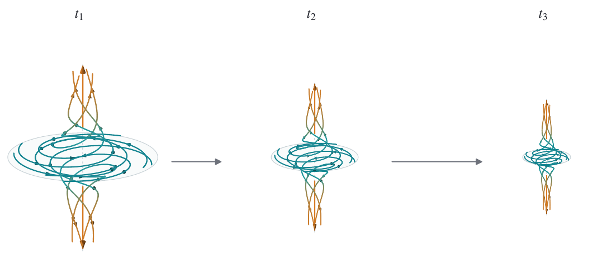
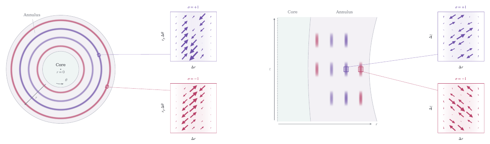
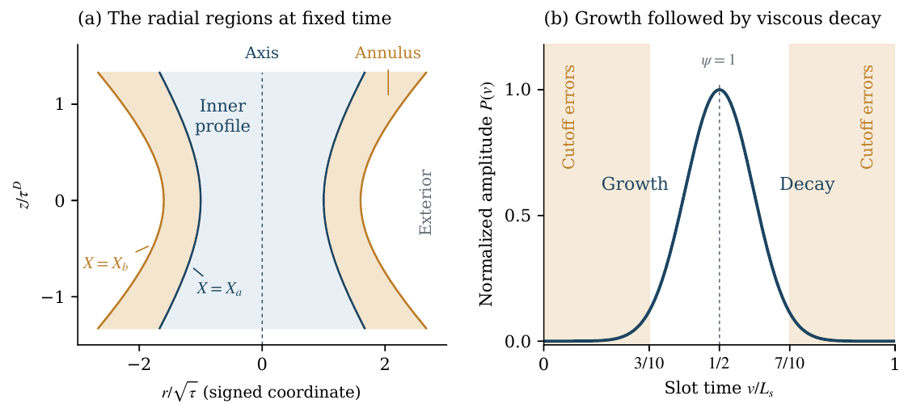
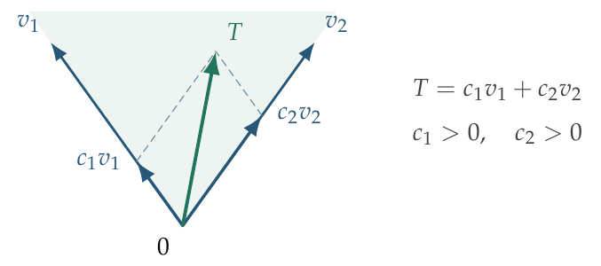
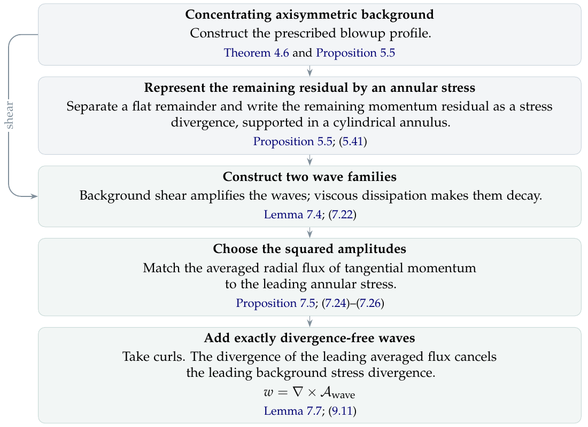
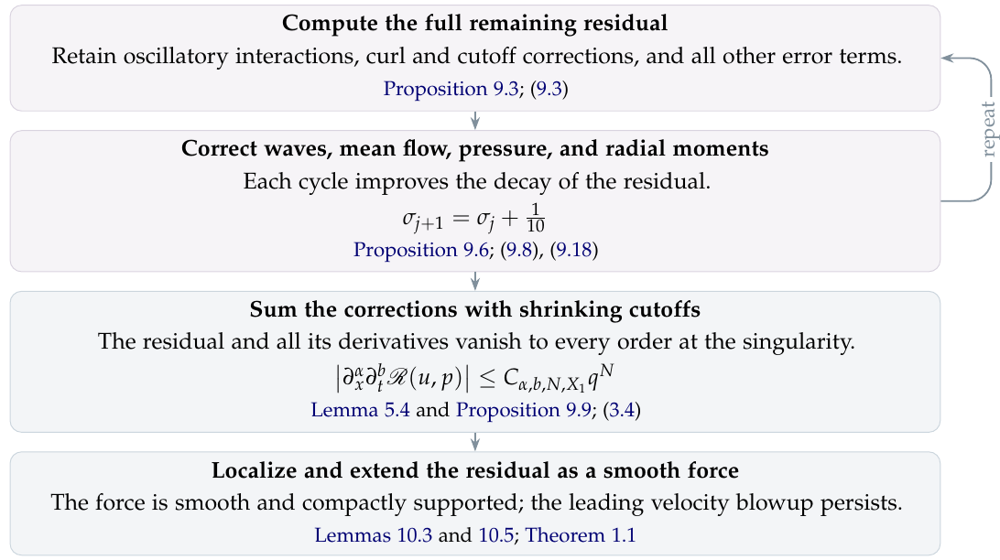

<!-- Page 1 -->

# FINITE TIME BLOWUP FOR NAVIER–STOKES

OPENAI

**Abstract.** For every positive viscosity, we construct a solution of the three-dimensional incompressible Navier–Stokes equations that starts from rest and develops unbounded velocity in finite time while maintaining uniformly bounded kinetic energy.

**Contents**

- 1. Introduction — 1
- 2. Physical description of the blowup — 3
- 3. Proof outline — 6
- 4. Constructing the leading order flow — 24
- 5. Correcting the base flow to every order — 45
- 6. Auxiliary torus and separation of oscillatory supports — 62
- 7. Oscillatory realization and correction of the residual stress — 73
- 8. Compactly supported mean corrections — 88
- 9. Residual improvement and the local field — 100
- 10. Compact forcing and whole-space breakdown — 116
- Appendix A. Matching radial moments and constructing the heat exterior — 126
- Appendix B. Analytic profiles near the axis and their continuation — 144
- Appendix C. Realizing the admissible stress cone — 157
- References — 165

## 1. Introduction

We consider the three-dimensional incompressible Navier–Stokes equations. A fundamental question about the nature of these equations is whether a solution starting from smooth data can develop unbounded velocity in finite time while its kinetic energy remains bounded. We construct such a flow with zero initial velocity and a smooth force compactly supported in space and time.

**Theorem 1.1.** For every $\nu > 0$ there exist a force $f \in C_c^\infty(\mathbb{R}^3 \times (0,\infty);\mathbb{R}^3)$, a compact set $K \subset \mathbb{R}^3$, and smooth velocity and pressure fields $u, p$ on $\mathbb{R}^3 \times [0,1)$ satisfying

$$ \partial_t u + (u\cdot\nabla)u - \nu\Delta u + \nabla p = f, \qquad \nabla\cdot u = 0, \qquad u(\cdot,0) = 0, \tag{1.1} $$

such that $\operatorname{supp} u(\cdot,t) \cup \operatorname{supp} p(\cdot,t) \subset K$ for every $0 \le t < 1$,

$$ \sup_{0\le t<1} \|u(t)\|_{L^2(\mathbb{R}^3)} < \infty, \qquad \limsup_{t\uparrow 1} \|u(t)\|_{L^\infty(\mathbb{R}^3)} = \infty. $$

Consequently, there is no smooth solution $(u,P)$ on $\mathbb{R}^3 \times [0,\infty)$ with the same force and initial datum whose kinetic energy is uniformly bounded $\sup_{t\ge 0} \frac{1}{2}\int_{\mathbb{R}^3} |u(x,t)|^2\,dx < \infty$.

This establishes alternative (C) in the Millennium problem statement for Navier–Stokes as stated by Fefferman in [13]. Compact support also yields the corresponding construction on $\mathbb{T}^3 = \mathbb{R}^3/\mathbb{Z}^3$, establishing alternative (D) in [13]; see Corollary 10.6.

<!-- Page 2 -->

### 1.1. Historical context and previous work.

Incompressible and inviscid flows are described by the classical Euler equations [12]:

$$ D_t u := \partial_t u + (u\cdot\nabla)u = -\nabla p + f, \qquad \nabla\cdot u = 0. \tag{1.2} $$

The material acceleration $D_t u$ describes the acceleration of a parcel of fluid along its trajectory, due both to the changing flow and the parcel's changing position. Crucially, the latter contribution $(u\cdot\nabla)u$ is nonlinear in the velocity $u$, creating most of the difficulty in the analysis. The first equation in (1.2) says that this acceleration is related by Newton's second law to the sum of the negative pressure gradient and the external force. The second equation tells us that the fluid is incompressible: we cannot squeeze the fluid in one direction without simultaneously stretching it in another.

The Navier–Stokes equations [18, 21], given in (1.1), add a viscous force that resists shear between neighbouring fluid parcels. The viscous force is linear in $u$. However, it significantly changes the character of the flows by smoothing velocity gradients. Whether this smoothing is always sufficient to prevent a finite-time singularity in three dimensions lies at the heart of the regularity problem.

In 1934, Leray [16] constructed global finite-energy weak solutions of the three-dimensional equations satisfying an energy inequality. Whether solutions starting from smooth data remain smooth was left unresolved. Caffarelli, Kohn, and Nirenberg [5] proved that the singular set of a suitable weak solution has zero one-dimensional parabolic Hausdorff measure, a bound that allows isolated singularities. Escauriaza, Seregin, and Šverák [11] proved regularity for the unforced Cauchy problem under a bounded scale-invariant $L_t^\infty L_x^3$ norm.

Tao [22] constructed finite-time blowup for an averaged Navier–Stokes equation that retains the energy cancellation of the original nonlinearity. For the original equations, Buckmaster and Vicol [4] used convex integration to establish nonuniqueness among finite-energy weak solutions. Albritton, Brué, and Colombo [1] subsequently constructed distinct suitable Leray–Hopf solutions with zero initial velocity and the same force, using an unstable vortex in similarity variables. Their force lies in $L_t^1 L_x^2$ and is singular at the initial time.

The methods of Lifschitz and Hameiri and of Friedlander and Vishik [17, 14] describe the evolution of wavevectors and velocity polarizations along a background flow. Craik and Criminale [9] constructed exact finite-amplitude waves on affine background flows, exploiting the cancellation of the wave's quadratic self-interaction. Further precedents for the wave dynamics include the centrifugal-instability criteria of Leibovich and Stewartson [15] and of Billant and Gallaire [2, 3] and the exact viscous shearing waves of Singh and Sridhar [19]. The use of oscillations to realize a prescribed stress is central to the Euler constructions of Daneri and Székelyhidi [10].

Córdoba and Martínez-Zoroa [6] constructed finite-time singularities for the forced three-dimensional Euler equations through successive amplification of increasingly concentrated vortex layers. Córdoba, Martínez-Zoroa, and Zheng [8] extended this approach to hypodissipative Navier–Stokes with small positive dissipation orders and forcing in a local well-posedness class. These works established a strategy for singularity formation based on amplification across scales while controlling the regularity of the external force. In their constructions, larger-scale strain amplifies smaller-scale vorticity, with leading self-interactions and feedback on the larger scales suppressed. For the incompressible porous media equation, Córdoba and Martínez-Zoroa [7] constructed singularities from smooth initial data by successive amplification of oscillatory layers, using approximations of increasing order to keep every spatial derivative of the source uniformly bounded. Our construction also exploits <!-- Page 3 --> dynamical amplification, with a different role for the amplified disturbances: oscillatory pulses generate a mean momentum flux that supplies the missing force on a collapsing background vortex.

## 2. Physical description of the blowup

We first describe the underlying physics of the flow realizing Theorem 1.1; we then provide a full sketch of the proof in Section 3.

For any incompressible flow $u$ and pressure $p$, we can always define the external force $f$ to be the residual in (1.1). The Navier–Stokes equations then hold by construction. The challenge is to choose a flow that blows up while this residual remains smooth. The individual terms in the momentum residual can diverge, but we must arrange sufficient cancellation that their sum and all its derivatives extend smoothly through the singular time.

Specifically, we construct a vortex whose leading profile is self-similar, with radial width decreasing faster than axial length. Its central flow combines inward spiralling with axial outflow. As the core contracts, the azimuthal and axial velocity scales increase, strengthening the shear in the surrounding annulus.

In the inner core, the profile equations impose the leading momentum balance. Joining this flow to a smooth exterior whose speed decreases with radius leaves a nonzero residual in the intervening annulus. For the background alone, the momentum residual becomes unbounded as $t \uparrow 1$, so it cannot supply the smooth force required by the theorem. We add spatially oscillatory pulses whose nonlinear momentum fluxes cancel the singular part of this residual. Further corrections remove the remaining singular errors, leaving a force that extends smoothly through $t = 1$.

### 2.1. Inner core.

We construct our flow so that the singularity forms at the spatial origin at time $t = 1$. We use cylindrical coordinates about the vertical axis:

$$ x = (r\cos\theta, r\sin\theta, z), $$

where $r$ is distance from the axis, $\theta$ is angle around it, and $z$ is height. The velocity components $u_r$, $u_\theta$, and $u_z$ describe motion toward or away from the axis, around the axis, and along it, respectively. The leading flow $u^{(0)}$ is axisymmetric: its components depend on $r, z, t$, but not on $\theta$.

In the central part of the inner region, fluid spirals inward toward the axis and flows upward and downward on opposite sides of a dividing layer close to $z = 0$ (Figure 1). Farther above and below this central region, the inner profile also contains radial outflow. Pressure decreases toward the axis, supplying the leading centripetal force. Its axial gradient enters the axial momentum balance together with transport and viscosity. Near the axis, the axial pressure force points toward the plane $z = 0$.

Radial inflow contributes to spin-up by carrying angular momentum toward smaller radii. For a fluid particle experiencing no torque, the angular momentum per unit mass $ru_\theta$ is conserved, so moving inward increases $u_\theta$. In the actual core, viscosity transports angular momentum outwards; the increasing characteristic speed reflects the balance between inward transport and viscous loss. Incompressibility prevents the incoming fluid from accumulating near the axis: the axial outflow carries it away, allowing the inward motion and spin-up to continue.

To leading order, the core evolves self-similarly: its velocity profile has a fixed shape when distances and velocities are measured in their respective time-dependent scales. The radial

<!-- Page 4 -->

> **Figure 1.** The central part of the inner core at successive times $t_1 < t_2 < t_3 < 1$. In this region, fluid spirals inward and flows axially on opposite sides of a dividing layer close to $z = 0$. As the singular time approaches, the region of intense flow shrinks and the velocity increases. Its radius shrinks faster than its height; this difference is exaggerated in the schematic.

and axial scales shrink at different rates. Writing $\tau = 1 - t$ for the time remaining before the singularity, we have

$$ \ell_r \asymp \tau^{1/2}, \qquad \ell_z \asymp \tau^{1/2-h}, \qquad 0 < h < 1/100, $$

where $h$ is fixed and $\asymp$ denotes bounds above and below by positive factors independent of $\tau$. Both lengths tend to zero, while $\ell_r/\ell_z \asymp \tau^h \to 0$: the core becomes an increasingly slender column concentrated at the origin, with volume of order $\tau^{3/2-h}$.

The characteristic velocity magnitudes of the leading flow satisfy

$$ |u_\theta^{(0)}|, |u_z^{(0)}| \asymp \tau^{-1/2-h}, \qquad |u_r^{(0)}| = O(\tau^{-1/2}). $$

These are typical scales across the core; in particular, the azimuthal velocity vanishes on the axis. The flow is smooth for every $t < 1$, but its largest speeds become unbounded in a shrinking neighbourhood of the origin as $t \uparrow 1$. The total kinetic energy of the core is of order $\tau^{1/2-3h}$, which tends to zero despite the increasing speeds.

The different velocity scales give different Reynolds numbers. For a speed $U$, length $\ell$, and viscosity $\nu$, the Reynolds number $U\ell/\nu$ compares the viscous diffusion time $\ell^2/\nu$ with the time $\ell/U$ for fluid motion over that distance. Using the core radius as the length scale, the characteristic angular and radial Reynolds numbers are

$$ \mathrm{Re}_\theta := \frac{|u_\theta|\ell_r}{\nu} \asymp \tau^{-h} \longrightarrow \infty, \qquad \mathrm{Re}_r := \frac{|u_r|\ell_r}{\nu} = O(1), $$

for fixed $\nu > 0$.

The angular Reynolds number grows without bound: fluid makes increasingly many turns during a radial diffusion time. The radial Reynolds number remains bounded, so viscosity continues to compete with radial inflow. The corresponding transport and diffusion

<!-- Page 5 -->

> **Figure 2.** Pulse geometry and perturbation velocities. *Left:* At fixed height, pulse envelopes occupy complete rings; the close-ups show radial and azimuthal perturbation velocities. *Right:* A radial–axial section, where each localized patch is a cross-section of a complete ring; the close-ups show radial and axial perturbation velocities. Colors distinguish the two families. The specific pulse arrangement shown is schematic; active locations, spacing, and aspect ratios are illustrative.

rates satisfy

$$ \frac{|u_r|}{\ell_r} = O(\tau^{-1}), \qquad \frac{|u_z|}{\ell_z} \asymp \tau^{-1}, \qquad \frac{\nu}{\ell_r^2} \asymp \tau^{-1}. $$

Thus radial diffusion and transport by the radial and axial flow remain in the leading balance as the core contracts. Axial diffusion is weaker: the ratio of axial to radial diffusion rates is

$$ \frac{\nu/\ell_z^2}{\nu/\ell_r^2} = \frac{\ell_r^2}{\ell_z^2} \asymp \tau^{2h} \longrightarrow 0. $$

The core must also provide enough shear at its outer edge to amplify the pulses placed there. Away from the middle plane, axial flow carries angular momentum from more rapidly rotating layers, supporting a steep radial decrease in angular velocity. With exact reflection symmetry, this transport would vanish at $z = 0$. Symmetry would also impose $u_z(r,0,t) = 0$, leaving no radial shear of the axial velocity to compensate. We therefore choose a slightly asymmetric axial profile, with a small upward bias and nonzero velocity at $z = 0$. This separates the layer where rotational amplification is weak from the layer where axial shear vanishes. The radial shear of axial velocity then supplies the additional amplification needed near the middle plane; farther away, the rotational mechanism already suffices.

### 2.2. Annulus and pulses.

At the edge of the core, there is an annular region where the inner vortex joins onto an exterior flow. The background satisfies its leading momentum equations inside the core, but this transition leaves an imbalance in the annulus. The external force needed to sustain the background becomes unbounded as $t \uparrow 1$, so it cannot serve as the smooth external force required by the construction.

We therefore perturb the velocity so that the fluid's own motion supplies the missing momentum transport. Through the nonlinear advection term, the perturbation produces additional momentum fluxes whose spatial variation acts as an internal force on the background. We require this contribution to cancel the singular part of the background residual, leaving only a remainder that extends smoothly through $t = 1$. These internal forces redistribute momentum within the fluid.

<!-- Page 6 -->

Our perturbation consists of a sequence of spatially oscillatory pulses that are localized in radius, height, and time, but extend around a complete ring. An exponentially small external force seeds each pulse; the background shear supplies its subsequent growth. Their cylindrical velocity components have zero angular average, but their momentum fluxes need not. For example, outward motion carrying an azimuthal velocity surplus and inward motion carrying a deficit both increase outward angular momentum flux. Reversing both velocity components leaves their product unchanged. Axial momentum is transported in the same way. We arrange the net transport into or out of each region to supply the contribution missing from the background's momentum balance.

The pulses grow by extracting energy from the background shear. A simple example illustrates how this amplification occurs. In a rotating flow, an azimuthal velocity surplus produces outward acceleration. If angular velocity decreases sufficiently rapidly with radius, this outward motion increases the surplus relative to the surrounding fluid. The two effects reinforce one another, giving exponential growth when the amplification exceeds viscous damping. In the full flow, axial shear also contributes to the amplification.

The same shear also changes the oscillation's spatial pattern: fluid at different radii carries it along at different speeds. We choose the pulse orientations so that this progressively shortens the radial wavelength. The changing orientation weakens the amplification, while shortening the radial wavelength increases the total squared wavenumber and hence viscous damping. We choose the initial wavelength so that amplification dominates at first, but damping overtakes it later. The tails are sufficiently small that the cutoff errors and all their derivatives vanish at the singularity.

We combine two families of pulses with different ratios of radial angular-momentum flux to radial axial-momentum flux. The background profile and oscillation directions are chosen together so that the averaged quadratic velocity products of the two families supply both components of the required leading stress. We arrange the pulses on successively finer spatial and temporal scales as the singularity approaches. Further corrections cancel the remaining singular terms in the momentum residual, giving a flow whose velocity becomes unbounded while its residual force extends smoothly through the singular time.

### 2.3. Exterior flow and localization.

Beyond the annulus, the flow is purely azimuthal and independent of height: fluid circles the axis, with speed decreasing as the radius increases. Pressure supplies the centripetal acceleration, while the azimuthal velocity evolves by viscous diffusion. We choose this outer flow to satisfy the radial heat equation for the azimuthal velocity exactly, and call it the heat exterior. Its momentum residual vanishes, so no external force is needed to sustain this part of the local flow.

At every fixed positive radius, the exterior velocity and pressure have smooth limits, together with all their derivatives, as the singular time approaches. Together with the regularity of the inner construction away from the origin, this allows us to cut off the flow smoothly in space. The additional force produced by this cutoff remains smooth through the singular time, while the cutoff leaves the concentrating core unchanged.

## 3. Proof outline

The physical description in Section 2 leads to a precise cancellation problem. We must construct a velocity and pressure whose momentum residual extends smoothly through the singular time, while the velocity becomes unbounded. At viscosity one, the residual is

$$ \mathscr{R}(u,p) = \partial_t u + (u\cdot\nabla)u - \Delta u + \nabla p. \tag{3.1} $$

<!-- Page 7 -->

The estimates must control every Cartesian space-time derivative of this residual.

First we construct the axisymmetric background $(u_B, p_B)$ of Proposition 5.5, whose residual in (5.41) is the negative divergence of an annular stress, up to a remainder vanishing to every order at the singular point. Oscillatory velocities supply the leading stress through their averaged quadratic products (Proposition 7.5). Successive corrections improve the decay of the remaining residual (Proposition 9.6). We then sum and localize the fields, preserving incompressibility and the leading velocity growth, and extend the residual to the smooth compactly supported force in Theorem 1.1 (Propositions 10.1 and 9.9 and Lemma 10.3). All estimates used below are proved for the viscous equations. The construction is summarized in Figures 5 and 6.

For any $\nu > 0$, a solution at viscosity one gives a solution at viscosity $\nu$ by

$$ u_\nu(x,t) = \sqrt{\nu}\, u(x/\sqrt{\nu}, t), \qquad p_\nu(x,t) = \nu p(x/\sqrt{\nu}, t), \qquad f_\nu(x,t) = \sqrt{\nu}\, f(x/\sqrt{\nu}, t). $$

The singular time is unchanged. The equation and energy scaling are verified in (10.22)–(10.23). We use $\nu = 1$ for the rest of this outline.

### 3.1. The concentrating leading field.

We encode the geometry of Section 2.1 by the fixed velocity profiles $E, U$ and pressure profile $\Pi$ in (4.3). The similarity coordinates $(X,\eta)$ in (3.2) resolve the different radial and axial contraction rates and express the velocity growth as powers of a concentration scale. We first specify this representation; the next subsection constructs profiles whose remaining momentum residual can be supplied by the pulses.

We write

$$ \tau = 1 - t, \qquad A = \tfrac{1}{2} + h, \qquad D = \tfrac{1}{2} - h, \qquad 0 < h < 1/100, $$

with $h$ fixed in the profile construction. In cylindrical coordinates,

$$ x = (r\cos\theta, r\sin\theta, z), \qquad e_r = (\cos\theta, \sin\theta, 0), \quad e_\theta = (-\sin\theta, \cos\theta, 0), \quad e_z = (0,0,1). $$

The leading field $u^{(0)} = u_r^{(0)} e_r + u_\theta^{(0)} e_\theta + u_z^{(0)} e_z$ is axisymmetric: its cylindrical components are independent of $\theta$. The tangential components are the azimuthal and axial components, tangent to cylinders of constant $r$.

We introduce the similarity coordinates

$$ \tau = q(1-\eta^2), \qquad z = q^D \eta, \qquad X = \frac{r^2}{2q}, \qquad q > 0, \quad -1 < \eta < 1. \tag{3.2} $$

For $\tau > 0$, eliminating $\eta$ gives

$$ q - z^2 q^{2h} = \tau, \qquad \partial_q(q - z^2 q^{2h}) = 1 - 2h\eta^2 \ge 1 - 2h > 0 \quad \text{on } |\eta| < 1. $$

Thus $q = q(z,\tau)$ is uniquely determined, and $q \asymp \tau + |z|^{1/D}$, where $\asymp$ denotes bounds above and below by fixed positive factors. On a fixed compact set of similarity coordinates away from $\eta = \pm 1$, we have $q \asymp \tau$. For bounded $X$, letting $q \downarrow 0$ approaches the singular point. The endpoints $\eta = \pm 1$, with $q > 0$, describe $t = 1$ away from that point; see Lemma 4.1.

The azimuthal and axial profiles $E(X,\eta)$, $U(X,\eta)$ determine the leading fields by

$$\begin{aligned} u_\theta^{(0)} &= q^{-A} E, \qquad & u_z^{(0)} &= q^{-A} U, \\ r u_r^{(0)} &= V_0, \qquad & p^{(0)} &= q^{-2A}\Pi. \end{aligned}$$

Incompressibility and regularity at the axis determine $V_0$:

$$ \frac{1}{r}\partial_r(r u_r^{(0)}) + \partial_z u_z^{(0)} = 0, \qquad V_0(0,\eta) = 0. $$

<!-- Page 8 -->

The leading radial pressure balance and the normalization at radial infinity give

$$ \partial_r p^{(0)} = \frac{(u_\theta^{(0)})^2}{r}, \qquad \Pi(X,\eta) = -\int_X^\infty \frac{E(x,\eta)^2}{2x}\,dx. $$

The construction ensures that $E/\sqrt{2X}$, $U$, and $V_0/X$ are smooth at $X = 0$, giving a smooth Cartesian field at the axis for every $t < 1$. In particular, $u_\theta^{(0)} = 0$ on the axis, while $E(X,\eta) > 0$ for $X > 0$.

We choose $X_c > 0$ and $0 < \eta_c < 1$ so that $[0, X_c] \times [-\eta_c, \eta_c]$ lies in the inner region of Theorem 4.6, and define the core at time $t = 1 - \tau$ by

$$ \mathcal{C}_\tau = \{(r\cos\theta, r\sin\theta, z) : 0 \le X(r,z,\tau) \le X_c,\ |\eta(z,\tau)| \le \eta_c\}. $$

Since $q \asymp \tau$ there, its radial and axial extents satisfy

$$ \ell_r \asymp \tau^{1/2}, \qquad \ell_z \asymp \tau^{1/2-h}, \qquad \frac{\ell_z}{\ell_r} \asymp \tau^{-h}. $$

Both extents vanish; their ratio diverges. The constructed profiles give

$$\begin{aligned} &\|u_\theta^{(0)}\|_{L^\infty(\mathcal{C}_\tau)} \asymp \tau^{-1/2-h}, \qquad && \|u_z^{(0)}\|_{L^\infty(\mathcal{C}_\tau)} \asymp \tau^{-1/2-h}, \\ &\|u_r^{(0)}\|_{L^\infty(\mathcal{C}_\tau)} = O(\tau^{-1/2}), && \frac{\|u_r^{(0)}\|_{L^\infty(\mathcal{C}_\tau)}}{\|u_\theta^{(0)}\|_{L^\infty(\mathcal{C}_\tau)}} = O(\tau^h). \end{aligned}$$

The axial lower bound follows from the nonzero axis datum in Proposition B.2. For any fixed $0 < X_* < X_c$, the circle $z = 0$, $r = \sqrt{2X_*\tau}$ has $q = \tau$, $\eta = 0$, and

$$ u_\theta^{(0)} = E(X_*, 0)\tau^{-1/2-h} \longrightarrow +\infty. $$

The core is a time-dependent region in space; its boundary is determined by fixed similarity coordinates. Incompressibility preserves the volume of material regions transported by the velocity. The radial regions are shown in Figure 3(a).

The leading field extends beyond the core. Outside a fixed radial interval in $X$, $U = V_0 = 0$, while

$$ E(X,\eta) = c_\infty X^{-1/2-h}\big(1 + O(X^{-1})\big) \qquad (X \to \infty), \qquad c_\infty > 0, $$

uniformly in $\eta$. The exact exterior formula (4.29) gives a purely azimuthal solution of the radial heat equation for the azimuthal velocity. The final spatial localization in Proposition 10.1 gives the completed velocity a fixed compact support.

At viscosity one, the local length scales $\ell_r = q^{1/2}$, $\ell_z = q^D$ give

$$ \mathrm{Re}_\theta = q^{-A}\ell_r = q^{-h} \longrightarrow \infty, \qquad \mathrm{Re}_r = |u_r^{(0)}|\ell_r = O(1). $$

The rotation rate exceeds the radial diffusion rate. In the axisymmetric tangential equations, radial diffusion and radial and axial transport enter the leading balance at the rates

$$ \frac{|u_r^{(0)}|}{\ell_r} = O(q^{-1}), \qquad \frac{q^{-A}}{\ell_z} = \frac{1}{\ell_r^2} = q^{-1}. $$

Axial diffusion is smaller than radial diffusion by the factor $\ell_r^2/\ell_z^2 = q^{2h}$, which supplies the expansion parameter for the background corrections.

<!-- Page 9 -->

> **Figure 3.** The concentrating geometry and the reference pulse. (a) A schematic radial–axial section at fixed time: the pulse annulus lies between the level surfaces $X = X_a$ and $X = X_b$. Horizontal and vertical axes use their respective similarity scales; both physical length scales shrink. (b) A reference amplitude $P(v)$, normalized to one at the midpoint of a pulse interval of length $L_s$ in $v$, grows and then decays. The shaded regions contain the small cutoff tails. The spatial radii and pulse parameters shown are representative; the proof chooses them by the estimates in the profile and pulse sections.

### 3.2. Construction of the background stress.

We now choose the profiles $E, U$ so that the pulses can supply their remaining momentum transport. The resulting stress $T$, defined by the radial integrals below, must vanish outside the pulse annulus and be a positive combination of the fluxes carried by the two wave families. The profile construction in Theorem 4.6(ii) gives this support; the admissible stress cone condition characterized in Lemma 4.5 ensures the positive representation of Proposition 7.5.

We denote by $R_\theta^{(0)}, R_z^{(0)}$ the tangential momentum residuals of $(u^{(0)}, p^{(0)})$, retaining radial viscosity and omitting axial viscosity. We construct physical stress components $T = (T_{r\theta}, T_{rz})$ satisfying

$$R_\theta^{(0)} = -(\partial_r + 2/r)T_{r\theta}, \qquad R_z^{(0)} = -(\partial_r + 1/r)T_{rz}.$$

Regularity at the axis fixes their integration constants:

$$T_{r\theta}(r) = -\frac{1}{r^2}\int_0^r s^2 R_\theta^{(0)}(s)\, ds, \qquad T_{rz}(r) = -\frac{1}{r}\int_0^r s R_z^{(0)}(s)\, ds.$$

We require $T$ to be nonzero precisely in the annulus $X_a < X < X_b$, or $\sqrt{2qX_a} < r < \sqrt{2qX_b}$, with $0 < X_a < X_b$. We make the residual zero in the inner region and in the heat exterior, and impose

$$\int_0^\infty r^2 R_\theta^{(0)}\, dr = 0, \qquad \int_0^\infty r R_z^{(0)}\, dr = 0.$$

These identities make the stress zero beyond the exterior radius as well as near the axis. The prescribed exterior moment identities give these zero integrals (Lemma A.8). Matching the profiles and the five radial integrals defined in (4.15) preserves the exterior fields (Lemma 4.4).

<!-- Page 10 -->

The admissible stress cone condition permits the pulse construction to select two families with linearly independent covariance vectors $v_1, v_2 \in \mathbb{R}^2$ at each point of the annulus. These vectors depend on the local background and give the azimuthal and axial momentum fluxes per unit squared amplitude. They represent the required stress as

$$T = c_1 v_1 + c_2 v_2, \qquad c_1, c_2 > 0 \quad \text{where } T \neq 0.$$

Thus $T$ lies in the interior of the cone generated by $v_1, v_2$. Proposition 7.5 constructs this representation from the admissible stress cone condition on the profiles. Figure 4 illustrates this positive representation.

> **Figure 4.** Positive representation of the target stress. The shaded cone consists of nonnegative linear combinations of the covariance directions $v_1, v_2$. An interior target $T = c_1 v_1 + c_2 v_2$ has $c_1, c_2 > 0$; the dashed lines show vector addition. The coefficients remain positive under sufficiently small perturbations of the two directions.

These conditions couple the inner and exterior profiles through the pressure and radial velocity, both of which depend on cumulative radial integrals. We choose the pressure datum, solve near the axis, and match these integrals before imposing the cone condition:

1. *Exterior and axis pressure.* Proposition A.4 constructs reference profiles with a purely azimuthal tail. Their radial pressure integral (4.31) fixes $\Pi(0, \eta)$. Replacing the tail by the exact heat flow of Lemma A.6 changes this integral. The corrections in Proposition A.7 restore it at smaller radii, preserving the axis pressure.
2. *Inner solution.* With this pressure datum and the specified axis data, Proposition B.2 constructs $E/\sqrt{2X}, U, \Pi$ analytic in $X, \eta$ near the axis and satisfying (4.13). Their leading tangential residual and stress vanish on $X \le X_a$.
3. *Joining and moment matching.* Corollary B.10 connects the inner profiles to the prescribed outer profiles. The correction in Proposition B.8 matches the five cumulative radial integrals governing the pressure, radial velocity, and stress. Equality of the profiles and these integrals at the joining radius restores the prescribed exterior fields by Lemma 4.4. The inner identity (4.13) and the exterior conclusion of Lemma A.8 give $T = 0$ for $X \le X_a$ and $X \ge X_b$.
4. *Enforcing the cone condition.* On a compact subinterval of the annulus, Proposition C.2 introduces a radial oscillation with phase $N \log X$, where $N$ is a large fixed integer. Its amplitude is $O(N^{-1})$; applying $X\partial_X$ produces an order-one change in the radial derivatives. This changes the leading tangential shear while changing profile values and radial moments by only $O(N^{-1})$. The shear follows a periodic curve satisfying the admissible stress cone condition. A separate localized correction restores all five radial integrals exactly. The inner solution and heat exterior are preserved, and the resulting stress admits positive covariance weights throughout the annulus (Proposition C.3).

<!-- Page 11 -->

The leading profiles are now fixed. Before adding pulses, Section 5 constructs corrections in successive powers $q^{2nh}$, $n = 1, 2, \ldots$. At each order, the previously determined coefficients supply the source terms in the coefficient equations. This recursion accounts for the radial momentum equation, axial viscosity, and the remaining lower-order terms. The coefficients are summed with smooth cutoffs on their vector potentials and pressures, equal to one near the singularity and supported in successively smaller neighborhoods. Taking curls after multiplication preserves incompressibility. The resulting smooth axisymmetric background $(u_B, p_B)$ satisfies

$$\begin{aligned} \mathscr{R}(u_B, p_B) = {} & -(\partial_r + 2/r)\mathcal{T}_{\mathrm{phys},\theta} e_\theta \\ & -(\partial_r + 1/r)\mathcal{T}_{\mathrm{phys},z} e_z + \mathcal{E}_B. \end{aligned}$$

The stress $\mathcal{T}_{\mathrm{phys}}$ is supported in the annulus and has leading term $T$. A residual is *flat* as $q \downarrow 0$ if every Cartesian space-time derivative is $O(q^N)$ for every $N \ge 0$, uniformly on each bounded interval in $X$. The remainder $\mathcal{E}_B$ has this property by Proposition 5.5.

### 3.3. Oscillations and momentum transport.

We've now arrived at a background $(u_B, p_B)$ with the required growth and leading annular stress $T$ that the two pulse families can realize. We next construct divergence-free pulses (Lemma 7.7) whose averaged quadratic flux supplies $T$ to leading order (Propositions 7.5 and 9.5). The exact increment identity separates this cancellation from the linear pulse evolution and the interactions left for later corrections.

For a divergence-free velocity increment $w$ with pressure increment $\pi$, the exact residual identity is

$$\mathscr{R}(u_B + w, p_B + \pi) = \mathscr{R}(u_B, p_B) + \mathcal{L}_{u_B}(w, \pi) + \nabla \cdot (w \otimes w),$$

where

$$\mathcal{L}_{u_B}(w, \pi) := \partial_t w + (u_B \cdot \nabla) w + (w \cdot \nabla) u_B - \Delta w + \nabla \pi.$$

The linear term describes the evolution of the pulses in the background; the quadratic term provides the stress that cancels the leading part of $\mathscr{R}(u_B, p_B)$.

We write $A_{\mathrm{wave}}$ for the characteristic pulse oscillation amplitude and $\ell_{\mathrm{wave}}$ for its wavelength. At fixed nonzero profile values in the pulse annulus, suppressing logarithmic factors and weights that vanish at the support boundary, the construction gives

$$\begin{gathered} A_{\mathrm{wave}} \asymp q^{-1/2-h/2}, \qquad \ell_{\mathrm{wave}} \asymp q^{1/2+h/2}, \\ \frac{A_{\mathrm{wave}}}{q^{-1/2-h}} \asymp \frac{\ell_{\mathrm{wave}}}{q^{1/2}} \asymp q^{h/2}. \end{gathered}$$

The square of the amplitude has the required stress scale:

$$A_{\mathrm{wave}}^2 \asymp q^{-1-h} \asymp \frac{|u_\theta^{(0)}|}{q^{1/2}}, \qquad \frac{A_{\mathrm{wave}}^2}{q^{1/2}} \asymp q^{-3/2-h}.$$

The last expression is the scale of the averaged radial stress divergence, matching the leading time derivative, transport, and radial viscosity in the tangential momentum equations.

Freezing the amplitude and phase gradient at a point gives the schematic local form

$$w_{\mathrm{lead}}(x) = a \cos(\xi \cdot x + \varphi), \qquad a \cdot \xi = 0.$$

Here $a \in \mathbb{R}^3$ is a constant amplitude, $\xi \in \mathbb{R}^3$ is the wavevector, and $\varphi \in \mathbb{R}$ is a phase. The velocity oscillates orthogonally to its wavevector. To separate distinct localized pulses while <!-- Page 12 --> retaining periodic averaging, we construct an extended field $\widetilde{w}(r, \theta, z, t, Y)$ depending on an independent auxiliary variable $Y \in \mathbb{T}^2$. Its physical value is

$$w(r, \theta, z, t) = \widetilde{w}(r, \theta, z, t, Y(r, t)),$$

where the fixed phase map $Y(r, t)$ is defined in (6.3). The covariance is computed before this evaluation. We use angular and auxiliary averages

$$\langle F \rangle_\theta := \frac{1}{2\pi}\int_0^{2\pi} F\, d\theta, \qquad \langle F \rangle_Y := \int_{\mathbb{T}^2} F\, dY, \qquad \int_{\mathbb{T}^2} 1\, dY = 1.$$

Their composition is denoted by $\langle F \rangle := \langle \langle F \rangle_\theta \rangle_Y$. The averaging conventions are collected in Equations (3.7) to (3.9). Components are taken in the cylindrical basis. Localized pulses with distinct labels whose slow space-time supports overlap receive disjoint supports in $Y$. Products between such pulses vanish pointwise, including after evaluation at $Y(r, t)$ (Lemma 6.1). Harmonics and corrections with the same label retain their interactions.

In the actual construction the amplitudes, phases, and cutoffs vary. We evaluate localized vector potentials at $Y(r, t)$ to obtain $\mathcal{A}_{\mathrm{wave}}$, then take the physical curl:

$$w = \nabla \times \mathcal{A}_{\mathrm{wave}}, \qquad \nabla \cdot w = 0.$$

All chain-rule terms from $Y(r, t)$ are included. Differentiating the amplitudes and cutoffs produces smaller velocity terms, retained in Lemma 7.7.

The chosen phases have nonzero integer angular frequencies, so each wave has zero angular mean and the cosine square has angular average $1/2$. The two families produce the momentum-flux directions used to choose $c_1, c_2 > 0$ above. These coefficients become squared amplitude weights. The covariance construction, with its physical scaling and curl corrections, gives

$$\begin{pmatrix} \langle \widetilde{w}_r \widetilde{w}_\theta \rangle \\ \langle \widetilde{w}_r \widetilde{w}_z \rangle \end{pmatrix} = T + \text{higher-order terms.}$$

The higher-order terms include the curl corrections and are smaller by positive powers of $q$, with derivative bounds proved in Corollary 7.8. The radial divergence of the displayed leading covariance cancels the leading negative stress divergence of the background (Propositions 7.5 and 9.5). The extended residual still contains oscillatory terms and angular means that depend on $Y$; these are evaluated at $Y(r, t)$ in the physical equation.

The same quadratic products govern energy transfer from the background. We consider the homogeneous linearized model

$$\mathcal{L}_{u_B}(w_{\mathrm{lin}}, \pi_{\mathrm{lin}}) = 0, \qquad \nabla \cdot w_{\mathrm{lin}} = 0.$$

Under sufficient spatial decay, integration by parts gives

$$\frac{d}{dt}\frac{1}{2}\int |w_{\mathrm{lin}}|^2 = -\sum_{i,j}\int (w_{\mathrm{lin}})_i (w_{\mathrm{lin}})_j\, \partial_j (u_B)_i - \int |\nabla w_{\mathrm{lin}}|^2.$$

The first term transfers energy between the background and the perturbation; the second dissipates it. The selected transverse velocity amplitudes extract energy from the shear and provide the two momentum-flux directions whose positive span contains $T$. During each pulse, shear increases the magnitude of the radial component of the wavevector. Viscous damping strengthens and eventually exceeds the amplification, so the pulse grows and then decays. The temporal cutoff acts only in its exponentially small tails. The phase and amplitude equations establish these properties in Lemmas 7.1 and 7.4; Figure 3(b) illustrates the resulting envelope.

<!-- Page 13 -->

The correction cycle treats the remaining linear and quadratic interactions, including the curl and cutoff errors in $\mathscr{R}(u_B + w, p_B + \pi)$.

> **Figure 5.** Construction of the background and the first oscillatory correction. The averaged pulse flux cancels the leading background stress divergence. The remaining residual is corrected by the cycle in Figure 6. A flat remainder and all curl and cutoff terms are retained.

### 3.4. Correction and summation.

The averaged wave flux is chosen to cancel the leading stress divergence associated with $T$ (Propositions 7.5 and 9.5). The remaining angular harmonics, auxiliary means, and radial integral defects require separate corrections. We treat them in a fixed cycle and recompute the full residual after each operation, as in Proposition 9.6, so newly created terms enter the next stage.

Starting from $(u_B + w, p_B + \pi)$, we reconstruct the pressure and correct the angularly averaged velocity and its radial integral defects. Proposition 9.5 proves that the resulting pair $(u^{[0]}, p^{[0]})$ satisfies the bounds required for the correction cycle. Square brackets count these cycles; the superscript $(0)$ continues to denote the leading field $(u^{(0)}, p^{(0)})$.

At stage $j$, we add a divergence-free velocity increment $\delta u_j$ and a pressure increment $\delta p_j$:

$$u^{[j+1]} = u^{[j]} + \delta u_j, \qquad p^{[j+1]} = p^{[j]} + \delta p_j.$$

The residual changes according to

$$\begin{aligned} \mathscr{R}(u^{[j+1]}, p^{[j+1]}) &= \mathscr{R}(u^{[j]}, p^{[j]}) + \mathcal{L}_{u^{[j]}}(\delta u_j, \delta p_j) \\ &\quad + \nabla \cdot (\delta u_j \otimes \delta u_j). \end{aligned}$$

<!-- Page 14 -->

Here $\mathcal{L}_v$ is the linear residual operator defined above, with background $v$. Thus canceling a selected source also introduces linear remainders and quadratic interactions. The four operations in Proposition 9.6 control these terms as follows.

1. We solve the inhomogeneous wave-amplitude equations for the supported nonzero angular Fourier modes. Their principal operator cancels the prescribed source. The remaining linear terms and the interactions of the new pulses enter the next residual (Proposition 9.1 and Lemma 9.2).
2. We construct signed amplitude increments using the fixed positive leading amplitudes. Their symmetrized cross covariance with the leading pulses supplies the prescribed correction to the averaged stress. Interactions with earlier corrections and the quadratic self-interaction remain as higher-order terms (Proposition 7.6, (9.13)).
3. We correct the angularly averaged residual with zero auxiliary average by inverting the fast auxiliary-time derivative (8.20). The axial increment is realized through a vector potential in (8.14), which also supplies its radial velocity. The reconstruction remainder, whose Cartesian space-time derivatives vanish faster than every power of $q$, is retained in the residual.
4. We solve the five radial moment equations in (8.25). Two equations preserve the zero angular-momentum and axial-flux integrals in (9.10). Three cancel the linear contributions to $(\mathcal{P}, \mathcal{J}_\theta, \mathcal{J}_z)$, the radial integral defects for pressure and tangential momentum defined in (8.12) and (8.15); their nonlinear remainders have improved decay (8.27). The radial integral constructions keep the velocity and pressure corrections compactly supported.

Pressure is reconstructed from the updated radial equation after each operation, and its contribution to the axial equation is included in the new residual. All products use the updated fields, including the curl and cutoff corrections. The background, leading amplitudes, and inverse operators remain fixed throughout the induction.

The parameter $\sigma_j$ in (9.8) measures residual decay. For Cartesian derivatives of order $m$, the bound in (9.18) contains the power $q^{h\sigma_j - K_m}$, where $K_m$ is independent of $j$, together with logarithmic factors and the separately retained remainder. Constants and logarithmic powers may depend on $j, m$. Initialization and one correction cycle give

$$\sigma_0 = \tfrac{1}{5}, \qquad \sigma_{j+1} = \sigma_j + \tfrac{1}{10}, \qquad \sigma_j = \tfrac{1}{5} + \tfrac{j}{10} \longrightarrow \infty.$$

The cumulative velocity bounds (9.9), support conditions, and two preserved integrals (9.10) persist, so the cycle can be repeated. All finite stages are defined on the common domain of Lemma 9.7.

To sum the corrections, we apply cutoffs to their vector potentials and pressures, then take curls; the direct axisymmetric azimuthal increments receive the same cutoffs. Each cutoff equals one sufficiently close to $q = 0$, and its support shrinks with the stage. The bounds in (9.17) have a loss in the power of $q$ that depends on derivative order but is independent of the stage. They allow the cutoffs to be chosen so that every differentiated tail satisfies (5.35). The sum is locally finite for $q > 0$ and defines smooth fields $(u_{\mathrm{loc}}, p_{\mathrm{loc}})$ for $t < 1$. Comparing their residual with that of a fixed finite stage proves (9.20), while preserving the leading velocity growth (Proposition 9.9).

The summation gives the required local velocity growth. To pass to the whole space, we also need a vector-potential representation and regularity up to time one away from the origin. Proposition 9.9 proves these properties together with flatness of the residual. In the theorem, we write $(u, p)$ for the local pair $(u_{\mathrm{loc}}, p_{\mathrm{loc}})$.

<!-- Page 15 -->

> **Figure 6.** Residual correction and completion, continuing Figure 5. The correction cycle improves the residual exponent $\sigma_j$ while retaining all linear and nonlinear terms. The flatness estimate holds uniformly for $0 \le X \le X_1$ as $q \downarrow 0$, for each finite $X_1$. Incompressibility is preserved throughout.

We write $\partial_x^\alpha \partial_t^b$ for Cartesian space-time derivatives, where $\alpha$ is a spatial multi-index and $b \ge 0$ is an integer.

**Theorem 3.1.** There are constants $0 < h < 1/100$, $q_* > 0$, $0 < X_a < X_{\mathrm{ext}} < \infty$, and smooth fields on

$$\Omega_* = \{(x, t) : \tau > 0,\ q < q_*\}$$

with the following properties.

(i) There is a vector potential $\mathcal{A}$ and an axisymmetric scalar $\mathcal{B}$ such that

$$u = \operatorname{curl} \mathcal{A} + \mathcal{B} e_\theta. \tag{3.3}$$

Both $\mathcal{A}$ and $\mathcal{B} e_\theta$ are smooth in Cartesian coordinates at the axis. The field is exactly divergence-free.

(ii) Every Cartesian space-time derivative of $\mathcal{A}, \mathcal{B} e_\theta, p$ is uniformly bounded on compact spatial subsets with $c \le q \le c' < q_*$, for each $0 < c < c'$, up to the one-sided boundary $\tau = 0$. The resulting limits of the derivatives are compatible under spatial and time differentiation.

(iii) For every $\alpha, b, N$ and every finite $X_1$,

$$|\partial_x^\alpha \partial_t^b \mathscr{R}(u, p)| \le C_{\alpha, b, N, X_1} q^N \qquad (0 \le X \le X_1,\ q \downarrow 0). \tag{3.4}$$

For $X \ge X_{\mathrm{ext}}$ the residual is identically zero, and

$$\mathcal{A} = 0, \qquad \mathcal{B} = K(r, \tau), \qquad p = -\int_r^\infty \frac{K(\rho, \tau)^2}{\rho}\, d\rho, \qquad K(r, \tau) = r^{-1-2h} \mathcal{H}_{\mathrm{ext}}(\tau/r^2). \tag{3.5}$$

Here $\mathcal{H}_{\mathrm{ext}}$ is smooth on $[0, \infty)$, with each fixed derivative bounded. The radial swirl heat equation satisfied by $K$ is

$$-\partial_\tau K = \partial_r^2 K + r^{-1} \partial_r K - r^{-2} K.$$

<!-- Page 16 -->

In this statement the second argument of $K$ is $\tau$; when written as $K(r, t)$ below, the same field is evaluated at $\tau = 1 - t$.

(iv) For some fixed $X_{\mathrm{in}} \in (0, X_a)$ and $e_0 > 0$,

$$u_\theta\big(\sqrt{2X_{\mathrm{in}}\tau}, 0, 0, 1 - \tau\big) = \tau^{-A}\big(e_0 + O(\tau^{2h})\big) \qquad (\tau \downarrow 0). \tag{3.6}$$

The entries on the left specify cylindrical position and time.

### 3.5. Localization and completion.

Finally, using the decomposition in (3.3), we multiply the vector potential $\mathcal{A}$, azimuthal coefficient $\mathcal{B}$, and pressure $p_{\mathrm{loc}}$ by $c = \chi_x \chi_t$. Here $\chi_x$ is smooth and axisymmetric with compact support $\mathcal{K}$, and $\chi_t$ is smooth with $\chi_t = 0$ on $[0, 1 - \tau_0]$ for some $0 < \tau_0 < 1/2$. Both cutoffs equal one near $(0, 1)$. Since $q \asymp \tau + |z|^{1/D}$, we can choose their supports so that $q < q_*/2$ wherever $c \neq 0$ and $t < 1$. We take the curl after multiplication and extend by zero outside the cutoff support:

$$\begin{gathered} u = \operatorname{curl}(c\mathcal{A}) + c\mathcal{B} e_\theta, \qquad p = c p_{\mathrm{loc}}, \\ u = c u_{\mathrm{loc}} + \nabla c \times \mathcal{A}. \end{gathered}$$

The curl term and the axisymmetric azimuthal term are separately divergence-free. Cartesian smoothness of the chosen representatives and the margin from $q = q_*$ give a smooth zero extension. Thus $u, p$ have fixed spatial support in $\mathcal{K}$, vanish on the stated initial time interval, and agree with the local fields near $(0, 1)$ (Proposition 10.1).

For $t < 1$, we set $f = \mathscr{R}(u, p)$. In $f - c\mathscr{R}(u_{\mathrm{loc}}, p_{\mathrm{loc}})$, differentiating the cutoffs produces terms such as $(\partial_t c - \Delta c) u_{\mathrm{loc}}$ and $p_{\mathrm{loc}} \nabla c$; the curl correction $\nabla c \times \mathcal{A}$ contributes its derivatives and advection products. The change in self-advection also contains $(c^2 - c)(u_{\mathrm{loc}} \cdot \nabla) u_{\mathrm{loc}}$. These additional terms are supported in the cutoff transition regions, away from a neighborhood of $(0, 1)$.

Near $(0, 1)$, the cutoffs equal one, so $f$ is the local residual. Its flatness estimate (3.4) on $X \le X_{\mathrm{ext}}$, together with the identically zero residual for larger $X$, gives the bound (10.9) for every Cartesian space-time derivative. On the cutoff transition regions near time one, Theorem 3.1(ii) bounds all derivatives of the actual potentials and pressure where $q$ stays positive. In the remaining region, $r$ stays positive while $q \to 0$; there $\mathcal{A} = 0$, and the heat bounds (10.8) and the normalized pressure integral in (3.5) give the derivative limits. These estimates, the uniform flatness bound near the origin, and the fixed support $\mathcal{K}$ give compatible limits uniformly on $\mathbb{R}^3$ for every derivative of $f$ (Lemma 10.2). Lemma 10.3 realizes these limits from $t > 1$ with a force supported in $\mathcal{K} \times [0, 2]$:

$$f \in C_c^\infty(\mathbb{R}^3 \times (0, \infty); \mathbb{R}^3), \qquad \mathscr{R}(u, p) = f \quad (0 \le t < 1).$$

The growth path in Theorem 3.1(iv) eventually lies where the cutoffs equal one. Hence the localized velocity retains the asymptotic (3.6) and becomes unbounded as $t \uparrow 1$.

The concentration scales are compatible with bounded energy. The core $\mathcal{C}_\tau$ has volume of order $\tau^{3/2-h}$. Its leading kinetic energy $E_{\mathrm{core}}$ and the integral of the squared radial derivatives of its leading velocity, $D_{\mathrm{core}}$, have scales

$$\begin{aligned} E_{\mathrm{core}} &\asymp \tau^{3/2-h} \tau^{-1-2h} = \tau^{1/2-3h}, \\ D_{\mathrm{core}} &\asymp \tau^{3/2-h} \tau^{-2-2h} = \tau^{-1/2-3h}. \end{aligned}$$

The factors are the regional volume and the squared velocity or squared radial derivative. Since $h < 1/6$,

$$\tau^{1/2-3h} \longrightarrow 0, \qquad \int_0^{\tau_0} \tau^{-1/2-3h}\, d\tau = \frac{\tau_0^{1/2-3h}}{1/2 - 3h} < \infty \quad (\tau_0 > 0).$$

<!-- Page 17 -->

Lemma 10.4 proves the global energy and integrated dissipation bounds for the localized fields directly from their equation.

Finally, Lemma 10.5 applies to any smooth solution with the same force and zero initial datum whose kinetic energy is uniformly bounded. It must agree with $u$ on every $[0,T]$, $T<1$. A global smooth solution would therefore agree with the constructed velocity for $0\le t<1$, contradicting its boundedness on a compact neighborhood of $(0,1)$ along the growth path. This proves Theorem 1.1.

### 3.6. Notation.

All profile choices are fixed before $q\downarrow 0$. Constants may depend on those choices and on the stated derivative order, but are independent of the concentration scale. The notation $O(q^a)$ means a bound by $Cq^a$ on the specified domain; uniformity in other parameters is stated when needed. The background expansion order $n$, correction stage $j$, dyadic band index $\ell$, and Fourier harmonic index are distinct.

**Averaging conventions.** For a scalar field $F(r,\theta,z,t,Y)$ on the extended domain, with the auxiliary variable $Y\in\mathbb{T}^2=\mathbb{R}^2/\mathbb{Z}^2$ independent of the physical coordinates, we define

$$\begin{aligned} \langle F\rangle_\theta(r,z,t,Y) &:= \frac{1}{2\pi}\int_0^{2\pi} F(r,\vartheta,z,t,Y)\,d\vartheta, \\ \langle F\rangle_Y(r,\theta,z,t) &:= \int_{\mathbb{T}^2} F(r,\theta,z,t,Y')\,dY', \qquad \int_{\mathbb{T}^2} 1\,dY' = 1. \end{aligned}\tag{3.7}$$

Thus angular averaging holds the independent auxiliary coordinate fixed, while auxiliary averaging holds all physical coordinates fixed. For vector and tensor fields, these averages act on cylindrical components. Their composition, also called the fast average for wave fields, is

$$\langle F\rangle := \langle\langle F\rangle_\theta\rangle_Y = \langle\langle F\rangle_Y\rangle_\theta = \frac{1}{2\pi}\int_{\mathbb{T}^2}\int_0^{2\pi} F(r,\vartheta,z,t,Y)\,d\vartheta\,dY. \tag{3.8}$$

These averages act before restriction to the physical phase map (6.3). They hold $(r,z,t)$ fixed, or equivalently $(R,Z,T)$ within a fixed normalized chart. The normalized Haar averages agree on the absolute, band, and common auxiliary tori by (6.19). In the wave construction, this composition specifies the entire fast average, including its normalization. For an angular mean coefficient, we define its auxiliary zero-mean part by

$$f^\circ := f - \langle f\rangle_Y, \qquad \langle f^\circ\rangle_Y = 0. \tag{3.9}$$

The profile construction also uses a separate auxiliary loop angle $\theta'$ of period $2\pi$: its average is $\langle f\rangle_{\theta'} = (2\pi)^{-1}\int_0^{2\pi} f(\theta')\,d\theta'$, as in Lemmas C.1 and 4.11. Bare brackets in that local profile convention refer to this loop average. We also use the radial average

$$\mathcal{A}_X(f)(X,\eta) = \frac{1}{X}\int_0^X f(X',\eta)\,dX'. \tag{3.10}$$

The auxiliary torus parametrizes oscillations; the torus in Corollary 10.6 is the spatial domain of the periodic solution.

**Normalized operators and coefficient classes.** In a dyadic chart, $Q=2^{-\ell}$ is fixed, $q\asymp Q$, and

$$(R,Z,T) = (r/\sqrt{Q}, z/Q^D, \tau/Q), \qquad \varepsilon = Q^h, \qquad S_* = \ell^2.$$

The star on a spatial operator includes the factor $\sqrt{Q}$ converting physical spatial differentiation to chart units. Physical differentiation includes the chain rule for the auxiliary phase map. Using the radial operator $\mathfrak{r}$ of (6.4), we put $D_r=\sqrt{Q}\,\mathfrak{r}$, $D_z=\sqrt{Q}\,\partial_z=\varepsilon\partial_Z$, and <!-- Page 18 --> $D_\theta = R^{-1}\partial_\theta$, as in (6.6). For a scalar $f$ and a vector $a=(a_r,a_\theta,a_z)$ in cylindrical components, our conventions are

$$\begin{aligned} \nabla_* f &= (D_r f, D_\theta f, D_z f), \\ \operatorname{div}_* a &= (D_r+R^{-1})a_r + D_\theta a_\theta + D_z a_z, \\ \operatorname{curl}_* a &= \big(D_\theta a_z - D_z a_\theta,\ D_z a_r - D_r a_z,\ (D_r+R^{-1})a_\theta - D_\theta a_r\big). \end{aligned}\tag{3.11}$$

The factors normalizing the fields themselves are recorded separately in (8.11). The physical momentum residual is $\mathscr{R}$ from (3.1).

The classes $\mathsf{W}_\alpha, \mathsf{M}_\alpha, \mathsf{S}_\alpha$ record wave amplitudes, angular mean coefficients, and radial moments in normalized units. A coefficient derivative differentiates the amplitude with its oscillatory exponential factored out, holding the band, label, and harmonic fixed. For each fixed correction stage and coefficient derivative order, $\partial^I$ denotes ordinary derivatives in $(R,Z,T,H)$, with $H$ the common auxiliary coordinate of (6.17); for moments, only $(Z,T)$ are differentiated. The defining bounds have the following forms. The first two hold on $X_a<X<X_b$, and the wave bound is restricted to its labelled rectangle:

$$\begin{aligned} f\in\mathsf{M}_\alpha &\quad\Longrightarrow\quad |\partial^I f| \le C_{j,I}\varepsilon^\alpha S_*^{b_{j,I}}\zeta\delta^{-d_{j,I}}, \\ a\in\mathsf{W}_\alpha &\quad\Longrightarrow\quad |\partial^I a| \le C_{j,I}\varepsilon^\alpha S_*^{b_{j,I}}\sqrt{\zeta}\,\delta^{-d_{j,I}}P_v \qquad (0\le v\le L_s), \\ F\in\mathsf{S}_\alpha &\quad\Longrightarrow\quad |\partial^I_{Z,T}F| \le C_{j,I}\varepsilon^\alpha S_*^{b_{j,I}}. \end{aligned}$$

Here $\zeta,\delta$ are the radial-edge weights of (6.23), and $P_v$ is the pulse envelope of (7.12), used as a pointwise weight. The constants $C_{j,I}>0$, $b_{j,I},d_{j,I}\ge 0$ may differ by row and depend on the fixed stage, derivative order, and profile choices; they are uniform in the band, label, rectangle copy, and point. The full definitions, including the support, compatibility, and smooth-extension conditions, are Definitions 6.4 and 6.5. Angular mean coefficients may still depend on the auxiliary torus.

**Definition 3.2 (Regularity at the axis).** A leading field is *regular at the axis* if its velocity and pressure extend smoothly across $r=0$ in Cartesian coordinates, for $t<1$. For scalar auxiliary profiles, "regular at the axis" means a smooth extension in $(X,\eta)$ to $X=0$.

**Definition 3.3 (Parameter smallness and order of choices).** For $\alpha\ge 0$ and $\beta>0$, we write $\alpha\ll\beta$ when $\alpha/\beta$ is required to be sufficiently small, with the allowed size depending on all data already fixed. In a chain of constants, choices proceed from right to left; small reciprocals specify large parameters. For expressions depending on profile variables, this smallness is uniform on the stated domain and is ensured by those parameter choices.

The following table collects the principal symbols used in the construction, with references to their definitions. The different background fields are grouped together. Repeated letters are identified by their role or the section in which they are used. Orders in the coefficient classes refer to normalized representatives, with the weights and derivative bounds specified in their definitions.

<!-- Page 19 -->

Table 1: Guide to the principal symbols.

| Symbol | Meaning and role | Definition |
|---|---|---|
| **Physical fields and the background construction** | | |
| $u, p, f, \nu$ | Velocity, pressure, external force, and physical viscosity in the Navier–Stokes equation. The local construction uses $\nu=1$. | (1.1); Section 3 |
| $\mathscr{R}(u,p)$ | Momentum residual at viscosity one, $\partial_t u + (u\cdot\nabla)u - \Delta u + \nabla p$. | (3.1) |
| $u^{(0)}, p^{(0)}$ | Leading axisymmetric velocity and pressure, including radial, azimuthal, and axial flow. The swirl is $u_\theta^{(0)}$. | (4.3) |
| $E, U, V_0, \Pi$ | Leading profiles of swirl, axial velocity, radial flux $ru_r^{(0)}$, and pressure, respectively. | (4.3), (4.7) |
| $\phi, F, H$ in the profiles | Smooth swirl profile $F=E/\sqrt{2X}=\phi/\mathsf{C}$, and angular-momentum profile $H=\sqrt{2X}E$. The normalization $\mathsf{C}>1$ is fixed. | (4.4), (4.8) |
| $\mathfrak{m}$, $(M, I, J, S, C_p)$ | Five cumulative radial integrals preserving pressure, radial velocity, and stress across profile joins; $C_p$ is the pressure increment from the axis. | (4.15); Lemma 4.4 |
| $Q_s, N_s$ | Normalized radial primitives of the inviscid azimuthal and axial momentum residuals, used to form the stress vector $p_s$. | (4.9), (4.16), (4.11) |
| $\mathfrak{s}=(a,-b_s), p_s$ | Normalized radial shear and integrated inviscid-stress vector, with $\mathcal{T}_0=F(p_s-\mathfrak{s})$. Here $p_s$ is a two-component stress quantity. | (4.11) |
| $t_s, v_s, P_{\mathrm{c}}, J_{\mathrm{c}}$ | Shear direction and strength parameters, and unnormalized components of $p_s$ along and across that direction; these specify the positive covariance cone. | (4.20); Equation (4.21) |
| $E_n, U_n, V_n, \Pi_n$, $\lambda_n=2nh$ | Formal background coefficient profiles at order $q^{2nh}$. The index $n$ counts background expansion orders. | (5.1), (5.2) |
| $u_B, p_B$ | Smooth corrected axisymmetric background, obtained by summing the coefficients with cutoffs on vector potentials, direct swirl terms, and pressures. | Proposition 5.5; (5.41) |
| $(b, V, G)$ | Radial, azimuthal (swirl), and axial components of the fixed background in normalized chart coordinates. | (8.1), (9.7) |
| $\mathcal{T}_0$, $T=q^{-A-1/2}\mathcal{T}_0$ | Leading stress profile and physical stress pair, in $(r\theta, rz)$ order. The negative cylindrical divergence of $T$ gives the leading tangential residual, retaining radial viscosity and omitting axial viscosity. | (4.11); Proposition 4.2 |

*Continued on the next page.*

<!-- Page 20 -->

*Guide to the principal symbols (continued).*

| Symbol | Meaning and role | Definition |
|---|---|---|
| $\mathcal{T}_{\mathrm{phys}}$, $\mathcal{E}_B$ | Summed annular background stress and the flat residual remaining after its negative divergence is removed. | (5.41); Proposition 5.5 |
| $\Sigma_\theta, \Sigma_z$ | Fixed base stress components in chart units: $\Sigma_a = Q^{2A}\mathcal{T}_{\mathrm{phys},a}$, $a=\theta,z$. | Proposition 8.1 |
| $\mathcal{S}_n$, $\mathcal{A}_n$ | Physical background Stokes streamfunction and its azimuthal vector potential $\mathcal{A}_n=(\mathcal{S}_n/r)e_\theta$. Taking its curl gives radial and axial velocity. | (5.27) |
| $K(r,\tau), \mathcal{H}_{\mathrm{ext}}$ | Exterior swirl heat velocity and its profile: $K=r^{-1-2h}\mathcal{H}_{\mathrm{ext}}(\tau/r^2)$. The exterior velocity is $Ke_\theta$. | (3.5) |
| $u^{[j]}, p^{[j]}$ | Full fields at finite correction stage $j$: the fixed background, waves, and mean corrections. Square brackets count correction cycles. | (9.7); Definition 9.4 |
| $Z_j=(A_j,B_j,p_j)$ in summation | Physical correction tuple from stage $j-1$ to $j$, $j\ge 1$: vector potential $A_j$, direct azimuthal velocity vector $B_j$, and pressure increment $p_j=p^{[j]}-p^{[j-1]}$. Its velocity increment is $\Delta u_j = \operatorname{curl} A_j + B_j$. | (9.15), (9.16) |
| $\mathcal{A}, \mathcal{B}$, $u_{\mathrm{loc}}, p_{\mathrm{loc}}$ | Summed local fields and their potential representation $u_{\mathrm{loc}}=\operatorname{curl}\mathcal{A}+\mathcal{B}e_\theta$; $\mathcal{B}$ is an axisymmetric scalar. The local pair is written $(u,p)$ in Theorem 3.1. | (3.3), (9.21) |
| $u, p$ after localization | Whole-space velocity and pressure obtained by applying spatial and time cutoffs to the local potential representation. Their residual supplies $f$. | (10.4), (10.5) |
| **Coordinates, scales, and auxiliary variables** | | |
| $(r,\theta,z), t$, $(e_r, e_\theta, e_z)$ | Physical cylindrical coordinates, time, and unit vectors. The directions tangent to a cylinder are azimuthal and axial. | Section 3.1 |
| $\tau, q$ | Remaining time $\tau=1-t$ and concentration scale $q=q(z,t)$, determined by $\tau=q(1-\eta^2)$, $z=q^D\eta$. | (4.1); Lemma 4.1 |
| $s, X, \eta$ | Squared radial variable $s=r^2/2$, radial similarity variable $X=s/q$, and axial similarity variable $\eta=z/q^D$. | (4.1) |
| $h, A, D$ | Fixed small exponent $h$, tangential velocity growth exponent $A=1/2+h$, and axial length exponent $D=1/2-h$. | (4.1), (4.3) |
| $\lambda$ | Fixed radial decay exponent in the reserved power-law profile, $E\propto X^{-1/2-\lambda}$. | (4.30) |

*Continued on the next page.*

<!-- Page 21 -->

*Guide to the principal symbols (continued).*

| Symbol | Meaning and role | Definition |
|---|---|---|
| $\ell, Q, \varepsilon, S_*$ in charts | Dyadic band index, fixed band scale $Q=2^{-\ell}$, small parameter $\varepsilon=Q^h$, and slow scale $S_*=\ell^2$. On a band, $q\asymp Q$; these chart parameters are held fixed in derivatives. | (6.1) |
| $R$ in profiles; $(R,Z,T)$ in charts | The profile radius is $R=\sqrt{2X}=r/\sqrt{q}$. In a dyadic chart, $(R,Z,T)=(r/\sqrt{Q}, z/Q^D, \tau/Q)$. | (6.1) and following prose |
| $u_*, p_*, g_*$ | Normalized physical velocity, pressure, and residual/source: multiplication by $Q^A, Q^{2A}, Q^{2A+1/2}$, respectively. Moment normalizations also include radial integration. | (8.11), (6.26) |
| $Y, J_g, v_r, v_t, d_r$ | Absolute auxiliary torus variable, its integer covering matrix, radial/time eigendirections, and radial phase exponent. Physical fields are evaluated at $Y=v_r r^{d_r}+v_t t \pmod{\mathbb{Z}^2}$. | (6.2), (6.3) |
| $Y_i, H, y$ on auxiliary tori | Band coordinate $Y_i=J_g^i Y$ and common coordinate $H=Y_{i_0}$ for overlapping bands. The mean construction calls that common coordinate $y$. | (6.5), (6.17), (8.5) |
| $\mathfrak{r}, \mathfrak{t}$; $D_r, D_z, D_\theta, \mathfrak{t}_*$ | Physical radial/time derivatives represented on extended fields before auxiliary evaluation, and their normalized spatial/time counterparts in the wave and mean equations. | (6.4), (6.6) |
| $\nabla_*, \operatorname{div}_*, \operatorname{curl}_*$ | Normalized gradient, divergence, and curl, including cylindrical frame terms and differentiation of the auxiliary phase map. | (3.11) |
| $X_a, X_b$ | Edges of the active stress annulus $X_a<X<X_b$, corresponding to $\sqrt{2qX_a}<r<\sqrt{2qX_b}$ at a physical slow point. | Theorem 4.6(ii) |
| $\mathcal{I}_{\mathrm{pos}}, \mathcal{I}_{\mathrm{mean}}$ | Disjoint fixed intervals inside the active annulus reserved for positive-order background corrections and mean-velocity corrections, respectively. They are intervals in $X$. | Theorem 4.6(vi); (4.30) |
| $\mathcal{J}_{\mathrm{pos}}, I_m$ | The same two patches expressed in $r/\sqrt{q}$: the images of $\mathcal{I}_{\mathrm{pos}}$ and $\mathcal{I}_{\mathrm{mean}}$ under $X\mapsto\sqrt{2X}$. | Lemma 5.2, Proposition 8.3 and preceding definition |
| $\mathcal{C}_a(\varepsilon), \mathcal{C}_b(\varepsilon)$ | Fixed profile collars at the two radial annular edges. Here $\varepsilon$ denotes their logarithmic width, independent of the physical scale $q$. | (4.24) |
| **Waves, amplitudes, and momentum flux** | | |
| $\gamma=(\ell,a,\sigma)\in\Gamma$ | Wave label specifying a band, slow box, and one of two wave families. This label is distinct from the axial mean-velocity component $\gamma$ below. | (6.8) |

*Continued on the next page.*

<!-- Page 22 -->

*Guide to the principal symbols (continued).*

| Symbol | Meaning and role | Definition |
|---|---|---|
| $\eta_\gamma, K_\gamma, \mathcal{R}_\gamma$ | Slow localization cutoff, its support in physical $(r,z,t)$, and the auxiliary support rectangle on the band torus. | (6.9), (6.10) |
| $k, m, \Phi, n_\Phi$ | Carrier frequency $k=\lceil\varepsilon^{-1/2}\rceil$, nonzero integer harmonic, label phase, and its normalized spatial gradient. | (7.2), (7.3), (7.4) |
| $t_m, \pi_m, f_m$ | Principal transverse velocity amplitude, pressure amplitude, and prescribed source for a harmonic; $n_\Phi\cdot t_m=0$. | (7.5), (7.13) |
| $B, B^\ell$, $\mathcal{K}, \mathcal{A}_\Phi$ | A $3\times 2$ frame matrix for $n_\Phi^\perp$ and its left inverse; the background shear/rotation matrix and the projected inviscid evolution operator on that moving plane. | (7.8), (7.6), (7.10) |
| $d, d_{\mathrm{ref}}, \lambda(v)$ in pulses | Viscous damping coefficient $d=\varepsilon k^2\lvert n_\Phi\rvert^2$, its reference approximation, and the positive reference growth rate in the frame $B$, with diagonal reference rates $\pm\lambda$. | (7.5), (7.11), (7.10) |
| $P_v=P(v)$, $v$ in pulses | Pulse envelope and its auxiliary time coordinate. The coordinate $v$ advances at unit speed under $\mathfrak{t}_*$. | (7.12), (6.11), (6.12) |
| $\mathsf{H}, \boldsymbol{y}$, $a_\sigma, W_0$ | Covariance matrix, positive squared pulse weights, their square-root amplitudes, and the local leading wave before taking curls. | Proposition 7.5; (7.24) |
| $C_m, A_m, r_m, a_m$ | Wave-potential coefficient, oscillating vector potential, curl remainder, and full harmonic velocity amplitude $a_m=t_m+r_m$. | (7.38), (7.39) |
| $W_0^{\mathrm{as}}=w_0^{\mathrm{tan}}$, $w$ | Assembled leading wave transverse to the phase normal, and the actual wave velocity formed by curls, including their remainders and later wave corrections. | (7.36), (9.7); Definition 9.4 |
| $W_{ab}=\langle w_a w_b\rangle_\theta$ | Full angularly averaged wave covariance in cylindrical components; its radial off-diagonal entries transport azimuthal and axial momentum. | (8.1), (8.3) |
| $\mathcal{C}(w), \mathcal{B}(w,v)$ | Doubly averaged radial momentum-flux pair and its symmetric cross term, used to prescribe covariance changes. | (7.23) |
| $\Sigma$, $\mathcal{L}\Sigma$ in the wave correction | Prescribed signed covariance increment and its linearized principal-wave correction. The base stresses are $\Sigma_a$ above. | (7.31), (7.34) |
| **Mean velocity and its compatibility conditions** | | |
| $(\beta, v, \gamma)$ | Angularly invariant radial, azimuthal, and axial velocity corrections. They may depend on the auxiliary torus. | (8.1) |
| $p_m, p_w$ | Angular mean pressure correction and nonzero-harmonic pressure correction, respectively. | (8.12), (9.7) |

*Continued on the next page.*

<!-- Page 23 -->

*Guide to the principal symbols (continued).*

| Symbol | Meaning and role | Definition |
|---|---|---|
| $g_r, E_\theta, E_z$ | Radial pressure source and exact azimuthal/axial mean residuals. The radial mean residual is $D_r p_m - g_r$. | (8.3) |
| $\mathcal{P}, \mathcal{J}_\theta, \mathcal{J}_z$ | Three slow compatibility defects: the radial source integral and two momentum-flux integrals corrected by the five-equation map. | (8.12), (8.15), (8.25) |
| $M_\theta, M_z$ | Angular-momentum and axial-flux moments of the auxiliary-averaged mean correction. Both are constrained to vanish. | (8.2) |
| $\gamma_d, \Psi_*, \Delta\gamma$ | Desired axial increment, its azimuthal vector-potential coefficient, and the actual axial increment $\Delta\gamma=\gamma_d-\mathcal{A}_1\gamma_d$. | (8.14) |
| $H_\theta, H_z$ | Supported covariance targets obtained from the averaged tangential residuals after subtracting their weighted radial moments. | (8.18) |
| **Averages and inversion operators** | | |
| $\langle f\rangle_\theta, \langle f\rangle_Y, \langle f\rangle$, $f^\circ$ | Angular average, auxiliary Haar average, and auxiliary zero-mean part $f-\langle f\rangle_Y$; bare brackets for wave fields denote the combined angular and auxiliary average. These act before evaluation at the physical phase map. | Equations (3.7) to (3.9) |
| $\mathcal{A}_X(f), \mathcal{D}_X$ | Radial prefix average $X^{-1}\int_0^X f(x,\eta)\,dx$, and logarithmic radial derivative $X\partial_X$. | (3.10), (4.2) |
| $\mathcal{I}, \mathcal{J}, \mathcal{I}_c$ | Phase-following prefix integral, full radial integral, and compactly supported primitive $\mathcal{I}-\chi_m\mathcal{J}$. | (8.4), (8.5) |
| $\mathcal{D}_e, \mathsf{T}_e, \mathcal{A}_e$ | Weighted radial derivative, supported inverse, and cutoff remainder: $\mathcal{D}_e\mathsf{T}_e f = f-\mathcal{A}_e f$, $e\in\{0,1,2\}$. | (8.6), (8.7) |
| $N^{-1}, N_{\mathrm{abs}}^{-1}$ | Zero-Haar-mean inverse of the auxiliary-time derivative, in chart and absolute auxiliary coordinates. | (8.19), (8.23) |
| **Weights, coefficient classes, and correction orders** | | |
| $\zeta, \delta, \kappa_s$ | Flat radial-edge weight, capped logarithmic distance to the radial edges, and fixed small radial derivative-loss exponent. | (6.23), (6.2) |
| $\mathsf{W}_\alpha$ | Normalized wave amplitudes of order $\varepsilon^\alpha$, with radial weight $\sqrt{\zeta}$, pulse envelope, and prescribed supports. | Definition 6.5; (6.29) |
| $\mathsf{M}_\alpha$ | Normalized angular mean coefficients of order $\varepsilon^\alpha$, with radial weight $\zeta$; auxiliary dependence is allowed. | Definition 6.4; (6.24) |
| $\mathsf{S}_\alpha$ | Normalized radial moments depending on $(Z,T)$, of order $\varepsilon^\alpha$, with the radial integration included in their units. | (6.25), (6.26) |

*Continued on the next page.*

<!-- Page 24 -->

*Guide to the principal symbols (continued).*

| Symbol | Meaning and role | Definition |
|---|---|---|
| $\mathcal{G}^{[j]}$, $\mathcal{F}^{[j]}$ | Supported residual part and separately retained flat residual at stage $j$. Flatness concerns every fixed Cartesian space-time derivative and every power of $q$. | (9.3), (9.5) |
| $\sigma_j, B_j, C_j^*$ | Stage decay parameters: $\sigma_j=1/5+j/10$, $B_j=1/2+\sigma_j$, $C_j^*=1+\sigma_j$. The latter two are wave and mean residual orders in powers of $\varepsilon$. | (9.8); Proposition 9.6 |
| $\chi(a_j q), a_j$ | Cutoffs and their increasing scale parameters used to sum the physical corrections on shrinking neighborhoods of $q=0$. Cutoffs are applied to potentials before taking curls. | Lemma 5.4; (9.21) |

## 4. Constructing the leading order flow

The concentrating flow of Section 3.1 requires an axisymmetric velocity with prescribed growth near the origin and a heat flow in the exterior. We construct its profiles $E, U, \Pi$, which define the leading velocity and pressure $(u^{(0)}, p^{(0)})$ in (4.3). Incompressibility holds exactly. The leading tangential momentum residual is minus the cylindrical divergence of the two-component stress with profile $\mathcal{T}_0$, defined in (4.11). This stress must vanish near the axis and in the exterior, leaving a cylindrical annulus on which the waves can act: an interval of the scaled radius $X$ at each fixed axial parameter $\eta$.

The stress direction is also constrained. As explained in Section 3, it must admit the positive covariance representation of Proposition 7.5. Theorem 4.6 gives profiles satisfying this condition, the required regularity and support conditions, and the exact heat exterior. Their remaining momentum residual is treated in two stages: Section 5 adds higher-order axisymmetric corrections to form the background $(u_B, p_B)$, and Section 7 supplies waves whose leading covariance supplies the annular stress.

We first derive the stress from the profiles, then identify the five cumulative radial integrals in (4.15), whose preservation allows profiles on different radial intervals to be joined without changing the prescribed exterior (Lemma 4.4). Next we describe the permitted stress directions and state Theorem 4.6. We state the required construction results in Section 4.5 and then prove the theorem in Section 4.6. The proofs of those construction results are in Sections A to C.

### 4.1. Similarity variables and radial integration of the residual.

We begin by expressing $(u^{(0)}, p^{(0)})$ and their derivatives in similarity coordinates, then recover the tangential stress by radial integration in Proposition 4.2. We use the right-handed cylindrical coordinates $(r,\theta,z)$, with $\theta\in\mathbb{R}/(2\pi\mathbb{Z})$, and the exponents $A, D$ from Section 3.1. Along with the relations (3.2), we set $d=1-\eta^2$, $L=1-2h\eta^2$, and $s=r^2/2$:

$$\begin{gathered} \tau = 1-t, \qquad A = \tfrac{1}{2}+h, \qquad D = \tfrac{1}{2}-h, \qquad 0<h<\tfrac{1}{2}, \\ z = q^D\eta, \qquad \tau = q(1-\eta^2), \qquad d = 1-\eta^2, \qquad L = 1-2h\eta^2, \qquad s = \frac{r^2}{2}, \qquad X = \frac{s}{q}. \end{gathered}\tag{4.1}$$

The coordinate identities in this subsection hold for $0<h<1/2$; Theorem 4.6 will choose $h<1/100$, as in Theorem 3.1. As noted in Section 3.1, for $\tau>0$ the similarity relations <!-- Page 25 --> determine a unique $q>|z|^{1/D}$. Indeed, $q-z^2q^{2h}$ is zero at that lower endpoint, tends to infinity, and has derivative $1-2hz^2q^{2h-1}=L\ge 1-2h>0$ on the indicated interval. Thus $|\eta|<1$; the parameter endpoints $\eta=\pm1$ describe one-sided limits. Throughout the profile construction, we write $\mathcal{D}_X f=X\partial_X f$ for differentiation in the logarithmic radial coordinate, with $\eta$ held fixed. To compute the residual of the field described in Section 3.1, we now derive the operators converting time and axial derivatives into derivatives in $(X,\eta)$.

**Lemma 4.1.** For a smooth profile $f$ and any real $b$,

$$\partial_t(q^b f)=q^{b-1}T_b f,\qquad \partial_z(q^b f)=q^{b-D}Z_b f,\qquad \begin{cases} T_b f=L^{-1}(-bf+D\eta f_\eta+\mathcal{D}_X f),\\ Z_b f=L^{-1}(2b\eta f+df_\eta-2\eta\mathcal{D}_X f).\end{cases} \tag{4.2}$$

*Proof.* Differentiating the equation for $q$, followed by $\eta=zq^{-D}$ and $X=s/q$, gives

$$\begin{aligned} &q_t=-L^{-1}, &&\eta_t=D\eta/(qL), &&X_t=X/(qL),\\ &q_z=2\eta q^{1-D}/L, &&\eta_z=d/(q^DL), &&X_z=-2\eta X/(q^DL). \end{aligned}$$

The middle entry in the second row uses $L-2D\eta^2=d$. The chain rule proves the claim. $\square$

To construct the leading field of Section 3.1 smoothly across the axis, we factor out the linear radial vanishing of its azimuthal component. We introduce a fixed amplitude normalization $\mathsf{C}>1$ and a smooth scalar $\phi$, and write

$$u_\theta^{(0)}=q^{-A}E,\qquad u_z^{(0)}=q^{-A}U,\qquad ru_r^{(0)}=V_0,\qquad p^{(0)}=q^{-2A}\Pi,\qquad E=\mathsf{C}^{-1}\sqrt{2X}\,\phi. \tag{4.3}$$

The normalization $\mathsf{C}$ is chosen in the proof of Theorem 4.6. As in Section 3.1, $E,U,V_0,\Pi$ are functions of $(X,\eta)$. The factor $\sqrt{2X}$ accounts for the vanishing of the azimuthal velocity at the axis; smoothness is imposed on $\phi$. For the profiles constructed here, regularity at the axis in the sense of Definition 3.2 follows from the conditions

$$E=\sqrt{2X}\,F,\qquad V_0=Xv_0,\qquad F=\phi/\mathsf{C},\ U,\ v_0,\ \Pi\in C^\infty([0,X_c]\times[-1,1]) \tag{4.4}$$

for some $X_c>0$. Smoothness on this closed rectangle means that all mixed $X,\eta$ derivatives have continuous one-sided extensions to its boundary. To see the Cartesian smoothness, write $x_1=r\cos\theta$, $x_2=r\sin\theta$, so that $X=(x_1^2+x_2^2)/(2q)$. Then

$$\begin{aligned} &u_1^{(0)}=\frac{v_0}{2q}x_1-q^{-A-1/2}Fx_2, &&u_2^{(0)}=\frac{v_0}{2q}x_2+q^{-A-1/2}Fx_1,\\ &u_3^{(0)}=q^{-A}U, &&p^{(0)}=q^{-2A}\Pi. \end{aligned} \tag{4.5}$$

Here all profiles are evaluated at $(X,\eta)$, and $q,\eta$ are smooth functions of $(t,z)$ with $q>0$ for $t<1$. Thus the coefficients in (4.5) are smooth functions of $(x_1,x_2,z,t)$. In particular, $E$ itself contains a $\sqrt{X}$ factor; smoothness at $X=0$ is imposed on $F$.

We choose $E,U$; incompressibility determines $V_0$, and the leading radial momentum balance determines $\Pi$ once its axis value is fixed. For a smooth radial scalar, recall the radial average from the notation paragraph at the end of Section 3; we specify its smooth extension to the axis by

$$\mathcal{A}_X(f)(X,\eta)=\frac{1}{X}\int_0^X f(x,\eta)\,dx,\qquad \mathcal{A}_X(f)(0,\eta)=f(0,\eta). \tag{4.6}$$

<!-- Page 26 -->

The incompressibility and centrifugal-pressure balances stated in Section 3.1 give the following explicit profile identities:

$$V_0=\frac{X}{L}\big(2\eta U-2D\eta\mathcal{A}_X(U)-d\partial_\eta\mathcal{A}_X(U)\big),\qquad \Pi_X=\frac{E^2}{2X}. \tag{4.7}$$

To see the first identity, use $A+D=1$ in $\partial_s(ru_r^{(0)})+\partial_z u_z^{(0)}=0$. It gives $(V_0)_X=L^{-1}(2A\eta U-dU_\eta+2\eta XU_X)$; integration with zero axis value gives the displayed formula. For the second identity, the coefficients of $\partial_r p^{(0)}$ and $(u_\theta^{(0)})^2/r$ are respectively $\sqrt{2X}\Pi_X$ and $E^2/\sqrt{2X}$, with common power $q^{-2A-1/2}$. The remaining radial terms, and axial viscosity relative to radial viscosity in the tangential equations, carry an additional factor at least $q^{2h}$. This viscosity comparison explains the powers $q^{2nh}$ used in the background corrections of Section 3. Here these are comparisons at fixed profile coordinates; physical derivative bounds will be proved separately for the completed fields. The higher-order terms just identified are retained in the full residual and treated in Section 5.

With incompressibility and the leading radial balance imposed, it remains to express the tangential residual as a radial stress divergence, as required in Section 3. We first integrate its inviscid terms, denoting the resulting scalar profiles by $Q_s,N_s$, and then add the contribution from radial viscosity. The definitions below depend only on $E,U,\Pi$; Proposition 4.2 verifies the resulting stress identity.

For profiles satisfying (4.7), with $\phi,U,\Pi$ smooth at the axis and $\phi>0$, we set

$$\begin{gathered} H=\sqrt{2X}E,\qquad F=\frac{E}{\sqrt{2X}},\qquad l=\mathcal{D}_X\log H,\\ W=1-2D\eta\mathcal{A}_X(U)-d\partial_\eta\mathcal{A}_X(U),\qquad H_c=D\eta+dU. \end{gathered} \tag{4.8}$$

Here $H$ is the profile of angular momentum $ru_\theta^{(0)}$, $F$ removes the factor $\sqrt{2X}$ from $E$, and $l$ measures the logarithmic radial slope of $H$. The coefficients $W,H_c$ collect the transport terms in (4.14). We define $Q_s,N_s$ by the following radial equations, selecting the solutions that extend smoothly to $X=0$:

$$\begin{aligned} \mathcal{D}_XQ_s+(1+l)Q_s=S_q,&\qquad \mathcal{D}_XN_s+N_s=S_n,\\ S_q&=-Wl-h(1-2\eta U)-H_c(\log E)_\eta,\\ S_n&=-W\mathcal{D}_XU-A(1-2\eta U)U-H_cU_\eta\\ &\qquad-d\Pi_\eta+4A\eta\Pi+2\eta\mathcal{D}_X\Pi. \end{aligned} \tag{4.9}$$

The integrating factors are $XH$ and $X$, respectively. Thus the integration constants, which may a priori depend on $\eta$, enter as

$$Q_s=\frac{C_Q(\eta)+\int_0^X H(x,\eta)S_q(x,\eta)\,dx}{XH(X,\eta)},\qquad N_s=\frac{C_N(\eta)+\int_0^X S_n(x,\eta)\,dx}{X}. \tag{4.10}$$

The required smooth extensions select $C_Q=C_N=0$. Indeed, $H=2X\phi/\mathsf{C}$ near the axis, a nonzero constant would produce an $X^{-2}$ singularity in $Q_s$, or an $X^{-1}$ singularity in $N_s$. With both constants zero, changing variables $x=sX$ gives

$$Q_s=\frac{1}{F(X,\eta)}\int_0^1 sF(sX,\eta)S_q(sX,\eta)\,ds,\qquad N_s=\int_0^1 S_n(sX,\eta)\,ds.$$

The sources are smooth at $X=0$, since $l=1+XF_X/F$ and $(\log E)_\eta=F_\eta/F$. These formulas give the smooth extensions $Q_s(0,\eta)=S_q(0,\eta)/2$ and $N_s(0,\eta)=S_n(0,\eta)$. We define the two <!-- Page 27 --> stress coefficients in the order $(r\theta,rz)$ by

$$\begin{gathered} \mathcal{T}_0=F(p_s-\mathfrak{s}),\qquad p_s=\left(\frac{XQ_s}{L},\frac{XN_s}{LE}\right),\\ \mathfrak{s}=(a,-b_s),\qquad a=1-2\mathcal{D}_X\log E=2-2l,\quad b_s=\frac{2\mathcal{D}_XU}{E}. \end{gathered} \tag{4.11}$$

Thus $p_s$ is a two-component vector of integrated inviscid contributions, distinct from the pressure $p^{(0)}$. The vector $\mathfrak{s}=(a,-b_s)$ records the cylindrical radial shear, with its normalization specified by

$$\left(\partial_r u_\theta^{(0)}-\frac{u_\theta^{(0)}}{r},\partial_r u_z^{(0)}\right)=-q^{-A-1/2}F\mathfrak{s}.$$

In (4.11), $Fp_s$ is the inviscid contribution and $-F\mathfrak{s}$ is the radial-viscosity contribution, as the calculation below shows. In the notation of Section 3, the physical stress representation to be proved is $T=q^{-A-1/2}\mathcal{T}_0$. Its two components are the required $r\theta$ and $rz$ entries of the wave covariance, the tensor of averaged quadratic velocity products constructed in Proposition 7.5. To verify the stress identity used in Section 3, we must separate the tangential terms at the leading order from axial viscosity. Define the *leading tangential residuals* by

$$R_j^{(0)}=\mathscr{R}(u^{(0)},p^{(0)})\cdot e_j+\partial_z^2u_j^{(0)},\qquad j\in\{\theta,z\}, \tag{4.12}$$

where $e_\theta,e_z$ are the cylindrical unit vectors and $\mathscr{R}$ is the full momentum residual defined in the introduction. Adding $\partial_z^2u_j^{(0)}$ removes axial viscosity from that residual; radial viscosity is retained.

**Proposition 4.2.** The residuals $R_\theta^{(0)},R_z^{(0)}$ in (4.12) are minus the cylindrical divergences $\partial_r+2/r$ and $\partial_r+1/r$ of $q^{-A-1/2}\mathcal{T}_0$. In particular the equations for vanishing leading residual stress are

$$-2L\frac{X\phi_{XX}+2\phi_X}{\phi}=S_q,\qquad -2L(XU_{XX}+U_X)=S_n. \tag{4.13}$$

*Proof.* The angular equation is simplest in angular momentum $ru_\theta^{(0)}=q^{-h}H$. Equations (4.2) and (4.7) give

$$(\partial_t+u_r^{(0)}\partial_r+u_z^{(0)}\partial_z)(q^{-h}H)=\frac{q^{-h-1}}{L}\{W\mathcal{D}_XH+H_cH_\eta+h(1-2\eta U)H\}=-\frac{q^{-h-1}}{L}HS_q. \tag{4.14}$$

The axial material derivative plus the pressure gradient is similarly $-q^{-A-1}S_n/L$. The integrating factors for the two radial divergences are $r^2$ and $r$. Integrating the negative inviscid residual from the axis therefore produces the coefficients $FXQ_s/L$ and $FXN_s/(LE)$. Radial viscosity contributes

$$\partial_ru_\theta^{(0)}-u_\theta^{(0)}/r=-q^{-A-1/2}Fa,\qquad \partial_ru_z^{(0)}=q^{-A-1/2}Fb_s.$$

Adding these viscous contributions to the radially integrated inviscid residual proves (4.11), including its sign. If that stress is zero then $XQ_s/L=a$, $N_s/L=-2U_X$; inserting these relations in (4.9) proves (4.13). At the axis $l=1+X\phi_X/\phi$ and $(\log E)_\eta=\phi_\eta/\phi$ are smooth, so $Q_s,N_s$ are regular at the axis in the scalar-profile sense of Definition 3.2. $\square$

<!-- Page 28 -->

### 4.2. The cumulative radial integrals.

Note that the stress profile $\mathcal{T}_0$ in (4.11) depends on the profiles $E,U$ at every smaller radius through the integrals in (4.10). To join an inner profile to a prescribed outer one, as in Section 3, we must therefore match the accumulated integrals as well as the profile values. Five integrals suffice to preserve the outer pressure, radial velocity, and stress (Lemma 4.4). Integrating (4.9) expresses $Q_s,N_s$ in terms of these quantities:

$$\begin{gathered} M=\int_0^X U\,dx,\qquad I=\int_0^X H\,dx,\qquad J=\int_0^X UH\,dx,\\ S=\int_0^X(U^2-E^2/2)\,dx,\qquad C_p=\int_0^X\frac{E^2}{2x}\,dx,\qquad \Pi=\Pi(0,\eta)+C_p. \end{gathered} \tag{4.15}$$

Each integral is a function of $(X,\eta)$; at a fixed matching radius it is a scalar function of $\eta$. Here $C_p$ is the pressure increment from the axis to $X$, and $\Pi(0,\eta)$ is the prescribed value of the pressure at $X=0$.

**Lemma 4.3.** For the solutions of (4.9) with $C_Q=C_N=0$,

$$\begin{aligned} Q_s&=-W+\frac{(1-h)I-D\eta I_\eta-dJ_\eta+2(h-D)\eta J}{XH},\\ N_s&=-WU+\frac{D(M-\eta M_\eta)+4h\eta S-dS_\eta}{X}+4A\eta\Pi-d\Pi_\eta. \end{aligned} \tag{4.16}$$

*Proof.* Use $\partial_X(XW)=1-2D\eta U-dU_\eta$ to integrate the terms $-W\mathcal{D}_XH$ and $-W\mathcal{D}_XU$. The angular terms $-dU_\eta H-dUH_\eta$ combine to $-d(UH)_\eta$. For the pressure contribution, integration by parts in $\Pi_X=E^2/(2X)$ gives $\int_0^X\Pi\,dx=X\Pi-\int_0^X E^2/2\,dx$. Consequently the source integrals are

$$\begin{aligned} \int_0^X HS_q\,dx&=-XWH+(1-h)I-D\eta I_\eta-dJ_\eta+2(h-D)\eta J,\\ \int_0^X S_n\,dx&=-XWU+D(M-\eta M_\eta)+4h\eta S-dS_\eta+X(4A\eta\Pi-d\Pi_\eta). \end{aligned}$$

Division by $XH$ and $X$ gives the result. $\square$

When two profiles agree beyond a joining radius, matching the five cumulative integrals there also preserves the quantities obtained by radial integration. Their common pressure value at the axis is held fixed. Small changes in the profiles, integrals, and their parameter derivatives also give small changes in $Q_s,N_s,p_s$, without requiring radial derivatives of the profiles to be close. We use the exact identity to join profiles and the estimate to alter their shear.

**Lemma 4.4.** Fix $h\in(0,1/2)$. For $i=1,2$, let $(U_i,E_i)$ be smooth on $(0,\infty)\times[-1,1]$, with $E_i>0$, and suppose the five integrals in (4.15) define smooth functions there, including one-sided $\eta$-derivatives at $\eta=\pm1$. Write

$$H_i=\sqrt{2X}E_i,\qquad \mathfrak{m}_i=(M_i,I_i,J_i,S_i,C_{p,i}).$$

Fix one smooth function $\Pi_{\mathrm{ax}}(\eta)$ on $[-1,1]$ and set

$$\Pi_i(X,\eta)=\Pi_{\mathrm{ax}}(\eta)+C_{p,i}(X,\eta),\qquad \Pi_i(0,\eta)=\Pi_{\mathrm{ax}}(\eta),\qquad i=1,2.$$

Thus the pressures have the same integration constant at the axis; the velocity profiles need not agree near the axis. Define $V_{0,i}$ by (4.7), $Q_{s,i},N_{s,i}$ by (4.16), and $p_{s,i},a_i,b_{s,i},\mathcal{T}_{0,i}$ by (4.11). We use the explicit formulas (4.16), previously derived with $C_Q=C_N=0$. For any of these quantities $f$, let $\Delta f=f_2-f_1$. Then the following two conclusions hold.

<!-- Page 29 -->

(i) Suppose that for some $X_h>0$,

$$(U_1,E_1)=(U_2,E_2)\quad\text{for } X\ge X_h,\qquad \Delta\mathfrak{m}(X_h,\eta)=0\quad(-1\le\eta\le1).$$

Then $\mathfrak{m}_1=\mathfrak{m}_2$, and the corresponding quantities $\Pi_i,V_{0,i},Q_{s,i},N_{s,i},p_{s,i},a_i,b_{s,i},\mathcal{T}_{0,i}$ agree for all $X\ge X_h$ and $\eta\in[-1,1]$.

(ii) Fix $0<X_0<X_1<\infty$, an integer $k\ge0$, and $e_{\min}>0$. On $\mathcal{R}=[X_0,X_1]\times[-1,1]$, put

$$\|f\|_j:=\max_{0\le r\le j}\sup_{(X,\eta)\in\mathcal{R}}|\partial_\eta^r f(X,\eta)|,\qquad j\ge0,$$

using the maximum of the component norms for tuples. If $E_i\ge e_{\min}$ on $\mathcal{R}$, then

$$\|\Delta(Q_s,N_s,p_s)\|_k\le C_k\big(\|\Delta(U,E)\|_{k+1}+\|\Delta\mathfrak{m}\|_{k+1}\big). \tag{4.17}$$

The constant $C_k$ depends only on $k,h,X_0,X_1,e_{\min}$, the $C^{k+1}$-norm of $\Pi_{\mathrm{ax}}$, and a common bound for $\|(U_i,E_i,\mathfrak{m}_i)\|_{k+1}$, $i=1,2$. No radial derivative of a difference occurs in this estimate.

*Proof.* By the definitions of the five cumulative integrals,

$$\begin{aligned} \Delta M&=\int_0^X(U_2-U_1)\,dx,\\ \Delta I&=\int_0^X(H_2-H_1)\,dx,\\ \Delta J&=\int_0^X(U_2H_2-U_1H_1)\,dx,\\ \Delta S&=\int_0^X\big(U_2^2-U_1^2-(E_2^2-E_1^2)/2\big)\,dx,\\ \Delta C_p&=\int_0^X\frac{E_2^2-E_1^2}{2x}\,dx. \end{aligned} \tag{4.18}$$

The quantities on the left are evaluated at $(X,\eta)$, and each integrand on the right at $(x,\eta)$. For part (i), agreement of $U_i,E_i$ on $X\ge X_h$ makes each integrand in (4.18) zero there. Consequently

$$\Delta\mathfrak{m}(X,\eta)=\Delta\mathfrak{m}(X_h,\eta)=0\quad(X\ge X_h,\ -1\le\eta\le1).$$

This is an identity of functions of $\eta$, so their $\eta$-derivatives agree as well. The common pressure datum gives $\Delta\Pi=\Delta C_p=0$. Equation (4.7) then gives $\Delta V_0=0$, and (4.16) gives $\Delta Q_s=\Delta N_s=0$. The profiles agree on a radial interval, so their radial derivatives also agree. The definitions in (4.11) therefore give equality of $p_s,a,b_s,\mathcal{T}_0$.

For part (ii), the quantities entering (4.16) can be written as

$$H_i=\sqrt{2X}E_i,\qquad W_i=1-\frac{2D\eta M_i+d\partial_\eta M_i}{X},\qquad \Pi_i=\Pi_{\mathrm{ax}}+C_{p,i}.$$

It follows that

$$\Delta H=\sqrt{2X}\Delta E,\qquad \Delta W=-\frac{2D\eta\Delta M+d\partial_\eta\Delta M}{X},\qquad \Delta\Pi=\Delta C_p.$$

The last identity is the use of the common axis pressure datum. On $\mathcal{R}$, the denominators satisfy $X\ge X_0$, $L\ge1-2h>0$, and $H_i\ge\sqrt{2X_0}e_{\min}$. For example,

$$\Delta(H^{-1})=-\frac{\Delta H}{H_1H_2},\qquad \Delta(E^{-1})=-\frac{\Delta E}{E_1E_2}.$$

Apply the product rule and these reciprocal identities to (4.16), and then to the formula for $p_s$ in (4.11). After at most $k$ $\eta$-derivatives, each term contains a difference of $U,E$, or of <!-- Page 30 --> a component of $\mathfrak{m}$, through order at most $k+1$. The remaining factors are controlled by the stated common bounds. This proves (4.17) and the dependence of its constant. These formulas contain no radial derivatives of the inputs. $\square$

Part (ii) applies to the radial modulation in Proposition C.2. The profiles $U,E$, the five integrals $\mathfrak{m}$, and their $\eta$-derivatives remain close, even though the radial shears $a,b_s$ change substantially. The estimate controls $p_s$; the full stress $\mathcal{T}_0=F(p_s-\mathfrak{s})$ also depends on those shears.

To use this comparison at a large joining radius $\rho$, we set $\widehat{U}(x,\eta)=U(\rho x,\eta)$ and $\widehat{E}(x,\eta)=E(\rho x,\eta)$, and define the remaining hatted quantities by

$$X=\rho x,\qquad H=\sqrt{\rho}\,\widehat{H},\qquad (M,I,J,S,C_p)=\big(\rho\widehat{M},\rho^{3/2}\widehat{I},\rho^{3/2}\widehat{J},\rho\widehat{S},\widehat{C}_p\big). \tag{4.19}$$

Here unhatted functions are evaluated at $(\rho x,\eta)$, and hatted functions at $(x,\eta)$. We put

$$\begin{gathered} \widehat{\mathfrak{m}}=(\widehat{M},\widehat{I},\widehat{J},\widehat{S},\widehat{C}_p),\\ (\widehat{Q}_s,\widehat{N}_s)(x,\eta)=(Q_s,N_s)(\rho x,\eta),\\ \widehat{p}_s(x,\eta)=\rho^{-1}p_s(\rho x,\eta). \end{gathered}$$

Substitution into (4.16) and (4.11) gives the same formulas for $\widehat{Q}_s,\widehat{N}_s,\widehat{p}_s$ with $X$ replaced by $x$. Thus on a fixed rectangle $[x_0,x_1]\times[-1,1]$, with $0<x_0<x_1$,

$$\|\Delta(\widehat{Q}_s,\widehat{N}_s,\widehat{p}_s)\|_k\le C_k\big(\|\Delta(\widehat{U},\widehat{E})\|_{k+1}+\|\Delta\widehat{\mathfrak{m}}\|_{k+1}\big),$$

where the norms use this fixed $x$-rectangle. The constant is independent of $\rho$ provided the positive lower bound for $\widehat{E}_i$, the bounds for $\|(\widehat{U}_i,\widehat{E}_i,\widehat{\mathfrak{m}}_i)\|_{k+1}$, and the $C^{k+1}$-bound for the common $\Pi_{\mathrm{ax}}$ are independent of $\rho$, with $h$ fixed.

The moment corrections used below add finite linear combinations of smooth functions supported on short radial intervals. Their changes to $\mathfrak{m}$ are linear or quadratic in the coefficients. The invertibility of the moment matrices and the solution of these finite systems are proved in Lemmas A.1 and A.2; at each application we verify the required bounds for the moment discrepancies and inverses.

Moment conditions at infinity serve a separate purpose. The quantities $M,J,S$ control, respectively, the radially integrated axial momentum, the axial transport of angular momentum, and the axial momentum flux including pressure. The angular moment $I$ is made convergent by subtracting the prescribed exterior power $H_{\mathrm{pow}}$ before integration, as in (4.28). The resulting total identities make the two weighted integrals of the tangential residuals vanish. Without them, a zero exterior residual could leave stresses proportional to $r^{-2}$ and $r^{-1}$ in the angular and axial components: the integrated inner residual may remain nonzero. Lemma A.8 uses the total moment identities to remove these tails and prove that the stress vanishes in the exterior.

### 4.3. The cone imposed on the leading stress.

Since the annular stress $\mathcal{T}_0$ must be produced by the chosen waves with real amplitudes, it must lie in the positive span of their covariance directions (Proposition 7.5). We now express the required cone condition in the profile variables; Lemma 4.5 gives the equivalent inequalities. At each $(X,\eta)$, the relevant profile data are the radial shear $(a,-b_s)$ and the integrated inviscid contribution $p_s=(p_{s,1},p_{s,2})$ from (4.11). Where $a>0$, we set

$$t_s=-\frac{b_s}{a},\qquad v_s=a(1+t_s^2),\qquad P_{\mathrm{c}}=p_{s,1}+t_sp_{s,2},\qquad J_{\mathrm{c}}=p_{s,2}-t_sp_{s,1}. \tag{4.20}$$

<!-- Page 31 -->

Thus $P_{\mathrm{c}},J_{\mathrm{c}}$ are the scalar products of $p_s$ with the orthogonal, unnormalized vectors $(1,t_s)$ and $(-t_s,1)$, respectively, and $\mathfrak{s}=a(1,t_s)$. We define

$$\mathcal{U}(P_{\mathrm{c}},J_{\mathrm{c}})=P_{\mathrm{c}}+\frac{J_{\mathrm{c}}^2}{4}-|J_{\mathrm{c}}|\sqrt{\frac{P_{\mathrm{c}}-2}{2}+\frac{J_{\mathrm{c}}^2}{16}}.\qquad P_{\mathrm{c}}>2,\quad v_s<\mathcal{U}(P_{\mathrm{c}},J_{\mathrm{c}}). \tag{4.21}$$

For $a>0$, the two inequalities in (4.21) are the *relaxed cone condition*. The *admissible stress cone condition* consists of these same inequalities together with $v_s>2$. We use the relaxed condition while joining the axis profile to the outer profile. The additional inequality is required by the viscous waves. Under the admissible condition, Proposition 7.5 constructs positive squared amplitudes whose wave covariances supply the required stress. The next lemma gives an equivalent test and a sufficient condition used in the outer construction of Proposition A.4.

**Lemma 4.5.** Let $a>0$, $b_s\in\mathbb{R}$, and $p_s=(p_{s,1},p_{s,2})\in\mathbb{R}^2$, and define $t_s,v_s,P_{\mathrm{c}},J_{\mathrm{c}}$ by (4.20). If $v_s>2$, the admissible stress cone condition, namely the inequalities in (4.21) together with $v_s>2$, is equivalent to

$$P_{\mathrm{c}}>v_s,\qquad (v_s-2)J_{\mathrm{c}}^2<2(P_{\mathrm{c}}-v_s)^2. \tag{4.22}$$

For every nonempty compact set

$$K\subset\{(a,b_s,w)\in\mathbb{R}^3:a>0\}$$

such that, for every $(a,b_s,w)\in K$,

$$a-b_sw>0,\qquad 2b_sw+\frac{b_s^2}{a}+(a-2)w^2<2,$$

there exists $P_K>0$ with the following property. For every $(a,b_s,w)\in K$ and every $p_{s,1}\ge P_K$, setting $p_{s,2}=wp_{s,1}$ gives the relaxed cone condition (4.21). If also $v_s>2$, these data satisfy the admissible stress cone condition.

*Proof.* Both conditions in the first assertion imply $P_{\mathrm{c}}>2$. On this range, the polynomial $2(P_{\mathrm{c}}-v)^2-(v-2)J_{\mathrm{c}}^2$ in $v$ has roots

$$v_\pm=P_{\mathrm{c}}+\frac{J_{\mathrm{c}}^2}{4}\pm|J_{\mathrm{c}}|\sqrt{\frac{P_{\mathrm{c}}-2}{2}+\frac{J_{\mathrm{c}}^2}{16}}.$$

For $P_{\mathrm{c}}>2$, $2<v_-\le P_{\mathrm{c}}$. Hence on $2<v<P_{\mathrm{c}}$ the polynomial is positive exactly when $v<v_-$. Since $\mathcal{U}(P_{\mathrm{c}},J_{\mathrm{c}})=v_-$, this proves the first assertion.

For the second assertion, put

$$c=1-\frac{b_sw}{a},\qquad j=w+\frac{b_s}{a},\qquad v=a+\frac{b_s^2}{a}=v_s.$$

Then $P_{\mathrm{c}}=p_{s,1}c$, $J_{\mathrm{c}}=p_{s,1}j$, and

$$(v_s-2)\left(w+\frac{b_s}{a}\right)^2-2\left(1-\frac{b_sw}{a}\right)^2=\left(1+\frac{b_s^2}{a^2}\right)\left((a-2)w^2+2b_sw+\frac{b_s^2}{a}-2\right).$$

The hypotheses give $c>0$ and $G:=2c^2-(v-2)j^2>0$ on $K$. By compactness there are constants $c_K,\gamma_K>0$ and $B_K\ge1$ such that

$$c\ge c_K,\qquad G\ge\gamma_K,\qquad v\le B_K,\qquad cv\le B_K\quad\text{on } K.$$

Choose

$$P_K=\max\left\{\frac{B_K+2}{c_K},\frac{8B_K}{\gamma_K}\right\}.$$

<!-- Page 32 -->

For every $p_{s,1}\ge P_K$, we have $P_{\mathrm{c}}\ge B_K+2>\max\{2,v\}$ and

$$\frac{2(P_{\mathrm{c}}-v)^2-(v-2)J_{\mathrm{c}}^2}{p_{s,1}^2}=G-\frac{4cv}{p_{s,1}}+\frac{2v^2}{p_{s,1}^2}\ge\frac{\gamma_K}{2}>0.$$

If $v>2$, the first assertion gives the relaxed condition. If $v\le2$, it follows from $P_{\mathrm{c}}>2$ and $\mathcal{U}(P_{\mathrm{c}},J_{\mathrm{c}})>2$. Thus one threshold works throughout $K$, including points with $v_s=2$. $\square$

In stress coordinates, the cone condition takes the form

$$\mathcal{T}_{0,\theta}+t_s\mathcal{T}_{0,z}=F(P_{\mathrm{c}}-v_s),\qquad \mathcal{T}_{0,z}-t_s\mathcal{T}_{0,\theta}=FJ_{\mathrm{c}}. \tag{4.23}$$

Since $F>0$, for $v_s>2$ the admissible stress cone condition is

$$\begin{gathered} \mathcal{T}_{0,\theta}+t_s\mathcal{T}_{0,z}>0,\\ (v_s-2)(\mathcal{T}_{0,z}-t_s\mathcal{T}_{0,\theta})^2<2(\mathcal{T}_{0,\theta}+t_s\mathcal{T}_{0,z})^2. \end{gathered}$$

These inequalities are homogeneous in $\mathcal{T}_0$. Thus, as the stress tends to zero at an annular edge, its unit direction can retain a strict margin in the cone; Theorem 4.6(iii) specifies this boundary condition. Proposition 7.5 represents the nonzero stress by positive coefficients multiplying the allowed wave covariances. Differentiating this representation gives the signed amplitude changes used for higher-order stress corrections in Proposition 7.6.

### 4.4. Properties of the leading profile.

We seek profiles $E,U$ satisfying both the radial matching conditions of Lemma 4.4 and the stress cone inequalities of Lemma 4.5. At the annular edges the stress $\mathcal{T}_0$ must tend to zero smoothly, while its direction remains within the cone. Theorem 4.6 makes these edge conditions quantitative and supplies the regular axis, heat exterior, and moment identities required in Sections 2.1 and 3. It also reserves intervals for the later background and mean corrections in (4.30).

To specify the edge estimates, we use *inner collar* and *outer collar* for fixed neighborhoods of the annular edges in profile coordinates. For $0<X_a<X_b$ and $0<\varepsilon<\log(X_b/X_a)$, they are the rectangles

$$\begin{aligned} \mathcal{C}_a(\varepsilon)&=[X_a,X_ae^{\varepsilon}]\times[-1,1],\\ \mathcal{C}_b(\varepsilon)&=[X_be^{-\varepsilon},X_b]\times[-1,1]. \end{aligned} \tag{4.24}$$

Thus at fixed $\eta$, an inner collar has $0\le\log(X/X_a)\le\varepsilon$, and an outer collar has $0\le\log(X_b/X)\le\varepsilon$. Their widths are fixed independently of $\eta$ and physical $q$. A smaller collar means one of these sets with a smaller positive $\varepsilon$. When a condition is imposed only inside the annulus, we intersect the collar with $\{X_a<X<X_b\}$.

A smooth scalar or vector $g$ is *flat at the radial edge* $X_e\in\{X_a,X_b\}$ if, componentwise,

$$\partial_X^jg(X_e,\eta)=0\quad\text{for every } j\ge0 \text{ and } \eta\in[-1,1].$$

The stress will be flat at both edges. Its normalized direction, initially defined only for $X_a<X<X_b$, will extend to the closed collars with the positive margin in Theorem 4.6(iii). The construction results used in the proof are stated after the theorem.

**Theorem 4.6.** There exist fixed $h\in(0,1/100)$, $\lambda>0$, $\mathsf{C}>1$, and $0<X_a<X_b$, together with profiles $E,U,\Pi$ for $X\ge0$, $-1\le\eta\le1$, having the following properties. The quantities $F,H,V_0,Q_s,N_s,p_s,a,b_s$ and $\mathcal{T}_0$ are defined by Equations (4.7) to (4.11); where $a>0$, $t_s,v_s$ are defined in (4.20). We use $A,d$ from (4.1). The closed annulus below means the profile rectangle $[X_a,X_b]\times[-1,1]$ in $(X,\eta)$. All assertions hold for every $\eta\in[-1,1]$.

<!-- Page 33 -->

(i) For every finite $R > 0$, the scalars $F = \phi/\mathsf{C}, U, \Pi, V_0/X$ are smooth on $[0, R] \times [-1, 1]$, with uniform bounds there for every fixed mixed $X, \eta$-derivative; derivatives at the boundary are one-sided. Moreover $\phi > 0$, and $E = \sqrt{2X}F > 0$ for $X > 0$. These factors give a smooth Cartesian field across the axis by Equations (4.4) to (4.5). There is a fixed $X_{\mathrm{an}} \in (X_a, X_b)$ such that on $[0, X_{\mathrm{an}}] \times [-1, 1]$ these scalars and their fixed radial derivatives are analytic in $\eta$ on one common complex neighborhood of $[-1, 1]$. The inner collar $[X_a, X_{\mathrm{an}}] \times [-1, 1]$, in the sense of (4.24), has the positive directional margin in part (iii). The pressure is normalized to vanish at radial infinity:

$$\Pi(X, \eta) = -\int_X^\infty \frac{E(x, \eta)^2}{2x}\, dx. \tag{4.25}$$

(ii) The radial pressure balance $\Pi_X = E^2/(2X)$ in (4.7), with its smooth extension $\Pi_X = F^2$ at $X = 0$, and the tangential residual identities of Proposition 4.2, with physical stress $q^{-A-1/2}\mathcal{T}_0$, hold exactly. The stress profile $\mathcal{T}_0$ is zero for $0 \le X \le X_a$ and $X \ge X_b$, and is nonzero at every $X_a < X < X_b$. For $0 \le X \le X_a$, the profiles solve (4.13).

(iii) The quantities $F, a, v_s - 2$ have positive lower bounds on the closed annulus $[X_a, X_b] \times [-1, 1]$. The unit direction $n = \mathcal{T}_0/|\mathcal{T}_0|$, initially defined in its radial interior $(X_a, X_b) \times [-1, 1]$, extends smoothly to the closed annulus, including the radial boundaries $X = X_a, X_b$. There is a fixed $\kappa \in (0, 2)$ such that throughout this rectangle,

$$n_\theta + t_s n_z \ge \kappa, \qquad (v_s - 2)(n_z - t_s n_\theta)^2 \le (2 - \kappa)(n_\theta + t_s n_z)^2. \tag{4.26}$$

For each $\eta$, $n(X_a, \eta)$ is parallel to $(a(X_a, \eta), -b_s(X_a, \eta))$; at $X = X_b$, $n(X_b, \eta) = (1, 0)$ and $b_s(X_b, \eta) = 0$.

(iv) There is a smooth weight $\zeta(X)$, positive for $X_a < X < X_b$ and zero for $X \le X_a$ and $X \ge X_b$. Every radial derivative of $\zeta$ vanishes at $X_a, X_b$. Put $\delta = \min\{1, \log(X/X_a), \log(X_b/X)\}$ in the radial interior. There exists a constant $c > 0$, independent of $\alpha$, and for every fixed multi-index $\alpha = (\alpha_1, \alpha_2)$ there are finite constants $C_\alpha, m_\alpha$, such that, with $\partial^\alpha = \partial_X^{\alpha_1}\partial_\eta^{\alpha_2}$, throughout $(X_a, X_b) \times [-1, 1]$,

$$|\mathcal{T}_0| \ge c\zeta, \qquad |\partial^\alpha \mathcal{T}_0| \le C_\alpha \zeta \delta^{-m_\alpha}. \tag{4.27}$$

(v) The limits $M(\infty, \eta), J(\infty, \eta), S(\infty, \eta)$ of the cumulative integrals in (4.15) exist. The angular moment is made convergent by subtracting the exterior power $H_{\mathrm{pow}}$ below from $H$ before integration. These four convergent quantities satisfy

$$M(\infty, \eta) = J(\infty, \eta) = S(\infty, \eta) = 0, \qquad \int_0^\infty (H - H_{\mathrm{pow}})\, dX = 0, \quad H_{\mathrm{pow}} = \sqrt{2X}\, c_\infty X^{-A}, \tag{4.28}$$

where $c_\infty > 0$ is independent of $\eta$. For $X \ge X_b$,

$$\begin{aligned} U = V_0 = 0, \qquad E &= c_\infty X^{-A} \mathcal{H}(2d/X), \\ \mathcal{H}(Z) &= \frac{1}{\Gamma(1 + h)} \int_0^\infty e^{-v} v^h (1 + Zv)^{-h}\, dv. \end{aligned} \tag{4.29}$$

The physical swirl there is the exact radial heat solution $c_\infty s^{-A}\mathcal{H}(2\tau/s)$. The profile $\mathcal{H}$ is positive and smooth for $Z \ge 0$, including its one-sided endpoint at zero. Moreover, for some fixed $X_{\mathrm{v}} \in (X_a, X_b)$, $U = V_0 = 0$ throughout $[X_{\mathrm{v}}, \infty)$, including the outer collar $[X_{\mathrm{v}}, X_b]$.

(vi) Two fixed disjoint intervals $\mathcal{I}_{\mathrm{pos}}$ and $\mathcal{I}_{\mathrm{mean}}$ remain available for later positive-order background corrections in Lemma 5.2 and corrections to the averaged flow in Lemma 8.7, respectively, <!-- Page 34 --> with $\sup \mathcal{I}_{\mathrm{pos}} < \inf \mathcal{I}_{\mathrm{mean}}$. Here positive order means a relative power $q^{2nh}$, $n \ge 1$, in the background expansion (5.1). Both intervals lie in $(X_a, X_{\mathrm{v}})$. For every $X$ in either interval,

$$U = 0, \qquad E = c_{\mathrm{patch}}(1 + \eta^2)^{-1} X^{-1/2-\lambda}, \tag{4.30}$$

with a positive constant $c_{\mathrm{patch}}$ independent of $X, \eta$. The construction of the leading profile leaves both intervals unchanged.

All constants in the theorem depend only on the fixed profile choices and, for the derivative bounds, on the derivative order. They are independent of physical $q$ and of all later dyadic bands and correction stages.

### 4.5. Construction results used in the proof.

Constructing the profile requires three compatible choices: an outer flow that fixes the axis pressure, a regular inner flow that matches its five cumulative integrals, and a shear on the connecting interval that satisfies the admissible cone. We first give the finite-dimensional moment solve in Lemma 4.7, then the outer and inner constructions in Lemma 4.8 and Proposition 4.10, and finally the periodic shear in Lemma 4.11. These results supply the inputs to the proof of Theorem 4.6; their detailed constructions are proved in the appendices at the references below.

A *parameter derivative* in these statements means an $\eta$-derivative, with all construction constants held fixed. For functions on $[-1, 1]$, we write $\|f\|_{C^k} = \max_{0 \le j \le k} \sup_\eta |\partial_\eta^j f|$, with componentwise maximum for vectors. Only finitely many such norms must be small when choosing parameters. Once those parameters are fixed, every other fixed derivative order has a finite bound.

**Lemma 4.7.** Let $\alpha_1, \dots, \alpha_m$ be distinct real numbers, and let $\beta_1, \dots, \beta_m$ be nonnegative, nonzero smooth functions supported in ordered disjoint compact intervals of $(0, \infty)$. Then

$$B_{ij} = \int_0^\infty x^{\alpha_i} \beta_j(x)\, dx$$

is invertible. Its inverse and every fixed parameter derivative are bounded for a smooth compact family preserving these hypotheses.

More generally, let $B(\eta)$ be a smooth invertible matrix on $[-1, 1]$, let $\mathcal{Q}_\eta$ be a smooth bilinear map, and let $d \in C^\infty([-1, 1]; \mathbb{R}^m)$. For a fixed integer $k \ge 0$, denote by $\nu_j$ the norm of multiplication by $B^{-1}$ on $C^j$, and by $q_j$ the bilinear norm of $\mathcal{Q}$ on $C^j$, for $j = 0, k$. If

$$8\nu_j^2 q_j \|d\|_{C^j} \le 1 \quad (j = 0, k),$$

then the equation

$$B(\eta)c(\eta) + \mathcal{Q}_\eta(c(\eta), c(\eta)) = d(\eta)$$

has a smooth solution, unique in $\|c\|_{C^0} \le 2\nu_0\|d\|_{C^0}$, and $\|c\|_{C^k} \le 2\nu_k\|d\|_{C^k}$. When $\mathcal{Q} = 0$, the solution is $c = B^{-1}d$ without any smallness condition.

*Proof.* These are Lemmas A.1 and A.2. For the first assertion, multilinearity gives

$$\det B = \int \det[x_j^{\alpha_i}] \prod_j \beta_j(x_j)\, dx_1 \cdots dx_m.$$

The determinant in the integrand has constant nonzero sign when $x_1 < \cdots < x_m$: a nonzero linear combination of $m$ distinct powers has at most $m - 1$ positive zeros, by induction and Rolle's theorem. Thus the integral is nonzero. For the second assertion, on the ball of radius $r_j = 2\nu_j\|d\|_{C^j}$, the iteration $c \mapsto B^{-1}(d - \mathcal{Q}(c, c))$ satisfies

$$\|B^{-1}(d - \mathcal{Q}(c, c))\|_{C^j} \le r_j/2 + \nu_j q_j r_j^2 \le r_j, \qquad 2\nu_j q_j r_j \le \tfrac{1}{2}.$$

<!-- Page 35 -->

It is a contraction in $C^0$ and $C^k$; iteration from zero selects the same solution in both spaces. The pointwise implicit function theorem gives its smoothness. $\square$

We next prepare the exterior before solving near the axis. Normalizing its pressure to vanish at infinity fixes the pressure datum for the axis problem. The family below includes the heat exterior and reserves intervals on which subsequent modifications can restore the required moments.

**Lemma 4.8.** There are finite parameters $M_d, P_*, \lambda, h$ and a constant $R_* > 0$ with the following properties. The parameter $M_d$ is fixed first; $P_*$ may then depend on $M_d$, $\lambda$ on $M_d, P_*$, and $h$ on $M_d, P_*, \lambda$. These choices satisfy

$$T_d = e^{M_d} + 10, \qquad P_* > e^{T_d}, \qquad 0 < h < \min\{1/100, \lambda, e^{-T_d}\}.$$

For every $X_R \ge R_*$, there are smooth profiles $(U_{\mathrm{o}}, E_{\mathrm{o}})$ on $(0, \infty) \times [-1, 1]$, with $E_{\mathrm{o}} > 0$, satisfying the conditions below. Put $x = X/X_R$ and $f(\eta) = (1 + \eta^2)^{-1}$.

(i) For $0 < x \le 1$,

$$U_{\mathrm{o}} = 4\eta, \qquad E_{\mathrm{o}} = P_* f(\eta) x^{1/10}.$$

The pressure datum

$$\Pi_0(\eta) = -\int_0^\infty \frac{E_{\mathrm{o}}(X, \eta)^2}{2X}\, dX, \qquad \Pi_{\mathrm{o}}(X, \eta) = \Pi_0(\eta) + C_{p,\mathrm{o}}(X, \eta) \tag{4.31}$$

is independent of $X_R$, analytic on one complex neighborhood of $[-1, 1]$, even, and satisfies

$$\Pi_0 \le -\tfrac{5}{2} P_*^2 f^2, \qquad \eta \Pi_0'(\eta) > 0 \quad (\eta \ne 0).$$

For this temporary profile, define the five cumulative integrals by (4.15), $V_{0,\mathrm{o}}$ by (4.7), and $Q_{s,\mathrm{o}}, N_{s,\mathrm{o}}$ by the explicit formulas (4.16). Its shear, stress, and cone coordinates are then given by (4.11) and (4.20). These are the definitions used in Lemma 4.4; they apply on $X > 0$ even though this temporary inner branch need not be regular at the physical axis.

(ii) There are four nonempty ordered disjoint intervals $\mathcal{I}_j = X_R(\alpha_j, \beta_j)$ and radii

$$X_R < X_{\mathrm{good}} < \inf \mathcal{I}_1, \qquad \sup \mathcal{I}_4 < X_{\mathrm{v}} < X_{\mathrm{tail}} < X_b = e^3 X_{\mathrm{tail}},$$

whose endpoints divided by $X_R$ are fixed independently of $X_R, \eta$. On all four intervals $U_{\mathrm{o}} = 0$, and

$$E_{\mathrm{o}} = c_{\mathrm{patch}} f(\eta) X^{-1/2-\lambda} \quad \text{on } \mathcal{I}_1, \mathcal{I}_3, \mathcal{I}_4, \qquad c_{\mathrm{patch}} > 0.$$

The heat compensation uses only $\mathcal{I}_2$; the other three intervals remain available for corrections. Moreover

$$\begin{gathered} U_{\mathrm{o}} = M_{\mathrm{o}} = J_{\mathrm{o}} = 0 \quad (X \ge X_{\mathrm{v}}), \\ M_{\mathrm{o}}(\infty) = J_{\mathrm{o}}(\infty) = S_{\mathrm{o}}(\infty) = 0, \qquad \int_0^\infty (H_{\mathrm{o}} - H_{\mathrm{pow}})\, dX = 0, \end{gathered}$$

where $H_{\mathrm{o}} = \sqrt{2X}E_{\mathrm{o}}$ and $H_{\mathrm{pow}} = \sqrt{2X}c_\infty X^{-A}$. Both $c_{\mathrm{patch}}, c_\infty > 0$ are independent of $X, \eta$.

(iii) The relaxed cone condition holds on $[e^{-5}X_R, e^{1/2}X_{\mathrm{tail}}] \times [-1, 1]$, and the admissible condition holds on $[X_{\mathrm{good}}, e^{1/2}X_{\mathrm{tail}}] \times [-1, 1]$, with a positive minimum for each defining gap on its closed rectangle. These minima may depend on $X_R$. For $X \ge X_b$,

$$U_{\mathrm{o}} = V_{0,\mathrm{o}} = 0, \qquad E_{\mathrm{o}} = c_\infty X^{-A} \mathcal{H}(2d/X),$$

where $\mathcal{H}$ is defined in (4.29). The physical swirl $K = c_\infty (r^2/2)^{-A} \mathcal{H}(4\tau/r^2)$ satisfies $\partial_t K = (\partial_{rr} + r^{-1}\partial_r - r^{-2})K$ and $K_r < 0$ for $r > 0$.

<!-- Page 36 -->

*Proof.* Proposition A.4 and Lemma A.5 supply the reference profiles and the common pressure datum in part (i); the four intervals defined after (A.9) are those in part (ii). Here $M_d$ controls the axial decrease, $T_d$ its logarithmic radial duration, $P_*$ the initial azimuthal amplitude, and $\lambda, h$ the intermediate and exterior exponents. We apply Lemma A.6 and Proposition A.7 to replace the tail by the heat profile in part (iii). The correction on $\mathcal{I}_2$ restores the pressure integral in part (i), and the total $S$-moment and renormalized angular moment in part (ii). Those results preserve the cone inequalities in part (iii) for all sufficiently large $X_R$, with the other parameters already fixed. $\square$

The prepared exterior has the correct moments and heat flow. Its stress is defined by integration from the axis, so the outer edge conclusions also require a regular inner extension with the same moments. Under that condition, the stress can be integrated from infinity and its limiting direction can be determined explicitly.

**Lemma 4.9.** The family in Lemma 4.8 can be chosen with the following additional property for every $X_R \ge R_*$. Suppose a leading field is regular at the axis, agrees with that family for $X \ge X_{\mathrm{tail}}$, satisfies the four moment identities in (4.28) as functions of $\eta$, and has the canonical pressure (4.25). Then its physical stress $T = q^{-A-1/2}\mathcal{T}_0$ satisfies

$$T_\theta(r) = r^{-2} \int_r^\infty r'^2 R_\theta^{(0)}(r')\, dr', \qquad T_z(r) = r^{-1} \int_r^\infty r' R_z^{(0)}(r')\, dr',$$

so $\mathcal{T}_0 = 0$ for $X \ge X_b$. On $e^{1/2}X_{\mathrm{tail}} \le X < X_b$, the admissible cone holds and

$$b_s = 0, \qquad 2 + h < a \le 2 + 2h, \qquad T_\theta > 0, \qquad 2 - (a - 2)(T_z/T_\theta)^2 \ge \kappa_o > 0.$$

For $y_b = \log(X_b/X)$, there are smooth functions $b_\theta, b_z$ on a closed outer collar, with $\inf b_\theta > 0$, such that

$$\mathcal{T}_{0,\theta} = e^{-4/y_b^2} y_b^{-3} b_\theta(y_b, \eta), \qquad \mathcal{T}_{0,z} = e^{-4/y_b^2} y_b^3 b_z(y_b, \eta). \tag{4.32}$$

All assertions are uniform in $\eta \in [-1, 1]$ for the fixed profile. Their constants may depend on $X_R$, but not on physical $q$.

*Proof.* These are Lemma A.8 and Proposition A.10. The four moment identities cancel the total residual integrals, giving the backward primitives above. The prepared terminal profile then gives the cone inequalities and (4.32). $\square$

We now construct the missing inner extension. It must be smooth at the axis and match the five cumulative integrals of the prepared exterior at a specified joining radius. We use the function $\Pi_0(\eta)$ from Lemma 4.8 as the pressure value at $X = 0$.

**Proposition 4.10.** Fix the outer-profile data of Lemma 4.8 and any prescribed finite collection of $\eta$-derivative orders. One can choose finite axis parameters $j_0, \delta_*, \sigma_*, \Lambda$, a logarithmic transition length $T_{\mathrm{sh}}$, and an amplitude threshold $\mathsf{C}_0$ such that every $\mathsf{C} \ge \mathsf{C}_0$ admits the following construction. Set

$$X_a = 4/\Lambda, \qquad X_R = 110(\mathsf{C}P_*)^{10}, \qquad x = X/X_R, \qquad X_h = X_R e^{-5}, \qquad f = (1 + \eta^2)^{-1}.$$

After $\mathsf{C}$, choose a positive activation width $t_1$ in the logarithmic coordinate $\log(X/X_a)$, a positive shear factor $\kappa_0$, and the remaining transition widths. There are profiles $E = \sqrt{2X}\,\phi/\mathsf{C}$, $U$, and $\Pi = \Pi_0 + C_p$ on $[0, X_h] \times [-1, 1]$ with these properties.

(i) The scalar $\phi$ is positive, and $\phi, U, \Pi, V_0/X$ are smooth on $[0, X_h] \times [-1, 1]$, including $X = 0$. Thus Equations (4.4) to (4.5) give a smooth Cartesian velocity and pressure across the axis. For some $X_{\mathrm{an}} \in (X_a, X_h)$, these scalars and every fixed radial derivative are analytic in $\eta$ on one common complex neighborhood throughout $[0, X_{\mathrm{an}}] \times [-1, 1]$. The profiles solve (4.13) for $0 \le X \le X_a$, and $\mathcal{T}_0 = 0$ there.

<!-- Page 37 -->

(ii) The inequalities $a > 0$, $P_{\mathrm{c}} > 2$, and $v_s < \mathcal{U}(P_{\mathrm{c}}, J_{\mathrm{c}})$ hold on $(X_a, X_h]$. On the first collar $(X_a, X_{\mathrm{an}}]$, one also has $v_s > 2$. At its inner endpoint, $a(X_a, \eta) > 0$ and $v_s(X_a, \eta) > 2 + c_{\mathrm{ex}}$ for a constant $c_{\mathrm{ex}} > 0$. Writing $y_a = \log(X/X_a)$, the first collar has the factorization

$$\begin{gathered} \mathcal{T}_0 = e^{-t_1^2/y_a^2} g_a(y_a) B_a(y_a, \eta), \qquad g_a(0) > 0, \\ B_a(0, \eta) = F(X_a, \eta)\mathfrak{s}(X_a, \eta) \ne 0. \end{gathered} \tag{4.33}$$

The functions $g_a, B_a$ are smooth through $y_a = 0$, and for every fixed multi-index $\alpha$ there are finite constants with

$$|\mathcal{T}_0| \ge c e^{-t_1^2/y_a^2}, \qquad |\partial_{X,\eta}^\alpha \mathcal{T}_0| \le C_\alpha e^{-t_1^2/y_a^2} y_a^{-N_\alpha}.$$

All assertions in these two items hold for every $\eta \in [-1, 1]$.

(iii) Near $X_h$, the fields equal $U_0 = 4\eta$, $E_0 = P_* f x^{1/10}$, and $\mathfrak{m}(X_h, \eta) = \mathfrak{m}_0(X_h, \eta)$. Here $\mathfrak{m}_0 = (M_0, I_0, J_0, S_0, C_{p,0})$ denotes the five integrals of this reference pair from zero. These are equalities of functions of $\eta$, and both pressures use the same prescribed value $\Pi_0(\eta)$ at $X = 0$.

Thus $X_R$ may exceed any further prescribed lower bound without altering the earlier choices of $\Lambda, T_{\mathrm{sh}}$.

*Proof.* We first choose axis data for Proposition B.2, then use Proposition B.3 and Corollary B.10 to continue the profile and match its moments. Set $U_* = 4\eta + j_0$, where $0 < j_0 \le .05$ is the small axis-velocity offset, and define

$$H_* = D\eta + dU_*, \qquad Z_* = -A(1 - 2\eta U_*)U_* - H_* U_*' - d\Pi_0' + 4A\eta\Pi_0.$$

The pressure bounds in Lemma 4.8 imply that $Z_*$ is positive at the unique zero of $H_*$. Choose a threshold $\delta_* > 0$, then a regularization parameter $\sigma_* > 0$, so that

$$\chi = \frac{H_*^2}{H_*^2 + \sigma_*^2} > .99 \quad \text{where } |Z_*| \le \delta_*.$$

These choices specify the positive analytic axis value

$$\phi(0, \eta) = \exp\left(-\Lambda \int_0^\eta \frac{L(w) H_*(w)}{H_*(w)^2 + \sigma_*^2}\, dw\right).$$

The parameter $\Lambda$ sets the radial scale $Y = \Lambda X$. Propositions B.2 and B.3 provide the stress-free solution through $Y = 4.1$ and the exit inequality $p_{s,1} + p_{s,2}^2/p_{s,1} > 2 + c_{\mathrm{ex}}$ at $Y = 4$. Proposition B.5 and Corollary B.6 give the axis and collar regularity in part (i) and the first-collar assertions in part (ii); $\kappa_0$ is the factor reducing the reference shear, and $t_1$ is the width of its initial transition in $\log(X/X_a)$.

For part (iii), we compute the reference integrals $\mathfrak{m}_0$. In the normalization

$$\widehat{\mathfrak{m}} = (M/X_R, I/X_R^{3/2}, J/X_R^{3/2}, S/X_R, C_p),$$

direct integration of the reference pair gives

$$\begin{aligned} &\widehat{M}_0(x) = 4\eta x, && \widehat{I}_0(x) = \tfrac{5\sqrt{2}}{8} P_* f x^{8/5}, \quad \widehat{J}_0(x) = 4\eta \widehat{I}_0(x), \\ &\widehat{S}_0(x) = 16\eta^2 x - \tfrac{5}{12} P_*^2 f^2 x^{6/5}, && C_{p,0}(x) = \tfrac{5}{2} P_*^2 f^2 x^{1/5}. \end{aligned} \tag{4.34}$$

The first continuation supplied by Proposition B.5 ends at

$$X_i = 110, \qquad G_i(\eta) = U(X_i, \eta), \qquad a(X_i, \eta) = 4/5, \qquad \mathcal{D}_X U(X_i, \eta) = 0.$$

The next transition, (B.34), holds $U = G_i$ while matching $E$ to the azimuthal reference profile. The value $U = G_i$ is retained until the restoration interval below.

To specify a matching tolerance before $\mathsf{C}$, put $\mathcal{R} = [e^{-8}, e^{-5}]$, and take minima and maxima over $\mathcal{R} \times [-1, 1]$. The reference fields have $Q_{\min} = \min Q_{s,0} > 0$, $e_* = \min E_0 > 0$, and <!-- Page 38 --> finite $w_* = 1 + \max |N_{s,0}/(E_0 Q_{s,0})|$. Here *restoration* means changing $U = G_i(\eta)$ to $4\eta$ on $e^{-8} < x < e^{-7}$, followed by the five moment corrections on $e^{-6} < x < e^{-5}$. At the entrance $x = e^{-6}$ to the correction interval, write $\Delta\widehat{\mathfrak{m}} = \widehat{\mathfrak{m}} - \widehat{\mathfrak{m}}_0$, using (4.19) with $\rho = X_R$. For the prescribed finite order $k$, choose $\varepsilon_m > 0$ so that

$$\|G_i - 4\eta\|_{C^{k+1}} + \|\Delta\widehat{\mathfrak{m}}(e^{-6}, \cdot)\|_{C^{k+1}} < \varepsilon_m$$

is sufficient for restoration and correction to satisfy

$$Q_s \ge Q_{\min}/2, \quad E \ge e_*/2, \quad .7 \le a \le .9, \quad \left|\frac{N_s}{EQ_s}\right| \le w_*, \quad |b_s| \le \frac{.1}{1 + w_*}.$$

Consequently $v_s = a + b_s^2/a \le .9 + .01/.7 < 1$, while

$$G = Q_s - \frac{b_s N_s}{aE} \ge \frac{6}{7} Q_s \ge \frac{3Q_{\min}}{7}, \qquad P_{\mathrm{c}} = \frac{X_R x}{L} G > 2$$

for every sufficiently large $X_R$. Hence the relaxed condition holds throughout restoration and moment matching with one fixed tolerance, as required in part (ii).

For each required order $k$, Lemma B.7 gives

$$\|G_i - 4\eta\|_{C^k} \le C_k j_0 + C_k^{\mathrm{nat}}/\Lambda + C_k^{\mathrm{join}}(\Lambda)(t_1 + \kappa_0 + \omega_{\mathrm{fin}}),$$

where $\omega_{\mathrm{fin}}$ is the sum of the two final widths in $\log X$: the width for setting $\mathcal{D}_X U = 0$ and that for interpolating $a$ to $4/5$ before $X = X_i$. It also bounds $\log(\mathsf{C}E(X_i, \cdot))$ independently of the later amplitude, fixing the length $T_{\mathrm{sh}}$ of the transition to $E_0$. Its endpoint satisfies

$$x_{\mathrm{sep}} = e^{T_{\mathrm{sh}}}/(\mathsf{C}P_*)^{10} \longrightarrow 0.$$

Choose $j_0, \Lambda$ to control the first two errors, then $\mathsf{C}$ large, and finally the widths and $\kappa_0$ small. The bound (B.39) makes the normalized moment error at $x = e^{-6}$ smaller than the prescribed tolerance; the extra derivative required by (B.35) is included among the prescribed orders. Proposition B.8 restores $U_0$ and solves all five moment equations before $x = e^{-5}$, preserving the relaxed inequalities above. Direct integration of $(U_0, E_0)$ gives (4.34), completing part (iii). $\square$

The inner and outer constructions leave an interval on which only the relaxed cone condition is known. We will replace its shear by a periodic family with the same mean, every value of which satisfies the admissible condition. To measure its distance from the four constraint boundaries, for $a > 0$, $b \in \mathbb{R}$, and $p = (p_1, p_2) \in \mathbb{R}^2$, define

$$\begin{gathered} v = a + \frac{b^2}{a}, \qquad c = p_1 - \frac{b}{a} p_2, \qquad j = p_2 + \frac{b}{a} p_1, \\ \Psi(a, b, p) = \big(a,\ v - 2,\ c - v,\ 2(c - v)^2 - (v - 2)j^2\big). \end{gathered} \tag{4.35}$$

For the profile data $(a, b_s, p_s)$, positivity of all four components is exactly $a > 0$, $v_s > 2$, and (4.22). The map $\Psi$ is smooth on $\{a > 0\}$.

**Lemma 4.11.** Let $\mathcal{I} = [X_-, X_+] \Subset (0, \infty)$, and let $a, b_s, p_s$ be smooth on $\mathcal{I} \times [-1, 1]$, with $a > 0$. Define $t_s, v_s, P_{\mathrm{c}}, J_{\mathrm{c}}$ by (4.20). Suppose $P_{\mathrm{c}} > 2$ and $v_s < \mathcal{U}(P_{\mathrm{c}}, J_{\mathrm{c}})$ throughout this rectangle, and $v_s > 2$ in neighborhoods of both radial endpoints. There is a smooth period-one family $(a_L, -b_L)(X, \eta, \varphi)$, $\varphi \in \mathbb{R}/\mathbb{Z}$, such that

$$\int_0^1 (a_L, -b_L)(X, \eta, \varphi)\, d\varphi = (a, -b_s)(X, \eta).$$

<!-- Page 39 -->

Every loop shear satisfies the admissible cone condition with the given vector $p_s(X, \eta)$ held fixed. More precisely, there is $\mu_L > 0$ such that

$$\Psi_i(a_L, b_L, p_s) \ge \mu_L \quad \text{on } \mathcal{I} \times [-1, 1] \times \mathbb{R}/\mathbb{Z}, \qquad 1 \le i \le 4. \tag{4.36}$$

Near both radial endpoints the loop is independent of $\varphi$ and equals $(a, -b_s)$. Smoothness includes one-sided derivatives at $\eta = \pm 1$; the constant $\mu_L$ may depend on all the fixed input data.

*Proof.* The variance construction in Lemma C.1 supplies a smooth $2\pi$-periodic ratio $t_\ell(X, \eta, \theta')$ and a smooth $\rho_\ell(X, \eta) \ge 0$ such that, writing $\langle f \rangle = (2\pi)^{-1} \int_0^{2\pi} f\, d\theta'$,

$$\langle t_\ell \rangle = t_s, \qquad \langle (t_\ell - t_s)^2 \rangle = \rho_\ell/a, \qquad v_\ell = v_s + \rho_\ell > 2.$$

It also gives, for every $\theta'$,

$$c_\ell = p_{s,1} + t_\ell p_{s,2} > 2, \qquad j_\ell = p_{s,2} - t_\ell p_{s,1}, \qquad v_\ell < \mathcal{U}(c_\ell, j_\ell).$$

These are (C.10) and (C.8), together with the cutoff choice (C.9); their construction is smooth also where $\rho_\ell = 0$. Near the radial endpoints it has $\rho_\ell = 0$ and $t_\ell = t_s$. Define the lifted parameter $\varphi$, with $\varphi(0) = 0$, by

$$\frac{d\varphi}{d\theta'} = \frac{a(1 + t_\ell^2)}{2\pi v_\ell}, \qquad (a_L, -b_L) = \frac{v_\ell(1, t_\ell)}{1 + t_\ell^2}. \tag{4.37}$$

We verify that the new parameter has period one and that the shear has the prescribed mean in this parameter. Both follow by direct integration:

$$\begin{gathered} \int_0^{2\pi} \frac{d\varphi}{d\theta'}\, d\theta' = \frac{a}{v_\ell}(1 + t_s^2 + \rho_\ell/a) = 1, \\ \int_0^1 (a_L, -b_L)\, d\varphi = \frac{a}{2\pi} \int_0^{2\pi} (1, t_\ell)\, d\theta' = (a, at_s) = (a, -b_s). \end{gathered}$$

The positive derivative in (4.37) has a positive minimum on the compact parameter set, so the inverse change of parameter is smooth. The resulting shear satisfies $-b_L/a_L = t_\ell$ and $a_L(1 + t_\ell^2) = v_\ell$. Thus Lemma 4.5 gives positivity of every component of $\Psi(a_L, b_L, p_s)$. Their common minimum over $\mathcal{I} \times [-1, 1] \times \mathbb{R}/\mathbb{Z}$ is a positive number $\mu_L$, proving (4.36). Where $\rho_\ell = 0$, formula (4.37) reduces to $(a_L, -b_L) = (a, -b_s)$, proving the endpoint assertion. $\square$

### 4.6. Proof of the leading profile theorem.

*Proof of Theorem 4.6.* We first attach the two profiles in Lemma 4.8 and Proposition 4.10, preserving their five cumulative integrals at the joining radius. We then change the shear using Lemma 4.11 on the remaining interval where only the relaxed cone holds, estimate the resulting errors, and use Lemma 4.7 to solve five equations restoring the integrals. All estimates below concern $\eta \in [-1, 1]$.

**Step 1: choose the parameters and join the profiles.** Choose the outer parameters $M_d, T_d, P_*, \lambda, h$ and $\Pi_0$ from Lemma 4.8, choosing the family with the endpoint property in Lemma 4.9. Apply Proposition 4.10 with this same function $\Pi_0$. In that result $\Lambda$ and the logarithmic transition length $T_{\mathrm{sh}}$ are fixed before the amplitude normalization $\mathsf{C}$. Let $R_*$ be the radius threshold in Lemma 4.8 and $\mathsf{C}_0$ a lower bound from the axis construction after these choices. We may take

$$\mathsf{C} \ge \max\left\{\mathsf{C}_0, \frac{(R_*/110)^{1/10}}{P_*}\right\}, \qquad X_R = 110(\mathsf{C}P_*)^{10} \ge R_*.$$

<!-- Page 40 -->

The tolerance $\varepsilon_m$ and the total logarithmic width $\omega_{\mathrm{fin}}$ are defined in the proof of Proposition 4.10. With the smallness convention in Definition 3.3, the profile parameters may be chosen with

$$\begin{gathered} 0 < \mathsf{C}^{-1} \ll T_{\mathrm{sh}}^{-1} \ll \Lambda^{-1} \ll \sigma_* \ll \delta_* \ll j_0 \ll \varepsilon_m \ll h \ll \lambda \ll P_*^{-1} \ll M_d^{-1} \ll 1, \\ 0 < \omega_{\mathrm{fin}} \ll t_1 \ll \kappa_0 \ll \mathsf{C}^{-1}. \end{gathered}$$

The second line continues the choices in the first. In particular, $M_d, P_*$ are large, $\lambda, h, \varepsilon_m, j_0, \delta_*, \sigma_*$ are small, $\Lambda, T_{\mathrm{sh}}, \mathsf{C}$ are large, and the three final transition parameters are small. The exact derived scales and the additional amplitude requirement remain

$$T_d = e^{M_d} + 10, \qquad P_* > e^{T_d}, \qquad X_R = 110(\mathsf{C}P_*)^{10}.$$

After these choices, we fix the periodic shear and the correction bumps in Steps 2–3. We then choose $N^{-1} \ll \omega_{\mathrm{fin}}$: with the same convention, take $N$ sufficiently large after fixing $\omega_{\mathrm{fin}}$, those functions, and all constants in the estimates below. Thus every radial scale and width is fixed before the final integer $N$.

Put $X_h = X_R e^{-5}$. Write $(U_{\mathrm{in}}, E_{\mathrm{in}})$ for the axis connection and $(U_{\mathrm{out}}, E_{\mathrm{out}})$ for the prepared outer pair, and define

$$(U_0, E_0)(X, \eta) = \begin{cases} (U_{\mathrm{in}}, E_{\mathrm{in}})(X, \eta), & X \le X_h, \\ (U_{\mathrm{out}}, E_{\mathrm{out}})(X, \eta), & X \ge X_h. \end{cases}$$

Both definitions equal $(4\eta, P_*(1 + \eta^2)^{-1}(X/X_R)^{1/10})$ on a neighborhood of $X_h$, so $U_0, E_0$ are smooth there. These are the profiles before the shear modification in Step 2. Set $H_0 = \sqrt{2X}E_0$, and define $\mathfrak{m}_0 = (M_0, I_0, J_0, S_0, C_{p,0})$ from $U_0, E_0$ by (4.15). Retaining the prescribed axis pressure $\Pi_0(\eta)$, put $\Pi_0^{\mathrm{prof}}(X, \eta) = \Pi_0(\eta) + C_{p,0}(X, \eta)$. Compute $V_0, Q_{s,0}, N_{s,0}, p_{s,0}, a_0, b_{s,0}, \mathcal{T}_{0,0}$ from $U_0, E_0, \Pi_0^{\mathrm{prof}}$ by (4.7), (4.16), and (4.11); write $p_0 = p_{s,0}$, $b_0 = b_{s,0}$, and $\mathfrak{s}_0 = (a_0, -b_0)$. The five equalities in Proposition 4.10(iii) give

$$\mathfrak{m}_0(X_h, \eta) = \mathfrak{m}_{\mathrm{out}}(X_h, \eta).$$

For $X \ge X_h$ the five integrands also agree, and hence

$$\begin{aligned} \mathfrak{m}_0(X, \eta) - \mathfrak{m}_{\mathrm{out}}(X, \eta) &= \mathfrak{m}_0(X_h, \eta) - \mathfrak{m}_{\mathrm{out}}(X_h, \eta) \\ &\quad + \int_{X_h}^X \begin{pmatrix} U_0 - U_{\mathrm{out}} \\ H_0 - H_{\mathrm{out}} \\ U_0 H_0 - U_{\mathrm{out}} H_{\mathrm{out}} \\ U_0^2 - U_{\mathrm{out}}^2 - (E_0^2 - E_{\mathrm{out}}^2)/2 \\ (E_0^2 - E_{\mathrm{out}}^2)/(2x) \end{pmatrix} dx = 0. \end{aligned}$$

By Lemma 4.4(i), the pressures and the coefficients $V_0, Q_{s,0}, N_{s,0}, p_0, \mathfrak{s}_0, \mathcal{T}_{0,0}$ agree with the outer ones on this interval. In particular the pressure normalization and all four total moment identities in Lemma 4.8 hold for the joined pair. The angular identity follows from

$$\int_0^\infty (H_0 - H_{\mathrm{out}})\, dX = I_0(X_h) - I_{\mathrm{out}}(X_h) = 0.$$

The joined pair is regular at the axis, so the conditional stress conclusions of Lemma 4.9 now apply. It has zero stress outside $[X_a, X_b]$, the stated inner and outer edge factorizations, and the admissible cone near both edges. It satisfies the relaxed cone throughout the intervening interval.

We specify the interval that still needs a shear change. Let $\mathcal{I}_1$ be the first reserved correction interval from Lemma 4.8, and choose a closed interval $\mathcal{I} = [X_-, X_+] \subset (X_a, \inf \mathcal{I}_1)$ containing <!-- Page 41 --> every point of $(X_a, X_b)$ where the joined pair may fail the admissible condition. Choose its left endpoint strictly between $X_a$ and the end of the analytic collar, and its right endpoint to satisfy $X_{\mathrm{good}} < X_+ < \inf \mathcal{I}_1$. Shrink the analytic collar endpoint to a number $X_{\mathrm{an}} \in (X_a, X_-)$. Let $Y_0 < Y_1$ lie inside $\mathcal{I}_1$, with $X_+ < Y_0$, and set $\mathcal{J} = [X_-, Y_1]$. The original pair is admissible near the ends of $\mathcal{I}$ and throughout $[X_+, Y_1]$. Apply Lemma 4.11 on $\mathcal{I} \times [-1,1]$ to its shear $(a_0, -b_0)$ and inviscid vector $p_0$. For each modified pair $(U_j, E_j)$, $j = N, f$, below, define $\mathfrak{m}_j$ by (4.15), set $\Pi_j = \Pi_0 + C_{p,j}$, and compute its remaining coefficients by (4.7), (4.16), and (4.11). We abbreviate $p_j = p_{s,j}$, $b_j = b_{s,j}$, and write $V_j$ for its radial-velocity profile.

**Step 2: realize the periodic shear at a finite frequency.** The periodic shear has the required cone direction. To obtain it from actual profiles, we integrate its difference from the original shear and evaluate the resulting antiderivatives at a large radial frequency. Let $(a_L, -b_L)(X, \eta, \varphi)$ be the loop just obtained. Its mean identities give periodic primitives $\mathscr{A}, \mathscr{B}$ with zero mean, satisfying

$$\partial_\varphi \mathscr{A} = -\tfrac{1}{2}(a_L - a_0), \qquad \partial_\varphi \mathscr{B} = \tfrac{1}{2} E_0 (b_L - b_0), \qquad \int_0^1 \mathscr{A}\, d\varphi = \int_0^1 \mathscr{B}\, d\varphi = 0.$$

They vanish near both ends of $\mathcal{I}$ because the loop there is constant. Extend them by zero off $\mathcal{I}$, and for an integer $N \ge 1$ define

$$E_N = E_0 \exp\left( \frac{\mathscr{A}(X, \eta, N \log X)}{N} \right), \qquad U_N = U_0 + \frac{\mathscr{B}(X, \eta, N \log X)}{N}. \tag{4.38}$$

In the following shear identities, $\mathcal{D}_X \mathscr{A}$ and $\mathcal{D}_X \mathscr{B}$ differentiate $X$ with $\varphi$ held fixed; all loop expressions are then evaluated at $\varphi = N \log X$. The chain rule gives exactly

$$\begin{aligned} a_N &= 1 - 2\mathcal{D}_X \log E_N = a_L - \frac{2\mathcal{D}_X \mathscr{A}}{N}, \\ b_N &= \frac{2\mathcal{D}_X U_N}{E_N} = e^{-\mathscr{A}/N} \left( b_L + \frac{2\mathcal{D}_X \mathscr{B}}{N E_0} \right). \end{aligned}$$

All radii are now fixed and $E_0$ has a positive minimum on $\mathcal{J} \times [-1,1]$. Since the phase has no $\eta$ dependence, for every fixed $k$ there are constants independent of $N$ such that

$$\|U_N - U_0, E_N - E_0\|_k \le A_k/N, \qquad \|a_N - a_L, b_N - b_L\|_k \le B_k/N. \tag{4.39}$$

Here and until the end of Step 3, $\|\cdot\|_k$ takes the componentwise maximum of $\eta$-derivatives of orders $0 \le j \le k$ on $\mathcal{J} \times [-1,1]$, or on the indicated subinterval of $\mathcal{J}$. The second bound is on $\mathcal{I}$; the shear is unchanged on $\mathcal{J} \setminus \mathcal{I}$.

Write $u_N = U_N - U_0$, $e_N = E_N - E_0$, and $\Delta \mathfrak{m}_N = \mathfrak{m}_N - \mathfrak{m}_0$. There is no change below $X_-$. For $X \in \mathcal{J}$, the five exact increment formulas are

$$\Delta \mathfrak{m}_N(X, \eta) = \int_{X_-}^X \begin{pmatrix} u_N \\ \sqrt{2x}\, e_N \\ H_0 u_N + U_0 \sqrt{2x}\, e_N + \sqrt{2x}\, u_N e_N \\ 2U_0 u_N + u_N^2 - E_0 e_N - e_N^2/2 \\ E_0 e_N / x + e_N^2/(2x) \end{pmatrix} dx.$$

The interval is fixed and bounded away from zero. The product rule and (4.39) therefore give

$$\|\Delta \mathfrak{m}_N\|_k \le D_k/N, \qquad \|\Pi_N - \Pi_0^{\mathrm{prof}}\|_k = \|\Delta C_{p,N}\|_k \le D_k/N.$$

<!-- Page 42 -->

Use Lemma 4.4(ii) with the common axis value $\Pi_0(\eta)$, taking $N$ large enough that $E_N \ge \frac{1}{2} \min_{\mathcal{J} \times [-1,1]} E_0$. It yields

$$\|p_N - p_0\|_k \le C_k (A_{k+1} + D_{k+1})/N =: P_k/N. \tag{4.40}$$

Thus the large radial shear change has only a small effect on the integrated vector $p_s$; the estimate uses no smallness of radial derivatives of $E_N - E_0$ or $U_N - U_0$.

We have controlled the change in $p_s$, while the shear follows the prescribed loop to order $N^{-1}$. It remains to show that these errors fit within the loop's strict cone margin. Use the map $\Psi$ in (4.35). With $\mathbb{T} = \mathbb{R}/\mathbb{Z}$, let

$$\mu_L = \min_{\mathcal{I} \times [-1,1] \times \mathbb{T}} \min_i \Psi_i(a_L, b_L, p_0) > 0, \qquad \mu_R = \min_{[X_+, Y_1] \times [-1,1]} \min_i \Psi_i(a_0, b_0, p_0) > 0.$$

Both minima are positive by Lemma 4.11 and the choice of $\mathcal{I}$. Fix a compact neighborhood of the values of $(a_L, b_L, p_0)$ and $(a_0, b_0, p_0)$ over the two displayed domains, on which $a > 0$, and let $C_\Psi$ be an upper bound on the Lipschitz constant of $\Psi$ on that neighborhood. By (4.39) and (4.40), for all sufficiently large $N$ the perturbed triples lie in that neighborhood and satisfy, componentwise,

$$\begin{aligned} \Psi_i(a_N, b_N, p_N) &\ge \mu_L - C_\Psi (B_0 + P_0)/N \ge \mu_L/2 \quad && \text{on } \mathcal{I}, \\ \Psi_i(a_N, b_N, p_N) &\ge \mu_R - C_\Psi P_0/N \ge \mu_R/2 && \text{on } [X_+, Y_1]. \end{aligned} \tag{4.41}$$

These four positive quantities assert $a_N > 0$, $v_N > 2$, and (4.22). The modulated pair is therefore admissible throughout $\mathcal{J}$. Its five cumulative integrals still differ from the original ones by $O(N^{-1})$; we now restore them exactly.

**Step 3: solve the five moment equations.** On $(Y_0, Y_1) \subset \mathcal{I}_1$, modulation has not changed the profiles, and

$$U_N = U_0 = 0, \qquad E_N = E_0 = K(\eta) X^{-1/2-\lambda}, \qquad K(\eta) = c_{\mathrm{patch}} (1 + \eta^2)^{-1} > 0.$$

Choose two nonnegative nonzero smooth functions $\beta_1, \beta_2$ with ordered disjoint compact supports in $(Y_0, Y_1)$, and three such functions $\gamma_1, \gamma_2, \gamma_3$. Set

$$u_c = \sum_{i=1}^2 \alpha_i(\eta) \beta_i(X), \qquad e_c = \sum_{j=1}^3 \xi_j(\eta) \gamma_j(X), \qquad c = (\alpha_1, \alpha_2, \xi_1, \xi_2, \xi_3).$$

For $U_f = U_N + u_c$, $E_f = E_N + e_c$, the exact changes at $Y_1$, ordered as $(M, J, I, S, C_p)$, are

$$\begin{pmatrix} \int u_c \, dX \\ \int (H_0 u_c + \sqrt{2X}\, u_c e_c)\, dX \\ \int \sqrt{2X}\, e_c \, dX \\ \int (u_c^2 - E_0 e_c - e_c^2/2)\, dX \\ \int (E_0 e_c / X + e_c^2/(2X))\, dX \end{pmatrix} = B(\eta) c + \mathcal{Q}_\eta(c, c) = d_N(\eta). \tag{4.42}$$

All five integrals are over $(Y_0, Y_1)$, and $d_N$ is $-\Delta \mathfrak{m}_N(Y_1, \eta)$ in the same row order. The linear map has two diagonal blocks:

$$B_U = \begin{pmatrix} \int \beta_1 & \int \beta_2 \\ \int H_0 \beta_1 & \int H_0 \beta_2 \end{pmatrix}, \qquad B_E = \begin{pmatrix} \int \sqrt{2X} \gamma_1 & \int \sqrt{2X} \gamma_2 & \int \sqrt{2X} \gamma_3 \\ -\int E_0 \gamma_1 & -\int E_0 \gamma_2 & -\int E_0 \gamma_3 \\ \int E_0 \gamma_1 / X & \int E_0 \gamma_2 / X & \int E_0 \gamma_3 / X \end{pmatrix}.$$

The weights in $B_U$ have exponents $0, -\lambda$, and those in $B_E$ have exponents $1/2, -1/2-\lambda, -3/2-\lambda$. They are distinct since $\lambda > 0$. By Lemma 4.7, both blocks are invertible, <!-- Page 43 --> smoothly in $\eta$. Their inverse bounds are finite because $\lambda$, the radii, and all bump functions were fixed before $N$.

Let $\nu_k$ be the norm of multiplication by $B^{-1}$ on $C^k([-1,1])$, and let $q_k$ be the bilinear norm of $\mathcal{Q} : C^k \times C^k \to C^k$, as in Lemma 4.7. Since $\|d_N\|_{C^k} \le D_k/N$, it suffices to choose

$$N \ge 8 \max_{k=0,2} \nu_k^2 q_k D_k$$

to obtain a smooth solution of (4.42) with $\|c\|_{C^2} \le 2\nu_2 D_2/N$. The fixed bump shapes then give

$$\max_{r \le 1} \|\partial_X^r (u_c, e_c)\|_2 \le C/N.$$

Integrating the five correction integrands in (4.42) only up to $X \in [Y_0, Y_1]$ gives

$$\max_{0 \le j \le 2} \sup_{[Y_0, Y_1] \times [-1,1]} |\partial_\eta^j (\mathfrak{m}_f - \mathfrak{m}_N)| \le C/N.$$

By the shear formulas and Lemma 4.4(ii), increasing $N$ if necessary gives

$$E_f \ge \tfrac{1}{2} \min_{[Y_0, Y_1] \times [-1,1]} E_0, \qquad \|a_f - a_N, b_f - b_N, p_f - p_N\|_0 \le C_{\mathrm{rep}}/N.$$

Here $C_{\mathrm{rep}}$ is independent of $N$. Increase $N$ so that the final triples stay in the fixed compact neighborhood used to define $C_\Psi$. Consequently (4.41) remains strict on the repair interval: for $N \ge 4 C_\Psi C_{\mathrm{rep}}/\mu_R$,

$$\Psi_i(a_f, b_f, p_f) \ge \mu_R/2 - C_\Psi C_{\mathrm{rep}}/N \ge \mu_R/4 > 0.$$

No profile or cumulative integral before $Y_0$ is affected by this correction.

The equations (4.42) give $\mathfrak{m}_f(Y_1) = \mathfrak{m}_0(Y_1)$. All profile changes are supported in $(X_-, Y_1)$; thus

$$\begin{gathered} (U_f, E_f) = (U_0, E_0) \quad \text{for } X \le X_- \text{ and } X \ge Y_1, \\ \mathfrak{m}_f(X) = \mathfrak{m}_0(X) \quad \text{for } X \ge Y_1, \\ (\Pi_f, V_f, Q_{s,f}, N_{s,f}, p_f, \mathcal{T}_{0,f}) = (\Pi_0^{\mathrm{prof}}, V_0, Q_{s,0}, N_{s,0}, p_0, \mathcal{T}_{0,0}) \quad \text{for } X \ge Y_1. \end{gathered} \tag{4.43}$$

The last two equalities follow from Lemma 4.4(i). Here $V_f$ and $V_0$ denote the radial-velocity profiles computed from the final and joined pairs. All lower bounds on $N$ encountered above are finite and depend only on already fixed data; one finite integer can therefore satisfy them simultaneously. We henceforth write $(U, E, \Pi)$ for the final profiles and $\mathcal{T}_0$ for their stress.

**Step 4: verify the six conclusions.** The final profiles satisfy the cone inequalities, and their five cumulative integrals agree exactly with the joined pair beyond the correction interval. We now use these two facts to verify the regularity, support, and endpoint estimates of the theorem. For the regularity in part (i), the changes in Steps 2–3 have compact support above $X_{\mathrm{an}}$. The analytic axis rectangle from Proposition 4.10 is therefore preserved. All remaining profile pieces and their joins are smooth. Positivity of $E$ follows from positivity of $E_0$, the exponential in (4.38), and the bound for $E_f$ on the repair interval. Near the axis $E = \sqrt{2X}\phi/\mathsf{C}$; there $F = \phi/\mathsf{C}, U, \Pi, V_0/X$ have the regularity asserted in part (i). On any finite rectangle this gives finite bounds for every fixed mixed derivative.

The preserved pressure increment satisfies $C_p(\infty, \eta) = -\Pi_0(\eta)$. Hence

$$\Pi(X, \eta) = \Pi_0(\eta) + C_p(X, \eta) = C_p(X, \eta) - C_p(\infty, \eta) = -\int_X^\infty \frac{E(x, \eta)^2}{2x}\, dx.$$

This proves the pressure normalization in part (i) and the radial balance in part (ii). In particular $\Pi_X = E^2/(2X) = F^2$ extends smoothly to the axis. Proposition 4.2 gives the exact <!-- Page 44 --> tangential residual identities. The first edge is unchanged, so the stress is zero for $X \le X_a$ and (4.13) holds there. By (4.43), the outer stress is unchanged and zero for $X \ge X_b$.

On $X_a < X < X_b$, the cone holds: it was preserved near the two edges and beyond $Y_1$, and was proved on $[X_-, Y_1]$ in Steps 2–3. In particular, (4.23) gives

$$\mathcal{T}_{0,\theta} + t_s \mathcal{T}_{0,z} = F(P_{\mathrm{c}} - v_s) > 0.$$

Thus the stress is nonzero at every interior point, completing part (ii).

We next prove the uniform assertions in part (iii). Set $y_a = \log(X/X_a)$, $y_b = \log(X_b/X)$. The factors (4.33), (4.32) give the following extensions of $n = \mathcal{T}_0/|\mathcal{T}_0|$:

$$n = \frac{B_a}{|B_a|} \quad \text{near } X_a, \qquad n = \frac{(b_\theta, y_b^6 b_z)}{\sqrt{b_\theta^2 + y_b^{12} b_z^2}} \quad \text{near } X_b.$$

Their denominators stay positive on smaller collars. Since $B_a(0, \eta) = F(X_a, \eta) \mathfrak{s}(X_a, \eta)$,

$$n(X_a, \eta) = \frac{(1, t_s)}{\sqrt{1 + t_s^2}}, \qquad n(X_b, \eta) = (1, 0), \qquad t_s(X_b, \eta) = 0.$$

The smooth functions $F, a, v_s - 2$ are positive in the interior; the endpoint estimates in Lemma 4.9 and Proposition 4.10 make them positive also at $X_a, X_b$. They therefore have positive minima on the closed annulus.

Define, on that rectangle,

$$A_n = n_\theta + t_s n_z, \qquad B_n = n_z - t_s n_\theta.$$

In the interior, (4.23) implies

$$A_n = \frac{P_{\mathrm{c}} - v_s}{|p_s - \mathfrak{s}|} > 0.$$

At the two edges, $B_n = 0$, while $A_n = \sqrt{1 + t_s^2}$ at $X_a$ and $A_n = 1$ at $X_b$. Thus $A_n > 0$ on the closed rectangle, and we may define

$$G_n = 2 - (v_s - 2) B_n^2 / A_n^2.$$

By (4.22), $G_n = 2 - (v_s - 2) J_{\mathrm{c}}^2 / (P_{\mathrm{c}} - v_s)^2 > 0$ in the interior, while $G_n = 2$ at both edges. Hence $A_n, G_n$ are smooth and positive throughout. Taking

$$\kappa = \min\left\{ 1, \min_{[X_a, X_b] \times [-1,1]} A_n, \min_{[X_a, X_b] \times [-1,1]} G_n \right\} > 0$$

gives (4.26), with $\kappa < 2$. This proves part (iii) including its endpoint directions.

For part (iv), let $c_a = t_1^2 > 0$ be the inner exponential constant from (4.33), and put

$$\zeta(X) = \exp(-c_a/y_a^2 - 4/y_b^2) \quad (X_a < X < X_b), \qquad \zeta = 0 \quad \text{otherwise}.$$

This function is smooth and flat at both edges. On a fixed inner collar, the ratio $\zeta / e^{-c_a/y_a^2}$ is bounded above and below by positive constants; on a fixed outer collar the same holds for $\zeta / e^{-4/y_b^2}$. The smooth nonzero factors in (4.33), (4.32) therefore give

$$\begin{aligned} |\mathcal{T}_0| \ge c\zeta, \quad |\partial^\alpha \mathcal{T}_0| &\le C_\alpha \zeta y_a^{-m_\alpha} \quad && \text{on the inner collar}, \\ |\mathcal{T}_0| \ge c\zeta, \quad |\partial^\alpha \mathcal{T}_0| &\le C_\alpha \zeta y_b^{-m_\alpha} && \text{on the outer collar}. \end{aligned}$$

Each derivative of an exponential factor contributes only finitely many inverse powers of $y_a$ or $y_b$. On the compact interval between the collars, $\zeta > 0$, $|\mathcal{T}_0| > 0$, and all fixed derivatives are bounded. With $\delta = \min\{1, y_a, y_b\}$, these estimates combine to give (4.27), proving part (iv).

<!-- Page 45 -->

Finally, the total moment identities in part (v) survive both exact connections. For the last correction this follows explicitly from

$$\begin{gathered} (M, J, S)_f(\infty) = (M, J, S)_0(\infty) = (0, 0, 0), \\ \int_0^\infty (H_f - H_0)\, dX = I_f(Y_1) - I_0(Y_1) = 0. \end{gathered}$$

Together with Step 1, these equalities give (4.28). The exterior pair remains the heat profile supplied by Lemma 4.8, with the same $c_\infty$. The identity

$$q^{-A} c_\infty X^{-A} \mathcal{H}(2d/X) = c_\infty s^{-A} \mathcal{H}(2\tau/s)$$

proves the physical exterior formula. Since $Y_1 < \sup \mathcal{I}_4 < X_{\mathrm{v}}$, equation (4.43) preserves $U = M = J = 0$ for $X \ge X_{\mathrm{v}}$ with the same $X_{\mathrm{v}}$ as in Lemma 4.8. Equation (4.7) yields

$$V_0 = \frac{2\eta X U - 2D\eta M - dM_\eta}{L} = 0.$$

The radius $X_{\mathrm{v}}$ precedes the terminal collar and lies after all four reserved intervals. This proves part (v). For part (vi), the heat compensation used $\mathcal{I}_2$, and Step 3 used only $\mathcal{I}_1$. Thus $\mathcal{I}_{\mathrm{pos}} = \mathcal{I}_3$ and $\mathcal{I}_{\mathrm{mean}} = \mathcal{I}_4$ retain the exact profile (4.30), proving part (vi). All choices were made in profile coordinates before physical $q$ or any later correction stage is introduced, as required. $\square$

The profiles now give the leading field from Section 3 with its prescribed annular stress. The next section corrects the higher-order residual terms identified after (4.7).

## 5. Correcting the base flow to every order

Near the axis, the leading profiles $(E, U, V_0, \Pi)$ of Theorem 4.6 satisfy the balances in Equations (4.7) and (4.13), but axial viscosity and the remaining radial terms still contribute to the residual. We add axisymmetric corrections to obtain the background $(u_B, p_B)$ described in Section 3 and Proposition 5.5. The velocity $u_B$ is exactly divergence-free, and its momentum residual is minus the cylindrical divergence of a physical annular stress $\mathcal{T}_{\mathrm{phys}}$, as in (5.41), plus an error $\mathcal{E}_B$ bounded by every power of $q$ as $q \downarrow 0$. The same bounds hold for every fixed physical derivative on each compact profile range. The annular stress is the input to the wave construction in Section 7.

These remaining terms enter at successive powers of $q^{2h}$ in Equations (5.3) to (5.6). At each order, Lemma 5.1 solves for a correction near the axis, and Lemma 5.2 extends it radially and imposes the five integral conditions that keep its stress supported in the prescribed annulus. The induction in Proposition 5.3 completes the current order before using its coefficients to construct the next order.

The leading profiles and their construction constants remain fixed throughout. The resulting coefficient sequence is the *formal expansion* (5.1): convergence of the unmodified infinite series is not asserted. After constructing this sequence, Lemma 5.4 produces smooth fields for $q > 0$ with the same asymptotic coefficients. The proof of Proposition 5.5 checks that summation preserves incompressibility, the exterior velocity, and the required residual estimates.

### 5.1. Higher coefficients near the axis.

We first solve the coefficient equations Equations (5.2) to (5.6) near the axis, where the stress must remain zero. For $n \ge 0$, we set $\lambda_n = 2nh$, $E_0 = E$, $U_0 = U$, and $\Pi_0 = \Pi$. Each coefficient profile is a function of $(X, \eta)$. The subscript zero now denotes expansion order: $\Pi_0(X, \eta)$ is the entire leading pressure profile, whose trace <!-- Page 46 --> $\Pi_0(0, \eta)$ is the axis pressure function defined in (4.31). We use the similarity variables of (4.1) and write the physical coefficients as

$$\begin{aligned} u_{\theta,n} &= q^{-A+\lambda_n} E_n = r q^{-A-1/2+\lambda_n} \phi_n/\mathsf{C}, \qquad && E_n = \sqrt{2X} \phi_n/\mathsf{C}, \\ u_{z,n} &= q^{-A+\lambda_n} U_n, && r u_{r,n} = q^{\lambda_n} V_n, \qquad p_n = q^{-2A+\lambda_n} \Pi_n. \end{aligned} \tag{5.1}$$

Here $\phi_n$, rather than $E_n$, is the azimuthal coefficient that is smooth at $X = 0$. The radial average is the operator from (4.6), applied at fixed $\eta$: $\mathcal{A}_X(U_n)(X, \eta) = X^{-1} \int_0^X U_n(x, \eta)\, dx$.

The spacing $2h$ in (5.1) accounts for the two lower-order effects identified after (4.7). We recall $A = \frac{1}{2} + h$ and $D = \frac{1}{2} - h$ from (4.1), so $1 - 2D = 2A - 1 = 2h$. First, the axial derivative identity in (4.2) gives the factor $q^{-2D} = q^{-1} q^{2h}$ for two axial derivatives. The radial relation $X = r^2/(2q)$ in (4.1) gives $q^{-1}$ for two radial derivatives. Thus axial viscosity applied to order $n-1$ enters the angular and axial equations at order $n$; these are the order-$n-1$ viscous terms in Equations (5.3) and (5.4) below.

Second, we recall the leading radial balance $r \partial_r p^{(0)} = (u_\theta^{(0)})^2$ underlying the pressure identity in (4.7). With the physical powers in (4.3), both sides have power $q^{-2A}$. The other terms in the radial momentum equation multiplied by $r$ start at $q^{-1} = q^{-2A} q^{2h}$, as noted after (4.7). This gives the order shift in the pressure equation (5.5): the remaining radial terms are collected in (5.6) and enter one order later.

To include differentiation of the powers of $q$, we recall the operators $T_a, Z_a$ from (4.2) and abbreviate

$$T_{a,n} = T_{a+\lambda_n}, \qquad Z_{a,n} = Z_{a+\lambda_n}, \qquad Z_{a,n}^{[2]} = Z_{a+\lambda_n-D} Z_{a+\lambda_n}.$$

The order of composition in the last expression accounts for the change of power after the first axial derivative. Negative field indices mean zero. Incompressibility, with the integration constant fixed by regularity at the axis, is equivalent to

$$\partial_X V_n = -Z_{-A,n} U_n, \qquad \frac{V_n}{X} = \frac{2\eta U_n - 2\eta(D + \lambda_n) \mathcal{A}_X(U_n) - d \partial_\eta \mathcal{A}_X(U_n)}{L}. \tag{5.2}$$

We fix $n \ge 1$. At this point all coefficients of orders $j < n$ are known, including their radial cutoffs and the integral corrections constructed in Lemma 5.2. We solve for $\phi_n, U_n, \Pi_n$ on a common inner interval; $V_n$ is determined from $U_n$ by (5.2). The pressure coefficient $\Pi_n$ must be solved together with $\phi_n, U_n$.

We set $b = -A - \frac{1}{2}$ and $c = -A$. Primes in the following system mean $\partial_X$, with $\eta$ fixed. The equations that cancel the order-$n$ momentum residual on the inner interval are

$$2(X\phi_n'' + 2\phi_n') = T_{b,n} \phi_n + \sum_{i+j=n} \Big\{ V_i (\phi_j' + \phi_j/X) + U_i Z_{b,j} \phi_j \Big\} - Z_{b,n-1}^{[2]} \phi_{n-1}, \tag{5.3}$$

$$2(XU_n'' + U_n') = T_{c,n} U_n + \sum_{i+j=n} \Big\{ V_i U_j' + U_i Z_{c,j} U_j \Big\} + Z_{-2A,n} \Pi_n - Z_{c,n-1}^{[2]} U_{n-1}, \tag{5.4}$$

$$\Pi_n' = \mathsf{C}^{-2} \sum_{i+j=n} \phi_i \phi_j - \frac{\Omega_{n-1}}{2X}, \tag{5.5}$$

$$\Omega_k = T_{0,k} V_k + \sum_{i+j=k} \Big\{ V_i (V_j' - V_j/(2X)) + U_i Z_{0,j} V_j \Big\} - 2XV_k'' - Z_{0,k-1}^{[2]} V_{k-1}. \tag{5.6}$$

<!-- Page 47 -->

Every occurrence of $\Omega_{n-1}$, $\phi_{n-1}$, or $U_{n-1}$ in these source terms uses already constructed coefficients. For example, the pressure equation separates into

$$\Pi_n' = 2\mathsf{C}^{-2} \phi_0 \phi_n + \mathsf{C}^{-2} \sum_{i=1}^{n-1} \phi_i \phi_{n-i} - \frac{\Omega_{n-1}}{2X}.$$

The sum is empty when $n = 1$. Its terms and $\Omega_{n-1}$ are known, while the first term is linear in the current unknown. Splitting the transport sums into $(i, j) = (0, n), (n, 0)$ and $1 \le i, j < n$ gives the same conclusion for the other equations. Thus the system is linear at each positive order. The pressure equation will also be imposed when the current profiles are extended beyond the inner interval.

The powers of $q$ and the terms arising from the cylindrical basis are obtained as follows. On $r q^{b+\lambda_n} \phi_n/\mathsf{C}$, angular radial transport includes $u_r(\partial_r + r^{-1}) u_\theta$ and therefore yields $V_i(\partial_X \phi_j + \phi_j/X)$. The angular vector Laplacian gives $2(X \partial_{XX} \phi_n + 2\partial_X \phi_n)$ after removing $r q^{b-1+\lambda_n}/\mathsf{C}$. The corresponding axial scalar Laplacian gives $2(X \partial_{XX} U_n + \partial_X U_n)$. Every transport product has the same power because $A + D = 1$, and axial viscosity increases the order in the $q^{2h}$ expansion by one because $1 - 2D = 2h$. In the radial equation, multiplication by $r$ places pressure and centrifugal acceleration at power $q^{-2A+\lambda_n}$, whereas the other radial terms start at $q^{-1+\lambda_k}$; hence $k = n - 1$. Finally, applying the radial operator $\partial_{rr} + r^{-1} \partial_r - r^{-2}$ to $V(X)/r$ gives $2X \partial_{XX} V/(qr)$, giving the last two terms of (5.6). Since (5.2) gives $V_j = X v_j$ with smooth $v_j$, every term of $\Omega_k$ is divisible by $X$. For example, $V_i(\partial_X V_j - V_j/(2X)) = X v_i (v_j/2 + X \partial_X v_j)$. Thus $\Omega_k/X$ is regular at the axis, including all fixed parameter derivatives.

The linear equations must be solvable on one radial interval at every order. This requires control of the $\eta$-derivatives in the recursion even as the coefficient bounds grow. The analytic dependence of the leading inner profile supplies that control.

**Lemma 5.1.** There exists an interval $0 \le \xi \le a$, $\xi = \sqrt{X}$, extending from the axis into the inner collar of Theorem 4.6(i), where the stress cone inequalities hold with a uniform positive margin, on which every positive order has a unique solution of Equations (5.2) to (5.6) with $\phi_n(0, \eta) = U_n(0, \eta) = \Pi_n(0, \eta) = 0$. The profiles are smooth in $X$ and, for each fixed radial derivative, holomorphic on a neighborhood of $[-1, 1]$ in the parameter $\eta$. That neighborhood and its bounds may depend on the order and the radial derivative; $a$ does not. Uniqueness holds among solutions whose profiles extend holomorphically in $\eta$ to a neighborhood of $[-1, 1]$, with bounds uniform for $0 \le \xi \le a$.

The zero axis values leave the leading traces of $\phi$, $U$, and $\Pi$ unchanged by every positive-order coefficient.

*Proof.* **Step 1: write a linear system on the fixed inner interval.** The analytic axis solution and its first collar, supplied by Proposition B.2 and Theorem 4.6, have the stated parameter regularity on a fixed radial rectangle. We choose $a$ inside this rectangle, beyond the shorter collar that will remain uncut. At order $n$, we use the previously constructed lower-order coefficients, including their cutoffs and moment corrections. The corrections are supported to the right of this rectangle, and the radial cutoffs preserve parameter analyticity there. A sufficiently small complex neighborhood $S_\rho = \{\eta \in \mathbb{C} : \operatorname{dist}(\eta, [-1, 1]) < \rho\}$ therefore contains no zero of $L$ and supplies bounded holomorphic coefficients and sources throughout $0 \le \xi \le a$.

We introduce the auxiliary variable $K_n$ and the vector $W_n$ to write the system as

$$\begin{gathered} K_n = \mathcal{A}_X(U_n) - U_n, \qquad W_n = (\phi_n, U_n, K_n, \Pi_n, \partial_\xi \phi_n, \partial_\xi U_n)^{\mathsf{T}}, \\ \partial_\xi W_n + \xi^{-1} \operatorname{diag}(0, 0, 2, 0, 3, 1) W_n = A_0 W_n + A_1 \partial_\eta W_n + f_n, \qquad W_n(0) = 0. \end{gathered} \tag{5.7}$$

<!-- Page 48 -->

The matrices $A_0, A_1$ are $6 \times 6$ coefficient matrices in $(\xi, \eta)$, with $n$ fixed; $f_n$ is a known six-component source formed from the lower-order profiles. The additional unknown $K_n$ replaces the radial average by a first-order equation, so the system has no unevaluated radial integral of the current unknowns. Indeed, $\partial_\xi K_n + 2K_n/\xi = -\partial_\xi U_n$, and the two radial second-order operators become $(\partial_{\xi\xi} + 3\xi^{-1} \partial_\xi)/2$ and $(\partial_{\xi\xi} + \xi^{-1} \partial_\xi)/2$. At positive order all terms containing an order-$n$ unknown are linear. The pressure row is $\partial_\xi \Pi_n = 4\xi \phi_0 \phi_n/\mathsf{C}^2 +$ known terms; we also use this row for $X \partial_X \Pi_n$ in the axial equation. All apparent divisions by $X$ are then regular.

**Step 2: solve without shrinking the radial interval.** Iteration of the system differentiates in $\eta$. We control the number of such derivatives before estimating the successive radial integrals. The coefficient of $\partial_\eta$ has the following sparse block form. With $H_c = D\eta + dU_0$, its only possibly nonzero entries are

$$\begin{aligned} &(A_1)_{51} = 2H_c/L, \qquad && (A_1)_{52} = (A_1)_{53} = -2d(\phi_0 + X \partial_X \phi_0)/L, \\ &(A_1)_{62} = 2(H_c - dX \partial_X U_0)/L, && (A_1)_{63} = -2dX \partial_X U_0/L, \qquad (A_1)_{64} = 2d/L. \end{aligned}$$

Thus $A_1$, at every radius and after every parameter derivative, maps the first four coordinates into the last two and annihilates the last two.

For $c_i = (0, 0, 2, 0, 3, 1)_i$, we invert the diagonal part of (5.7), with zero axis data, by the integral operator

$$(Gg)_i(\xi) = \int_0^\xi (s/\xi)^{c_i} g_i(s)\, ds, \qquad \mathcal{K} = G(A_0 + A_1 \partial_\eta).$$

Its kernels are independent of $\eta$ and preserve the two coordinate subspaces just described. If $D_0$ is any intervening diagonal kernel, then

$$A_1(\xi) D_0 A_1(s) = 0, \qquad A_1(\xi) D_0 \partial_\eta A_1(s) = 0.$$

Consequently two adjacent derivative operators vanish even when the left derivative falls on a variable matrix coefficient. A nonzero composition of $k$ factors contains at most $p_k = \lceil k/2 \rceil$ parameter derivatives.

We bound $A_0, A_1, f_n$ on the larger neighborhood $S_\rho$, uniformly on the whole radial interval. On $S_{\rho'}$, $0 < \rho' < \rho$, we split the Cauchy radius loss $\Delta = \rho - \rho'$ among the at most $p_k$ derivatives. The diagonal kernels have norm at most one, and the ordered integration simplex has volume $a^{k+1}/(k+1)!$. Summing the at most $2^k$ compositions gives

$$\|\mathcal{K}^k G f_n\|_{S_{\rho'}} \le \frac{C_n^{k+1} a^{k+1}}{(k+1)!} \left( \max\{1, p_k/\Delta\} \right)^{p_k}. \tag{5.8}$$

The $k$th root of the right-hand side of (5.8) tends to zero. The Picard series $W_n = \sum_{k \ge 0} \mathcal{K}^k G f_n$ therefore converges on $S_{\rho'}$ for every finite $a$, regardless of the size of $C_n$. Iterating the homogeneous equation for the difference of two solutions and applying the same bound proves uniqueness. In particular, the radial interval is independent of the coefficient norms at later orders.

**Step 3: recover smooth profiles at the axis.** Radial smoothness follows without differentiating a singular expression:

$$(Gg)_i = \xi \int_0^1 t^{c_i} g_i(t\xi)\, dt, \qquad \partial_\xi (Gg)_i = g_i(\xi) - c_i \int_0^1 t^{c_i} g_i(t\xi)\, dt.$$

The second identity is continuous at zero. Repeated use of it, with a smaller parameter neighborhood when necessary, gives every fixed radial derivative. We extend the integral <!-- Page 49 --> equation across $\xi = 0$. The original equations preserve even parity of the first four coordinates and odd parity of the last two; uniqueness gives precisely these parities. Taylor's formula for an even smooth function of $\xi$ shows, to every finite order, that it is smooth as a function of $X = \xi^2$ on the half-interval. This also verifies the regularity required to form the next source $\Omega_n/X$. $\square$

### 5.2. Canceling the total radial residual integrals.

The inner profiles $(\phi_n, U_n, V_n, \Pi_n)$ from Lemma 5.1 are not yet coefficients that can be used at the next order. We must extend $E_n, U_n$ to all $X \geq 0$, recompute $V_n, \Pi_n$ from Equations (5.2) and (5.5), and control the residual created by that extension. A radial cutoff of $E_n, U_n$ alone does not give compact support for the fields obtained by radial integration. In particular, the pressure may acquire a nonzero exterior constant and the stress $\mathcal{T}_n$ defined below in (5.9) may acquire a nonzero exterior tail. We impose vanishing of the five moments defined below in Equations (5.10) and (5.11) to remove these terms, as proved in Lemma 5.2.

We specify how to collect the residual coefficients before imposing the moments, using $R = \sqrt{2X}$. To extract order $n$, we substitute (5.1) into the differential polynomial $\mathscr{R}$, perform the physical differentiations, remove the common tangential power $q^{-A-1}$, and collect the coefficient of $q^{2nh}$. This is a finite algebraic operation: multiplication uses the sums $i + j = n$, and axial viscosity uses order $n - 1$. Explicitly,

$$\begin{aligned} \mathfrak{r}_{\theta,n} &= \frac{R}{\mathsf{C}}\Big[ T_{b,n}\phi_n + \sum_{i+j=n} \{ V_i(\phi_j' + \phi_j/X) + U_i Z_{b,j}\phi_j \} - 2(X\phi_n'' + 2\phi_n') - Z^{[2]}_{b,n-1}\phi_{n-1} \Big], \\ \mathfrak{r}_{z,n} &= T_{c,n}U_n + \sum_{i+j=n} \{ V_i U_j' + U_i Z_{c,j} U_j \} + Z_{-2A,n}\Pi_n - 2(XU_n'' + U_n') - Z^{[2]}_{c,n-1}U_{n-1}. \end{aligned}$$

These expressions vanish where the inner equations are solved. We define the two required stress components by weighted radial integration of the negative residuals:

$$\mathcal{T}_{n,\theta}(R) = -R^{-2}\int_0^R \varrho^2 \mathfrak{r}_{\theta,n}(\varrho)\, d\varrho, \qquad \mathcal{T}_{n,z}(R) = -R^{-1}\int_0^R \varrho\, \mathfrak{r}_{z,n}(\varrho)\, d\varrho. \tag{5.9}$$

All profiles under these integrals have the same parameter $\eta$. The two physical stress components are $q^{-A-1/2+\lambda_n}\mathcal{T}_n$. For the forward integrals to vanish beyond the support of their sources, the total integrals of $R^2\mathfrak{r}_{\theta,n}$ and $R\mathfrak{r}_{z,n}$ must vanish. The five conditions below imply those two identities through the conservative momentum equations; they also remove the radial-velocity and pressure terms left by integration. We also write $F_n = \int_0^X U_n(x,\eta)\, dx = X\mathcal{A}_X(U_n)$ for the Stokes streamfunction coefficient; this indexed notation is distinct from the leading azimuthal profile $F = E/\sqrt{2X}$.

For a tentative extension at order $n$, we denote the five total moments by

$$m_{n,1} = \int_0^\infty RU_n\, dR, \quad m_{n,2} = \int_0^\infty R^2 E_n\, dR, \quad m_{n,3} = \int_0^\infty \partial_R \Pi_n\, dR, \tag{5.10}$$

$$\begin{aligned} m_{n,4} &= \int_0^\infty R^2 \sum_{i+j=n} U_i E_j\, dR, \\ m_{n,5} &= \int_0^\infty \bigg( R\sum_{i+j=n} U_i U_j - \tfrac{1}{2}R^2\partial_R\Pi_n \bigg)\, dR. \end{aligned} \tag{5.11}$$

<!-- Page 50 -->

These are functions of $\eta$, with every lower-order factor held fixed. We write

$$\mathbf{m}_n = (m_{n,1}, \ldots, m_{n,5}), \qquad \mathbf{P}_n = \left( \phi_n, U_n, \frac{V_n}{X}, \Pi_n, \frac{F_n}{X} \right).$$

Radial supports below are uniform over $|\eta| \leq 1$. For the stress estimates, we use the flat weight $\zeta$ of Theorem 4.6 (Item (iv)) and set

$$\delta(X) = \min\{1, \log(X/X_a), \log(X_b/X)\} \qquad (X_a < X < X_b).$$

**Lemma 5.2.** There are radii $X_a < X_- < X_+ < X_b$, independent of $n$, for the following induction. Fix $n \geq 1$. For each $1 \leq j < n$, assume that $\mathbf{P}_j$ is smooth, satisfies Equations (5.2) and (5.5) globally, and obeys (5.12) with $n = j$. Assume also that these profiles agree with their inner solutions on $[0, X_-]$ and retain the parameter regularity of Lemma 5.1 throughout $[0, a^2]$. For $n = 1$, there are no lower positive-order hypotheses. Then the inner order-$n$ solution of Lemma 5.1 has a smooth extension to $X \geq 0$, $|\eta| \leq 1$, agreeing with it on $[0, X_-]$ and retaining its parameter regularity throughout $[0, a^2]$, satisfying Equations (5.2) and (5.5) globally, and obeying

$$\mathbf{m}_n(\eta) = 0 \quad (|\eta| \leq 1), \qquad \operatorname{supp}_X \mathbf{P}_n \subset [0, X_+]. \tag{5.12}$$

Both $V_n/X$ and $F_n/X$ extend smoothly to $X = 0$. The stress defined by (5.9) satisfies

$$\operatorname{supp}_X \mathcal{T}_1 \subset [X_-, X_b], \qquad \operatorname{supp}_X \mathcal{T}_n \subset [X_-, X_+] \quad (n \geq 2),$$

and, for every fixed profile derivative $\partial^I$,

$$|\partial^I \mathcal{T}_n(X,\eta)| \leq C_{n,I}\,\zeta(X)\,\delta(X)^{-N_{n,I}} \qquad (X_a < X < X_b,\ |\eta| \leq 1). \tag{5.13}$$

Here $C_{n,I}, N_{n,I}$ may depend on the order and derivative; for $n \geq 2$ one may take $N_{n,I} = 0$.

*Proof.* **Step 1: extend the current profiles while preserving the inner solution.** We preserve the inner solution on $[0, X_-]$, then choose the extension so that $\mathbf{m}_n(\eta) = 0$ for every $|\eta| \leq 1$. The conditions $m_{n,1} = m_{n,3} = 0$ remove the exterior streamfunction and pressure terms. The conditions $m_{n,1} = m_{n,2} = 0$ cancel the integrated time and viscosity terms; $m_{n,4} = m_{n,5} = 0$ cancel the integrated momentum fluxes, including the pressure contribution. Steps 3 and 4 verify these implications.

Let $(\phi_n^{\mathrm{in}}, U_n^{\mathrm{in}}, V_n^{\mathrm{in}}, \Pi_n^{\mathrm{in}})$ be the inner profiles, defined for $0 \leq X \leq a^2$ by Lemma 5.1. Let $\mathcal{I}_{\mathrm{pos}}$ be the reserved positive-order patch of Theorem 4.6 (Item (vi)). We choose $X_-$ in the inner collar of Theorem 4.6(i), where the stress cone inequalities have a uniform positive margin, and fix, independently of $n$,

$$\begin{gathered} X_- < X_{\mathrm{keep}} < X_{\mathrm{cut}} < a^2 < \inf \mathcal{I}_{\mathrm{pos}}, \qquad \kappa \in C^\infty([0,\infty)), \quad 0 \leq \kappa \leq 1, \\ \kappa(X) = 1 \quad (0 \leq X \leq X_{\mathrm{keep}}), \qquad \kappa(X) = 0 \quad (X \geq X_{\mathrm{cut}}). \end{gathered}$$

The initial extensions are

$$\widetilde{\phi}_n = \kappa\phi_n^{\mathrm{in}}, \qquad \widetilde{U}_n = \kappa U_n^{\mathrm{in}}, \qquad \widetilde{E}_n = \frac{R}{\mathsf{C}}\widetilde{\phi}_n, \qquad R = \sqrt{2X},$$

with the products extended by zero past $X = a^2$.

In the $R$ coordinate, the reserved patch $\mathcal{I}_{\mathrm{pos}}$ is $\mathcal{J}_{\mathrm{pos}} = \{R > 0 : R^2/2 \in \mathcal{I}_{\mathrm{pos}}\}$. We choose nonnegative smooth bumps

$$\begin{gathered} b_1^U, b_2^U, b_1^E, b_2^E, b_3^E \in C_c^\infty(\mathcal{J}_{\mathrm{pos}}), \\ \int_0^\infty b_j^U\, dR = 1 \quad (j = 1, 2), \qquad \int_0^\infty b_j^E\, dR = 1 \quad (j = 1, 2, 3), \end{gathered}$$

<!-- Page 51 -->

with mutually disjoint ordered supports, fixed across orders. For five unknown scalar functions $\alpha_{n,j}(\eta), \beta_{n,j}(\eta)$, we set

$$\begin{aligned} U_n(X,\eta) &= \widetilde{U}_n(X,\eta) + \sum_{j=1}^{2} \alpha_{n,j}(\eta) b_j^U(R), \\ E_n(X,\eta) &= \widetilde{E}_n(X,\eta) + \sum_{j=1}^{3} \beta_{n,j}(\eta) b_j^E(R), \qquad \phi_n = \frac{\mathsf{C}}{R}E_n. \end{aligned} \tag{5.14}$$

At $R = 0$, the quotient defining $\phi_n$ is its smooth extension: near the axis the bumps vanish and $\phi_n = \widetilde{\phi}_n$. For each choice of these five coefficient functions, we define the remaining profiles by

$$\begin{aligned} F_n(X,\eta) &= \int_0^X U_n(x,\eta)\, dx, \\ V_n(X,\eta) &= -\int_0^X (Z_{-A,n}U_n)(x,\eta)\, dx, \\ \Pi_n(X,\eta) &= \int_0^X \bigg[ \mathsf{C}^{-2}\sum_{i+j=n}\phi_i\phi_j - \frac{\Omega_{n-1}}{2x} \bigg](x,\eta)\, dx. \end{aligned} \tag{5.15}$$

All lower-order profiles and $\Omega_{n-1}$ remain fixed in these formulas. The quotient $\Omega_{n-1}/x$ is smooth at the axis, as established after (5.6). Equations (5.2) and (5.5) hold globally by construction. On $[0, X_-]$, the cutoff is one and the bumps vanish, so forward integration from the zero axis values gives

$$(\phi_n, U_n, V_n, \Pi_n) = (\phi_n^{\mathrm{in}}, U_n^{\mathrm{in}}, V_n^{\mathrm{in}}, \Pi_n^{\mathrm{in}}).$$

The radial cutoff is independent of $\eta$, and the bumps vanish on $[0, a^2]$. The reconstructed profiles therefore retain the parameter regularity of Lemma 5.1 on that whole interval, as required at the next order.

**Step 2: solve the five moment equations.** On $\mathcal{I}_{\mathrm{pos}}$,

$$U_0 = 0, \qquad E_0 = e_* f(\eta) R^{-1-2\lambda}, \qquad e_* > 0, \quad \lambda > 0,$$

where $f$ is smooth and bounded away from zero. With the lower-order profiles fixed, all five moments are affine in the five unknown coefficients. For the fifth moment, the pressure equation gives

$$m_{n,5} = \int_0^\infty \bigg( \sum_{i+j=n} U_i U_j - \frac{1}{2}\sum_{i+j=n} E_i E_j + \frac{1}{2}\Omega_{n-1} \bigg)\, dX.$$

The term $\Omega_{n-1}$ depends only on lower orders and is unchanged by the five coefficients. Using $R^2 = 2X$, the pressure equation also gives

$$\partial_R \Pi_n = \frac{2E_0E_n}{R} + \frac{1}{R}\left( \sum_{i=1}^{n-1} E_i E_{n-i} - \Omega_{n-1} \right).$$

We define the constant moment matrices

$$\begin{aligned} (B_U)_{ij} &= \int_0^\infty R^{p_i} b_j^U(R)\, dR, \qquad (p_1, p_2) = (1, 1 - 2\lambda), \\ (B_E)_{ij} &= \int_0^\infty R^{s_i} b_j^E(R)\, dR, \quad (s_1, s_2, s_3) = (2, -2 - 2\lambda, -2\lambda). \end{aligned}$$

<!-- Page 52 -->

Here $B_U$ is $2 \times 2$ and $B_E$ is $3 \times 3$. Let $m^0_{n,j}$ be the moments obtained by setting all five coefficients in (5.14) to zero and reconstructing the profiles by (5.15). We put

$$\mathbf{d}_{U,n} = \begin{pmatrix} m^0_{n,1} \\ m^0_{n,4}/(e_* f) \end{pmatrix}, \qquad \mathbf{d}_{E,n} = \begin{pmatrix} m^0_{n,2} \\ m^0_{n,3}/(2e_* f) \\ -m^0_{n,5}/(e_* f) \end{pmatrix}.$$

Writing $\boldsymbol{\alpha}_n = (\alpha_{n,1}, \alpha_{n,2})^{\mathsf{T}}$ and $\boldsymbol{\beta}_n = (\beta_{n,1}, \beta_{n,2}, \beta_{n,3})^{\mathsf{T}}$, the five conditions are exactly

$$\mathbf{m}_n = 0 \quad \iff \quad B_U\boldsymbol{\alpha}_n = -\mathbf{d}_{U,n}, \qquad B_E\boldsymbol{\beta}_n = -\mathbf{d}_{E,n}.$$

Lemma A.1 applies because the exponents in each block are distinct and the bump supports are ordered. Both matrices are therefore invertible, and the required coefficients are

$$\boldsymbol{\alpha}_n = -B_U^{-1}\mathbf{d}_{U,n}, \qquad \boldsymbol{\beta}_n = -B_E^{-1}\mathbf{d}_{E,n}. \tag{5.16}$$

The discrepancies are smooth functions of $\eta$, and all fixed derivatives of $1/f$ are bounded on $[-1, 1]$. Thus these coefficients are smooth for discrepancies of any finite size. This proves $\mathbf{m}_n = 0$. The support assertion in (5.12) remains to be checked.

**Step 3: close the velocity and pressure outside the correction region.** We choose $X_+$ beyond the leading axial-velocity perturbation $U_0$ and every positive-order patch, and before the terminal outer collar. The first moment gives

$$F_n(X,\eta) = \int_0^\infty U_n(x,\eta)\, dx = m_{n,1}(\eta) = 0 \qquad (X \geq X_+).$$

Hence $\mathcal{A}_X(U_n) = V_n = 0$ there at positive order, while the leading axial-flux moment correction gives $U_0 = V_0 = 0$ there as well. Each term of every $\Omega_k$ contains a $V$ factor or a derivative of a $V$ field, and hence vanishes on this same exterior region. At positive order each product $\phi_i\phi_j$, $i + j = n$, contains a positive-order factor. Thus $\partial_X\Pi_n = 0$ beyond $X_+$, and the third moment gives

$$\Pi_n(X,\eta) = \Pi_n(0,\eta) + \int_0^\infty \partial_R\Pi_n(R,\eta)\, dR = m_{n,3}(\eta) = 0 \qquad (X \geq X_+).$$

Thus $\phi_n, U_n, V_n, \Pi_n, F_n$ all vanish for $X \geq X_+$. Their smoothness follows from the cutoff ansatz, the finite solve (5.16), and the integrals (5.15). At the axis,

$$\frac{F_n(X,\eta)}{X} = \int_0^1 U_n(tX,\eta)\, dt$$

is smooth, and (5.2) gives the same conclusion for $V_n/X$. Compactness of $[0, X_+] \times [-1, 1]$ now yields the coefficient bounds

$$\max_{k+\ell\leq m}\ \sup_{X\geq 0,\, |\eta|\leq 1} |\partial_X^k\partial_\eta^\ell \mathbf{P}_n(X,\eta)| \leq C_{n,m} < \infty \qquad (n \geq 1,\ m \geq 0). \tag{5.17}$$

The support radius is common to all orders; these constants may grow with $n$ and $m$.

On the reserved interval $\mathcal{I}_{\mathrm{mean}}$ for later angular-mean corrections, the higher-order velocity coefficients vanish identically. The support of the inner cutoff and the patch $\mathcal{I}_{\mathrm{pos}}$ both lie to the left of $\mathcal{I}_{\mathrm{mean}}$. Thus $E_n = U_n = 0$ there, and the first moment gives $F_n = 0$ already beyond the positive-order patch; (5.2) then gives $V_n = 0$. In particular,

$$E_n = U_n = F_n = V_n = 0 \quad \text{on the reserved mean patch, for every } n \geq 1. \tag{5.18}$$

Placing $X_+$ beyond the leading axial-velocity perturbation is essential for the pressure support: $\Omega_0$ can remain nonzero beyond the positive-order patches.

<!-- Page 53 -->

**Step 4: cancel the total tangential residual integrals.** The inner equations make both positive-order stress components zero on $[0, X_-]$. To prove that they also vanish beyond the outer radius, we use the conservative forms of the tangential residual for any smooth axisymmetric divergence-free field:

$$\begin{aligned} r^2\mathscr{R}_\theta &= \partial_t(r^2 u_\theta) + \partial_r(r^2 u_r u_\theta) + \partial_z(r^2 u_z u_\theta) - \partial_r(r^2\partial_r u_\theta - r u_\theta) - \partial_{zz}(r^2 u_\theta), \\ r\mathscr{R}_z &= \partial_t(r u_z) + \partial_r(r u_r u_z) + \partial_z\big(r(u_z^2 + p)\big) - \partial_r(r\partial_r u_z) - \partial_{zz}(r u_z). \end{aligned}$$

Axis parity and compact positive-order supports make the radial boundary terms vanish. At order $n$, the remaining angular moments before differentiation are

$$\begin{aligned} \int_0^\infty r^2 u_{\theta,n}\, dr &= q^{3/2-A+\lambda_n}\int_0^\infty R^2 E_n\, dR, \\ \int_0^\infty r^2 \sum_{i+j=n} u_{z,i}u_{\theta,j}\, dr &= q^{3/2-2A+\lambda_n}\int_0^\infty R^2 \sum_{i+j=n} U_i E_j\, dR. \end{aligned}$$

They vanish because $m_{n,2} = m_{n,4} = 0$. The product power is independent of the split $i + j = n$, so this cancellation holds before taking derivatives in the physical variables $z, t$. The lower angular moment used by axial viscosity vanishes because $m_{n-1,2} = 0$ when $n \geq 2$. When $n = 1$, the compensated leading profile instead supplies the convergent identity

$$\int_0^\infty r^2\big(u_{\theta,0}(r,z,t) - P(r)\big)\, dr = 0, \tag{5.19}$$

where $P$ is the fixed pure-power exterior of (A.45), so $\partial_z^2 P(r) = 0$. Differentiation under the integral is justified: beyond the varying terminal collar $u_{\theta,0} = K(r,t)$ is independent of $z$, while the difference moment itself converges. Thus the order-one angular viscosity term also has zero total moment.

The axial moments are

$$\begin{aligned} \int_0^\infty r u_{z,n}\, dr &= q^{1-A+\lambda_n}\int_0^\infty RU_n\, dR, \\ \int_0^\infty r\bigg( \sum_{i+j=n} u_{z,i}u_{z,j} + p_n \bigg)\, dr &= q^{1-2A+\lambda_n}\int_0^\infty R\bigg( \sum_{i+j=n} U_i U_j + \Pi_n \bigg)\, dR. \end{aligned} \tag{5.20}$$

For the pressure contribution, integration by parts gives

$$\int_0^\infty R\Pi_n\, dR = -\tfrac{1}{2}\int_0^\infty R^2\partial_R\Pi_n\, dR.$$

The identities $m_{n,1} = m_{n,5} = 0$ therefore make both integrals in (5.20) vanish. The axial-viscosity term uses the order-$n-1$ axial-flux integral, which also vanishes, including at order zero. Integrating the conservative equations now gives, order by order,

$$\begin{align} \int_0^\infty r^2\mathscr{R}_{\theta,n}\, dr &= \partial_t\int_0^\infty r^2 u_{\theta,n}\, dr + \partial_z\int_0^\infty r^2\sum_{i+j=n} u_{z,i}u_{\theta,j}\, dr - \partial_{zz}\int_0^\infty r^2 u_{\theta,n-1}\, dr = 0, \tag{5.21} \\ \int_0^\infty r\mathscr{R}_{z,n}\, dr &= \partial_t\int_0^\infty r u_{z,n}\, dr + \partial_z\int_0^\infty r\bigg( \sum_{i+j=n} u_{z,i}u_{z,j} + p_n \bigg)\, dr - \partial_{zz}\int_0^\infty r u_{z,n-1}\, dr = 0. \notag \end{align}$$

Here $\mathscr{R}_{j,n} = q^{-A-1+\lambda_n}\mathfrak{r}_{j,n}$, for $j \in \{\theta, z\}$, denotes the order-$n$ tangential residual in physical variables. In (5.21) at $n = 1$, the final integral means the convergent integral of $u_{\theta,0} - P$ from

<!-- Page 54 -->

(5.19); differentiation applies to this convergent subtracted integral. Removing the common physical powers yields

$$\int_0^\infty R^2\mathfrak{r}_{\theta,n}\, dR = 0, \qquad \int_0^\infty R\mathfrak{r}_{z,n}\, dR = 0.$$

Consequently (5.9) can also be written as

$$\begin{aligned} \mathcal{T}_{n,\theta}(R) &= -R^{-2}\int_0^R \varrho^2\mathfrak{r}_{\theta,n}(\varrho)\, d\varrho = R^{-2}\int_R^\infty \varrho^2\mathfrak{r}_{\theta,n}(\varrho)\, d\varrho, \\ \mathcal{T}_{n,z}(R) &= -R^{-1}\int_0^R \varrho\,\mathfrak{r}_{z,n}(\varrho)\, d\varrho = R^{-1}\int_R^\infty \varrho\,\mathfrak{r}_{z,n}(\varrho)\, d\varrho. \end{aligned}$$

This representation applies to the signed higher-order stress.

**Step 5: locate the stress support and bound the order-one outer term.** For $n \geq 2$ the residual itself vanishes beyond $X_+$: its same-order terms have a positive-order factor and its axial viscosity acts on order $n - 1 > 0$. The backward representation proves $\operatorname{supp}\mathcal{T}_n \subset [X_-, X_+]$. At $n = 1$ the only remaining exterior source is $-\partial_{zz}u_{\theta,0}$ in the angular equation. Beyond $X_b$, the leading profile is the $z$-independent heat field, so $\mathcal{T}_1$ is still supported in the closed active annulus. For the quantitative edge estimate we restrict further to the terminal collar where the exterior heat-flow cutoff equals one. There $u_{\theta,0} = K(r,t)f_o$, where $K(r,t) = c_\infty s^{-A}\mathcal{H}(2(1-t)/s)$ is the physical heat field of (4.29). The smooth terminal multiplier $f_o$ is constant on its initial plateau and equals one for $X \geq X_b$; its exact construction is (A.12), with a translation of the logarithmic radial coordinate. In the local coordinate $y = \log X$ it has $1 - f_o = e^{-4/\delta_b^2}$ times a smooth factor, with $\delta_b = \log(X_b/X)$. Direct differentiation gives

$$a_z(\eta) = -2\eta/L, \qquad b_z(\eta) = \frac{-2D\eta a_z + d\partial_\eta a_z}{L}, \qquad \partial_{zz}(Kf_o) = Kq^{-2D}\big(a_z^2\partial_{yy}f_o + b_z\partial_y f_o\big).$$

All fixed $\eta$-derivatives of $a_z, b_z$ are bounded on $[-1, 1]$. The derivatives $\partial_y f_o$ and $\partial_{yy}f_o$ are bounded respectively by $Ce^{-4/\delta_b^2}\delta_b^{-3}$ and $Ce^{-4/\delta_b^2}\delta_b^{-6}$. Backward integration gains three powers of $\delta_b$ by Lemma A.9, applied with $c = 4$ and $j = 3, 6$. The radial weights and the conversion between $R$ and $\delta_b$ are bounded smooth factors on this fixed collar. After factoring out the stress power $q^{-A-1/2+\lambda_1}$, Lemma A.9 gives the pointwise estimate

$$|\mathcal{T}_1| \leq Ce^{-4/\delta_b^2}\delta_b^{-3}, \qquad |\partial^I\mathcal{T}_1| \leq C_I e^{-4/\delta_b^2}\delta_b^{-N_I}. \tag{5.22}$$

The second estimate in (5.22) follows by differentiating the backward integral; each derivative adds only a finite inverse power of $\delta_b$. Near this edge the inner factor of $\zeta$ is bounded above and below by positive constants. This proves (5.13) for $n = 1$; the identity $\mathcal{T}_1 = 0$ on $[0, X_-]$ gives the estimate near the inner edge. For $n \geq 2$ the common compact interior support makes every fixed derivative of $\mathcal{T}_n/\zeta$ bounded. $\square$

### 5.3. The coefficient induction and finite residual.

The preceding lemmas construct and extend one coefficient from the completed lower orders. Lemma 5.1 solves the inner equations Equations (5.2) to (5.6), and Lemma 5.2 supplies the extension and support properties while retaining those equations on $0 \leq X \leq X_-$. In this subsection we apply these lemmas inductively and estimate the residual of each finite truncation in (5.25), including its physical derivatives. The gain in decay must grow with the truncation order, while the exponent loss caused by physical differentiation stays independent of that order, as quantified below in (5.26).

<!-- Page 55 -->

For a tuple $V$ of physical fields, we write

$$|V|_m = \max_{|\alpha|+b\leq m} |\partial_x^\alpha\partial_t^b V|. \tag{5.23}$$

This is the pointwise maximum of its Cartesian space–time derivatives through order $m$. We write $u_n = u_{r,n}e_r + u_{\theta,n}e_\theta + u_{z,n}e_z$ for the physical velocity coefficient in (5.1), and $\mathcal{T}_0$ for the leading stress profile of (4.11). We define the finite tuple, before applying any cutoff in $q$, by

$$\mathcal{U}^{[N]} = (u^{[N]}_{\mathrm{slow}}, p^{[N]}_{\mathrm{slow}}, T^{[N]}_{\mathrm{slow}}) = \sum_{n=0}^{N}\big(u_n, p_n, q^{-A-1/2+\lambda_n}\mathcal{T}_n\big).$$

The profiles in this sum already include their radial cutoffs and moment corrections. For a physical stress pair $T = (T_\theta, T_z)$, we define

$$\mathcal{F}_{\mathrm{slow}}(u,p,T) = \mathscr{R}(u,p) + (\partial_r + 2/r)T_\theta e_\theta + (\partial_r + 1/r)T_z e_z. \tag{5.24}$$

The added terms are the tangential divergence of the stress retained for the later wave construction.

**Proposition 5.3.** Fix the leading profiles of Theorem 4.6. There is a sequence of positive-order profiles constructed at each order by Lemma 5.1 and then Lemma 5.2, using the finalized lower orders. Every finite velocity sum $u^{[N]}_{\mathrm{slow}}$ is divergence-free. On every fixed compact profile range $0 \leq X \leq X_{\max}$, $-1 \leq \eta \leq 1$, with $0 < X_{\max} < \infty$, for each $N, m \geq 0$ and $0 < q \leq 1$, its augmented momentum residual satisfies

$$|\mathcal{F}_{\mathrm{slow}}(\mathcal{U}^{[N]})|_m \leq C_{N,m}q^{2h(N+1)-K_m}, \qquad K_m \text{ independent of } N. \tag{5.25}$$

The constants may depend on the fixed profile range, and $C_{N,m}$ may depend on $N$; the exponent loss $K_m$ does not.

*Proof.* **Step 1: construct the sequence and cancel the retained coefficients.** At order $n$, we apply Lemma 5.1 with the already finalized orders $0, \ldots, n-1$. We then apply Lemma 5.2 to extend and repair the current profiles, reconstruct $V_n, \Pi_n$ from Equations (5.2) and (5.5), and define $\mathcal{T}_n$ by (5.9). These operations preserve the equations on the retained inner interval and the regularity needed to form $\Omega_n/X$ at the next order. Both lemmas use the same fixed radial intervals, so the induction continues for all $n$.

Equation (5.2) gives exact incompressibility at each order, hence for every finite sum. The pressure equation holds globally. Differentiating the stress primitives gives

$$(\partial_R + 2/R)\mathcal{T}_{n,\theta} = -\mathfrak{r}_{\theta,n}, \qquad (\partial_R + 1/R)\mathcal{T}_{n,z} = -\mathfrak{r}_{z,n}.$$

Thus the tangential residual is exactly minus the stress divergence at each retained order. The same leading identities hold at order zero by Proposition 4.2. After truncation at $N$, every uncancelled product or shifted viscous term has exponent increment at least $2h(N+1)$. For example, at $N = 1$ the product of two order-one velocity coefficients and axial viscosity applied to order one first enter at order two.

**Step 2: estimate physical derivatives of the finite residual.** The powers of $q$ introduced by physical differentiation follow directly from the coordinates. For a profile $g(x_\perp/\sqrt{q}, \eta)$ smooth in its Cartesian arguments on a compact profile range, a derivative with $a = |\beta|$ transverse, $k$ axial and $l$ time differentiations satisfies

$$\Big|\partial_{x_\perp}^\beta\partial_z^k\partial_t^l[q^b g(x_\perp/\sqrt{q}, \eta)]\Big| \leq C_m(1 + |b|)^m\|g\|_{C^m}q^{b-a/2-Dk-l}, \qquad m = a + k + l. \tag{5.26}$$

<!-- Page 56 -->

This is the chain rule with $\partial_t = q^{-1}L^{-1}(-q\partial_q + X\partial_X + D\eta\partial_\eta)$ and $\partial_z = q^{-D}L^{-1}(2\eta q\partial_q - 2\eta X\partial_X + d\partial_\eta)$; transverse differentiation introduces a factor $q^{-1/2}$ in these smooth Cartesian profiles.

The powers of $n$ generated by differentiating $q^{\lambda_n}$ enter the coefficient constants. The exponent reduction depends only on the number and type of physical derivatives. On the common stress support, $X \geq X_a > 0$, so $r^{-1} = q^{-1/2}(2X)^{-1/2}$ also has derivative losses independent of $N$; near the axis the velocity is estimated through its smooth Cartesian representative. There are only finitely many terms in a fixed truncated residual. Applying (5.26) to them gives (5.25), with $K_m$ independent of $N$. $\square$

### 5.4. Divergence-preserving summation of the coefficients.

The finite tuples $\mathcal{U}^{[N]}$ have the improving residual decay in (5.25), but the constants $C_{n,m}$ in their coefficient bounds (5.17) may grow too quickly for the full formal series (5.1) to converge. We obtain smooth fields by multiplying the $n$th positive-order term by $\chi(c_n q)$, where $\chi = 1$ near zero and $\chi = 0$ beyond one, and choosing $c_n \to \infty$, as in (5.34). Later terms then vanish outside successively smaller neighborhoods of $q = 0$. On a compact set with $q$ bounded below, only finitely many terms remain. We must show that the finite residual bound of Proposition 5.3 survives these cutoffs. This is the conclusion (5.36) of Lemma 5.4, applied to the augmented residual (5.24).

To preserve incompressibility, we apply these cutoffs to vector potentials before differentiating. An axisymmetric Stokes streamfunction $S$ gives such a potential: if $S/r^2$ is smooth in $(r^2, z, t)$, then

$$A = \frac{S}{r}e_\theta = \frac{S}{r^2}(-x_2, x_1, 0), \qquad \operatorname{curl} A = -\frac{\partial_z S}{r}e_r + \frac{\partial_r S}{r}e_z.$$

The assumed smoothness of $S/r^2$ as a function of $(r^2, z, t)$ makes the potential smooth in Cartesian coordinates. For the positive-order profiles constructed above, the physical streamfunctions and their vector potentials are

$$\begin{gathered} F_n = X\mathcal{A}_X(U_n), \qquad \mathcal{S}_n = q^{1-A+\lambda_n}F_n, \qquad \mathcal{A}_n = (\mathcal{S}_n/r)e_\theta, \\ u_{z,n} = \partial_s\mathcal{S}_n, \quad r u_{r,n} = -\partial_z\mathcal{S}_n. \end{gathered} \tag{5.27}$$

Here $s = r^2/2$, as in (4.1). Indeed $\operatorname{curl}\mathcal{A}_n = u_{r,n}e_r + u_{z,n}e_z$ gives the radial and axial velocity components. In Cartesian coordinates, using $r^2 = 2qX$,

$$\mathcal{A}_n = \frac{\mathcal{S}_n}{r^2}(-x_2, x_1, 0) = \frac{1}{2}q^{-A+\lambda_n}\frac{F_n}{X}(-x_2, x_1, 0).$$

Since $F_n/X$ is smooth at $X = 0$, this expression extends smoothly across the axis for $q > 0$. Lemma 5.2 supplies common supports and bounds on every fixed coefficient derivative, with no bound uniform in $n$ required.

Cutting off $\mathcal{A}_n$ and taking its curl includes the extra velocity term from differentiating the cutoff, so the result remains divergence-free. We formulate the summation argument for tuples of physical fields, allowing its later application to the wave and mean correction sequence. For the present application its indices are $j = n$, its decay orders are $g_n = 2nh$, and its entries are

$$A_n = \mathcal{A}_n, \qquad B_n = u_{\theta,n}e_\theta, \qquad p_n = q^{-2A+\lambda_n}\Pi_n, \qquad T_n = q^{-A-1/2+\lambda_n}\mathcal{T}_n.$$

Its differential polynomial will be $\mathcal{F}_{\mathrm{slow}}$ from (5.24). In the lemma, $U_j$ denotes a tuple of physical fields, not the axial profile $U_n(X,\eta)$. We use the derivative notation (5.23) and set $\Lambda_{\log}(q) = 1 + |\log q|$. All estimates in the lemma hold uniformly over its stated domain.

<!-- Page 57 -->

The general argument needs a common domain, increasing decay orders, and derivative losses independent of the summation index. Let $\Omega$ be a domain on which $0 < q < q_0 \le 1$. Assume that $q = q(z,t)$ is smooth, is bounded below on compact subsets of $\Omega$, and satisfies

$$ |\partial_z^a \partial_t^b q| \le C_{a,b}\, q^{1-aD-b}, \qquad a, b \ge 0, \qquad 0 < D < 1. \tag{5.28}$$

Let $U_0 = (u_0, p_0, T_0)$ be smooth, with $\operatorname{div} u_0 = 0$. Assume that for every $m$ there are finite $C_m, K_m, P_m$ such that $|U_0|_m \le C_m q^{-K_m} \Lambda_{\log}(q)^{P_m}$. The entries $T_0$ and $T_j$ below may be omitted. For $j \ge 1$, suppose that the smooth physical tuples

$$ Z_j = (A_j, B_j, p_j, T_j), \qquad B_j = b_j(r,z,t) e_\theta, \qquad U_j = (\operatorname{curl} A_j + B_j, p_j, T_j) \tag{5.29}$$

are defined on this same domain. Require smooth Cartesian representatives at the axis and smooth zero extensions at every lateral boundary of their spatial supports. Suppose that, for every $j, m$, there are finite constants $C_{j,m}, P_{j,m}$ such that

$$ |Z_j|_m \le C_{j,m}\, q^{g_j - \ell_m} \Lambda_{\log}(q)^{P_{j,m}}, \qquad 0 < g_1 \le g_2 \le \cdots \longrightarrow \infty, \tag{5.30}$$

where the nonnegative, nondecreasing losses $\ell_m$ are independent of $j$.

For each finite $J$, we set $U^{[J]} = U_0 + \sum_{j=1}^J U_j$. We write the scalar components of a tuple as $U = (U^1, \dots, U^{N_U})$. A fixed differential polynomial of finite order and degree has, componentwise, the form

$$ (\mathcal{F}(U))^a = c_{a0}(x,t) + \sum_{\nu=1}^{M_a} c_{a\nu}(x,t) \prod_{r=1}^{d_{a\nu}} \partial_{x,t}^{\beta_{a\nu r}} U^{k_{a\nu r}}. \tag{5.31}$$

Here the output index runs through the fixed finite set $1 \le a \le N_{\mathcal{F}}$, each $M_a$ is finite, and the fixed integers $s \ge 0$, $d \ge 1$ bound the order and degree: $1 \le d_{a\nu} \le d$, $|\beta_{a\nu r}| \le s$, and $1 \le k_{a\nu r} \le N_U$. For $\beta = (\alpha, b) \in \mathbb{N}_0^4$, $\partial_{x,t}^\beta = \partial_x^\alpha \partial_t^b$. The coefficient functions, indices, and order and degree bounds $s, d$ are fixed independently of the summation and truncation indices.

For each nonconstant monomial in (5.31), fix a common region $\Omega_{a\nu}$ containing the supports of its field factors in the base and in every increment, both before and after applying cutoffs. For the term independent of $U$, we set $\Omega_{a0} = \Omega$. For every coefficient $c_{a\nu}$, $0 \le \nu \le M_a$, and every Cartesian space–time multi-index $I \in \mathbb{N}_0^4$, require

$$ |\partial_{x,t}^I c_{a\nu}(x,t)| \le C_I\, q^{-K_I} \Lambda_{\log}(q)^{P_I} \qquad \big((x,t) \in \Omega_{a\nu}\big). \tag{5.32}$$

The regions are independent of truncation. Since the coefficient list is finite, the finite constants $C_I, K_I, P_I$ may be chosen common to that list for each fixed $I$; they are independent of the truncation index. Thus the bounds hold throughout a comparison of partial sums and cutoff sums. The terms $c_{a0}$, which are independent of $U$, cancel from that comparison. The following residual hypothesis concerns the full $\mathcal{F}$, including those terms: assume that each finite partial sum satisfies

$$ |\mathcal{F}(U^{[J]})|_m \le C_{J,m}\, q^{\rho_J - K_m^{\mathcal{F}}} \Lambda_{\log}(q)^{P_{J,m}} + E_{J,m}, \qquad \rho_J \longrightarrow \infty, \tag{5.33}$$

where $K_m^{\mathcal{F}}$ is independent of $J$ and, for every fixed $J, m, N$, $0 \le E_{J,m} \le C_{J,m,N}\, q^N$. These bounds, including the flat remainder, are uniform over the full domain at that fixed stage.

**Lemma 5.4.** There are numbers $a_{j+1} \ge 2a_j$, with $a_1^{-1} < q_0$, and a fixed smooth cutoff $\chi$, equal to one on $[0, 1/2]$ and zero on $[1, \infty)$, such that

$$ U = U_0 + \sum_{j \ge 1} \big(\operatorname{curl}(\chi(a_j q) A_j) + \chi(a_j q) B_j, \chi(a_j q) p_j, \chi(a_j q) T_j\big) \tag{5.34}$$

<!-- Page 58 -->

is locally finite and smooth, and its velocity component $u$ satisfies $\operatorname{div} u = 0$. Its added terms extend smoothly by zero across the outer boundary $q = q_0$. For every $m$ and $J \ge \max(1, m)$ one has

$$ |U - U^{[J]}|_m \le 2^{-J} q^{g_{J+1}/2 - \ell'_m} \qquad \left(0 < q < \frac{1}{2a_J}\right), \tag{5.35}$$

where $\ell'_m$ is independent of $J$.

Under the residual hypothesis (5.33), every Cartesian space–time derivative of $\mathcal{F}(U)$ vanishes to infinite order as $q \downarrow 0$:

$$ \forall m, N \quad \exists \delta, C > 0 \quad |\mathcal{F}(U)|_m \le C q^N \qquad (0 < q < \delta). \tag{5.36}$$

*Proof.* We bound the derivatives of each cutoff, choose the cutoffs so the tail is summable after any fixed number of derivatives, and compare the residual with one finite partial sum before cutoffs. In these bounds, each prescribed Cartesian derivative reduces the power of $q$ by an amount independent of the truncation order.

**Step 1: bound the cutoff and curl derivatives.** For a positive-order derivative of $\chi(aq)$, the chain rule gives terms of the form

$$ a^k \chi^{(k)}(aq) \prod_{\nu=1}^k \partial_z^{a_\nu} \partial_t^{b_\nu} q, \qquad \sum_\nu a_\nu = a', \quad \sum_\nu b_\nu = b'.$$

On their support, $1/2 \le aq \le 1$. Using (5.28), the factors $q^k$ compensate for $a^k$, since $aq$ is bounded on the cutoff support. Consequently

$$ |\partial_z^{a'} \partial_t^{b'} \chi(aq)| \le C_{a',b'}\, q^{-a'D - b'},$$

with constants independent of $a$. Since $q = q(z,t)$, $\partial_{x_1} q = \partial_{x_2} q = 0$. In particular the commutator in

$$ \operatorname{curl}(\chi(aq) A_j) = \chi(aq) \operatorname{curl} A_j + a\chi'(aq) \nabla q \times A_j$$

is controlled by the assumed derivatives of the potentials. The product rule therefore bounds derivatives through order $m$ of the $j$th summand in (5.34) by $\widehat{C}_{j,m} q^{g_j - \ell'_m} \Lambda_{\log}(q)^{\widehat{P}_{j,m}}$, where the exponent reduction $\ell'_m$ depends only on $m$ and $\ell_{m+1}$.

**Step 2: choose the cutoffs and estimate the tail.** We choose the scales $a_j$ recursively so that $a_{j+1} \ge 2a_j$, each cutoff $\chi(a_j q)$ is supported in $q < q_0$, and

$$ \widehat{C}_{j,m} \Lambda_{\log}(q)^{\widehat{P}_{j,m}} q^{g_j/2} \le 2^{-j} \qquad (0 < q \le a_j^{-1},\ 0 \le m \le j). \tag{5.37}$$

Only finitely many requirements are imposed at step $j$, and each holds for all sufficiently small $q$ because $g_j > 0$. Derivatives through order $m$ of the resulting cutoff increment are bounded by $2^{-j} q^{g_j/2 - \ell'_m}$ whenever $m \le j$. On a compact subset where $q \ge \delta > 0$, all terms with $a_j > \delta^{-1}$ vanish. Thus the sum is locally finite. The curl of any vector field is divergence-free, and $\chi(a_j q) B_j$ is divergence-free because its angular amplitude is independent of $\theta$. Smoothness and the stated support extensions follow termwise.

For fixed $m$ and $J \ge \max(1, m)$, when $q < (2a_J)^{-1}$ the first $J$ cutoffs equal one. Since $q < 1$ and $g_j$ is nondecreasing, the remaining terms obey

$$ \sum_{j > J} 2^{-j} q^{g_j/2 - \ell'_m} \le 2^{-J} q^{g_{J+1}/2 - \ell'_m},$$

which proves (5.35).

<!-- Page 59 -->

**Step 3: compare the residual with one finite partial sum.** The cutoff sum $U$ is now smooth, and its velocity component is divergence-free. To prove flatness of $\mathcal{F}(U)$, we compare it with $\mathcal{F}(U^{[J]})$ for a finite partial sum with sufficiently high residual decay, and control the change caused by $U - U^{[J]}$. The assumed bound on $|U_0|_m$ and (5.30) give

$$ |U^{[J]}|_m \le C_{J,m}\, q^{-K_m} \Lambda_{\log}(q)^{P_{J,m}}, \tag{5.38}$$

with $K_m \ge 0$ independent of $J$: every increment has $g_j > 0$, and taking the curl requires one additional derivative of its potential. The order and degree bounds $s, d$ are those in (5.31). Subtracting two monomials one factor at a time, then applying the product rule and (5.32), gives for $e = U - U^{[J]}$

$$ |\mathcal{F}(U) - \mathcal{F}(U^{[J]})|_m \le C_m q^{-H_m} |e|_{m+s} \big(1 + |U^{[J]}|_{m+s} + |e|_{m+s}\big)^{d-1}, \tag{5.39}$$

where $H_m$ is independent of $J$; the finitely many coefficient logarithms are absorbed into this fixed power of $q^{-1}$. A polynomial independent of $U$ has zero difference and needs no estimate.

For fixed derivative order $m$ and decay order $N$, we choose $J \ge m + s$ large enough that

$$ \frac{g_{J+1}}{2} - \ell'_{m+s} \ge N + H_m + (d-1)(K_{m+s} + 1), \qquad \rho_J - K_m^{\mathcal{F}} \ge N + 1.$$

We also take $J$ large enough that $g_{J+1}/2 - \ell'_{m+s}$ is nonnegative, and then keep $J$ fixed. After shrinking the $q$-neighborhood, $\chi(a_j q) = 1$ for $j \le J$, the constants and logarithms in (5.38) are absorbed by $q^{-1}$, and $|e|_{m+s} \le 1$ by (5.35). Formula (5.39) is then $O(q^N)$. The same holds for (5.33), after absorbing its logarithm by one power and using the flatness of this fixed $E_{J,m}$. This proves (5.36). The order of choices is $(m, N)$, then $J$, then the neighborhood and constants; the comparison uses only the remainder $E_{J,m}$ at that fixed truncation. $\square$

A finite block of initial terms with nonpositive decay orders may receive one common cutoff, applied as in (5.34), and be included in the base $U_0$. Its cutoff equals one near $q = 0$, preserving every comparison with a finite partial sum there.

For smooth vector fields $v, e$ and smooth scalar fields $p, \pi$, the physical residual comparison is

$$ \mathscr{R}(v + e, p + \pi) - \mathscr{R}(v, p) = \partial_t e - \Delta e + \nabla \pi + (v \cdot \nabla) e + (e \cdot \nabla) v + (e \cdot \nabla) e.$$

For $\mathcal{F}_{\mathrm{slow}}$, we add the difference of the linear tangential stress-divergence term in (5.24). On the common annular stress support, the cylindrical coefficients and each of their prescribed Cartesian derivatives are bounded by a fixed negative power of $q$. In the final correction sequence, $\mathcal{F} = \mathscr{R}$ and there is no stress variable.

The same cutoff choices can meet further normalized estimates when those estimates have been proved for the coefficients. More precisely, at step $j$ one may add any finite list of requirements

$$ B_{j,k} \Lambda_{\log}(q)^{P_{j,k}} q^{\gamma_{j,k}} \le 2^{-j}, \qquad \gamma_{j,k} > 0, \tag{5.40}$$

to (5.37). For derivatives of the normalized expansion coefficients and boundary weights, we impose these additional coefficient estimates using the corresponding cutoff product rules. To recover a full expansion after a fixed truncation $N$ and at a fixed derivative order $m$, we choose $M \ge \max(N, m)$ with $g_{M+1}/2 \ge g_{N+1}$: the finite block from $N + 1$ through $M$ retains its original orders near $q = 0$, while (5.35) controls the remaining tail at order $g_{N+1}$, with its fixed exponent reduction $\ell'_m$.

<!-- Page 60 -->

### 5.5. The realized base field.

The finite tuples $\mathcal{U}^{[N]}$ from Proposition 5.3 now satisfy the residual estimates required by Lemma 5.4. In this subsection we apply that lemma to the coefficient fields and their potentials $\mathcal{A}_n$ in (5.27) to construct the smooth background $(u_B, p_B)$. We must also retain the leading profile as in (5.42), the exact heat exterior (4.29), and the weighted stress bounds (5.43) used to choose the wave amplitudes and their corrections in Propositions 7.5 and 7.6.

**Proposition 5.5.** There are smooth axisymmetric fields $(u_B, p_B)$ for $q > 0$ and two physical tangential stress components $\mathcal{T}_{\mathrm{phys}}$, supported where $X_a \le X(r,z,t) \le X_b$, such that $\operatorname{div} u_B = 0$ and

$$ \mathscr{R}(u_B, p_B) = -(\partial_r + 2/r)\mathcal{T}_{\mathrm{phys},\theta}\, e_\theta - (\partial_r + 1/r)\mathcal{T}_{\mathrm{phys},z}\, e_z + \mathcal{E}_B. \tag{5.41}$$

For every fixed $0 < X_{\max} < \infty$, uniformly on the profile rectangle $[0, X_{\max}] \times [-1, 1]$ in $(X, \eta)$, for every Cartesian space-time derivative $\partial^\alpha$ and every $M > 0$, $|\partial^\alpha \mathcal{E}_B| \le C_{\alpha,M} q^M$ as $q \downarrow 0$. The constants may depend on $X_{\max}$. The formal expansion of $(u_B, p_B, \mathcal{T}_{\mathrm{phys}})$ has the finite truncations $\mathcal{U}^{[N]}$ from Proposition 5.3, with the physical Stokes streamfunctions $\mathcal{S}_n$ from (5.27) summed before differentiation. Fix radial endpoints $0 < X_{\mathrm{lo}} < X_a < X_b < X_{\mathrm{hi}} < \infty$. The rectangle $[X_{\mathrm{lo}}, X_{\mathrm{hi}}] \times [-1, 1]$ is the fixed radial enlargement of the closed active annulus $[X_a, X_b] \times [-1, 1]$ from Theorem 4.6(ii), with $\eta$ ranging over its full closed parameter interval. Uniformly on this enlarged rectangle, for every fixed composition $\mathscr{D}^I$ of $q\partial_q, \partial_X, \partial_\eta$, as $q \downarrow 0$,

$$\begin{aligned} \mathscr{D}^I(q^A u_{\theta,B} - E_0) &= O_I(q^{2h}), & \mathscr{D}^I(q^A u_{z,B} - U_0) &= O_I(q^{2h}), \\ \mathscr{D}^I(q^{1/2} u_{r,B} - V_0/\sqrt{2X}) &= O_I(q^{2h}), & \mathscr{D}^I(q^A u_{r,B}) &= O_I(q^h). \end{aligned} \tag{5.42}$$

The constants in these estimates may depend on the fixed radial endpoints. With $\widehat{\mathcal{T}} = q^{A+1/2}\mathcal{T}_{\mathrm{phys}}$, the weighted comparison uses $\zeta, \delta$ from Theorem 4.6(iv) and holds on $X_a < X < X_b$, $-1 \le \eta \le 1$:

$$ |\mathscr{D}^I(\widehat{\mathcal{T}} - \mathcal{T}_0)| \le C_I q^{2h} \zeta \delta^{-N_I} \le C_I q^h \zeta \delta^{-N_I} \qquad (0 < q \le 1). \tag{5.43}$$

Every fixed physical space-time derivative of $u_B, p_B, \mathcal{T}_{\mathrm{phys}}, \mathcal{E}_B$ extends continuously to $\eta = \pm 1$ on compact sets with $q > 0$. The positive-order corrections $u_B - u^{(0)}$ and $p_B - p^{(0)}$ vanish for $X \ge X_+$, with $X_+$ from Lemma 5.2; in particular the leading profile's exact exterior (4.29) is preserved. On the reserved interval $X \in \mathcal{I}_{\mathrm{mean}} \subset (X_a, X_{\mathrm{v}})$ from Theorem 4.6(vi), for every $-1 \le \eta \le 1$, the base velocity agrees exactly with the leading profile:

$$ u_B = u^{(0)}, \qquad u_{z,B} = 0, \qquad q^A u_{\theta,B} = E_0 = c_{\mathrm{patch}} (1 + \eta^2)^{-1} X^{-1/2-\lambda}. \tag{5.44}$$

Here $u^{(0)}$ denotes the velocity determined by the leading profile in (4.3).

*Proof.* **Step 1: verify the summation hypotheses and choose the cutoffs.** We use the potentials (5.27) and the physical tuples specified before Lemma 5.4, keeping order zero intact. The Cartesian formula for $\mathcal{A}_n$ there verifies regularity at the axis, and Lemma 5.2 supplies the common supports and all fixed coefficient derivative bounds. By (5.26), since $D < 1/2$, the tuple of coefficients in (5.27) and (5.1), including the stress components, has a reduction in the power of $q$ bounded by $\ell_m = 2A + m$. The coefficient constants absorb the powers of $n$ generated by differentiating $q^{\lambda_n}$. For the cutoffs, we set $\sigma = c_n q$. For every integer $j \ge 0$,

$$\begin{gathered} (q\partial_q)^j \chi(c_n q) = (\sigma\partial_\sigma)^j \chi(\sigma)\Big|_{\sigma = c_n q}, \\ \sup_{n \ge 1,\, q > 0} |(q\partial_q)^j \chi(c_n q)| \le \sup_{\sigma > 0} |(\sigma\partial_\sigma)^j \chi(\sigma)| =: \mathrm{C}_j < \infty. \end{gathered}$$

<!-- Page 61 -->

Thus the same derivative estimates hold uniformly after applying the cutoffs. The stress-divergence coefficient bounds were checked in Proposition 5.3, whose estimate (5.25) is the lemma's finite-residual hypothesis with $\rho_N = 2h(N+1)$ and no additional remainder. The hypotheses of Lemma 5.4 are therefore satisfied on each fixed compact profile range. We apply it to obtain $u_B, p_B, \mathcal{T}_{\mathrm{phys}}$, with residual $\mathcal{E}_B = \mathcal{F}_{\mathrm{slow}}(u_B, p_B, \mathcal{T}_{\mathrm{phys}})$ bounded by every power of $q$ with all prescribed physical derivatives.

**Step 2: preserve divergence, support, and the mean-patch velocity.** The radial contribution from differentiating the cutoff appears explicitly in

$$ r u_{r,n}^{\mathrm{cut}} = q^{2nh} \left[\chi(c_n q) V_n - \frac{2\eta}{L} (c_n q) \chi'(c_n q) F_n\right], \qquad u_{z,n}^{\mathrm{cut}} = q^{-A+2nh} \chi(c_n q) U_n. \tag{5.45}$$

The term containing $\chi'(c_n q) F_n$ has the same $q^{2nh}$ prefactor and the common radial support supplied by Lemma 5.2. Commutation of physical derivatives proves that the divergence is identically zero across every cutoff transition. Equation (5.18) makes both terms in the radial bracket zero on the mean patch; the positive-order axial and azimuthal terms also vanish there. This proves (5.44), including the Stokes streamfunction cutoff contributions.

**Step 3: prove the normalized velocity and stress estimates.** We use the additional diagonal bounds in (5.40) to control, through order $n$, all normalized coefficient and Stokes streamfunction derivatives, the extra streamfunction derivative, and, for $n \ge 2$, all derivatives of $\mathcal{T}_n/\zeta$. The normalized velocity estimates are taken on the fixed enlarged rectangle in the statement; the weighted stress estimates are on $X_a < X < X_b$, $-1 \le \eta \le 1$. For estimates reaching the axis we use the profiles expressed in smooth Cartesian coordinates. The finite constants include the powers of $n$ and the fixed cutoff derivatives. Thus, in addition to the lemma's physical requirements, the cutoff choice gives

$$ |\mathscr{D}^I[\chi(c_n q) q^{2nh} a_n]| \le 2^{-n} q^{nh} \qquad (n \ge \max\{2, |I|\}), \tag{5.46}$$

where $a_n$ denotes one of $E_n, U_n, \Pi_n, V_n/\sqrt{2X}, F_n/\sqrt{2X}$ on the enlarged rectangle, or a component of $\mathcal{T}_n/\zeta$ for $n \ge 2$ on the active radial interior. The same estimate holds for the expression in brackets in (5.45) after multiplication by $q^{2nh}$. The diagonal choice in the summation lemma accommodates these finitely many additional seminorms at each order. The analytic neighborhoods may depend on the order.

At a fixed derivative order, we retain a finite initial block, whose positive-order terms are all $O(q^{2h})$, and sum (5.46) from an index at least two and larger than the selected derivative order. This proves (5.42); in the common normalization $q^A$, the positive-order radial correction is even $O(q^{3h})$. For the stress components, the same argument for $n \ge 2$ carries the factor $\zeta$. The single term $n = 1$ is controlled by (5.22), with a finite inverse power of $\delta$ in each derivative. This proves (5.43). The wave construction can therefore use the fixed positive covariance representation of $\mathcal{T}_0$ and treat the higher-order stress by signed corrections.

**Step 4: recover the full expansion and the endpoint extensions.** For a fixed formal order $N$ and fixed derivative order $m$, we split the summed remainder at $J = \max\{2N + 2, m + 1\}$: the finitely many terms $N < n < J$ have their original powers at least $q^{2h(N+1)}$, and the tail satisfies the displayed geometric estimate

$$ \sum_{n \ge J} 2^{-n} q^{nh} \le 2^{1-J} q^{Jh} \le 2^{1-J} q^{2h(N+1)} \qquad (0 < q \le 1).$$

<!-- Page 62 -->

The coefficient constants for the finite intermediate block may depend on $N, m$. The cutoffs of the finitely many initial terms are identically one for sufficiently small $q$. This recovers every fixed original formal order, including after physical differentiation with its fixed exponent loss. The geometric bounds used for summation therefore do not change the asymptotic coefficients. The residual conclusion was established in Step 1 by comparison with a sufficiently long finite partial sum.

Finally, the cutoff sequence grows at least geometrically, so only finitely many positive-order terms remain on any compact set with $q$ bounded below. For each fixed physical space-time derivative, we intersect the finitely many parameter neighborhoods of the contributing positive-order coefficients. Their profiles and Stokes streamfunctions extend to this neighborhood. The order-zero term has the smooth one-sided extension in $\eta$ supplied by the leading profile and heat construction. Since $L > 0$, the coordinate map transfers these extensions to the physical variables, including all the specified derivatives. This proves the asserted extensions at $\eta = \pm 1$. $\square$

## 6. Auxiliary torus and separation of oscillatory supports

Fix the background velocity $u_B$, pressure $p_B$, and annular stress $\mathcal{T}_{\mathrm{phys}}$ supplied by Proposition 5.5. Its momentum residual is the divergence of that stress, with the sign in (5.41), plus a flat remainder. The leading stress will be supplied by the waves of Proposition 7.5, whose amplitudes evolve under the local background shear through (7.5). We must first localize the waves to regions where that shear varies little and arrange their supports so that distinct waves do not produce additional quadratic interactions. The localization must also permit rapid temporal variation without introducing radial derivatives large enough to spoil the residual estimates.

We introduce the periodic variable $Y \in \mathbb{T}^2 = \mathbb{R}^2/\mathbb{Z}^2$, independent of the physical coordinates $(r, \theta, z, t)$, then obtain physical fields by evaluating it at the fixed map of $(r, t)$ in (6.3). This map allows rapid temporal variation with much smaller additional radial derivatives. The temporal variation drives the pulse equation in Section 7; the radial derivative bounds control the errors caused by localization. Oscillations whose supports in the remaining variables overlap receive disjoint auxiliary supports, so their cross products vanish after evaluation. Harmonics of the same localized oscillation still interact.

We first derive the evaluated derivative operators in (6.6). Lemma 6.1 gives the support separation, and Lemma 6.2 supplies a common representation for overlapping bands. We finish with the coefficient classes in Section 6.4 and their product and derivative rules in Proposition 6.6.

All preliminary geometric choices are made on one domain $0 < q < q_{\mathrm{big}}$. The number $q_{\mathrm{big}}$ may be decreased when the fixed base and pulse coefficients are chosen, before the correction iteration begins.

### 6.1. Dyadic charts and derivatives after phase evaluation.

Recall $q = q(z,t)$ and $A = 1/2 + h$, $D = 1/2 - h$ from (4.1). We work on dyadic regions where $q$ is comparable to a fixed scale $Q$. The radial, axial, and temporal coordinates are rescaled by $Q^{1/2}, Q^D, Q$, respectively, so that the concentrating annulus has bounded size in each region. For a dyadic index $\ell$, we set

$$ Q = 2^{-\ell}, \qquad \varepsilon = Q^h, \qquad S_* = \ell^2, \qquad R = \frac{r}{\sqrt{Q}}, \quad Z = \frac{z}{Q^D}, \quad T = \frac{\tau}{Q}, \qquad \tau = 1 - t. \tag{6.1}$$

<!-- Page 63 -->

The radius $R$ now uses the fixed band scale $Q$, whereas in the profile calculations it denoted $\sqrt{2X} = r/\sqrt{q}$; the two representatives satisfy $R_{\mathrm{chart}} = \sqrt{q/Q}\, R_{\mathrm{profile}}$. Throughout a chart, $Q, \varepsilon, S_*$ are constants. A physical velocity, pressure, and residual have chart representatives obtained by multiplication by $Q^A, Q^{2A}, Q^{2A+1/2}$, respectively. An integer matrix acts on the torus while preserving periodicity. Its distinct eigenvalues will give different rates of variation in the radial and temporal directions. Fix

$$\begin{gathered} J_g = \begin{pmatrix} 3 & 1 \\ 1 & 5 \end{pmatrix}, \qquad \Lambda_g = 4 - \sqrt{2}, \quad T_g = 4 + \sqrt{2}, \quad b_g = \sqrt{2} - 1, \\ v_r = (1, -b_g), \qquad v_t = (b_g, 1), \qquad \rho_g = \frac{\log \Lambda_g}{\log T_g}, \\ \kappa_s = 10^{-5}, \quad d_r = 2\big((1+h)\rho_g - h\kappa_s\big) > 0. \end{gathered} \tag{6.2}$$

These vectors satisfy $J_g v_r = \Lambda_g v_r$ and $J_g v_t = T_g v_t$, with $1 < \Lambda_g < T_g$. We define the physical evaluation map by

$$ Y = v_r r^{d_r} + v_t t \pmod{\mathbb{Z}^2}. \tag{6.3}$$

For a field on the extended domain with independent variable $Y$, the chain rule differentiates its restriction to this map by the operators

$$\begin{aligned} N_{\mathrm{abs}} &= v_t \cdot \partial_Y, & \mathcal{L}_{\mathrm{abs}} &= v_r \cdot \partial_Y, \\ \mathfrak{t} &= \partial_t + N_{\mathrm{abs}}, & \mathfrak{r} &= \partial_r + d_r r^{d_r - 1} \mathcal{L}_{\mathrm{abs}}. \end{aligned} \tag{6.4}$$

Here $\partial_t$ and $\partial_r$ on the extended domain hold $Y$ fixed. Thus physical time and radial differentiation become $\mathfrak{t}$ and $\mathfrak{r}$, respectively, before restriction.

We call $Y$ the *absolute* auxiliary variable. Its *band representative* for band $\ell$ is the image $Y_i$ under the following integer covering:

$$ Y_i = J_g^i Y \pmod{\mathbb{Z}^2}, \qquad i = i(\ell) = \left\lfloor \log_{T_g} \frac{Q^{-1-h}}{S_*} \right\rfloor. \tag{6.5}$$

For a function $f$ on the band torus, its pullback to the absolute torus is the composition $f(J_g^i Y)$. A function descends to that band torus when its value is unchanged by every translation $Y \mapsto Y + a$ with $J_g^i a \in \mathbb{Z}^2$; such translations are called deck translations. Only large $\ell$, for which $i(\ell) \ge 0$, will be used. Writing $N_i = v_t \cdot \partial_{Y_i}$ and $\mathcal{L}_i = v_r \cdot \partial_{Y_i}$, the eigenvector identities give $N_{\mathrm{abs}} = T_g^i N_i$ and $\mathcal{L}_{\mathrm{abs}} = \Lambda_g^i \mathcal{L}_i$ on band pullbacks. The chart versions of the physical derivatives are therefore

$$\begin{aligned} \mathfrak{t}_* &= Q^{1+h} \mathfrak{t} = -\varepsilon \partial_T + c_i N_i, & c_i &= T_g^i Q^{1+h} \asymp S_*^{-1}, \\ D_r &= \sqrt{Q}\, \mathfrak{r} = \partial_R + M_i d_r R^{d_r - 1} \mathcal{L}_i, & M_i &= \Lambda_g^i Q^{d_r/2} \asymp \varepsilon^{-\kappa_s} S_*^{-\rho_g}, \\ D_z &= \sqrt{Q}\, \partial_z = \varepsilon \partial_Z, & D_\theta &= R^{-1} \partial_\theta. \end{aligned} \tag{6.6}$$

The velocity and residual normalizations following (6.1) will be used throughout. In (6.6), the *slow* derivative terms act on $R, Z, T$ while holding the auxiliary variable $Y_i$ fixed. The *fast* terms act on $Y_i$ and arise from the chain rule along the physical phase map. For example, $-\varepsilon \partial_T$ is the slow time term and $c_i N_i$ is the fast time term. The velocity and residual normalizations give the time factor $Q^{2A+1/2} Q^{-A} = Q^{1+h}$ and the viscous factor $Q^{2A+1/2} Q^{-A} Q^{-1} = \varepsilon$.

<!-- Page 64 -->

The integer $i(\ell)$ in (6.5) satisfies

$$ \frac{1}{T_g} \frac{Q^{-1-h}}{S_*} < T_g^{i(\ell)} \le \frac{Q^{-1-h}}{S_*}, \qquad \Lambda_g^{i(\ell)} = (T_g^{i(\ell)})^{\rho_g}.$$

These inequalities prove both comparisons in (6.6): the choice of covering index makes $c_i$ comparable to $S_*^{-1}$, and the choice of $d_r$ leaves only the factor $\varepsilon^{-\kappa_s}$ in $M_i$, apart from its power of $S_*$. These are the two derivative scales used below.

The absolute coordinate derivatives $\mathfrak{r}, \partial_z, \partial_\theta, \mathfrak{t}$ commute: the only variable coefficient is a function of $r$ multiplying a constant torus direction. Cylindrical frame coefficients, such as $1/R$, must still be retained when differentiating vector components. Every correction depending on the auxiliary variable is supported away from the axis, so no smoothness of $r^{d_r}$ at $r = 0$ is required. Auxiliary periodicity imposes no spatial periodicity after restriction to (6.3).

We will also integrate along each of the two torus directions. On a Fourier mode of frequency $n$, this requires division by the scalar product of that direction with $n$. Both directions satisfy the bound

$$ |v_r \cdot n| \ge \frac{c}{1 + |n|}, \qquad |v_t \cdot n| \ge \frac{c}{1 + |n|} \qquad (n \in \mathbb{Z}^2 \setminus \{0\}). \tag{6.7}$$

Indeed $v_r \cdot n = (n_1 + n_2) - \sqrt{2}\, n_2$; multiplication by its algebraic conjugate gives the nonzero integer $(n_1 + n_2)^2 - 2n_2^2$. The conjugate has absolute value at most $C|n|$. For $v_t$, we use $(n_2 - n_1) + \sqrt{2}\, n_1$ and the same argument. The inverse directional operators on zero-mean torus functions therefore have only a finite loss of torus derivatives; they are used in Lemma 8.2 and in the mean correction equations.

### 6.2. Slow cutoffs and disjoint auxiliary rectangles.

We next assign supports to the localized oscillations. The squared partition of unity formed from the slow cutoffs in (6.9) will recover the target stress when their covariances are summed in (7.30). To eliminate cross terms between distinct local oscillations, we place them in disjoint auxiliary rectangles whenever their slow supports meet, as proved in Lemma 6.1.

We choose a smooth squared partition $\sum_\ell \chi_\ell(q)^2 = 1$, with $\chi_\ell$ supported where $q/Q \in [1/2, 2]$. In each band we choose a product squared partition $\sum_a \chi_{\ell,a}(R, Z, T)^2 = 1$ whose mesh is $S_*^{-3}$ in each coordinate and whose supports extend at most one mesh length on either side of a grid point. Normalizing translates of a smooth bump by the square root of their squared sum constructs both partitions. To specify which boxes and labels we use, we write

$$ \mathcal{C}_\ell(r, z, t) = \left(\frac{r}{\sqrt{Q}}, \frac{z}{Q^D}, \frac{1-t}{Q}\right), \qquad B_{\ell,a} = \operatorname{supp} \chi_{\ell,a}.$$

Fix a sufficiently large lower band index $\ell_0$, and decrease $q_{\mathrm{big}}$ so that $q_{\mathrm{big}} \le 2^{-\ell_0}$. The closed active part of band $\ell$ at $\tau \ge 0$, expressed in this chart, is

$$ \mathcal{A}_\ell = \left\{ \mathcal{C}_\ell(r, z, t) : \begin{matrix} 0 < q < q_{\mathrm{big}}, \quad \frac{1}{2} \le q/Q \le 2, \quad \tau \ge 0, \\ X_a \le r^2/(2q) \le X_b \end{matrix} \right\}.$$

We select the indices, representatives, and labels by

$$\begin{gathered} \mathcal{I}_\ell = \{a : B_{\ell,a} \cap \mathcal{A}_\ell \ne \varnothing\}, \qquad x^0_{\ell,a} \in B_{\ell,a} \cap \mathcal{A}_\ell, \\ \Gamma = \{(\ell, a, \sigma) : \ell \ge \ell_0,\ a \in \mathcal{I}_\ell,\ \sigma \in \{+, -\}\}. \end{gathered} \tag{6.8}$$

<!-- Page 65 -->

For $\gamma = (\ell, a, \sigma) \in \Gamma$, we define its slow cutoff and its closed support in physical slow coordinates by

$$\begin{aligned} \eta_\gamma(R, Z, T) &= \chi_\ell(q)\chi_{\ell,a}(R, Z, T), \\ K_\gamma &= \operatorname{supp}_{(r,z,t)}(\eta_\gamma \circ \mathcal{C}_\ell). \end{aligned} \tag{6.9}$$

The supports are taken in the coordinate domain, including its smooth extension near $\tau = 0$. The signs duplicate the cutoff, so on the active shell the partition identity is

$$\eta_{(\ell,a,+)} = \eta_{(\ell,a,-)}, \qquad \sum_\ell \sum_{a \in \mathcal{I}_\ell} (\eta_{(\ell,a,+)} \circ \mathcal{C}_\ell)^2 = 1.$$

Representatives and all other discrete choices are fixed before taking derivatives.

On these supports, $R$ lies in a fixed compact subinterval of $(0, \infty)$ and $Z, T$ in fixed bounded intervals. These bounds may depend on the fixed profile scale $\mathsf{C}$. Derivatives of any fixed order in $(R, Z, T)$ of these cutoffs are bounded by powers of $S_*$. The same statements hold on fixed small enlargements within the coordinate domain, using the smooth base extension from Proposition 5.5.

Each label receives a small rectangle in its band torus. Its coordinates are chosen along $v_r, v_t$, so that the pulse coordinate will advance at unit speed under $\mathfrak{t}_*$. For each label we will choose a center $c_\gamma \in \mathbb{T}^2$. We write $\pi_j(Y) = J_g^j Y \pmod{\mathbb{Z}^2}$ for the covering in (6.5). Given $r_0 > 0$, we define a band rectangle, its enlargement, and their preimages on the absolute torus by

$$\begin{aligned} \mathcal{R}_\gamma &= \{c_\gamma + \xi v_r + \eta v_t : |\xi|, |\eta| < r_0\} \pmod{\mathbb{Z}^2}, \\ \mathcal{R}_\gamma^+ &= \{c_\gamma + \xi v_r + \eta v_t : |\xi|, |\eta| < 2r_0\} \pmod{\mathbb{Z}^2}, \\ \mathcal{R}_\gamma^{\mathrm{abs}} &= \pi_{i(\ell)}^{-1}(\mathcal{R}_\gamma), \qquad \mathcal{R}_\gamma^{\mathrm{abs},+} = \pi_{i(\ell)}^{-1}(\mathcal{R}_\gamma^+). \end{aligned} \tag{6.10}$$

We take $r_0$ small enough that the enlarged parametrizations are injective. We choose a representative of $c_\gamma$ in $\mathbb{R}^2$. On a local lift of $\mathcal{R}_\gamma$, the coordinates are

$$\begin{gathered} Y_i - c_\gamma - k_{\mathrm{copy}} = \xi_g v_r + \eta_g v_t, \qquad |\xi_g|, |\eta_g| < r_0, \\ v = \frac{\eta_g + r_0}{c_i}, \qquad L_s = \frac{2r_0}{c_i} \asymp S_*. \end{gathered} \tag{6.11}$$

Here $k_{\mathrm{copy}} \in \mathbb{Z}^2$ selects the local lift; the same coordinates extend to $\mathcal{R}_\gamma^+$. The dual coordinates satisfy $\mathcal{L}_i \eta_g = N_i \xi_g = 0$ and $N_i \eta_g = \mathcal{L}_i \xi_g = 1$. Since $c_i$ is constant within the chart, (6.6) gives

$$D_r v = D_z v = 0, \qquad \mathfrak{t}_* v = 1, \qquad N_i \xi_g = 0. \tag{6.12}$$

Thus $v$ measures normalized time along a rectangle while staying constant under the normalized spatial derivatives. We now choose the centers so that these local coordinates can be used without cross products between different local oscillations.

**Lemma 6.1.** For the labels $\Gamma$ and slow supports $K_\gamma$ in Equations (6.8) and (6.9), there exist centers $c_\gamma$ and a radius $r_0 > 0$, common to all labels and independent of the band, such that the enlarged rectangles in (6.10) are injectively parametrized and

$$\gamma \neq \gamma', \quad K_\gamma \cap K_{\gamma'} \neq \varnothing \quad \Longrightarrow \quad \overline{\mathcal{R}_\gamma^{\mathrm{abs},+}} \cap \overline{\mathcal{R}_{\gamma'}^{\mathrm{abs},+}} = \varnothing. \tag{6.13}$$

*Proof.* **Step 1: bound the number of possible interactions.** If two dyadic supports meet, then $q/Q, q/Q' \in [1/2, 2]$, so $|\ell - \ell'| \le 2$. We enlarge each mesh box by a fixed factor. We join two distinct labels if these enlarged slow boxes intersect in physical coordinates and their band indices differ by at most four; we also join opposite signs of one box. This graph has <!-- Page 66 --> bounded degree. In fact, for $|\ell - \ell'| \le 4$, the changes of physical scale in each coordinate are bounded, as are the ratios $\ell^2/(\ell')^2$. A box can consequently meet only a bounded number of enlarged boxes of any such band. The degrees and the number of colors required are independent of the band.

There is also a fixed bound on the differences of covering indices $i(\ell)$. If all bands have $\ell \ge \ell_0$, then, for $|\ell - \ell'| \le 4$,

$$|i(\ell) - i(\ell')| \le 1 + \frac{4(1 + h)\log 2 + 8/\ell_0}{\log T_g} \le \Delta_{\max}, \tag{6.14}$$

after taking an integer upper bound. This follows by subtracting $((1 + h)\ell \log 2 - 2 \log \ell)/\log T_g$ and using the mean value theorem; flooring adds at most one.

**Step 2: separate the centers under the relevant coverings.** We greedily color the countable graph with finitely many colors. We choose one rational center $c_\nu \in \mathbb{T}^2$ for each color $\nu$, and assign $c_\gamma = c_\nu$ when label $\gamma$ has that color. The color centers are chosen subject to all the ordered constraints

$$c_\mu \neq J_g^\Delta c_\nu \pmod{\mathbb{Z}^2} \quad (0 \le \Delta \le \Delta_{\max}), \qquad \text{unless } (\Delta, \nu, \mu) = (0, \nu, \nu). \tag{6.15}$$

Each excluded equality is a proper closed constraint on the finite tuple of centers. For a self-pair and $\Delta > 0$, this uses that $J_g^\Delta - I$ is invertible. Their complement is open and dense and contains a rational tuple. Thus all the finitely many forbidden differences have a positive separation from the integer lattice.

**Step 3: choose one rectangle size.** We take rectangles in the eigenvector coordinates around these centers, small enough to be injective on the band torus and to retain that separation after a fixed enlargement. If a point belonged to the lifted rectangles of adjacent labels of levels $i$ and $i + \Delta$, it would give $c_\mu - J_g^\Delta c_\nu = J_g^\Delta e_\nu - e_\mu$ modulo the lattice, with $|e_\nu| + |e_\mu| \le C r_0$. The finite bound on $\Delta$ contradicts (6.15) for one sufficiently small fixed $r_0$. By Step 1 every pair with overlapping slow supports was joined in the graph. This proves (6.13), including the separation needed for supports of derivatives. $\square$

For the remainder of the construction, we fix the centers $c_\gamma$ and radius $r_0$ supplied by Lemma 6.1, together with one integer $\Delta_{\max}$ satisfying (6.14). In particular, for a family $(F_\gamma)_{\gamma \in \Gamma}$, with supports taken in $(r, z, t, Y)$ uniformly in $\theta$,

$$\big[\operatorname{supp} F_\gamma \subset K_\gamma \times \mathcal{R}_\gamma^{\mathrm{abs},+} \text{ for all } \gamma \in \Gamma\big] \quad \Longrightarrow \quad F_\gamma F_{\gamma'} = 0 \quad (\gamma \neq \gamma').$$

The same identity holds for derivatives of smoothly extended fields and after evaluation on (6.3).

We choose a nonzero smooth transverse cutoff $\chi_g \in C_c^\infty((-r_0, r_0))$, with $0 \le \chi_g \le 1$. The time cutoff $0 \le \psi \le 1$ is rescaled from a fixed function and has

$$\psi(v) = 1 \quad \text{if } |v - L_s/2| \le L_s/5, \qquad \operatorname{supp} \psi \subset \{|v - L_s/2| < L_s/3\}. \tag{6.16}$$

These cutoffs lie strictly inside the enlarged rectangles. Multiplication by $\psi$ will give temporal support inside the rectangle after the pulse equation has been solved there.

### 6.3. A common torus for overlapping bands.

The rectangle $\mathcal{R}_\gamma$ in (6.10), for a label in band $\ell$, is expressed in the band coordinate $Y_i = \pi_{i(\ell)}(Y)$ of (6.5). To add fields from overlapping bands, we first express these rectangles and fields on the same torus $H$, without changing their physical evaluations. Lemma 6.2 gives uniformly bounded derivative factors <!-- Page 67 --> for this change of representation and preserves normalized Haar averages. Fix $(z, t)$ with $0 < q(z, t) < q_{\mathrm{big}}$. For a sufficiently small neighborhood $U$ of this point, we set

$$\begin{gathered} \mathcal{D}_\ell = \operatorname{supp}_{(z,t)} \chi_\ell(q(z, t)), \qquad \mathcal{L}(U) = \{\ell : \mathcal{D}_\ell \cap U \neq \varnothing\}, \\ i_0 = \min_{\ell \in \mathcal{L}(U)} i(\ell), \qquad H = \pi_{i_0}(Y). \end{gathered} \tag{6.17}$$

We choose $U$ so that its band indices differ by at most four. Then (6.14) gives the factorization

$$\begin{gathered} \Delta_\ell = i(\ell) - i_0 \in \{0, \dots, \Delta_{\max}\}, \qquad \pi_{i(\ell)} = \pi_{\Delta_\ell} \circ \pi_{i_0}, \\ Y_i = J_g^{\Delta_\ell} H, \qquad \mathcal{R}_\gamma^H = \pi_{\Delta_\ell}^{-1}(\mathcal{R}_\gamma), \qquad \mathcal{R}_\gamma^{\mathrm{abs}} = \pi_{i_0}^{-1}(\mathcal{R}_\gamma^H). \end{gathered} \tag{6.18}$$

We define $\mathcal{R}_\gamma^{H,+}$ by the same preimage formula with $\mathcal{R}_\gamma^+$. Since $\pi_{i_0}$ is surjective, the separation in (6.13) also holds for these common-torus rectangles. A sum of band fields now has the representation

$$\sum_{\ell \in \mathcal{L}(U)} f_\ell(Y_{i(\ell)}) = \sum_{\ell \in \mathcal{L}(U)} f_\ell(J_g^{\Delta_\ell} H).$$

**Lemma 6.2.** For $U, i_0, H$ as in (6.17), each change $H \mapsto Y_i$ has uniformly bounded derivative factors, and $\mathcal{R}_\gamma^H$ consists of $14^{\Delta_\ell} \le 14^{\Delta_{\max}}$ disjoint lifts of $\mathcal{R}_\gamma$. Haar averages on the absolute, common, and band tori agree whenever the function is a pullback from the respective torus. Radial integration at fixed $(z, t)$, torus translation, averaging, and directional Fourier inversion on zero-mean functions preserve common-torus descent and introduce no new dyadic band.

*Proof.* **Step 1: compare the covering maps and their averages.** We write $\Delta = \Delta_\ell$. The matrix norms of $J_g^\Delta$ are bounded because $0 \le \Delta \le \Delta_{\max}$. The preimage rectangles are indexed by a finite quotient:

$$\begin{gathered} \mathcal{R}_\gamma^H = \bigsqcup_{[k] \in \mathbb{Z}^2/J_g^\Delta \mathbb{Z}^2} \Big\{ J_g^{-\Delta}(c_\gamma + k + \xi v_r + \eta v_t) \pmod{\mathbb{Z}^2} : |\xi|, |\eta| < r_0 \Big\}, \\ \#(\mathbb{Z}^2/J_g^\Delta \mathbb{Z}^2) = |\det J_g|^\Delta = 14^\Delta. \end{gathered}$$

Here $c_\gamma$ denotes the chosen representative in $\mathbb{R}^2$. Haar compatibility can be checked on Fourier characters:

$$\int_{\mathbb{T}^2} f(J_g^\Delta H)\, dH = \int_{\mathbb{T}^2} f(Y_i)\, dY_i. \tag{6.19}$$

Indeed a character of frequency $n$ pulls back to frequency $(J_g^\Delta)^T n$, which is zero exactly when $n = 0$.

**Step 2: preserve the common representation under the stated operations.** Radial integration fixes $(z, t)$, and hence $q = q(z, t)$. It leaves every band cutoff unchanged even though it can pass through many radial grid boxes. Torus translations commute with deck translations; averaging and directional Fourier multipliers preserve the lattice of pullback frequencies. These facts prove the preservation claims. $\square$

Fields are defined on the extended domain with the independent variable $Y$, using the original physical normalization; the common torus is a local representation. On overlapping neighborhoods $U, V$, fix the same normalized band chart and write $f_U, f_V$ for the two common-torus representatives. Their compatibility is the identity

$$f_U(R, Z, T, J_g^{i_0(U)} Y) = f_V(R, Z, T, J_g^{i_0(V)} Y) \tag{6.20}$$

at points over $U \cap V$. Both sides equal the original field in that chart, so the identity also holds on the support closures where the set of overlapping dyadic supports changes.

<!-- Page 68 -->

For a fixed band $\ell \in \mathcal{L}(U)$, we write $\Delta = \Delta_\ell$. On its chart, a field descending to $H = J_g^{i_0} Y$ has the operators in (6.6) with $i$ replaced by $i_0$, while $Q$ remains fixed. In particular, $c_{i_0} = T_g^{-\Delta} c_i$ and $M_{i_0} = \Lambda_g^{-\Delta} M_i$. Since $\Delta$ is bounded by (6.18), the change of torus leaves the powers of $\varepsilon$ in the derivative bounds unchanged.

Radial integration can collect more terms than pointwise multiplication. The mesh gives the following bounds for sums over slow labels, with $S_\ell = \ell^2$ when several bands are compared.

**Lemma 6.3 (Number of relevant labels).** There is a constant $C$, independent of the band and point, such that

$$\sup_{(r,z,t)} \#\{\gamma \in \Gamma : (r, z, t) \in K_\gamma\} \le C.$$

For a fixed band $\ell$, compact chart set $B \subset \mathbb{R}^3$, and bounded normalized radial interval $I_R$,

$$\begin{aligned} \#\{(\ell, a, \sigma) \in \Gamma : B_{\ell,a} \cap B \neq \varnothing\} &\le C_B S_\ell^9, \\ \sup_{Z,T} \#\{(\ell, a, \sigma) \in \Gamma : B_{\ell,a} \cap (I_R \times \{Z\} \times \{T\}) \neq \varnothing\} &\le C_{I_R} S_\ell^3. \end{aligned}$$

The same bounds hold for fixed-factor enlargements of the mesh boxes.

*Proof.* At a point, the dyadic partition and each one-dimensional grid partition have bounded overlap; the two signs add a factor of two. On a bounded interval, a mesh of size $S_\ell^{-3}$ has $O(S_\ell^3)$ positions. A compact chart varies three coordinates, giving $O(S_\ell^9)$ boxes; a radial line varies only one, giving $O(S_\ell^3)$. Fixed-factor enlargement changes only the constants. $\square$

During radial integration the possible bands are fixed:

$$\mathcal{L}(z, t) = \{\ell : (z, t) \in \mathcal{D}_\ell\}, \qquad q = q(z, t) \text{ is independent of } r.$$

The selected slow supports lie in a uniformly bounded normalized radial interval. Thus Lemma 6.3 bounds the number of labels met by the integral by $O(S_{\mathrm{ref}}^3)$, where $S_{\mathrm{ref}} = \ell_{\mathrm{ref}}^2$ for any $\ell_{\mathrm{ref}} \in \mathcal{L}(U)$. All these $S_\ell$ are comparable. Counting the common-torus lifts adds at most the fixed factor $14^{\Delta_{\max}}$. The sum over these labels therefore permits polynomial growth in $S_*$, without changing the bands or their covering-index differences.

To solve an amplitude equation from the beginning of a pulse to its current coordinate $v$, we need the earlier points on the same lifted rectangle. The slow and transverse coordinates remain fixed along this path. A source formed from several bands may be a function of $H$ without being a function of a particular $Y_i$: it can take different values at the distinct preimages of that band-torus point. We therefore describe the path separately on each lifted rectangle. The linear functional $\lambda_t(w) = v_t \cdot w/(1 + b_g^2)$ satisfies $\lambda_t(v_r) = 0$, $\lambda_t(v_t) = 1$. Within one lifted band rectangle, we write $\eta_g(H) = \lambda_t(J_g^\Delta H - c_\gamma - k_{\mathrm{copy}})$. For $w \in [0, L_s]$, we define

$$\begin{aligned} H_w &= H + T_g^{-\Delta} c_i \big(w - v(H)\big) v_t \\ &= H_0 + T_g^{-\Delta} c_i w v_t, \qquad H_0 = H - T_g^{-\Delta}(\eta_g(H) + r_0) v_t. \end{aligned} \tag{6.21}$$

This is the point with the same slow coordinates and band transverse coordinate $\xi_g$, and with pulse coordinate $w$. Thus a source $f(R, Z, T, H)$ is evaluated along the path as $f(R, Z, T, H_w)$, without averaging over the other preimages. Since $\lambda_t J_g^\Delta = T_g^\Delta \lambda_t$, at fixed $w$ one has

$$D_H H_w = I - v_t \lambda_t, \qquad D_H v = \frac{T_g^\Delta}{c_i} \lambda_t = O(S_*). \tag{6.22}$$

<!-- Page 69 -->

Higher derivatives of these affine maps vanish. Equivalently, in the original auxiliary coordinate $Y$, the path is $Y' = Y + T_g^{-i}(\eta_g' - \eta_g) v_t$. A deck translation preserving $H$ translates this path by the same amount and reindexes the rectangle copy. A uniquely specified solution with zero initial data therefore descends to the common torus. The precise differentiated inverse estimate is proved in Proposition 7.2; (6.22) supplies its coordinate change without a new power of $\varepsilon$.

### 6.4. Coefficient bounds and their algebra.

The residual estimates must account for both the size of a correction and its vanishing at the boundary of its support. Let $f, g$ denote angular mean coefficients and $a, b$ denote labelled wave amplitudes. Their products and normalized derivatives appear in the correction equations, for example

$$fg, \qquad fa, \qquad ab, \qquad D_r f, \qquad D_r a.$$

We define three classes in Definitions 6.4 and 6.5 to record the size of a mean coefficient, a wave amplitude, and a radial moment, respectively:

$$f \in \mathsf{M}_\alpha, \qquad a_{\gamma,m} \in \mathsf{W}_\alpha, \qquad F(Z, T) \in \mathsf{S}_\alpha.$$

The exponent $\alpha$ records a power of $\varepsilon$. We measure radial vanishing by the weight $\zeta$ in (6.23) and temporal decay by an envelope $P_v$ satisfying $0 < P_v \le 1$ on $0 \le v \le L_s$. Its formula will be given in (7.12). The estimates are imposed at every fixed derivative order so that the shell extensions are smooth and the bounds survive the products and derivatives in Proposition 6.6.

Recall the flat edge weight of Theorem 4.6. On the fixed active interval $X_a < X < X_b$, it may be written

$$\zeta(X) = \exp\left( -\frac{a_a}{\log^2(X/X_a)} - \frac{a_b}{\log^2(X_b/X)} \right), \qquad \delta(X) = \min\{1, \log(X/X_a), \log(X_b/X)\}, \tag{6.23}$$

where $a_a, a_b > 0$ are fixed; we extend $\zeta$ by zero outside the interval. For every $b > 0$ and finite $N$, $\zeta^b \delta^{-N}$ tends to zero faster than any power at either boundary. Both $\zeta$ and $\delta$ depend only on $X$, so they are constant along (6.21).

The rapidly varying phase and its amplitude have different derivative scales. A *coefficient derivative* acts on the amplitude with the oscillatory exponential factored out. Fix a finite stage $j$, and use normalized chart representatives. For a coefficient $a$, we write

$$\partial^I a = \partial_R^{I_1} \partial_Z^{I_2} \partial_T^{I_3} \partial_{H_1}^{I_4} \partial_{H_2}^{I_5} a, \qquad I \in \mathbb{N}_0^5.$$

These derivatives hold the band, label, representative, and harmonic integer fixed. The auxiliary coordinate derivatives measure each representative separately and transform by the chain rule when $i_0$ changes. In the definitions below, $C_{j,I} > 0$ and $b_{j,I}, d_{j,I} \ge 0$ may depend on $j, I$ and the fixed profile data, and are uniform in band, label, rectangle copy, and point.

**Definition 6.4 (Mean and moment coefficients).** A smooth coefficient $f = f(R, Z, T, H)$ belongs to $\mathsf{M}_\alpha$ if it descends to each applicable common torus with representatives satisfying (6.20), extends smoothly by zero outside the active radial shell, and on $X_a < X < X_b$ satisfies

$$\begin{aligned} \partial_\theta f = 0, \qquad &\forall I \in \mathbb{N}_0^5 \ \exists C_{j,I}, b_{j,I}, d_{j,I} : \\ &|\partial^I f| \le C_{j,I} \varepsilon^\alpha S_*^{b_{j,I}} \zeta\, \delta^{-d_{j,I}}. \end{aligned} \tag{6.24}$$

<!-- Page 70 -->

It may depend on $H$; it has no auxiliary rectangle restriction or pulse-envelope bound. For a function $F = F(Z, T)$, define

$$\begin{aligned} F \in \mathsf{S}_\alpha \quad \iff \quad &\forall I \in \mathbb{N}_0^2 \ \exists C_{j,I}, b_{j,I} : \\ &|\partial_{Z,T}^I F| \le C_{j,I} \varepsilon^\alpha S_*^{b_{j,I}}. \end{aligned} \tag{6.25}$$

Radial moment normalization. The moments to be estimated in $\mathsf{S}_\alpha$ include the radial measure and weight in their normalization: if $f_* = Q^{a_f} f_{\mathrm{phys}}$, then

$$M_*(Z, T) := \int R^e \langle f_* \rangle_Y \, dR = Q^{a_f - (e+1)/2} \int r^e \langle f_{\mathrm{phys}} \rangle_Y \, dr. \tag{6.26}$$

The auxiliary Haar average removes the dependence on $Y$; by (6.19), it can be taken on any applicable common torus. The same scaling identity holds before averaging.

Phase, envelope, and support of a wave. For each label $\gamma$, we prescribe local data

$$\begin{gathered} \Phi_\gamma = p_\gamma \theta + \phi_\gamma(R, Z, T, H), \qquad k = \lceil \varepsilon^{-1/2} \rceil, \qquad k p_\gamma \in \mathbb{Z} \setminus \{0\}, \\ 0 < P_v \le 1 \quad (0 \le v \le L_s), \qquad \mathscr{H}_j \subset \mathbb{Z} \setminus \{0\}, \quad |\mathscr{H}_j| < \infty. \end{gathered} \tag{6.27}$$

Here $p_\gamma$ is fixed for each label, $\phi_\gamma$ is defined on its enlarged lifted rectangles, and the harmonic set $\mathscr{H}_j$ is independent of the band. The pulse construction specifies the phases and envelopes in Equations (7.3) and (7.12).

We write $x_* = (R, Z, T)$ and $K_\gamma^* = \mathcal{C}_\ell(K_\gamma)$. On each component of $\mathcal{R}_\gamma^H$, we use the coordinates $\xi_g, v$ from (6.11). The domains and allowed supports are

$$\begin{aligned} \mathcal{E}_\gamma &= \{(x_*, H) : H \in \overline{\mathcal{R}_\gamma^H}\}, \\ \Omega_\gamma &= \{(x_*, H) \in \mathcal{E}_\gamma : x_* \in K_\gamma^*,\ \xi_g(H) \in \operatorname{supp} \chi_g,\ X_a \le X \le X_b\}, \\ \Omega_\gamma^{\mathrm{cut}} &= \Omega_\gamma \cap \{v(H) \in \operatorname{supp} \psi\}. \end{aligned} \tag{6.28}$$

The slow coordinates range over the chart domain, and $X = QR^2/(2q)$. Replacing the closed rectangle in $\mathcal{E}_\gamma$ by $\mathcal{R}_\gamma^{H,+}$ gives the open enlarged domain $\mathcal{E}_\gamma^+$.

**Definition 6.5 (Labelled wave coefficients).** For $\gamma \in \Gamma$ and $m \in \mathbb{Z} \setminus \{0\}$, a smooth amplitude $a_{\gamma,m}$ on $\mathcal{E}_\gamma^+$ belongs to $\mathsf{W}_\alpha$ if its local formulas agree whenever lifts represent the same common-torus point, satisfy (6.20) on overlapping neighborhoods, and

$$\partial_\theta a_{\gamma,m} = 0, \qquad \operatorname{supp}(a_{\gamma,m}|_{\mathcal{E}_\gamma}) \subset \Omega_\gamma.$$

It extends smoothly by zero across the slow and transverse support boundaries and both shell edges. On $\mathcal{E}_\gamma \cap \{X_a < X < X_b\}$, its bounds are

$$\begin{gathered} \forall I \in \mathbb{N}_0^5 \ \exists C_{j,I}, b_{j,I}, d_{j,I} : \\ |\partial^I a_{\gamma,m}| \le C_{j,I} \varepsilon^\alpha S_*^{b_{j,I}} \sqrt{\zeta}\, \delta^{-d_{j,I}} P_v, \qquad 0 \le v \le L_s. \end{gathered} \tag{6.29}$$

These are amplitude derivatives; $P_v$ is only a pointwise weight. The continuation beyond $v = 0, L_s$ has no envelope bound or temporal zero-extension condition.

Cut-off fields and sums. An actual cut-off coefficient additionally has

$$\operatorname{supp} a_{\gamma,m}^{\mathrm{cut}} \subset \Omega_\gamma^{\mathrm{cut}} \quad \text{and smooth zero extension in } v.$$

No divisibility by $\eta_\gamma, \chi_g, \psi$ is assumed.

<!-- Page 71 -->

Let $a_\nu$ be a finite or locally finite family of amplitudes, with labels $\gamma_\nu \in \Gamma$ and harmonics $m_\nu \in \mathscr{H}_j$, representing a real wave

$$w = \sum_\nu a_\nu e^{i k_{\gamma_\nu} m_\nu \Phi_{\gamma_\nu}}.$$

Here $k_\gamma$ is the integer $k$ in (6.27) for the band of $\gamma$. We collect equal label–harmonic pairs before testing membership in $\mathsf{W}_\alpha$:

$$w = \sum_\gamma \sum_{m \in \mathscr{H}_j} A_{\gamma,m} e^{i k_\gamma m \Phi_\gamma}, \qquad A_{\gamma,m} = \sum_{\nu : (\gamma_\nu, m_\nu) = (\gamma, m)} a_\nu.$$

Then $w \in \mathsf{W}_\alpha$ means that every $A_{\gamma,m}$ belongs to $\mathsf{W}_\alpha$, with the uniform bounds in (6.29).

The bounds at every fixed derivative order justify smooth zero extension at the shell edges: $\zeta$ and $\sqrt{\zeta}$ absorb every allowed inverse power of $\delta$, including those introduced by differentiation. We can now determine the size and support of the products that occur in the momentum residual.

**Proposition 6.6.** Each class in Section 6.4 is closed under finite sums at a fixed exponent. For $\alpha, \beta \in \mathbb{R}$, products satisfy

$$\mathsf{M}_\alpha \mathsf{M}_\beta \subset \mathsf{M}_{\alpha+\beta}, \qquad \mathsf{M}_\alpha \mathsf{W}_\beta \subset \mathsf{W}_{\alpha+\beta}. \tag{6.30}$$

For $a_{\gamma,m} \in \mathsf{W}_\alpha$ and $b_{\gamma,m'} \in \mathsf{W}_\beta$ with the same label,

$$a_{\gamma,m} b_{\gamma,m'} \in \begin{cases} \mathsf{W}_{\alpha+\beta}, & m + m' \neq 0, \text{ with harmonic } m + m', \\ \mathsf{M}_{\alpha+\beta}, & m + m' = 0, \text{ after temporal cutoff.} \end{cases} \tag{6.31}$$

Before cutoff, a zero harmonic satisfies the mean bounds on its labelled rectangle. Actual waves with distinct labels satisfy, for every pair of derivative multi-indices $I, J$,

$$(\partial^I w_\gamma)(\partial^J w_{\gamma'}) = 0 \qquad (\gamma \neq \gamma').$$

For $\mathcal{C} \in \{\mathsf{M}, \mathsf{W}\}$, every coefficient derivative in a fixed common-torus representative preserves the $\varepsilon$ exponent in its defining bounds. The operators below also preserve (6.20) and therefore act on the classes by

$$\begin{array}{c|c} \textit{operator} & \textit{mapping} \\ \hline \partial_{R,Z,T} & \mathcal{C}_\alpha \longrightarrow \mathcal{C}_\alpha \\ D_r & \mathcal{C}_\alpha \longrightarrow \mathcal{C}_{\alpha-\kappa_s} \\ D_z = \varepsilon \partial_Z & \mathcal{C}_\alpha \longrightarrow \mathcal{C}_{\alpha+1} \\ Q^{1+h} N_{\mathrm{abs}} = c_{i_0} N_{i_0} & \mathcal{C}_\alpha \longrightarrow \mathcal{C}_\alpha \\ -\varepsilon \partial_T & \mathcal{C}_\alpha \longrightarrow \mathcal{C}_{\alpha+1}. \end{array} \tag{6.32}$$

These mappings concern amplitudes with the phase factored out. The local coordinate derivative bounds, including those for $\partial_H$, retain the prescribed supports. The wave rules are local to the labelled rectangles before cutoff, and hold for smoothly extended fields on the common torus after cutoff. Products, differentiation, and angular averaging preserve finite band-independent harmonic sets at every fixed stage.

*Proof.* The triangle inequality gives closure under finite sums at a fixed exponent.

**Step 1: multiply the coefficient bounds.** Leibniz' formula bounds each fixed derivative of a product using finitely many derivative bounds for its factors. Powers of $S_*$ and $\delta^{-1}$ add <!-- Page 72 --> and are allowed to increase. The weight bounds in Equations (6.30) and (6.31) follow from $0 \le \zeta \le 1$, $0 < P_v \le 1$, and

$$\zeta^2 \le \zeta, \qquad \zeta^{3/2} P_v \le \sqrt{\zeta} P_v, \qquad \zeta P_v^2 \le \begin{cases} \zeta, & m + m' = 0, \\ \sqrt{\zeta} P_v, & m + m' \neq 0. \end{cases}$$

A mean coefficient may have larger radial or auxiliary support than a wave coefficient. Their product is supported within the wave's support and retains its envelope bound.

**Step 2: separate labels and select angular harmonics.** The support of a derivative of a smoothly extended function is contained in its original closed support. After the time cutoff has provided this smooth extension, Lemma 6.1 therefore eliminates all cross-label products of actual fields. Before that cutoff, the coefficient algebra is used only on its labelled band rectangle.

Recall that $\langle \cdot \rangle_\theta$ is the physical angular average and $\langle \cdot \rangle_Y$ is normalized Haar averaging in the auxiliary variable. By Lemma 6.2, the latter can be computed in any applicable torus coordinates. Within one label the product harmonic is $m + m'$. Because $k p_\gamma$ is a nonzero integer, angular averaging gives

$$\langle a_{\gamma,m} a_{\gamma,m'} e^{ik(m+m')\Phi_\gamma} \rangle_\theta = \begin{cases} a_{\gamma,m} a_{\gamma,m'}, & m + m' = 0, \\ 0, & m + m' \neq 0. \end{cases}$$

In particular,

$$\langle a_{\gamma,m} e^{ikm\Phi_\gamma} \rangle_\theta = 0 \quad (m \neq 0), \qquad f^\circ = f - \langle f \rangle_Y \quad \text{for an angular mean } f.$$

The second expression recalls the auxiliary zero-mean projection in (3.9); it is different from both the physical angular mean and the radial prefix average $\mathcal{A}_X(f)$ of (4.6). A mean coefficient may therefore have a nonzero auxiliary projection $f^\circ$. Differentiation preserves each harmonic integer and products take pairwise sums, so finitely many operations preserve a finite harmonic set at a fixed stage.

**Step 3: apply the normalized derivative operators.** The coordinate coefficients of $D_r$ and all their coefficient derivatives are bounded by $C_I \varepsilon^{-\kappa_s} S_*^{C_I}$ on the active annulus. Together with (6.6), these bounds prove the exponent estimates in (6.32); changing from a band to a common torus contributes only the bounded matrices of Lemma 6.2. The local $\partial_H$ bounds follow directly from (6.24) and (6.29).

In a fixed band chart, $\partial_{R,Z,T}$ preserves (6.20), since the covering maps are independent of the slow coordinates. The auxiliary terms $M_{i_0} \mathcal{L}_{i_0}$ and $c_{i_0} N_{i_0}$ represent the same absolute operators $Q^{d_r/2} \mathcal{L}_{\mathrm{abs}}$ and $Q^{1+h} N_{\mathrm{abs}}$ on every common torus. Thus the remaining operators in (6.32) also preserve compatibility. These derivative rules concern amplitude coefficients; differentiating $e^{ikm\Phi_\gamma}$ also differentiates the phase and introduces its explicitly retained factor $km$.

Differentiation, integration, translation, averaging, and Fourier multipliers in $(R, Z, T, H)$ preserve independence of $\theta$. $\square$

The wave support convention also fits the initial-value equations used to construct pulses. The path (6.21) fixes the same slow and transverse variables. If a source vanishes there along the whole rectangle, its linear solution with zero initial data is identically zero; after multiplication by $\psi$, it is supported in the original rectangle. Smooth source extension and smooth dependence of the linear equation give smooth extension at those boundaries. The mapping estimates at every fixed derivative order are proved in Proposition 7.2. The <!-- Page 73 --> correction cycle of Proposition 9.6 preserves containment in these prescribed supports; its estimates require no divisibility by the original cutoff factors.

## 7. Oscillatory realization and correction of the residual stress

We fix the background $(u_B, p_B)$ of Proposition 5.5 and the charts, slow cutoffs, and auxiliary rectangles of Equations (6.1), (6.9) and (6.10). We construct waves whose averaged quadratic velocity products supply the prescribed radial fluxes of azimuthal and axial momentum in the leading stress $\mathcal{T}_0$, with the physical normalization in (7.30). Their principal linearized evolution must also agree with the background shear and viscous diffusion in (7.5). The supports allow us to solve these problems locally and sum the waves without cross terms between distinct labels, by Lemma 6.1. For subsequent corrections, we solve the same amplitude equation with a prescribed harmonic source using the inverse in Proposition 7.2. A second linear operator, $\mathcal{L}$ in Proposition 7.6, prescribes a signed change in the leading covariance.

The common ingredient is a linear amplitude equation determined by the background shear and viscosity. We choose phases for which the homogeneous solution $t_\sigma^{\mathrm{h}}$ in Lemma 7.4 grows and then decays. Its Gaussian bound (7.16) makes the solution exponentially small near both ends of its interval. We call this solution a *pulse*. We compute the covariance of two pulses with different phase gradients and choose their amplitudes to match the stress. The strict cone condition (7.1) permits positive squared amplitudes in Proposition 7.5; linearizing at those fixed amplitudes permits subsequent stress increments of either sign. Finally, we take curls of supported vector potentials to enforce exact incompressibility in Lemma 7.7. The additional velocity terms and cutoff errors remain in the covariance estimate of Corollary 7.8 and the residual identity (7.40).

All calculations use normalized chart representatives until physical factors are displayed. A band, its representative, its discrete labels, and its integer frequencies are fixed before differentiation. Constants for derivatives of any fixed order may depend on the fixed profiles and that order; in applications they may also depend on the finite correction stage. They remain uniform over bands, labels, and rectangle copies.

### 7.1. Phase construction and a frame orthogonal to its gradient.

We first construct the phase $\Phi$ in (7.3) that approximately follows transport by the background, controlling the defect in the leading transport terms as in (7.9). For a harmonic $e^{ikm\Phi}$, the leading incompressibility condition on its amplitude $t_m$ is $\nabla_*\Phi \cdot t_m = 0$. The frame $B$ in (7.8) for this two-dimensional plane will compare the undamped principal equation with a diagonal system having one positive and one negative eigenvalue, as in (7.10).

Fix a label $\gamma = (\ell, a, \sigma)$ from (6.8). On each of its lifted rectangles we use the slow point $x_* = (R, Z, T)$, transverse coordinate $\xi_g$, and pulse coordinate $v \in [0, L_s]$, where $L_s = 2r_0/c_i \asymp S_*$, as in (6.11). Recall $Q = 2^{-\ell}$, $\varepsilon = Q^h$, and $S_* = \ell^2$ from (6.1). The normalized spatial derivatives are those in (6.6); write $\nabla_* f = (D_r f, R^{-1}\partial_\theta f, D_z f)$. A prime means $\partial_v$ with $x_*$ and $\xi_g$ fixed. In coefficient estimates, $D^I$ denotes ordinary derivatives in the listed slow and auxiliary coordinates; the individual operators $D_r, D_z$ retain their normalized meanings.

We write the chart base velocity as $be_r + Ve_\theta + Ge_z$, and set $F = V/R$ and $g = (RF_R, G_R)$. Thus $F$ is angular velocity, and $g$ is the radial shear in the tangential component order $(\theta, z)$. We identify a tangential two-vector with the vector in $\operatorname{span}(e_\theta, e_z)$ having those components. By (5.42), $b = O(\varepsilon)$ and the tangential velocity differs from its order-zero value by $O(\varepsilon^2)$, in <!-- Page 74 --> every fixed slow derivative. A subscript 0 denotes an order-zero quantity evaluated at the chosen representative $x^0_{\ell,a}$.

The positive lower bounds in Theorem 4.6(iii) allow us to define the following tangential frame and growth parameters:

$$N = \frac{g_0}{|g_0|}, \qquad K = N^\perp, \qquad \lambda_0^2 = -2F_0 N_\theta (2F_0 N_\theta + |g_0|) > 0, \qquad c_0 = \frac{\lambda_0}{2F_0 N_\theta} < 0.$$

We use the quarter turn $K = (-N_z, N_\theta)$, so $N, K$ are an orthonormal pair in the tangential plane, and take $\lambda_0 > 0$. The definitions of $a, b_s, v_s$ in Equations (4.11) and (4.20) give $g_0 = F_0(-a, b_s)$ and $\lambda_0^2 = 2aF_0^2(1 - 2/v_s)$. In particular, $\lambda_0^2 > 0$ and $c_0 < 0$ follow from the profile bounds; they are not additional choices.

The phase choice must also retain the stress directions allowed by Lemma 4.5. Before freezing $N, K, c_0$, that pointwise condition is equivalently

$$\mathcal{T}_{0,*} \cdot N < 0, \qquad \left| c_0 \frac{\mathcal{T}_{0,*} \cdot K}{\mathcal{T}_{0,*} \cdot N} \right| < 1, \qquad \mathcal{T}_{0,*} = (Q/q)^{A+1/2} \mathcal{T}_0. \tag{7.1}$$

For this equivalence, the frame, $c_0$, and target are evaluated at the same point. Indeed, $c_0^2 = (v_s - 2)/2$, while the absolute quotient without $c_0$ equals $|J_{\mathrm{c}}|/(P_{\mathrm{c}} - v_s)$. At an annulus boundary the stress vanishes; there the quotient means the one-sided limit obtained from the smooth unit stress direction in Theorem 4.6(iii).

The strict margin on the closed annulus permits us to choose one $u_* > 0$ such that $u_*/\sqrt{1 + u_*^2}$ exceeds the supremum of $|c_0(\mathcal{T}_{0,*} \cdot K)/(\mathcal{T}_{0,*} \cdot N)|$, with this interpretation at the edges. We now freeze $N, K, c_0$ at each representative. Uniform continuity of the leading stress direction preserves the strict inequalities, with a uniform margin, throughout sufficiently small slow boxes. The frequency and shear bounds, the positive lower bound for $\lambda_0$, and the frame bounds also hold on fixed small enlargements of the active slow supports. We take these slow neighborhoods to be enlargements of the mesh boxes by one fixed factor, relative to $\tau \geq 0$, so every point remains within $CS_*^{-3}$ of its representative. Derivatives at $\tau = 0$ are understood one-sidedly. The uniform cone margin persists on each neighborhood's intersection with the closed active annulus, using the limiting stress direction at its radial edges. All these bounds and margins are uniform over bands and labels.

The stress has two components, so we use two phases with different covariance directions in each slow box. The phase gradient will change along the pulse until viscous damping exceeds shear amplification. On the rectangle of sign $\sigma \in \{+1, -1\}$, we define

$$k = \lceil \varepsilon^{-1/2} \rceil, \qquad B_s^2 = \frac{\lambda_0}{\varepsilon k^2 (1 + u_*^2)^{3/2}}, \qquad s(v) = \sigma \left( \frac{u_*}{2} + \frac{u_* v}{L_s} \right). \tag{7.2}$$

We take $B_s > 0$. The carrier frequency $k$ keeps $\varepsilon k^2$ of order one, so viscosity remains in the leading amplitude equation. To choose the angular and axial wave numbers $p, p_z$, we first set

$$(\widetilde{p}/R_0, p_z) = B_s \left( K - \frac{\sigma u_* g_0}{L_s |g_0|^2} \right).$$

Angular periodicity requires $kp$ to be an integer. We take $kp$ to be a nearest nonzero integer to $k\widetilde{p}$, with a fixed rule at ties, and leave $p_z$ unchanged. All these wave numbers are constants for the label. With $x_0 = \sigma B_s u_*/2$, we define the phase on a lifted rectangle by

$$\Phi = p\theta + p_z Z/\varepsilon + x_0 R - v(pF + p_z G), \tag{7.3}$$

$$n_\Phi := \nabla_* \Phi = \big( x_0 - v(pF_R + p_z G_R),\ p/R,\ p_z - \varepsilon v(pF_Z + p_z G_Z) \big). \tag{7.4}$$

<!-- Page 75 -->

For a source coefficient $f_m \in \mathbb{C}^3$ and a nonzero integer $m$, the principal amplitude problem is to find $t_m \in \mathbb{C}^3$ and a pressure coefficient $\pi_m \in \mathbb{C}$ satisfying $n_\Phi \cdot t_m = 0$ and

$$t_m' + \mathcal{K} t_m + m^2 d t_m + \mathrm{i} k m n_\Phi \pi_m = -f_m, \qquad d = \varepsilon k^2 |n_\Phi|^2. \tag{7.5}$$

Here $\mathcal{K}$ is defined below. This equation retains transport in the pulse coordinate, the base tangential velocity and radial shear, and the viscous term in which both derivatives act on the exponential. The two factors $2F$ in $\mathcal{K}$ include the cylindrical connection terms: radial motion changes the tangential frame as well as the base swirl. Eliminating the normal pressure term while differentiating $n_\Phi \cdot t_m = 0$ gives the projected evolution operator $\mathcal{A}_\Phi$:

$$\mathcal{K} = \begin{pmatrix} 0 & -2F & 0 \\ 2F + RF_R & 0 & 0 \\ G_R & 0 & 0 \end{pmatrix}, \qquad \mathcal{A}_\Phi = -\mathcal{K} + \frac{n_\Phi \big( n_\Phi^T \mathcal{K} - (n_\Phi')^T \big)}{|n_\Phi|^2}. \tag{7.6}$$

The slow transport, the error in phase transport, and the remaining viscous terms occur in the residual beyond (7.5); Proposition 9.1 estimates them. For later use, we fix the geometric coordinates and frame explicitly. Write $n_{\Phi,\mathrm{tan}} = (n_{\Phi,\theta}, n_{\Phi,z})$. Since $kp \in \mathbb{Z} \setminus \{0\}$ and $R > 0$, the component $n_{\Phi,\theta} = p/R$ is nonzero. We may therefore define

$$K_a = \frac{n_{\Phi,\mathrm{tan}}}{|n_{\Phi,\mathrm{tan}}|}, \qquad N_a = ((K_a)_z, -(K_a)_\theta), \qquad s_a = \frac{n_{\Phi,r}}{|n_{\Phi,\mathrm{tan}}|}. \tag{7.7}$$

The corresponding basis of $n_\Phi^\perp$ and frame are

$$U = [\, e_r - s_a K_a,\ N_a \,], \qquad B = U \begin{pmatrix} 1 & 1 \\ c_0\sqrt{1 + s^2} & -c_0\sqrt{1 + s^2} \end{pmatrix}. \tag{7.8}$$

The next lemma compares the actual phase normal and projected operator with their reference values. In the resulting coordinates, the amplitude equation has two scalar reference growth rates and a small matrix error.

**Lemma 7.1.** For the labels and phases in Equations (6.8), (7.2) and (7.3), there exists a sufficiently small $q_* > 0$, common to all labels and fixed derivative orders, such that every rectangle on $0 < q < q_*$ has the following properties. Every $e^{ikm\Phi}$, $m \in \mathbb{Z} \setminus \{0\}$, is single-valued in $\theta$, with nonzero angular frequency. On the rectangle $0 \leq v \leq L_s$,

$$|n_\Phi - B_s(s(v), K)| + |n_\Phi'| \leq C/S_*, \qquad E_{\mathrm{ik}} := (\mathfrak{t}_* + bD_r + F\partial_\theta + GD_z)\Phi = O(\varepsilon S_*^C). \tag{7.9}$$

The estimate for $E_{\mathrm{ik}}$ in (7.9) holds in every fixed coefficient derivative, with a corresponding polynomial degree. The coefficients extend smoothly to the fixed enlargement. All fixed mixed derivatives in the slow, transverse, and pulse coordinates of $n_\Phi$, and of the frames used here, have polynomial bounds in $S_*$.

The real $3 \times 2$ matrix $B$ in (7.8) has columns forming a basis of $n_\Phi^\perp$, and is also viewed as a map $\mathbb{C}^2 \longrightarrow \{t \in \mathbb{C}^3 : n_\Phi \cdot t = 0\}$. It has a uniformly bounded left inverse $B^\ell$ and satisfies

$$B^\ell(\mathcal{A}_\Phi B - B') = \operatorname{diag}(\lambda, -\lambda) + E, \qquad \lambda(v) = \frac{\lambda_0}{\sqrt{1 + s(v)^2}}, \qquad |E| \leq C/S_*. \tag{7.10}$$

For the damping coefficient $d$ in (7.5), put $d_{\mathrm{ref}} = \varepsilon k^2 B_s^2 (1 + s^2)$. Then

$$|d - d_{\mathrm{ref}}| \leq C/S_*. \tag{7.11}$$

*Proof.* **Step 1: periodicity and estimates for the phase.** Because $kp \in \mathbb{Z} \setminus \{0\}$, the angular frequency $kmp$ is a nonzero integer for every $m \neq 0$. This proves the periodicity assertion.

<!-- Page 76 -->

Write $H_\Phi = pF + p_z G$. Since $D_r v = D_z v = 0$ and the base is independent of the auxiliary variable,

$$D_r\Phi = x_0 - v(H_\Phi)_R, \qquad R^{-1}\partial_\theta\Phi = p/R, \qquad D_z\Phi = p_z - \varepsilon v(H_\Phi)_Z.$$

These are precisely the three entries of $n_\Phi$. Before rounding, $(p/R_0, p_z) \cdot g_0 = -\sigma B_s u_*/L_s$. The slow box has diameter $O(S_*^{-3})$, the base comparison contributes $O(\varepsilon^2)$, and rounding contributes $O(k^{-1})$. Consequently the error in $pF_R + p_z G_R$ is $O(S_*^{-3} + \varepsilon^2 + k^{-1})$. Multiplication by $v = O(S_*)$, together with the tangential error $O(S_*^{-1} + \varepsilon S_*)$, proves the first estimate in (7.9) after one choice of $q_*$. Differentiation in the pulse coordinate gives $|n_\Phi'| \leq C/S_*$. Differentiating any fixed number of times introduces only powers of $S_*$; the discrete rounding is not differentiated. For the phase transport we compute each term:

$$\mathfrak{t}_*\Phi = -H_\Phi + \varepsilon v(H_\Phi)_T, \qquad F\partial_\theta\Phi + GD_z\Phi = H_\Phi - \varepsilon v G(H_\Phi)_Z.$$

Consequently

$$E_{\mathrm{ik}} = \varepsilon v\big((H_\Phi)_T - G(H_\Phi)_Z\big) + b n_{\Phi,r}.$$

Every term has a factor $\varepsilon$ or $b = O(\varepsilon)$, and the remaining derivatives of fixed order have polynomial bounds in $S_*$. This proves the differentiated phase-defect estimates as well as the value estimate. Since $\varepsilon k^2 \asymp 1$ and $B_s$ is bounded above and below, (7.11) follows.

**Step 2: coordinates on the moving plane.** It remains to bound the frame (7.8) and express the projected evolution in its coordinates. The phase comparison and the lower bound on $B_s$ bound $|n_{\Phi,\mathrm{tan}}|$ away from zero. The vector $N_a$ in (7.7) is the perpendicular close to $N$. Let $M$ be the $2 \times 2$ matrix in (7.8). Then

$$B^\ell = M^{-1} \begin{pmatrix} e_r^T \\ N_a^T \end{pmatrix}, \qquad \begin{pmatrix} e_r^T \\ N_a^T \end{pmatrix} U = I_2.$$

The matrices $U, M, B$ and these left inverses are uniformly bounded.

**Step 3: diagonalization at the reference normal.** For $n_{\mathrm{ref}} = B_s(s, K)$, write $t = x(e_r - sK) + yN \in n_{\mathrm{ref}}^\perp$, and form $\mathcal{K}_0$ from the reference coefficients. Since $g_0 = |g_0|N$,

$$\begin{aligned} (\mathcal{K}_0 t)_r &= 2F_0 s K_\theta x - 2F_0 N_\theta y, \\ n_{\mathrm{ref}} \cdot \mathcal{K}_0 t &= 2B_s F_0 \{K_\theta(1 + s^2)x - sN_\theta y\}. \end{aligned}$$

Let $e = e_r - sK$. The vectors $e, N$ are orthogonal, with squared lengths $1 + s^2, 1$. Directly,

$$-\mathcal{K}_0 e = (-2F_0 s K_\theta, -2F_0 e_\theta - g_0), \qquad -\mathcal{K}_0 N = (2F_0 N_\theta, 0),$$

where each ordered pair gives the radial and tangential parts. Therefore

$$e \cdot (-\mathcal{K}_0 e) = sK \cdot g_0 = 0, \quad e \cdot (-\mathcal{K}_0 N) = 2F_0 N_\theta, \quad N \cdot (-\mathcal{K}_0 e) = -(2F_0 N_\theta + |g_0|).$$

Dividing the first coordinate by $1 + s^2$ gives the reference undamped matrix in $(x, y)$:

$$\begin{pmatrix} 0 & 2F_0 N_\theta/(1 + s^2) \\ -(2F_0 N_\theta + |g_0|) & 0 \end{pmatrix}.$$

Its eigenvectors are the columns of $M$, with eigenvalues $\lambda, -\lambda$. To compare this matrix with the actual evolution, first use the value estimates for the base coefficients and $n_\Phi - n_{\mathrm{ref}}$. They change the algebraic projection $-\mathcal{K} + n_\Phi n_\Phi^T \mathcal{K}/|n_\Phi|^2$ by $O(S_*^{-1})$. Also $K_a - K$ and $s_a - s$ are $O(S_*^{-1})$, so the actual frame and its left inverse differ from their reference values by that order. Expressing the algebraic projection in these frames therefore changes the reference matrix by $O(S_*^{-1})$. The moving-normal term $-n_\Phi(n_\Phi')^T/|n_\Phi|^2$ has the same bound, since $|n_\Phi'| = O(S_*^{-1})$ and $|n_\Phi|$ is bounded below. Also $s' = O(S_*^{-1})$, so the definitions of $U, M$ give <!-- Page 77 --> $U', M' = O(S_*^{-1})$. Hence $B' = U'M + UM' = O(S_*^{-1})$, and multiplication by the bounded $B^\ell$ gives $-B^\ell B' = O(S_*^{-1})$. These contributions give the error $E$ in (7.10).

We now specify why this choice of $q_*$ works for every fixed derivative order. The value comparisons in Step 1 require only finitely many smallness conditions. For example, we can require

$$S_*^2(\varepsilon + \varepsilon^2 + k^{-1}) \leq 1$$

to bound the errors multiplied by $v = O(S_*)$ by $C/S_*$. Since $\varepsilon = 2^{-h\ell}$, $k^{-1} \leq \varepsilon^{1/2}$, and $S_* = \ell^2$, this holds for all sufficiently large band indices. The bound $1 \leq \varepsilon k^2 \leq 4$ for $\varepsilon \leq 1$ gives fixed positive upper and lower bounds for $B_s$. We make the phase-normal error smaller than half this lower bound. The estimate $|n_{\Phi,\mathrm{tan}}| \geq B_s - C/S_*$ then keeps the tangential phase normal uniformly nonzero; the same lower bound applies to $|n_\Phi|$. The formula $\det M = -2c_0\sqrt{1 + s^2}$ and the fixed lower bound for $|c_0|$ likewise bound $|\det M|$ away from zero. Thus one lower bound on the band index, or equivalently one upper bound $q_*$ on $q$, makes every denominator in the frame and its left inverse uniformly nonzero.

With that domain fixed, any prescribed number of coefficient derivatives of the base coefficients and the phase normal $n_\Phi$ has a bound $C_I S_*^{b_I}$. Applying the product and quotient rules to the displayed frame formulas gives bounds of the same form for $U, M, B, B^\ell$ and their pulse derivatives, using the lower bounds just established. Differentiating the phase defect retains its factor $\varepsilon$: the band is fixed, and every fixed derivative of $b$ is $O(\varepsilon)$. These arguments require bounds on the higher derivatives, with constants and polynomial degrees allowed to depend on $I$; they impose no further smallness condition on those derivatives. Consequently they use the same $q_*$. $\square$

### 7.2. Solving the pulse equation and controlling derivatives.

The frame $B$ from Lemma 7.1 reduces (7.5) to an ordinary differential equation along each pulse. In this subsection we will first solve it with zero initial amplitude and a prescribed source $f_m$, obtaining the linear inverse used to remove later harmonics in Proposition 7.2. We will then solve the zero-source equation with a specified nonzero initial amplitude to produce the pulses for the leading covariance in Lemma 7.4. Localizing both solutions requires decay at both ends of the interval. Subtracting the reference damping from the growing eigenvalue defines the common envelope

$$P(v) = \exp\left( \int_{L_s/2}^{v} (\lambda(w) - d_{\mathrm{ref}}(w))\, dw \right). \tag{7.12}$$

We also write $P_v = P(v)$, as in the coefficient class (6.29). The estimates (7.14) below show that a source bounded by this envelope has a response with the same envelope, at the cost of polynomial factors in $S_*$. Multiplying a solution by $\psi$ will therefore change its principal equation only where the solution and source are exponentially small, as shown after (7.40).

**Proposition 7.2.** Fix $\alpha \in \mathbb{R}$, a finite set of harmonics $0 < |m| \leq M$, and a label at level $i$ on a common torus $H = Y_{i_0}$, with $i - i_0$ bounded as in Lemma 6.2. For each harmonic, let $f_m(x_*, H) \in \mathbb{C}^3$ be a coefficient descending to $H$, smooth on the fixed enlargement of that label's rectangles. Assume that it has a fixed closed slow support contained in the label's slow support, a compact transverse support contained in $\operatorname{supp}\chi_g$, and support in the closed active shell $X_a \leq X \leq X_b$, with smooth zero extension across all these support boundaries. Assume also that on $X_a < X < X_b$ and $0 \leq v \leq L_s$, for every fixed multi-index $I$ of derivatives in $(R, Z, T, H)$,

$$|D^I f_m| \leq C_I \varepsilon^\alpha S_*^{b_I} \sqrt{\zeta}\, \delta^{-a_I} P(v).$$

<!-- Page 78 -->

On the domain $0 < q < q_*$ fixed in Lemma 7.1, there is a unique amplitude $t_m$ satisfying $n_\Phi \cdot t_m = 0$, with zero initial data, and a pressure coefficient $\pi_m$ such that (7.5) holds. They are given by

$$\begin{align} t_m' &= \mathcal{A}_\Phi t_m - m^2 d t_m - \operatorname{proj}_{n_\Phi^\perp} f_m, \qquad\qquad t_m(0) = 0, \notag \\ \pi_m &= \frac{\mathrm{i}}{km} \frac{n_\Phi \cdot \mathcal{K} t_m - n_\Phi' \cdot t_m + n_\Phi \cdot f_m}{|n_\Phi|^2}. \tag{7.13} \end{align}$$

Here $\operatorname{proj}_{n_\Phi^\perp} f = f - n_\Phi(n_\Phi \cdot f)/|n_\Phi|^2$ is orthogonal projection. The source is evaluated along the path $H_w$ in Equation (6.21), with $x_* = (R, Z, T)$ and the transverse coordinate fixed. The coefficients descend to the same common torus and preserve the specified slow, transverse, and shell supports, including smooth zero extension there. The solution is defined on the entire closed pulse interval $0 \leq v \leq L_s$. On $X_a < X < X_b$, for every fixed $I$,

$$\begin{align} |D^I t_m| &\leq C_I' \varepsilon^\alpha S_*^{b_I'} \sqrt{\zeta}\, \delta^{-a_I'} P(v), \tag{7.14} \\ |D^I \pi_m| &\leq C_I' \varepsilon^{\alpha + 1/2} S_*^{b_I'} \sqrt{\zeta}\, \delta^{-a_I'} P(v). \tag{7.15} \end{align}$$

Constants and degrees may depend on $M$, $I$, and the prescribed source bounds. The threshold $q_*$ does not depend on $M$, $\alpha$, or the correction stage. If the source has uniform one-sided derivatives in the slow variables at $\tau = 0$ on compact sets with $q > 0$, the solution and pressure have the same one-sided derivatives.

Only descent to the common torus $H$ is required in Proposition 7.2: the source may take different values at distinct preimages of a band-torus point. No orthogonality to $n_\Phi$ or divisibility by either rectangle cutoff is assumed. The support conclusion concerns the slow, transverse, and shell variables; no temporal zero extension is asserted before multiplication by $\psi$.

*Proof.* The moving frame gives a two-dimensional equation. We first bound its forward propagator by $P(v)/P(w)$, then use the resulting Duhamel formula for values and derivatives. Finally, we check support, descent, and the normal pressure equation.

**Step 1: the envelope and forward propagator.** The scalar reference growth rate is

$$a_{\mathrm{net}}(y) = \frac{\lambda_0}{\sqrt{1 + y^2}} - \frac{\lambda_0(1 + y^2)}{(1 + u_*^2)^{3/2}}, \qquad y = |s(v)|.$$

It vanishes at $y = u_*$, and its derivative in the pulse coordinate is

$$\frac{d}{dv} a_{\mathrm{net}}(|s(v)|) = -\frac{u_* \lambda_0 |s(v)|}{L_s} \Big( (1 + s(v)^2)^{-3/2} + 2(1 + u_*^2)^{-3/2} \Big).$$

Because $u_*/2 \leq |s(v)| \leq 3u_*/2$, this derivative lies between $-C/L_s$ and $-c/L_s$. By (7.12), $(\log P)' = a_{\mathrm{net}}(|s(v)|)$, and both $\log P$ and its first derivative vanish at $v = L_s/2$. Integrating these derivative bounds twice from the midpoint gives

$$e^{-C(v - L_s/2)^2/L_s} \leq P(v) \leq e^{-c(v - L_s/2)^2/L_s} \leq 1. \tag{7.16}$$

The envelope therefore decays on both sides of the midpoint. To show that the sourced amplitude $t_m$ has the same decay, we write $t_m = Bz_m$ using the actual moving frame. The coordinate vector $z_m$ satisfies

$$z_m' = A_m z_m + g_m, \qquad A_m = \operatorname{diag}(\lambda, -\lambda) + E - m^2 d\, I_2, \qquad g_m = -B^\ell \operatorname{proj}_{n_\Phi^\perp} f_m. \tag{7.17}$$

<!-- Page 79 -->

Let $V_m(v, w)$ be the forward fundamental matrix for the homogeneous equation $z' = A_m z$, normalized by $V_m(w, w) = I_2$; thus $\partial_v V_m(v, w) = A_m(v) V_m(v, w)$. The scalar nature of the damping gives the exact identity

$$V_m(v, w) = \exp\left( -(m^2 - 1) \int_w^v d(a)\, da \right) V_1(v, w). \tag{7.18}$$

The Euclidean norm inequality for the $m = 1$ equation is $\partial_v |z| \leq (\lambda - d_{\mathrm{ref}} + C/S_*)|z|$. As $L_s/S_*$ is bounded, it follows that

$$\|V_m(v, w)\| \leq C\, P(v)/P(w), \qquad 0 \leq w \leq v \leq L_s, \quad m \neq 0. \tag{7.19}$$

This value bound is uniform in all nonzero integers $m$, since the exponential in (7.18) is at most one.

**Step 2: values and coefficient derivatives.** The zero initial condition gives Duhamel's formula. The bound on $g_m(w)$ contains $P(w)$, which cancels the denominator in (7.19); integration contributes $L_s = O(S_*)$:

$$z_m(v) = \int_0^v V_m(v, w) g_m(w)\, dw, \qquad |z_m(v)| \leq C\varepsilon^\alpha S_*^{b_0 + 1} \sqrt{\zeta}\, \delta^{-a_0} P(v),$$

after enlarging $b_0$ for the frame factors. To differentiate this formula, first use the slow variables, the transverse coordinate at $v = 0$, and the pulse coordinate. In the next equation, $D^I$ differentiates only the slow variables and initial transverse coordinate, holding $v$ fixed. These parameter derivatives commute with $\partial_v$, so differentiating the two-dimensional equation gives

$$(D^I z_m)' = A_m D^I z_m + D^I g_m + \sum_{0 < J \leq I} \binom{I}{J} (D^J A_m) D^{I - J} z_m. \tag{7.20}$$

All these parameter derivatives of the zero initial data vanish. If the coefficient derivatives obey $|D^J A_m| \leq C_J S_*^{c_J}$, an induction using (7.19) increases the polynomial degree by at most

$$1 + \max\{b_I,\ \max_{0 < J \leq I} (c_J + b_{I-J}')\}$$

at the $I$th step. The inverse-distance exponent can be enlarged to the maximum of the source and lower-order exponents. The slow point is fixed in the integral, so $\sqrt{\zeta}$ and $\delta$ are fixed there. Pulse-coordinate derivatives then follow from (7.17). This proves every fixed-order derivative estimate with no decrease of $\alpha$. Differentiation in the moving frame retains the constraint $n_\Phi \cdot t_m = 0$ and accounts for derivatives of the plane $n_\Phi^\perp$.

**Step 3: common-torus coordinates and support.** The preceding estimates used $\xi_g, v$ on one lifted rectangle. To express the derivative estimates in $H$, we use the directions $v_r, v_t$ from (6.2) and recall the linear functional $\lambda_t(w) = v_t \cdot w/(1 + b_g^2)$, so $\lambda_t(v_r) = 0$ and $\lambda_t(v_t) = 1$. For a current point $H$ with pulse coordinate $v(H)$, the point on the same path at pulse coordinate $w$ is

$$H_w = H + T_g^{-(i - i_0)} c_i \big( w - v(H) \big) v_t.$$

Since $v_t$ is an eigenvector of $J_g$ with eigenvalue $T_g$,

$$D_H H_w = I_2 - v_t \lambda_t, \qquad D_H^a H_w = 0 \quad (a \geq 2), \qquad D_H v = T_g^{i - i_0} \lambda_t / c_i = O(S_*).$$

Thus the pullback $H \mapsto H_w$ at fixed $w$ has bounded derivatives, and returning to the current common coordinate introduces only powers of $S_*$ multiplying fixed derivatives in the pulse coordinate. Together with Step 2, this proves (7.14) in the stated coefficient variables. Deck translations reindex the copies and commute with this path. Uniqueness of the initial-value <!-- Page 80 --> equation with zero data proves descent to $H$, without identifying sources on different preimages of the finer band torus. The path holds the slow and transverse points fixed. If the source vanishes along their whole rectangle, the solution does also. The differentiated equation, applied at their support boundaries, proves smooth zero extension and support containment.

**Step 4: the constraint and pressure.** The definition of $\mathcal{A}_\Phi$ gives

$$n_\Phi \cdot t_m' = -n_\Phi' \cdot t_m - m^2 d(n_\Phi \cdot t_m), \qquad (n_\Phi \cdot t_m)' = -m^2 d(n_\Phi \cdot t_m).$$

Zero initial data therefore preserve $n_\Phi \cdot t_m = 0$. Substitution in the projected equation yields

$$t_m' + \mathcal{K} t_m + m^2 d t_m + f_m = \frac{n_\Phi}{|n_\Phi|^2} (n_\Phi \cdot \mathcal{K} t_m - n_\Phi' \cdot t_m + n_\Phi \cdot f_m).$$

Multiplication of (7.13) by $\mathrm{i} k m n_\Phi$ gives the negative of this normal vector. Thus $(t_m, \pi_m)$ satisfies the full principal cancellation (7.5). The factor $(km)^{-1} = O(\varepsilon^{1/2})$ and the fixed coefficient-derivative bounds prove (7.15). In particular, normal components of the source have been canceled as well. On a compact set with $q > 0$, the base has the one-sided endpoint derivative data of Proposition 5.5. The same parameter-dependent equations and differentiated Duhamel formulas extend those endpoint derivatives from the source to $t_m$ and then to $\pi_m$. $\square$

The harmonic factor in (7.18) only adds damping. Consequently the later appearance of higher harmonics does not force a smaller space-time domain for these inverses.

**Corollary 7.3.** The solution operators $f_m \mapsto (t_m, \pi_m)$ for the projected amplitude equation with $t_m(0) = 0$ are defined at every finite correction stage on the same domain $0 < q < q_*$. Increasing the finite harmonic set or the derivative order changes constants and polynomial degrees, but does not require shrinking this domain.

*Proof.* The frame and damping comparisons require only the single finite choice in Lemma 7.1. The exact factor (7.18) makes every higher harmonic at least as damped in value as the first. In (7.20), the extra factors of $m$ and coefficient derivatives enlarge only the constants and polynomial degrees in the source bounds. Thus the previously chosen threshold $q_*$ remains valid. $\square$

The zero-data inverse is now available for prescribed harmonic sources. For the leading stress, we instead need a nonzero real solution whose radial component stays comparable to $P(v)$. We choose its initial value in the growing coordinate of the frame $B$; its amplitude and direction must remain controlled through the subsequent decay.

**Lemma 7.4.** For each sign $\sigma$, let $t_\sigma^{\mathrm{h}} = B(z_+, z_-)^T$ solve $(t_\sigma^{\mathrm{h}})' = \mathcal{A}_\Phi t_\sigma^{\mathrm{h}} - d t_\sigma^{\mathrm{h}}$ with $z_+(0) = P(0)$, $z_-(0) = 0$. This specifies the real amplitude of the homogeneous $m = 1$ problem, with pressure given by (7.13) at $f_m = 0$. With $K_a, N_a, s_a$ as in (7.7), write $t_\sigma^{\mathrm{h}} = x(e_r - s_a K_a) + yN_a$. Then

$$cP(v) \leq x(v) \leq CP(v), \qquad \frac{y(v)}{x(v)} = c_0\sqrt{1 + s(v)^2} + O(S_*^{-1}). \tag{7.21}$$

Every fixed derivative of this homogeneous solution in the coefficient variables or pulse coordinate is bounded by $C_I S_*^{b_I} P(v)$. Its homogeneous pressure, given by (7.13) with $f = 0$, has the extra factor $\varepsilon^{1/2}$.

<!-- Page 81 -->

*Proof.* We control the ratio of the decaying and growing frame coordinates, then convert to the radial and tangential coordinates $x, y$. Write $E = (E_{ab})$. While $z_+ > 0$, the ratio $r = z_-/z_+$ satisfies

$$ r' = E_{21} + (-2\lambda + E_{22} - E_{11})r - E_{12}r^2, \qquad r(0) = 0. $$

Let $c_\lambda > 0$ be a uniform lower bound for $\lambda$. For a sufficiently large fixed $K_b$ and all sufficiently large $S_*$,

$$ \pm r'\big|_{r=\pm K_b/S_*} \le \frac{-2c_\lambda K_b + C(1 + K_b/S_* + K_b^2/S_*^2)}{S_*} < 0. $$

Thus $|r| \le K_b/S_*$. Since $z_+(0) = P(0) > 0$, the envelope definition gives

$$ \Big(\log\frac{z_+}{P}\Big)' = -(d - d_{\mathrm{ref}}) + E_{11} + E_{12}r = O(S_*^{-1}), \qquad \left|\log\frac{z_+(v)}{P(v)}\right| \le \frac{Cv}{S_*} \le \frac{CL_s}{S_*} \le C. $$

This prevents $z_+$ from reaching zero and proves $cP \le z_+ \le CP$ on the whole interval. Multiplication by the matrix in (7.8) gives $x = z_+ + z_- = z_+(1+r)$ and $y = c_0\sqrt{1+s^2}(z_+ - z_-) = c_0\sqrt{1+s^2}\,z_+(1-r)$. These identities give (7.21). Differentiating the coordinate equation and using (7.19) proves the derivative estimates just as in (7.20); the initial value $P(0)$ is fixed with the label. The pressure formula supplies the extra factor $\varepsilon^{1/2}$. $\square$

**Energy transfer from the shear.** The pulse equation also identifies the source of the homogeneous growth. For the real amplitude $t = t_\sigma^{\mathrm{h}}$, the constraint $n_\Phi \cdot t = 0$ makes the normal term in $\mathcal{A}_\Phi t$ orthogonal to $t$. Moreover,

$$ t \cdot \mathcal{K}t = -2Ft_rt_\theta + (2F + RF_R)t_rt_\theta + G_Rt_rt_z = g \cdot \big(t_r(t_\theta, t_z)\big). $$

Taking the scalar product of $t' = \mathcal{A}_\Phi t - dt$ with $t$ gives

$$ \frac{1}{2}\frac{d}{dv}|t|^2 = -g \cdot \big(t_r(t_\theta, t_z)\big) - \varepsilon k^2|n_\Phi|^2|t|^2. \tag{7.22} $$

The first term gives energy exchange with the base shear; the second gives viscous dissipation. The vector $t_r(t_\theta, t_z)$ records transport of azimuthal and axial momentum across a cylinder. At the representative point, decompose such a flux vector as $T = T_NN + T_KK$. The energy transfer is $-g_0 \cdot T = -|g_0|T_N$; the covariance construction also prescribes the transverse component $T_K$. We therefore need both components of the covariance to match the prescribed momentum flux.

Viscosity remains a leading-order term in the pulse equation. At viscosity one, the base velocity and radial length give Reynolds number of order $q^{-h}$. The carrier wavelength is $\sqrt{Q}/k \asymp Q^{1/2+h/2}$, whereas the physical amplitude of the leading oscillations constructed below has order $Q^{-A}\sqrt{\varepsilon} = Q^{-1/2-h/2}$, up to powers of $S_*$. The powers of $Q$ in their product cancel. Thus $\varepsilon k^2 \asymp 1$ in the pulse equation throughout the correction process.

### 7.3. Covariance of the leading oscillations and its linearization.

The two real homogeneous pulses $t_\pm^{\mathrm{h}}$ from Lemma 7.4 determine two covariance directions in each slow box. Their scalar amplitudes $a_\pm$ will be chosen in Proposition 7.5 so that a positive combination of these directions equals the leading stress. In this subsection we will compute the two covariances, solve for the squared amplitudes, and then differentiate this relation to obtain signed stress corrections using $\mathcal{L}$ from Proposition 7.6.

Recall the angular and auxiliary averages in (3.7), with normalized Haar measure on the auxiliary torus. They are taken at fixed slow variables, before evaluation at the physical phase map. For real velocity fields $w, v$ on the extended domain, we write $w_{\mathrm{tan}} = (w_\theta, w_z)$.

<!-- Page 82 -->

The product $w_rw_{\mathrm{tan}}$ records radial transport of azimuthal and axial momentum. At each fixed slow point, we define the covariance $\mathcal{C}(w)$ and symmetric cross term $\mathcal{B}(w, v)$ by

$$ \mathcal{C}(w) = \langle\langle w_rw_{\mathrm{tan}}\rangle_\theta\rangle_Y, \qquad \mathcal{B}(w, v) = \langle\langle w_rv_{\mathrm{tan}} + v_rw_{\mathrm{tan}}\rangle_\theta\rangle_Y. \tag{7.23} $$

The averages can be computed on any applicable common torus by Lemma 6.2. Expansion of the product gives $D\mathcal{C}(w)[v] = \mathcal{B}(w, v)$.

Write $\beta = (\ell, a)$ for a slow box and $\gamma = (\beta, \sigma)$ for one of its two rectangle labels. The two signs have the same slow cutoff $\eta_\beta = \eta_{(\beta,+)} = \eta_{(\beta,-)}$; thus the squared partition sums over $\beta$, with each box counted once. On the slow neighborhood of $\beta$, we define

$$ b_\sigma = \chi_g(\xi_g)\psi(v)t_\sigma^{\mathrm{h}}\cos(k\Phi_\sigma), \qquad \sigma \in \{+, -\}, $$

and extend by zero off that sign's auxiliary rectangle. The factors $\chi_g, \psi$ give smooth extension there. The field $b_\sigma$ includes neither the slow cutoff $\eta_\beta$ nor a scalar amplitude. The two signs have disjoint auxiliary supports.

Let $\mathsf{H} = [\,\mathcal{C}(b_+) \mid \mathcal{C}(b_-)\,]$, a real $2 \times 2$ matrix depending on the slow point. Its columns have component order $(r\theta, rz)$. For any real numbers $a_+, a_-$, disjointness gives $\mathcal{C}(a_+b_+ + a_-b_-) = \mathsf{H}(a_+^2, a_-^2)^T$. Thus the nonnegative span of its columns is exactly the set of stresses obtainable by these two waves. The strict cone condition will give positive coefficients for the leading stress, whose square roots define the real wave amplitudes.

**Proposition 7.5.** For each slow box $\beta$, use the homogeneous pulses of Lemma 7.4 to form $b_\pm$ and $\mathsf{H}$ as above, and use the order-zero target $\mathcal{T}_{0,*} = (Q/q)^{A+1/2}\mathcal{T}_0$. After a further single decrease of $q_*$, the matrix $\mathsf{H}$ is invertible throughout each enlarged slow neighborhood, and the components of $\mathsf{H}^{-1}\mathcal{T}_{0,*}$ are positive on its intersection with $X_a < X < X_b$. We may therefore define, with componentwise square roots,

$$ \boldsymbol{y} = \mathsf{H}^{-1}\mathcal{T}_{0,*}, \qquad a_\sigma = \sqrt{y_\sigma}, \qquad W_0 = \sqrt{\varepsilon}\sum_{\sigma=\pm} a_\sigma b_\sigma. \tag{7.24} $$

The squared amplitudes satisfy, for every fixed slow multi-index $I$ on $X_a < X < X_b$,

$$ y_\sigma \ge c\sqrt{S_*}\zeta, \qquad |D^Iy_\sigma| \le C_IS_*^{b_I}\zeta\delta^{-a_I}. \tag{7.25} $$

The coefficients $a_\sigma$ extend smoothly by zero at the shell edges. On the label's slow neighborhood, the harmonic coefficients of $W_0$ obey the derivative and envelope estimates of $\mathsf{W}_{1/2}$. Multiplication by the slow cutoff gives $\eta_\beta W_0 \in \mathsf{W}_{1/2}$. Before that multiplication, the covariance is

$$ \mathcal{C}(W_0) = \varepsilon\mathcal{T}_{0,*}. \tag{7.26} $$

This positive-coefficient decomposition uses only the order-zero target $\mathcal{T}_{0,*}$.

*Proof.* The proof of Lemma 7.1 applies throughout these neighborhoods: their diameter remains $O(S_*^{-3})$, and the base comparison holds on the enlarged annulus. The phase and homogeneous-pulse estimates, and hence the column estimates below, hold there with uniform constants.

**Step 1: compute and estimate the covariance columns.** The angular frequency $kp$ is a nonzero integer, so the angular average of $\cos^2(k\Phi_\sigma)$ is exactly $1/2$. We may compute the auxiliary average on the band torus. There the rectangle parametrization has area element $|\det(v_r, v_t)|\,d\xi_g\,d\eta_g$, with $d\eta_g = c_i\,dv$. Recall that $x, y$ are the geometric coordinates of $t_\sigma^{\mathrm{h}}$ in Lemma 7.4. This amplitude is independent of $\xi_g$ and has radial component $x$. Therefore the column $\mathsf{H}_\sigma$ equals

$$ \mathsf{H}_\sigma = \frac{|\det(v_r, v_t)|}{2}\left(\int \chi_g^2\,d\xi_g\right)c_i\int_0^{L_s}\psi^2x\,t_{\sigma,\mathrm{tan}}^{\mathrm{h}}\,dv. \tag{7.27} $$

<!-- Page 83 -->

Define the corresponding positive scalar by

$$ h_\sigma = \frac{|\det(v_r, v_t)|}{2}\left(\int \chi_g^2\,d\xi_g\right)c_i\int_0^{L_s}\psi^2x^2\,dv. $$

The Gaussian envelope and the region where $\psi = 1$ give

$$ c\sqrt{L_s} \le \int_0^{L_s}\psi^2x^2\,dv \le C\sqrt{L_s}, \qquad \int_0^{L_s}\frac{|v - L_s/2|}{L_s}\psi^2x^2\,dv \le C. $$

Indeed the substitution $w = (v - L_s/2)/\sqrt{L_s}$ reduces these to integrals of $e^{-cw^2}$ and $|w|e^{-cw^2}$. Hence $h_\sigma \asymp c_i\sqrt{L_s} \asymp S_*^{-1/2}$, and the normalized $x^2\psi^2$ average of $|v - L_s/2|/L_s$ is $O(S_*^{-1/2})$. The definitions of $K_a, N_a, s_a$ in (7.7) give the tangential part of the pulse: $t_{\sigma,\mathrm{tan}}^{\mathrm{h}} = -s_axK_a + yN_a$. By Lemma 7.4, its ratio to $x$ differs by $O(S_*^{-1})$ from $-s(v)K + c_0\sqrt{1+s(v)^2}N$. The preceding weighted average concentrates near $v = L_s/2$, where $s = \sigma u_*$. Thus, setting $A_c = -c_0\sqrt{1+u_*^2} > 0$, we obtain

$$ \mathsf{H}_\sigma = h_\sigma(-A_cN - \sigma u_*K + e_\sigma), \qquad |e_\sigma| \le CS_*^{-1/2}. \tag{7.28} $$

The derivatives of the covariance columns and homogeneous solutions have polynomial bounds by Lemma 7.4.

**Step 2: solve for positive squared amplitudes.** First omit the errors $e_\sigma$ in (7.28). For a target $T = T_NN + T_KK$, the two scalar equations then give

$$ h_+y_+ = \tfrac{1}{2}(-T_N/A_c - T_K/u_*), \qquad h_-y_- = \tfrac{1}{2}(-T_N/A_c + T_K/u_*). $$

Thus the reference cone is $T_N < 0$, $|T_K| < (u_*/A_c)(-T_N)$. The two formulas above give the positive coefficient decomposition. Our choice of $u_*$ and the uniform leading cone margin give $|T_K|/u_* \le (1 - \eta_c)(-T_N/A_c)$ for some fixed $\eta_c > 0$ and $T = \mathcal{T}_{0,*}$, by (7.1). Freezing $N, K, c_0$ at the representative changes this normalized cone inequality by an error tending uniformly to zero. The smooth limiting stress direction gives the same comparison at the radial edges. The errors in (7.28) preserve this strict inequality and give

$$ |\det\mathsf{H}| \ge c/S_*, \qquad \|\mathsf{H}^{-1}\| \le C\sqrt{S_*}, \qquad c\sqrt{S_*}|T| \le y_\sigma \le C\sqrt{S_*}|T|. \tag{7.29} $$

**Step 3: derivatives, shell edges, and covariance.** Apply the leading stress bounds (4.27) in the chart. Differentiating $\mathsf{H}\mathsf{H}^{-1} = I_2$ gives polynomial bounds for all fixed derivatives of $\mathsf{H}^{-1}$; differentiating $\boldsymbol{y} = \mathsf{H}^{-1}\mathcal{T}_{0,*}$ then proves (7.25). For $|I| \ge 1$, the chain rule gives

$$ D^Ia_\sigma = \sum_{n=1}^{|I|}\sum_{\substack{I_1+\cdots+I_n=I\\ |I_\nu|\ge 1}} c_{I_1,\ldots,I_n}\,y_\sigma^{1/2-n}\prod_{\nu=1}^nD^{I_\nu}y_\sigma. $$

The bounds in (7.25) therefore imply

$$ |D^Ia_\sigma| \le C_IS_*^{b_I'}\sqrt{\zeta}\,\delta^{-a_I'}. $$

The same bound holds for $I = 0$. Its right-hand side tends to zero at each shell edge for every fixed derivative order, so the zero extension of $a_\sigma$ is smooth. The bounds for $a_\sigma$, Lemma 7.4, and the cutoffs $\chi_g, \psi$ give the local derivative and envelope bounds for $W_0$. Multiplication by $\eta_\beta$ then gives $\eta_\beta W_0 \in \mathsf{W}_{1/2}$. Disjointness of the two rectangles and (7.24) yield $\mathcal{C}(W_0) = \varepsilon\mathsf{H}\boldsymbol{y}$, which is (7.26). $\square$

<!-- Page 84 -->

Each slow box now has the required local covariance. Multiplication by the common slow cutoff $\eta_\beta$ multiplies (7.26) by $\eta_\beta^2$. Returning to physical velocities and summing slow boxes and bands gives the leading physical stress pair

$$ \sum_{\beta=(\ell,a)}Q^{-2A}\eta_\beta^2\varepsilon\mathcal{T}_{0,*} = q^{-A-1/2}\mathcal{T}_0. \tag{7.30} $$

To check the scale explicitly, $A = 1/2 + h$ gives

$$ Q^{-2A}\varepsilon\mathcal{T}_{0,*} = Q^{-2A+h}(Q/q)^{A+1/2}\mathcal{T}_0 = Q^{-A+h+1/2}q^{-A-1/2}\mathcal{T}_0 = q^{-A-1/2}\mathcal{T}_0. $$

We then use $\sum_\beta\eta_\beta^2 = 1$; cross-label products vanish by the disjoint auxiliary supports.

The sum supplies the leading physical stress. Later residuals require stress increments of either sign, which we obtain by varying the amplitudes to first order about this fixed positive representation. We keep the positive coefficients $a_\sigma$ fixed at their values in Proposition 7.5. Let $\alpha \in \mathbb{R}$, and let $\Sigma(R, Z, T) \in \mathsf{M}_\alpha$ be a real two-vector independent of both angular and auxiliary variables. This auxiliary independence is an additional requirement here; the class $\mathsf{M}_\alpha$ alone allows auxiliary dependence. On the label's slow neighborhood, we define

$$ d_\Sigma = \mathsf{H}^{-1}(\Sigma/\varepsilon), \qquad \delta a_\sigma = \frac{(d_\Sigma)_\sigma}{2a_\sigma}, \qquad \mathcal{L}\Sigma = \sqrt{\varepsilon}\sum_{\sigma=\pm}\delta a_\sigma b_\sigma. \tag{7.31} $$

The divisions are componentwise and are defined first on $X_a < X < X_b$, where $a_\sigma > 0$. The estimates below justify smooth zero extension at the shell edges.

**Proposition 7.6.** For every $\alpha \in \mathbb{R}$ and every real two-vector $\Sigma(R, Z, T) \in \mathsf{M}_\alpha$ independent of the angular and auxiliary variables, (7.31) defines a linear operation $\mathcal{L}\Sigma$. Its harmonic coefficients on the slow neighborhood satisfy the local derivative and envelope bounds of $\mathsf{W}_{\alpha-1/2}$, with smooth zero extension at the shell edges. With the slow cutoffs shown explicitly, its bounds and covariance are

$$ \eta_\beta\mathcal{L}\Sigma \in \mathsf{W}_{\alpha-1/2}, \qquad \mathcal{B}(W_0, \mathcal{L}\Sigma) = \Sigma, \qquad \mathcal{C}(\eta_\beta\mathcal{L}\Sigma) \in \mathsf{M}_{2\alpha-1}. \tag{7.32} $$

The denominator $a_\sigma$ remains this fixed coefficient at every correction stage.

No sign or relative-size restriction is imposed on $\Sigma$ in Proposition 7.6.

*Proof.* Apply Leibniz' rule to $d_\Sigma = \mathsf{H}^{-1}(\Sigma/\varepsilon)$, using (7.29) and the differentiated inverse bounds proved in Proposition 7.5. The weighted derivative bounds on $\Sigma$ give $|D^I(d_\Sigma)_\sigma| \le C_I\varepsilon^{\alpha-1}S_*^{b_I}\zeta\delta^{-a_I}$. Every derivative of $y_\sigma^{-1/2}$ is a sum of terms of the form $C\,y_\sigma^{-k-1/2}\prod_{\nu=1}^kD^{I_\nu}y_\sigma$. The $k$ numerator weights cancel all but $\zeta^{-1/2}$ in the denominator, by (7.25). Leibniz therefore gives

$$ |D^I\delta a_\sigma| \le C_I\varepsilon^{\alpha-1}S_*^{b_I'}\sqrt{\zeta}\,\delta^{-a_I'}. \tag{7.33} $$

The remaining square-root edge weight proves smooth zero extension; Lemma 7.4 gives the local wave estimates. Multiplication by $\eta_\beta$ gives the supported wave class. Write $a = (a_+, a_-)^T$ and $\delta a = (\delta a_+, \delta a_-)^T$, and let $\odot$ denote componentwise multiplication. Since these scalar coefficients are independent of the averaging variables, disjoint rectangles give the exact bilinear identity

$$ \mathcal{B}(W_0, \mathcal{L}\Sigma) = \varepsilon\mathsf{H}(2a \odot \delta a) = \varepsilon\mathsf{H}d_\Sigma = \Sigma. \tag{7.34} $$

The factor $1/2$ for the real cosine has already entered (7.27); the factor 2 in this cross identity explains the denominator in (7.31). In $\mathcal{C}(\eta_\beta\mathcal{L}\Sigma)$, both wave factors have exponent $\alpha - 1/2$, so the class product rule gives the last assertion in (7.32). $\square$

<!-- Page 85 -->

In particular, the covariance identity before the curl correction is

$$ \mathcal{C}(W_0 + \mathcal{L}\Sigma) = \varepsilon\mathcal{T}_{0,*} + \Sigma + \mathcal{C}(\mathcal{L}\Sigma). $$

Thus $\mathcal{L}$ is a right inverse of $D\mathcal{C}(W_0)$. The quadratic remainder $\mathcal{C}(\mathcal{L}\Sigma)$ is retained in the stress. The same squared partition used for the leading covariance also assembles this linear inverse across the slow boxes. Write $W_{0,\beta}$ and $\mathcal{L}_\beta$ for the local constructions before multiplication by the slow cutoff. For a real two-vector stress $\sigma(r, z, t)$, independent of the angular and auxiliary variables, whose normalized representatives $Q^{2A}\sigma$ are in $\mathsf{M}_\alpha$, set

$$\begin{aligned} W_{0,\mathrm{phys}}^{\mathrm{as}} &= \sum_{\beta=(\ell,a)}Q^{-A}\eta_\beta W_{0,\beta}, \\ \mathcal{L}_{\mathrm{phys}}^{\mathrm{as}}\sigma &= \sum_{\beta=(\ell,a)}Q^{-A}\eta_\beta\mathcal{L}_\beta(Q^{2A}\sigma). \end{aligned} \tag{7.35}$$

Each summand uses the scale $Q = 2^{-\ell}$ of its label $\beta = (\ell, a)$. The sums are locally finite for $q > 0$. For overlapping slow supports, disjointness of the assigned rectangles, the squared partitions, and the physical factor $Q^{-2A}$ give $\mathcal{B}(W_{0,\mathrm{phys}}^{\mathrm{as}}, \mathcal{L}_{\mathrm{phys}}^{\mathrm{as}}\sigma) = \sigma$. In a chart of scale $Q$, set $\Sigma = Q^{2A}\sigma$ and define the normalized representatives by

$$ W_0^{\mathrm{as}} = Q^AW_{0,\mathrm{phys}}^{\mathrm{as}}, \qquad \mathcal{L}^{\mathrm{as}}\Sigma = Q^A\mathcal{L}_{\mathrm{phys}}^{\mathrm{as}}(Q^{-2A}\Sigma). $$

To test wave-class membership, collect all coefficients with the same label and harmonic, as in Definition 6.5. Bounded overlap of the slow cutoffs and the common-torus bounds give $W_0^{\mathrm{as}} \in \mathsf{W}_{1/2}$ and $\mathcal{L}^{\mathrm{as}}\Sigma \in \mathsf{W}_{\alpha-1/2}$, and

$$ \mathcal{B}(W_0^{\mathrm{as}}, \mathcal{L}^{\mathrm{as}}\Sigma) = \Sigma. \tag{7.36} $$

These definitions are consistent across overlapping charts. Auxiliary independence of the input allows the scalar coefficients to be taken outside the covariance integral, as required for the identity in Proposition 7.6.

### 7.4. Exact curls, retained tails, and the covariance remainder.

For the harmonic velocity $t_me^{ikm\Phi}$, orthogonality to the phase gradient, $n_\Phi \cdot t_m = 0$, cancels the leading term in its divergence. Derivatives of the amplitude $t_m$ still contribute. Taking the full curl of the vector potential $A_m = C_me^{ikm\Phi}$ in (7.38) supplies the corrected amplitude $t_m + r_m$ needed for exact incompressibility: the amplitude from differentiating the exponential is $t_m$, while derivatives of the potential coefficient $C_m$ and the cylindrical frame give $r_m$. In this subsection we will estimate $r_m$ in Lemma 7.7, then the temporal cutoff residual in (7.40), and finally the covariance of a stress increment formed from the actual velocities in Corollary 7.8.

For a normalized potential $A = (A_r, A_\theta, A_z)$, we define

$$ \operatorname{curl}_*A = \Big(R^{-1}\partial_\theta A_z - D_zA_\theta,\ D_zA_r - D_rA_z,\ (D_r + R^{-1})A_\theta - R^{-1}\partial_\theta A_r\Big). \tag{7.37} $$

The normalized derivatives include the chain-rule terms for evaluation at (6.3), so $\operatorname{curl}_*A$ is the normalized physical curl of the evaluated potential.

Fix a label, a nonzero integer $m$, and a harmonic coefficient $t_m \in \mathsf{W}_\alpha$ independent of $\theta$, with $n_\Phi \cdot t_m = 0$. We require $t_m$ to be supported in the prescribed slow and transverse supports and compactly inside the pulse interval, with smooth zero extension across all these boundaries. We choose the potential so that the amplitude obtained when its curl <!-- Page 86 --> differentiates the exponential is $t_m$. The potential coefficient $C_m$ and the oscillating potential $A_m$ are

$$ C_m = \frac{\mathrm{i}\,n_\Phi \times t_m}{km|n_\Phi|^2}, \qquad A_m = C_me^{ikm\Phi}, \qquad \operatorname{curl}_*A_m = (t_m + r_m)e^{ikm\Phi}. \tag{7.38} $$

The last identity defines $r_m$, the difference between the curl amplitude and the prescribed transverse amplitude. Since $C_m$ is independent of $\theta$, the remainder $r_m$ is

$$ r_m = \big(-D_z(C_m)_\theta,\ D_z(C_m)_r - D_r(C_m)_z,\ (D_r + R^{-1})(C_m)_\theta\big). $$

**Lemma 7.7.** For every $\alpha \in \mathbb{R}$ and nonzero integer $m$, let $t_m \in \mathsf{W}_\alpha$ satisfy $n_\Phi \cdot t_m = 0$. Assume it is supported in the prescribed slow and transverse supports and compactly inside the pulse interval, with smooth zero extension across all these boundaries. The construction (7.38) gives $C_m \in \mathsf{W}_{\alpha+1/2}$ and $r_m \in \mathsf{W}_{\alpha+1/2-\kappa_s}$. The velocity $(t_m + r_m)e^{ikm\Phi} = \operatorname{curl}_*A_m$ is exactly divergence-free for the normalized operators and after evaluation at the phase map. Potential and velocity have smooth zero extensions across their support boundaries. For the full amplitude $a_m = t_m + r_m$, the scalar product with the phase normal satisfies

$$ \mathrm{i}km\,n_\Phi \cdot a_m = -\big((D_r + R^{-1})(a_m)_r + D_z(a_m)_z\big), \qquad n_\Phi \cdot a_m \in \mathsf{W}_{\alpha+1/2-\kappa_s}. \tag{7.39} $$

Physical potentials and pressures are obtained from chart ones by multiplication by $Q^{1/2-A}$ and $Q^{-2A}$, respectively.

*Proof.* The amplitude from differentiating the exponential in $\operatorname{curl}_*A_m$ is

$$ \mathrm{i}km\,n_\Phi \times C_m = -\frac{n_\Phi \times (n_\Phi \times t_m)}{|n_\Phi|^2} = t_m - \frac{n_\Phi(n_\Phi \cdot t_m)}{|n_\Phi|^2} = t_m. $$

Every remaining term in $\operatorname{curl}_*A_m$ differentiates the potential coefficient $C_m$ or the cylindrical frame. The factor $(km)^{-1}$ increases the $\varepsilon$ exponent by $1/2$, and applying $D_r$ decreases it by at most $\kappa_s$, by (6.32). The multiplier $n_\Phi/|n_\Phi|^2$ has polynomial coefficient bounds by Lemma 7.1. These estimates prove the two class bounds with all derivatives of fixed order. The normalized divergence is $\operatorname{div}_*a = (D_r + R^{-1})a_r + R^{-1}\partial_\theta a_\theta + D_za_z$. Since $D_r(R^{-1}) = -R^{-2}$, we have $(D_r + R^{-1})(R^{-1}f) = R^{-1}D_rf$. Substituting (7.37) gives

$$\begin{aligned} \operatorname{div}_*\operatorname{curl}_*A &= R^{-1}D_r\partial_\theta A_z - (D_r + R^{-1})D_zA_\theta \\ &\quad + R^{-1}D_z\partial_\theta A_r - R^{-1}\partial_\theta D_rA_z \\ &\quad + D_z(D_r + R^{-1})A_\theta - R^{-1}D_z\partial_\theta A_r = 0, \end{aligned}$$

where the three pairs cancel by commutation. The chain rule preserves this identity after evaluation at the phase map. Expanding the divergence of $a_me^{ikm\Phi}$, whose amplitude coefficient is independent of $\theta$, gives (7.39); division by $km$ and one application of $D_r$ give the exponent improvement $1/2 - \kappa_s$. The support and smooth extension statements follow from the coefficient bounds and cutoffs. $\square$

To assemble real velocities, use conjugate pairs. For example, $t\cos(k\Phi)$, with real $t$, has coefficients $t/2$ at harmonics $m = 1, -1$. The corresponding potential and pressure coefficients obey the same conjugacy condition. In particular, the pressure associated with a real cosine velocity mode retains the factor $\mathrm{i}/(km)$ in (7.13).

**The temporal cutoff and its residual.** For the solution of Proposition 7.2, we set $\widehat{t}_m = \psi t_m$ and $\widehat{\pi}_m = \psi\pi_m$, and apply Lemma 7.7 to $\widehat{t}_m$. We write $\widehat{r}_m$ for the curl remainder of this cutoff amplitude. The solution before multiplication by $\psi$ may reach both pulse endpoints. The <!-- Page 87 --> cutoff makes the potential and pressure zero on an open neighborhood of each endpoint. On the labelled rectangle $0 \le v \le L_s$, the product rule in (7.5) gives

$$ \widehat{t}_m' + \mathcal{K}\widehat{t}_m + m^2d\widehat{t}_m + \mathrm{i}kmn_\Phi\widehat{\pi}_m + f_m = (1 - \psi)f_m + \psi't_m. \tag{7.40} $$

By (6.16), $\psi = 1$ on $|v - L_s/2| \le L_s/5$, where both terms on the right vanish. Wherever either term remains, $|v - L_s/2| \ge L_s/5$, so (7.16) gives an additional factor $S_*^Ce^{-cS_*}$ in every fixed coefficient derivative estimate. In the iteration, $f_me^{ikm\Phi}$ is an actual supported harmonic source with smooth zero extension; thus this local identity describes its global uncancelled remainder as well.

At a fixed correction stage, converting any fixed derivative estimate to physical variables introduces a fixed power of $Q^{-1}$ and a polynomial in $S_*$. As $S_* = \ell^2$, $Q = 2^{-\ell}$, and $q \asymp Q$, for each fixed $M, C, N$ we have

$$ q^{-N}Q^{-M}S_*^Ce^{-cS_*} \le C_N\exp\big(-c\ell^2 + (M + N)\ell\log 2 + 2C\log\ell\big) \longrightarrow 0. $$

Thus the resulting physical derivatives are $O(q^N)$ for every fixed $N$. These terms remain separate additive flat residuals throughout subsequent corrections. The same argument treats homogeneous cutoff tails. The pressure coefficient still satisfies $\widehat{\pi}_m \in \mathsf{W}_{\alpha+1/2}$, while the exact velocity amplitude is $\widehat{t}_m + \widehat{r}_m$, with $\widehat{r}_m \in \mathsf{W}_{\alpha+1/2-\kappa_s}$.

**Covariance of the actual velocities.** The linear covariance inverse was defined at the fixed primary wave. During iteration, its increment is added to a divergence-free wave field that already contains earlier corrections, and the new increment has its own curl remainder. The exact expansion below identifies the prescribed stress increment and retains three further contributions: interaction with previous corrections, interaction with the new curl remainder, and the square of the new velocity.

**Corollary 7.8.** Fix $\alpha, \rho \in \mathbb{R}$, and use the normalized representatives of (7.35). Suppose $U$ is a real divergence-free wave field, including its curl remainders, such that

$$ U = W_0^{\mathrm{as}} + E, \qquad U \in \mathsf{W}_{1/2}, \qquad E \in \mathsf{W}_\rho. $$

Let $\Sigma(R, Z, T) \in \mathsf{M}_\alpha$ be a real two-vector independent of the angular and auxiliary variables. Apply Lemma 7.7 to the signed amplitudes $\mathcal{L}^{\mathrm{as}}\Sigma$, obtaining the divergence-free increment $V = \mathcal{L}^{\mathrm{as}}\Sigma + R$, where $R \in \mathsf{W}_{\alpha-\kappa_s}$ is its curl remainder. Then

$$ \mathcal{C}(U + V) - \mathcal{C}(U) = \Sigma + \mathcal{B}(E, \mathcal{L}^{\mathrm{as}}\Sigma) + \mathcal{B}(U, R) + \mathcal{C}(V). \tag{7.41} $$

The three remainder terms satisfy

$$\begin{gathered} \mathcal{B}(E, \mathcal{L}^{\mathrm{as}}\Sigma) \in \mathsf{M}_{\rho+\alpha-1/2}, \\ \mathcal{B}(U, R) \in \mathsf{M}_{\alpha+1/2-\kappa_s}, \\ \mathcal{C}(V) \in \mathsf{M}_{2\alpha-1}. \end{gathered} \tag{7.42}$$

Taking the radial divergence of each remainder term decreases the $\varepsilon$ exponent by at most a further $\kappa_s$.

*Proof.* We expand the quadratic map and use $\mathcal{B}(W_0^{\mathrm{as}}, \mathcal{L}^{\mathrm{as}}\Sigma) = \Sigma$:

$$\begin{aligned} \mathcal{C}(U + V) - \mathcal{C}(U) &= \mathcal{B}(U, V) + \mathcal{C}(V) \\ &= \mathcal{B}(W_0^{\mathrm{as}}, \mathcal{L}^{\mathrm{as}}\Sigma) + \mathcal{B}(E, \mathcal{L}^{\mathrm{as}}\Sigma) + \mathcal{B}(U, R) + \mathcal{C}(V) \\ &= \Sigma + \mathcal{B}(E, \mathcal{L}^{\mathrm{as}}\Sigma) + \mathcal{B}(U, R) + \mathcal{C}(V). \end{aligned}$$

The bounds for $\mathcal{B}(E, \mathcal{L}^{\mathrm{as}}\Sigma)$ and $\mathcal{B}(U, R)$ are products of the stated classes. Since $\kappa_s < 1/2$, $V \in \mathsf{W}_{\alpha-1/2}$, so $\mathcal{C}(V) \in \mathsf{M}_{2\alpha-1}$. This proves (7.41) and (7.42) without any positivity condition <!-- Page 88 --> on an accumulated stress. The radial-divergence assertion follows from (6.32); the zeroth-order cylindrical terms cause no further exponent loss. $\square$

## 8. Compactly supported mean corrections

The wave construction in Section 7 provides pulses whose averaged covariance realizes the leading stress target (7.26), and an inverse for the principal equation of each nonzero angular harmonic (Proposition 7.2). The angular mean of the residual still requires correction. It includes quadratic wave products and may depend on the auxiliary torus even though it is independent of the physical angle (Proposition 8.1). In this section we construct pressure, tangential stresses, and divergence-free velocity increments for this mean, with support inside the active annulus (Proposition 8.3 and Corollary 8.5).

There are two different inversion problems. For an auxiliary-averaged source, a compactly supported solution $\varphi$ of $(D_r + e/R)\varphi = f$, with $e \in \{0, 1, 2\}$, requires $\int R^ef\,dR = 0$; see Lemma 8.2. For a source depending on the auxiliary torus, inversion of the fast time derivative requires zero auxiliary average at each slow point (Lemma 8.6). We first derive the mean momentum equations (Proposition 8.1) and construct the radial inverse (Lemma 8.2), including the remainder needed when its source depends on the torus. We then apply it to pressure and divergence-free axial increments (Proposition 8.3), and to tangential stresses (Corollary 8.5). The integrated equations (8.16) identify three scalar defects $\mathcal{P}, \mathcal{J}_\theta, \mathcal{J}_z$, defined in Equations (8.12) and (8.15). A final linear map chooses five velocity coefficients to cancel their linear changes while preserving two velocity moments (Lemma 8.7); we compute the nonlinear changes explicitly in Lemma 8.8. The correction cycle in Proposition 9.6 uses these constructions after each wave update.

Unspecified radial integrals run from zero to infinity. We use the averaging and projection conventions of Equations (3.7) and (3.9). Recall that $\langle\cdot\rangle_\theta$ takes the angular average componentwise in the cylindrical basis, whereas $\langle\cdot\rangle_Y$ takes Haar average on the auxiliary torus of Lemma 6.2, and $f^\circ = f - \langle f\rangle_Y$. In particular, an angularly invariant field may still depend on that torus. The coefficient classes $\mathsf{M}_\alpha$ and $\mathsf{S}_\alpha$ are those of Definition 6.4; their estimates hold for every fixed derivative order. Unless physical variables are displayed, we use the normalized chart variables and operators of (6.6).

### 8.1. Conservative momentum equations and integral constraints.

In this subsection we derive the mean momentum equations in divergence form (Proposition 8.1) and state the two velocity moments (8.2) that the corrections must preserve. The radial integrals of these equations determine which compactly supported corrections are possible (Proposition 8.4 and Corollary 8.5); divergence form makes the boundary contributions explicit. The calculation retains the quadratic products of the actual divergence-free field $w$, including its curl remainders, as in (8.1). In a common chart with the normalized operators of (6.6), the actual velocity has the decomposition

$$ u = (b + \beta, V + v, G + \gamma) + w, \qquad \langle w\rangle_\theta = 0, \qquad W_{ab} = \langle w_aw_b\rangle_\theta. \tag{8.1} $$

Here $(b, V, G)$ is the slow base, $(\beta, v, \gamma)$ is its angularly invariant correction, and $w$ is the sum of the divergence-free fields obtained by taking curls of the wave potentials. The indices in $W_{ab}$ range over $a, b \in \{r, \theta, z\}$; thus $W$ includes every curl remainder. The correction components and $W$ extend smoothly by zero outside the active shell. The mean correction is divergence-free, meaning $(D_r + R^{-1})\beta + D_z\gamma = 0$, and we impose the two integral constraints

$$ M_\theta := \int_0^\infty R^2\langle v\rangle_Y\,dR = 0, \qquad M_z := \int_0^\infty R\langle\gamma\rangle_Y\,dR = 0. \tag{8.2} $$

<!-- Page 89 -->

These identities hold at every $(Z,T)$. They are the zero angular-momentum moment and zero axial-flux integral of the auxiliary-averaged correction, up to normalization; the base is treated separately. Compactly supported azimuthal potentials preserve the axial-flux constraint, and the finite-dimensional moment correction preserves both.

Let $p_m$ be the perturbation mean pressure, and put $\Delta_0 = D_r^2 + R^{-1}D_r + D_z^2$ and $\Sigma_a = Q^{2A}\mathcal{T}_{\mathrm{phys},a}$ for $a = \theta, z$, where the full residual stress tensor is that in (5.41).

**Proposition 8.1.** Let $u$ have the divergence-free decomposition (8.1), with slow base $(b,V,G)$, angularly invariant correction $(\beta,v,\gamma)$, and $\langle w\rangle_\theta = 0$. Let $p_m$ be its angularly invariant pressure correction and let $\Sigma_a = Q^{2A}\mathcal{T}_{\mathrm{phys},a}$ be the normalized base stress components from (5.41). Retain the base's flat residual as a separate additive error: all its derivatives of every fixed order vanish faster than every power of $q$. Then the angular mean of the remaining normalized residual is $(D_r p_m - g_r, E_\theta, E_z)$, where

$$\begin{aligned} E_\theta &= \mathfrak{t}_* v + (D_r + 2/R)(bv + \beta V + \beta v + W_{r\theta}) \\ &\quad + D_z(Gv + V\gamma + \gamma v + W_{z\theta}) - \varepsilon(\Delta_0 - R^{-2})v - (D_r + 2/R)\Sigma_\theta, \\ E_z &= \mathfrak{t}_*\gamma + (D_r + 1/R)(b\gamma + \beta G + \beta\gamma + W_{rz}) \\ &\quad + D_z(2G\gamma + \gamma^2 + W_{zz} + p_m) - \varepsilon\Delta_0\gamma - (D_r + 1/R)\Sigma_z, \\ g_r &= -\mathfrak{t}_*\beta - (D_r + 1/R)(2b\beta + \beta^2 + W_{rr}) \\ &\quad - D_z(b\gamma + G\beta + \beta\gamma + W_{zr}) + (2Vv + v^2 + W_{\theta\theta})/R + \varepsilon(\Delta_0 - R^{-2})\beta. \end{aligned} \tag{8.3}$$

*Proof.* Incompressibility puts the transport terms in divergence form. For cylindrical components of any divergence-free field, the three transport expressions are

$$\begin{aligned} (u\cdot\nabla u)_r &= (D_r + 1/R)u_r^2 + R^{-1}\partial_\theta(u_\theta u_r) + D_z(u_z u_r) - u_\theta^2/R, \\ (u\cdot\nabla u)_\theta &= (D_r + 2/R)(u_r u_\theta) + R^{-1}\partial_\theta u_\theta^2 + D_z(u_z u_\theta), \\ (u\cdot\nabla u)_z &= (D_r + 1/R)(u_r u_z) + R^{-1}\partial_\theta(u_\theta u_z) + D_z u_z^2. \end{aligned}$$

The rotation of the cylindrical frame contributes the centrifugal term in the first row and the additional $u_r u_\theta/R$ in the second. Angular differentiation integrates to zero; products with exactly one factor of $w$ do also. Subtracting the pure base terms therefore leaves the fluxes in (8.3). The angular derivative terms in the vector Laplacian have zero angular average, leaving $\Delta_0 - R^{-2}$ in the radial and angular components and $\Delta_0$ in the axial component. The residual stress tensor contributes the two displayed radial divergences by (5.41). Excluded pulse tails have nonzero angular harmonics and hence zero angular mean. The calculation retains the full covariance of the divergence-free wave field, including the curl remainders. $\square$

### 8.2. A compactly supported primitive for the cylindrical weights.

In this subsection we construct a radial primitive with support in the active shell (Lemma 8.2). A direct radial integral can remain nonzero beyond the source support. We will subtract its full radial integral with a fixed cutoff and retain the resulting error. Since the radial derivative after phase evaluation also differentiates the auxiliary variable (6.4), both integrals must follow the corresponding path on the torus. We include that path in the physical definition below.

We define the radial operations first in physical variables, holding $(z,t)$ and the independent angular variable fixed. We choose a slow cutoff $\chi_m(X)$ that is zero on an inner collar, one on an outer collar, and changes only in a fixed interior portion of the active shell. For a smooth source $g(r,z,t,Y)$, periodic in $Y$ and smoothly extended by zero outside that shell, <!-- Page 90 --> set

$$\begin{aligned} \mathcal{I}g(r,Y) &= \int_0^r g\big(r', Y + ((r')^{d_r} - r^{d_r})v_r\big)\,dr', \\ \mathcal{J}g(r,Y) &= \int_0^\infty g\big(r', Y + ((r')^{d_r} - r^{d_r})v_r\big)\,dr', \\ \mathcal{I}_c g &= \mathcal{I}g - \chi_m\mathcal{J}g. \end{aligned} \tag{8.4}$$

The shift in $Y$ follows the radial phase map while the physical $(z,t)$ stay fixed. Below the shell, $\mathcal{I}g = 0$; above it, $\mathcal{I}g = \mathcal{J}g$. Thus $\mathcal{I}_c g$ vanishes for $X \le X_a$ and $X \ge X_b$, with smooth zero extension across both radial edges. The subtraction introduces an error supported where $\chi_m$ varies, which we retain in the radial equation.

For the normalized operators, we use a common torus $y = Y_{i_0}$ and put $M = \Lambda_g^{i_0}Q^{d_r/2}$. At fixed $(Z,T)$, the same symbols denote

$$\begin{aligned} \mathcal{I}g(R,y) &= \int_0^R g\big(R', y + M((R')^{d_r} - R^{d_r})v_r\big)\,dR', \\ \mathcal{J}g(R,y) &= \int_0^\infty g\big(R', y + M((R')^{d_r} - R^{d_r})v_r\big)\,dR', \\ \mathcal{I}_c g &= \mathcal{I}g - \chi_m\mathcal{J}g. \end{aligned} \tag{8.5}$$

Here $\chi_m = \chi_m(QR^2/(2q))$ is the chart representative of the fixed physical cutoff. For $e \in \{0,1,2\}$, define

$$\mathcal{D}_e = D_r + e/R, \qquad \mathsf{T}_e f = R^{-e}\mathcal{I}_c(R^e f), \qquad \mathcal{A}_e f = R^{-e}(\partial_R\chi_m)\mathcal{J}(R^e f). \tag{8.6}$$

At corresponding physical and chart points, with $r = \sqrt{Q}\,R$, the normalization is

$$\begin{gathered} f_* = Q^a f_{\mathrm{phys}}, \\ Q^{a-1/2}r^{-e}\mathcal{I}_{c,\mathrm{phys}}(r^e f_{\mathrm{phys}}) = R^{-e}\mathcal{I}_c(R^e f_*) = \mathsf{T}_e f_*. \end{gathered}$$

Here $\mathcal{I}_{c,\mathrm{phys}}$ is the physical operator defined above. We call $\mathcal{A}_e f$ the cutoff remainder introduced by making the primitive compactly supported.

The inverse must preserve the decay order of its source. We also need its cutoff remainder to be flat when the weighted auxiliary-mean integral vanishes. The next statement provides both estimates.

**Lemma 8.2.** Fix a correction stage $j$, an exponent $\alpha$, a band, its common torus $y = Y_{i_0}$, and $e \in \{0,1,2\}$. Let $f \in \mathsf{M}_\alpha$ be a smooth scalar coefficient. In particular, its smooth zero extension satisfies, for every fixed multi-index $I$ of derivatives in $(R,Z,T,y)$,

$$|\partial^I f| \le C_{j,I}\varepsilon^\alpha S_*^{B_{j,I}}\zeta\delta^{-B_{j,I}}.$$

Then $\mathsf{T}_e f$ is supported in the same active radial shell and in the projection of the input support to $(Z,T)$, and belongs to $\mathsf{M}_\alpha$ under the primitive normalization just defined. Exactly,

$$\mathcal{D}_e\mathsf{T}_e f = f - \mathcal{A}_e f. \tag{8.7}$$

If $\int R^e\langle f\rangle_Y\,dR = 0$ at every $(Z,T)$, then $\langle\mathcal{A}_e f\rangle_Y = 0$, and for every fixed $I$ and integer $p \ge 1$,

$$|\partial^I\mathcal{A}_e f| \le C_{j,I,p}\varepsilon^{\alpha + p\kappa_s}S_*^{B_{j,I,p}}\zeta\delta^{-B_{j,I,p}}. \tag{8.8}$$

Only finitely many input derivatives are used for each $(I,p)$. Constants and powers may depend on these indices, the stage, and the fixed profile, but not on the band, label, or point. If $f$ is independent of $Y$ and $\int R^e f\,dR = 0$ at every slow point, the cutoff remainder is identically zero.

<!-- Page 91 -->

*Proof.* We first estimate the primitive without differentiating its rapidly shifted argument. We then verify the exact radial identity and use torus Fourier inversion to estimate its cutoff remainder.

**Step 1: support and coefficient estimates.** Work on a neighborhood with a fixed common index, as in Lemma 6.2, and put $\mathcal{L} = v_r\cdot\partial_y$ and $g = R^e f$. Multiplication by $R^e$ preserves the input estimate on the shell. To estimate $\mathcal{I}_c g$, set $U = R^{d_r}$ and smoothly extend $F(U) = g(R)/(d_r R^{d_r - 1})$ by zero. The shell stays in a fixed compact subset of $R > 0$, so this change of variables and its inverse have bounded derivatives of every fixed order. The exact half-line representation is

$$\begin{aligned} A_-(U,y) &= \int_{-\infty}^0 F(U + u, y + Muv_r)\,du, \\ A_+(U,y) &= \int_0^\infty F(U + u, y + Muv_r)\,du, \\ \mathcal{J}g &= A_- + A_+, \qquad \mathcal{I}_c g = (1 - \chi_m)A_- - \chi_m A_+. \end{aligned} \tag{8.9}$$

At fixed $u$, the shift depends on neither $U$ nor $(Z,T)$. Consequently a coefficient derivative differentiates only $F$ and $\chi_m$, without a factor $M$. The input zero extension includes derivatives of the moving shell, so differentiation creates no boundary terms.

Near the inner edge only the left integral occurs. Write $d_a = \log(X/X_a)$, $d_b = \log(X_b/X)$, so $\zeta = \exp(-a_a/d_a^2 - a_b/d_b^2)$ and $\delta = \min(1, d_a, d_b)$, with fixed positive $a_a, a_b$. For every fixed $B$, the function $s \mapsto e^{-a_a/s^2}s^{-B}$ is increasing for sufficiently small positive $s$. On the left integration segment this bounds the input weight by the same type of weight at its endpoint; the factors belonging to the opposite edge are bounded and comparable. Near the outer edge use the right integral and the analogous monotonicity for $d_b$. In the interior the output weight is bounded below. Integration takes place over bounded length. These observations apply after every fixed coefficient derivative, proving the $\mathsf{M}_\alpha$ estimate. Formula (8.9) also makes the output zero below and above the shell. Multiplication by $R^{\pm e}$ costs only fixed constants there.

**Step 2: the radial equation.** The operator $\partial_U + M\mathcal{L}$ on the integrand in (8.9) equals its $u$-derivative. Thus it sends $A_-$ to $F$, $A_+$ to $-F$, and $\mathcal{J}g$ to zero. Multiplication by $d_r R^{d_r - 1}$, followed by the product rule for $R^{-e}$, gives (8.7). In physical variables the same computation reads $\mathfrak{r}\mathcal{I}_c g = g - (\partial_r\chi_m)\mathcal{J}g$.

**Step 3: the cutoff remainder under the moment condition.** The radial identity and the support bounds are now established. To estimate the remaining cutoff term, we use cancellation in the full radial integral. Haar measure is translation invariant, and hence $\langle\mathcal{J}g\rangle_Y = \int\langle g\rangle_Y\,dR$. Under the weighted moment condition this is zero for $g = R^e f$. For a zero-mean torus function $H$, the Diophantine inequality (6.7) gives

$$\|\mathcal{L}^{-p}H\|_{C_y^m} \le C_{m,p}\|H\|_{C_y^{m+p+3}}, \qquad p \ge 1. \tag{8.10}$$

Indeed the Fourier multiplier is $(2\pi i v_r\cdot k)^{-p}$; after estimating $m + p + 3$ derivatives of $H$, the remaining series is bounded by $\sum_{k\in\mathbb{Z}^2}(1 + |k|)^{-3}$. Slow and radial derivatives commute with this multiplier. The zero-average part of the full-line integral therefore satisfies the exact identity

$$\mathcal{J}g = (-M^{-1})^p\int_{\mathbb{R}}\partial_U^p\mathcal{L}^{-p}F^\circ(U + u, y + Muv_r)\,du.$$

It follows by integrating the $u$-derivative of $\mathcal{L}^{-1}F^\circ$ and repeating; every endpoint term vanishes by compact support. The omitted zero Fourier mode has identically zero full-line <!-- Page 92 --> integral at every slow point. Averaging, integration, and slow differentiation of coefficients commute on the smooth zero extensions, so all its derivatives have zero integral as well. The same fixed-shift argument handles further coefficient derivatives. For the output derivative indexed by $I$, radial input derivatives up to $I_R + p$ and torus derivatives up to $|I_y| + p + 3$ suffice, together with the slow derivatives specified by $I$. Since $M^{-1} \le C\varepsilon^{\kappa_s}S_*^{\rho_g}$, and $\partial_R\chi_m$ has interior support, this proves (8.8). Fix a physical normalization and a physical derivative order, and let $L \ge 0$ bound the resulting loss of powers of $q$, including differentiation after phase evaluation. The graph operators give such a finite $L$, independent of $p$. For any prescribed flatness order $N \ge 0$, choose $p$ with $h(\alpha + p\kappa_s) > N + L$. Since $\varepsilon = Q^h$ and $q \asymp Q$, the strict excess absorbs the fixed powers of $S_*$ and gives an $O(q^N)$ bound for that physical derivative. No estimate uniform in $p$ is asserted. Finally, if $f$ is independent of $Y$, then $\mathcal{J}(R^e f) = \int R^e f\,dR$, which vanishes under the stated weighted integral condition. $\square$

The inverse is therefore exact up to a flat cutoff remainder whenever the weighted mean integral vanishes. This flatness uses estimates at every fixed derivative order. Frequencies comparable to $M$ can be nearly resonant with $v_r$; their small Fourier coefficients are controlled by the additional derivatives in the torus variables in (8.10). A fixed finite regularity bound would give only a fixed finite flatness order.

### 8.3. Pressure reconstruction and divergence-free velocity corrections.

In this subsection we will apply the radial inverse of Lemma 8.2 first to pressure $p_m$, then to an azimuthal vector potential that produces a divergence-free velocity increment (Proposition 8.3). Its axial component will equal the prescribed source $\gamma_d$ up to the cutoff remainder in (8.14). The pressure source may have a nonzero radial integral of its auxiliary mean. Subtracting a fixed bump times that integral isolates the obstruction and allows the remaining source to be integrated with compact support, as in (8.12).

Let $\mathcal{I}_{\mathrm{mean}}$ be the reserved interval in $X$ from Theorem 4.6(vi), and set

$$I_m = \{\sqrt{2X} : X \in \mathcal{I}_{\mathrm{mean}}\}.$$

The *mean patch* is the region $r/\sqrt{q} \in I_m$. Choose a fixed bump $\widehat{\rho} \in C_c^\infty(I_m)$, normalized by $\int\widehat{\rho}(x)\,dx = 1$. Define

$$\rho_{\mathrm{phys}}(r,z,t) = q^{-1/2}\widehat{\rho}(r/\sqrt{q}), \qquad \rho = Q^{1/2}\rho_{\mathrm{phys}}.$$

The bump is independent of the angular and auxiliary variables, and $\int\rho_{\mathrm{phys}}\,dr = \int\rho\,dR = 1$. It is fixed independently of the velocity corrections.

The operator $\mathsf{T}_0$ reconstructs pressure, and $\mathsf{T}_1$ reconstructs an azimuthal vector potential. The operators $\mathsf{T}_1$ and $\mathsf{T}_2$ will also recover radial fluxes of axial and azimuthal momentum. Write $\Psi$ for the azimuthal coefficient of the vector potential. The physical normalizations, with a star denoting a normalized representative, are

$$\begin{gathered} u_* = Q^A u_{\mathrm{phys}}, \qquad g_* = Q^{2A+1/2}g_{\mathrm{phys}}, \qquad p_* = Q^{2A}p_{\mathrm{phys}}, \\ \Psi_* = Q^{A-1/2}\Psi_{\mathrm{phys}}, \qquad \rho_* = Q^{1/2}\rho_{\mathrm{phys}}. \end{gathered} \tag{8.11}$$

In particular, $Q^{2A}\mathcal{I}_{c,\mathrm{phys}}g_{\mathrm{phys}} = \mathcal{I}_c g_*$. Preservation of the $\varepsilon$ exponent refers to these normalized representatives, with the integration length included.

**Proposition 8.3.** Fix the radial operators of Lemma 8.2 and the bump $\rho$ above.

<!-- Page 93 -->

(i) Pressure. For a smooth shell-supported scalar source $g_r(R,Z,T,y)$, define the radial defect $\mathcal{P}$ and pressure $p_m$ by

$$\mathcal{P} = \int\langle g_r\rangle_Y\,dR, \qquad p_m = \mathsf{T}_0(g_r - \rho\mathcal{P}), \qquad \int\rho\,dR = 1. \tag{8.12}$$

Then

$$D_r p_m - g_r = -\rho\mathcal{P} - \mathcal{A}_0(g_r - \rho\mathcal{P}), \qquad \partial_R\langle p_m\rangle_Y = \langle g_r\rangle_Y - \rho\mathcal{P}. \tag{8.13}$$

If $g_r \in \mathsf{M}_\alpha$, then $\mathcal{P} \in \mathsf{S}_\alpha$ and $p_m \in \mathsf{M}_\alpha$. A change in $g_r$ of class $\mathsf{M}_\alpha$ produces a pressure change of that same class. Under this class hypothesis, the cutoff remainder in (8.13) has zero auxiliary mean and is flat as $q \downarrow 0$ at every fixed derivative order.

(ii) Axial velocity. Let $\gamma_d(R,Z,T,y)$ be a smooth shell-supported desired axial increment satisfying $\int R\langle\gamma_d\rangle_Y\,dR = 0$ at every $(Z,T)$. Define the physical azimuthal vector-potential coefficient $\Psi = r^{-1}\mathcal{I}_c(r\gamma_{d,\mathrm{phys}})$, using (8.4), and define its normalized velocity increments by

$$\Psi_* = \mathsf{T}_1\gamma_d, \qquad \Delta\beta = -\varepsilon\partial_Z\Psi_*, \qquad \Delta\gamma = (D_r + 1/R)\Psi_* = \gamma_d - \mathcal{A}_1\gamma_d. \tag{8.14}$$

The actual increment $(\Delta\beta, 0, \Delta\gamma)$ is divergence-free and has $\langle\Delta\gamma\rangle_Y = \langle\gamma_d\rangle_Y$. If $\gamma_d \in \mathsf{M}_\alpha$, then $\Psi_*, \Delta\gamma \in \mathsf{M}_\alpha$ and $\Delta\beta \in \mathsf{M}_{\alpha+1}$. If $\gamma_d$ is independent of $Y$, its zero weighted integral implies $\Delta\gamma = \gamma_d$ pointwise. The pressure and vector potential are compactly supported in the active shell and retain the projection of the source support to $(Z,T)$.

*Proof.* **Part (i): pressure.** The source in (8.12) has zero radial auxiliary-mean integral:

$$\int\langle g_r - \rho\mathcal{P}\rangle_Y\,dR = \mathcal{P} - \mathcal{P}\int\rho\,dR = 0.$$

Apply Lemma 8.2 with $e = 0$, then take its auxiliary average. The moment $\mathcal{P}$ lies in $\mathsf{S}_\alpha$ when $g_r \in \mathsf{M}_\alpha$: integrate its derivatives of any fixed order over the bounded shell, using the smooth zero extension and the boundedness of $\zeta\delta^{-B}$ for each finite $B$. The interior bump $\rho\mathcal{P}$ lies in $\mathsf{M}_\alpha$. Since $\rho$ is fixed independently of the current velocity, the same argument proves the difference statement and completes part (i).

**Part (ii): axial velocity.** The azimuthal potential generates the two physical velocity components $-\partial_z\Psi$ and $(\mathfrak{r} + 1/r)\Psi$. Commutation of the operators $\mathfrak{r}$ and $\partial_z$, which differentiate after evaluation at the phase map, proves that their divergence vanishes exactly:

$$(\mathfrak{r} + r^{-1})(-\partial_z\Psi) + \partial_z\big((\mathfrak{r} + r^{-1})\Psi\big) = 0.$$

The weighted primitive identity gives the last equality in (8.14), including its sign. The zero weighted axial-flux integral gives zero auxiliary average of its cutoff remainder. Finally $Q^{1/2-D} = Q^h = \varepsilon$, which gives the extra factor of $\varepsilon$ in $\Delta\beta$ in (8.14). The remaining claims follow from Lemma 8.2, completing part (ii). No slow derivative is commuted through $\mathcal{I}_c$ in this argument. $\square$

### 8.4. Three compatibility defects in the integrated equations.

In this subsection we identify the integral defects left by pressure reconstruction (8.13) and the two tangential equations in (8.3). We will then construct tangential stresses whose radial divergences cancel the auxiliary-averaged residuals up to two explicit bump terms (Corollary 8.5). Pressure reconstruction leaves the integral $\mathcal{P}$ in (8.12) to be corrected. The auxiliary averages of the tangential residuals must likewise have zero weighted radial integrals before they can be represented by compactly supported stresses (Lemma 8.2). The moment constraints (8.2) remove the time and axial-viscosity terms from those integrals. The surviving axial fluxes give two further defects, as in Equations (8.15) and (8.16).

<!-- Page 94 -->

Alongside $\mathcal{P}$ in (8.12), define the two flux defects and the second radial moment $c_\rho$ of $\rho$ by

$$\begin{aligned} \mathcal{J}_\theta &= \int R^2\langle Gv + V\gamma + \gamma v + W_{z\theta}\rangle_Y\,dR, \\ \mathcal{J}_z &= \int R\langle 2G\gamma + \gamma^2 + W_{zz}\rangle_Y\,dR - \frac{1}{2}\int R^2\langle g_r\rangle_Y\,dR, \qquad c_\rho = \frac{1}{2}\int R^2\rho\,dR. \end{aligned} \tag{8.15}$$

**Proposition 8.4.** Let $(\beta,v,\gamma)$ and $w$ be the smooth shell-supported corrections of (8.1). Suppose that the two moments in (8.2) vanish at every $(Z,T)$, and reconstruct $p_m$ from their radial source $g_r$ by (8.12). For the residual components $E_\theta, E_z$ in (8.3) and the defects $\mathcal{J}_\theta, \mathcal{J}_z, c_\rho$ in (8.15), one has

$$\int R^2\langle E_\theta\rangle_Y\,dR = \varepsilon\partial_Z\mathcal{J}_\theta, \qquad \int R\langle E_z\rangle_Y\,dR = \varepsilon\partial_Z(\mathcal{J}_z + c_\rho\mathcal{P}). \tag{8.16}$$

*Proof.* Auxiliary averaging turns $D_r$ into $\partial_R$ and $\mathfrak{t}_*$ into $-\varepsilon\partial_T$. Each radial divergence in (8.3), including that of the residual stress tensor, is an endpoint term after multiplication by its indicated weight. Those terms vanish by compact support. The radial viscous integrals vanish by two integrations by parts:

$$\begin{aligned} \int R^2(v_{RR} + R^{-1}v_R - R^{-2}v)\,dR &= (2 - 1 - 1)\int v\,dR = 0, \\ \int R(\gamma_{RR} + R^{-1}\gamma_R)\,dR &= -\int\gamma_R\,dR + \int\gamma_R\,dR = 0. \end{aligned}$$

These formulas are applied to the auxiliary averages. The time terms and axial viscosity terms are derivatives of the two zero integrals. The pressure moment is fixed by its compactly supported reconstruction:

$$\int R\langle p_m\rangle_Y\,dR = -\frac{1}{2}\int R^2\partial_R\langle p_m\rangle_Y\,dR = -\frac{1}{2}\int R^2\langle g_r\rangle_Y\,dR + c_\rho\mathcal{P}.$$

Substitution in the surviving axial fluxes yields (8.16). Since $\rho$ is scaled by the moving $q$, $c_\rho$ can depend on $(Z,T)$. Its full product with $\mathcal{P}$ therefore remains inside $\partial_Z$. $\square$

The moments in physical variables and their normalized representatives are related by

$$\begin{aligned} (M_\theta)_* &= Q^{A-3/2}(M_\theta)_{\mathrm{phys}}, & (M_z)_* &= Q^{A-1}(M_z)_{\mathrm{phys}}, \\ \mathcal{P}_* &= Q^{2A}\mathcal{P}_{\mathrm{phys}}, & (c_\rho)_* &= Q^{-1}(c_\rho)_{\mathrm{phys}}, \\ (\mathcal{J}_\theta)_* &= Q^{2A-3/2}(\mathcal{J}_\theta)_{\mathrm{phys}}, & (\mathcal{J}_z)_* &= Q^{2A-1}(\mathcal{J}_z)_{\mathrm{phys}}. \end{aligned} \tag{8.17}$$

The zero integral constraints are invariant under normalization. Each nonzero correction target uses the normalization of its corresponding row.

The two tangential residual moments are therefore axial derivatives of $\mathcal{J}_\theta$ and $\mathcal{J}_z + c_\rho\mathcal{P}$. We subtract a fixed normalized bump times each weighted residual integral, then apply the radial inverse. The sources are independent of the auxiliary variable and have zero weighted integrals, so this inverse is exact. The resulting pair will be the target for an *added covariance* of the waves: its weighted radial divergence enters (8.3) with a positive sign through $W_{r\theta}$ and $W_{rz}$. Fix interior profiles $\widehat{\sigma}_\theta, \widehat{\sigma}_z$ with $\int\xi^2\widehat{\sigma}_\theta(\xi)\,d\xi = \int\xi\widehat{\sigma}_z(\xi)\,d\xi = 1$, and define

$$\sigma_{\theta,\mathrm{phys}} = q^{-3/2}\widehat{\sigma}_\theta(r/\sqrt{q}), \qquad \sigma_{z,\mathrm{phys}} = q^{-1}\widehat{\sigma}_z(r/\sqrt{q}).$$

Their supports lie in the mean patch. In each chart use $\sigma_\theta = Q^{3/2}\sigma_{\theta,\mathrm{phys}}$ and $\sigma_z = Q\sigma_{z,\mathrm{phys}}$, so $\int R^2\sigma_\theta\,dR = \int R\sigma_z\,dR = 1$. This fixes the same physical bump functions on chart overlaps.

<!-- Page 95 -->

**Corollary 8.5.** Under the hypotheses of Proposition 8.4, define the covariance targets

$$\begin{aligned} H_\theta &= -\mathsf{T}_2\big(\langle E_\theta\rangle_Y - \sigma_\theta\varepsilon\partial_Z\mathcal{J}_\theta\big), \\ H_z &= -\mathsf{T}_1\big(\langle E_z\rangle_Y - \sigma_z\varepsilon\partial_Z(\mathcal{J}_z + c_\rho\mathcal{P})\big) \end{aligned} \tag{8.18}$$

They are independent of the auxiliary variable, compactly supported in the active shell, and satisfy

$$\begin{aligned} (D_r + 2/R)H_\theta &= -\langle E_\theta\rangle_Y + \sigma_\theta\varepsilon\partial_Z\mathcal{J}_\theta, \\ (D_r + 1/R)H_z &= -\langle E_z\rangle_Y + \sigma_z\varepsilon\partial_Z(\mathcal{J}_z + c_\rho\mathcal{P}). \end{aligned}$$

The radial primitives act at fixed $(Z,T)$. Thus $H_\theta$ and $H_z$ vanish whenever their respective integrands in (8.18) vanish for every $R$; the construction does not enlarge support in the axial variable $Z$.

*Proof.* The integrated identities and the normalization of the two bumps give

$$\begin{aligned} \int R^2\big(\langle E_\theta\rangle_Y - \sigma_\theta\varepsilon\partial_Z\mathcal{J}_\theta\big)\,dR &= 0, \\ \int R\big(\langle E_z\rangle_Y - \sigma_z\varepsilon\partial_Z(\mathcal{J}_z + c_\rho\mathcal{P})\big)\,dR &= 0. \end{aligned}$$

Both sources are independent of the auxiliary variable. Their cutoff remainders vanish by Lemma 8.2, which gives the two identities and the support assertions. $\square$

These radial divergence identities retain the factors $\varepsilon\partial_Z\mathcal{J}_\theta$ and $\varepsilon\partial_Z(\mathcal{J}_z + c_\rho\mathcal{P})$ in the remaining bump terms. We can therefore correct the three defects at fixed $(Z,T)$ without losing the displayed factors of $\varepsilon\partial_Z$.

### 8.5. Inverting the auxiliary-time derivative on zero-mean functions.

Corollary 8.5 reduces the auxiliary-averaged correction to the three integral defects and a compactly supported stress. The complementary part $(E_\theta^\circ, E_z^\circ)$ of the mean residual has zero auxiliary average at every slow point, by (3.9). In this subsection we construct its correction through the fast time derivative, whose Fourier multiplier is invertible on nonzero torus frequencies (Equation (6.7)). The axial velocity increment is then realized through its azimuthal potential in (8.14) to preserve incompressibility.

Recall from Equations (6.4) and (6.6) that $N_{\mathrm{abs}} = v_t\cdot\partial_Y$ acts in the original auxiliary coordinate. On a common torus $y = Y_{i_0}$, the normalized fast time derivative is $c_{i_0}N_{i_0}$, where $N_{i_0} = v_t\cdot\partial_y$ and $c_{i_0} = T_g^{i_0}Q^{1+h}$. Here the normalized physical time derivative splits as $\mathfrak{t}_* = -\varepsilon\partial_T + c_{i_0}N_{i_0}$. The *slow* term $-\varepsilon\partial_T$ differentiates the coefficient's explicit time dependence while holding $y$ fixed. The *fast* term $c_{i_0}N_{i_0}$ differentiates its auxiliary oscillations along the physical phase map. We invert the fast term here and retain the slow term in the residual.

**Lemma 8.6.** Let $N = v_t\cdot\partial_y$ on $\mathbb{T}^2$, with $v_t$ as in (6.2), and let $F$ be a smooth function of zero Haar mean. Then $N\varphi = F$ has a unique smooth zero-mean solution $\varphi = N^{-1}F$. This solution is given by the following Fourier series and satisfies the displayed norm bound for every integer $m \ge 0$:

$$N^{-1}F = \sum_{k\in\mathbb{Z}^2\setminus\{0\}}\frac{\widehat{F}(k)}{2\pi i v_t\cdot k}e^{2\pi i k\cdot y}, \qquad \|N^{-1}F\|_{C_y^m} \le C_m\|F\|_{C_y^{m+4}}. \tag{8.19}$$

For a pair $E_\theta, E_z \in \mathsf{M}_\alpha$ of normalized angularly invariant residual coefficients, use this inverse in the original auxiliary coordinate $Y$ to define the physical tangential update $-N_{\mathrm{abs}}^{-1}(E_{\theta,\mathrm{phys}}^\circ, E_{z,\mathrm{phys}}^\circ)$. Here <!-- Page 96 --> residuals and velocities have the normalizations in (8.11). This physical definition ensures agreement on chart overlaps. Its chart representatives are

$$\Delta v = -c_{i_0}^{-1}N_{i_0}^{-1}E_\theta^\circ, \qquad \gamma_d = -c_{i_0}^{-1}N_{i_0}^{-1}E_z^\circ, \qquad c_{i_0}^{-1} \le CS_*. \tag{8.20}$$

Both desired increments $\Delta v, \gamma_d$ lie in $\mathsf{M}_\alpha$ and have zero auxiliary mean at each slow and radial point. The realization of $\gamma_d$ by (8.14) gives the actual velocity increment

$$\begin{aligned} (\Delta\beta, \Delta v, \Delta\gamma) &= \big(-\varepsilon\partial_Z\mathsf{T}_1\gamma_d,\ \Delta v,\ \gamma_d - \mathcal{A}_1\gamma_d\big), \\ (\Delta\beta, \Delta v, \Delta\gamma) &\in \mathsf{M}_{\alpha+1}\times\mathsf{M}_\alpha\times\mathsf{M}_\alpha. \end{aligned} \tag{8.21}$$

This field is divergence-free and its addition preserves both integral constraints in (8.2). If $a = -\mathcal{A}_1\gamma_d$ denotes the cutoff remainder in the axial increment, then its fast-time cancellation equations are

$$c_{i_0}N_{i_0}\Delta v = -E_\theta^\circ, \qquad c_{i_0}N_{i_0}\Delta\gamma = -E_z^\circ + c_{i_0}N_{i_0}a. \tag{8.22}$$

The angular cancellation is exact, and $c_{i_0}N_{i_0}a$ is flat at every fixed coefficient derivative order.

*Proof.* The divisor bound (6.7) gives $|v_t\cdot k|^{-1} \le C(1 + |k|)$. Four more derivatives of $F$ than the requested output leave a summable $(1 + |k|)^{-3}$ bound on the Fourier series in two dimensions. This proves (8.19), smoothness, and uniqueness after fixing the zero Fourier coefficient. The multiplier commutes with every slow coefficient derivative and preserves reality. It acts at fixed $(R,Z,T)$, so it preserves slow and radial support and their smooth zero extensions, although it need not preserve auxiliary-torus support.

Let $P_i F(Y) = F(J_g^i Y)$. A mode $k$ on the $i$-torus has frequency $(J_g^i)^T k$ in the original auxiliary coordinate $Y$. Since $J_g v_t = T_g v_t$,

$$N_{\mathrm{abs}}P_i = T_g^i P_i N_i, \qquad N_{\mathrm{abs}}^{-1}P_i = T_g^{-i}P_i N_i^{-1}. \tag{8.23}$$

The finite covering preserves Haar average, as follows also from its injective map of frequency lattices. Applying (8.19) in the common frequency coordinate $k$ gives the same fixed derivative loss in every chart.

In physical variables the update is $-N_{\mathrm{abs}}^{-1}E_{\mathrm{phys}}^\circ$. Its chart velocity value has factor $Q^{A-(2A+1/2)}T_g^{-i_0} = Q^{-1-h}T_g^{-i_0} = c_{i_0}^{-1}$, which proves (8.20). This factor is bounded by $CS_*$ by the choice of covering level and its bounded difference from a band level. For each output derivative, four additional derivatives in the torus variables suffice, so the class estimates at every fixed derivative order retain their $\varepsilon$ exponent. Applying the slow-time term $-\varepsilon\partial_T$ to these increments gives an additional factor of $\varepsilon$.

The desired increments have zero auxiliary mean at each radial point. Hence both desired integral constraints hold, and the azimuthal-potential realization preserves them exactly. The bounds for $\Delta\beta$ and $\Delta\gamma$ in (8.21) follow from Proposition 8.3(ii). The fast derivative commutes with $\mathcal{I}$, $\mathcal{J}$, and $\mathcal{I}_c$: the shifts are translations and $\chi_m$ is torus independent. Applying it to $\Delta\gamma = \gamma_d + a$ proves (8.22). Its last term is flat in every fixed coefficient derivative by (8.8). Full slow differentiation need not commute with $\mathcal{I}_c$; those derivatives are estimated by Lemma 8.2 instead. $\square$

### 8.6. Five-dimensional correction of the moment constraints.

We have constructed inverses for pressure (Proposition 8.3), the auxiliary-averaged tangential residual (Corollary 8.5), and the part with zero auxiliary average (Lemma 8.6). The remaining quantities are the three integral defects $\mathcal{P}, \mathcal{J}_\theta, \mathcal{J}_z$ in Equations (8.12) and (8.15). In this subsection we will correct their linear changes by a velocity increment that also preserves the two constraints (8.2). Three azimuthal coefficients and two axial coefficients will solve the five equations (8.25).

<!-- Page 97 -->

On the reserved mean patch, the background retains the power law (4.30) by Proposition 5.5. We will use this form to reduce the equations to independent power moments of supported bumps. We first construct the fixed linear map for arbitrary targets (Lemma 8.7), then compute what remains when its targets are the current defects (Lemma 8.8).

In $x = r/\sqrt{q} \in I_m$, the base after velocity normalization at $q$ is

$$G_q = 0, \qquad V_q = a(\eta) x^{-1-2\lambda}, \qquad |a(\eta)| \ge a_0 > 0. \tag{8.24}$$

Here $a(\eta) = 2^{1/2+\lambda} c_{\mathrm{patch}} (1+\eta^2)^{-1}$. The exact summed-base statement is (5.44). The tangential coefficients beyond the leading profile are supported elsewhere by (5.18). Multiplication of their azimuthal potentials by a cutoff in $q$ does not create an axial component on this patch, because $q$ is independent of radius. Thus (8.24) holds for the summed base used in the balances. The fixed parameter $\lambda$ is positive.

**Lemma 8.7.** Suppose that the fixed slow base satisfies (8.24) on the reserved interior interval $I_m$, with $\lambda > 0$ and $|a(\eta)| \ge a_0 > 0$. There are three fixed azimuthal bump profiles and two fixed axial bump profiles supported in this interval with the following property. At each $(Z, T)$, for arbitrary scalar targets $(\mathcal{P}, \mathcal{J}_\theta, \mathcal{J}_z)$, their physical rescalings have a unique linear combination $(\Delta v, \gamma_d)$ satisfying

$$\begin{gathered} \int R^2 \Delta v \, dR = 0, \qquad \int R \gamma_d \, dR = 0, \\ \int (2V/R) \Delta v \, dR = -\mathcal{P}, \\ \int R^2 (G \Delta v + V \gamma_d) \, dR = -\mathcal{J}_\theta, \\ \int (2RG\gamma_d - RV\Delta v) \, dR = -\mathcal{J}_z. \end{gathered} \tag{8.25}$$

The target triple is normalized row by row as in (8.17). The resulting increments are independent of the angular and auxiliary variables and depend linearly on the targets. For every $\alpha$, targets in $\mathsf{S}_\alpha$ give increments in $\mathsf{M}_\alpha$, for every fixed coefficient derivative, with constants permitted to depend on the fixed $\lambda$. The azimuthal-potential realization (8.14) has $\Delta\gamma = \gamma_d$ exactly and $\Delta\beta \in \mathsf{M}_{\alpha+1}$. The two integral constraints are preserved exactly. When the targets are the current defects defined by Equations (8.12) and (8.15), the last three equations cancel the displayed contributions involving the fixed base.

*Proof.* **Step 1: choose the five profiles.** Normalize every physical row and its target using $q$. On the patch, (8.24) splits the rows into an angular block whose powers of $x$ are $2, -2-2\lambda, -2\lambda$, and an axial block whose powers are $1, 1-2\lambda$. Each list contains distinct powers for the fixed positive $\lambda$.

To see invertibility explicitly, choose a nonnegative nonzero bump $\eta_0$ supported near some $x_0 > 0$ inside the patch. Choose a small fixed $d > 0$ and a sufficiently narrow support so that its geometrically scaled copies $\eta_j(x) = a_j^{-1} \eta_0(x/a_j)$, $a_j = e^{jd}$, $j = 0, 1, 2$, lie on disjoint subintervals of the patch. Their power moments are

$$\int x^p \eta_j(x) \, dx = \mu_p e^{jdp}, \qquad \mu_p = \int x^p \eta_0(x) \, dx > 0.$$

For the three angular powers the matrix, after dividing its rows by $\mu_p$, is the ordinary Vandermonde matrix in the distinct numbers $e^{dp}$. Its determinant is nonzero. Two copies give the same argument for the axial block. The remaining factors are nonzero multiples of $a(\eta)$.

<!-- Page 98 -->

**Step 2: define the coefficients by matrix inversion.** Use $\eta_0, \eta_1, \eta_2$ as the azimuthal profiles and $\eta_0, \eta_1$ as the axial profiles. Let $\mathcal{P}_q, \mathcal{J}_{\theta,q}, \mathcal{J}_{z,q}$ denote the physical targets multiplied by the powers in (8.17), with $q$ in place of $Q$. Define the matrices

$$\begin{aligned} A_\theta &= \begin{pmatrix} \mu_2 & \mu_2 e^{2d} & \mu_2 e^{4d} \\ 2a\mu_{-2-2\lambda} & 2a\mu_{-2-2\lambda} e^{d(-2-2\lambda)} & 2a\mu_{-2-2\lambda} e^{2d(-2-2\lambda)} \\ -a\mu_{-2\lambda} & -a\mu_{-2\lambda} e^{-2d\lambda} & -a\mu_{-2\lambda} e^{-4d\lambda} \end{pmatrix}, \\ A_z &= \begin{pmatrix} \mu_1 & \mu_1 e^{d} \\ a\mu_{1-2\lambda} & a\mu_{1-2\lambda} e^{d(1-2\lambda)} \end{pmatrix}, \qquad a = a(\eta). \end{aligned}$$

Step 1 proves that both matrices are invertible. Define

$$\begin{gathered} (u_0, u_1, u_2)^T = A_\theta^{-1} (0, -\mathcal{P}_q, -\mathcal{J}_{z,q})^T, \\ (s_0, s_1)^T = A_z^{-1} (0, -\mathcal{J}_{\theta,q})^T, \\ \Delta v_{\mathrm{phys}}(r, z, t) = q^{-A} \sum_{j=0}^{2} u_j \eta_j(r/\sqrt{q}), \\ \gamma_{d,\mathrm{phys}}(r, z, t) = q^{-A} \sum_{j=0}^{1} s_j \eta_j(r/\sqrt{q}). \end{gathered}$$

The matrix $A_\theta$ enforces the zero angular-momentum constraint and the targets $-\mathcal{P}_q, -\mathcal{J}_{z,q}$; $A_z$ enforces the zero axial-flux constraint and the target $-\mathcal{J}_{\theta,q}$. Since $G_q = 0$, these two blocks exhaust the five equations. Their inverse defines one physical correction, linear in the target triple and smooth in the slow variables whenever the targets are smooth. The inverse may deteriorate as $\lambda \downarrow 0$; no uniformity in that limit is required.

**Step 3: normalization, bounds, and axial realization.** Passing from $q$-normalized rows to a fixed $Q$ chart multiplies each row and its target by the same powers in (8.17) and by bounded smooth powers of $q/Q$. Those ratios have bounded derivatives of every fixed order. Matrix inversion and differentiation therefore cost fixed constants, and the radial weight is bounded above and below on the fixed interior support. This proves the $\mathsf{S}_\alpha$ to $\mathsf{M}_\alpha$ bound. The desired axial field is slow and its weighted axial-flux integral is zero; Lemma 8.2 gives an identically vanishing cutoff remainder. Its azimuthal potential and radial velocity component stay in the mean patch, including between the finitely many bump supports. $\square$

The linear map has now been fixed independently of the target values. Its use in the nonlinear equations requires the defects of the updated field. The next statement records the exact difference and the gain available under the bounds used in the iteration. The base estimates for this gain are local to the support of the azimuthal potential, which includes the intervals between its bump supports.

**Lemma 8.8.** Suppose that the slow base satisfies (8.24), with the fixed $\lambda > 0$ and lower bound $|a(\eta)| \ge a_0 > 0$. Let $(\beta, v, \gamma)$ be a smooth divergence-free mean correction supported in the active shell, and keep the base and wave field $w$ fixed. Form $g_r$ and $(\mathcal{P}, \mathcal{J}_\theta, \mathcal{J}_z)$ by Equations (8.3), (8.12) and (8.15). Apply Lemma 8.7 with these three defects as its targets, and realize the resulting $\gamma_d$ by (8.14). For the updated mean velocity

$$(\beta_{\mathrm{new}}, v_{\mathrm{new}}, \gamma_{\mathrm{new}}) = (\beta + \Delta\beta, v + \Delta v, \gamma + \Delta\gamma),$$

<!-- Page 99 -->

compute $g_{r,\mathrm{new}}$ from (8.3) and define $\mathcal{R}_g = g_{r,\mathrm{new}} - g_r - (2V/R)\Delta v$. Then

$$\begin{aligned} \mathcal{R}_g = &-\mathsf{t}_* \Delta\beta - (D_r + 1/R)\big(2b\Delta\beta + 2\beta\Delta\beta + (\Delta\beta)^2\big) \\ &- D_z\big(b\Delta\gamma + G\Delta\beta + \beta\Delta\gamma + \gamma\Delta\beta + \Delta\beta\Delta\gamma\big) \\ &+ (2v\Delta v + (\Delta v)^2)/R + \varepsilon(\Delta_0 - R^{-2})\Delta\beta. \end{aligned} \tag{8.26}$$

The defects recomputed from the updated field satisfy

$$\begin{aligned} \mathcal{P}_{\mathrm{new}} &= \int \langle \mathcal{R}_g \rangle_Y \, dR, \\ (\mathcal{J}_\theta)_{\mathrm{new}} &= \int R^2 \langle \gamma\Delta v + v\Delta\gamma + \Delta\gamma\Delta v \rangle_Y \, dR, \\ (\mathcal{J}_z)_{\mathrm{new}} &= \int R \langle 2\gamma\Delta\gamma + (\Delta\gamma)^2 \rangle_Y \, dR - \frac{1}{2} \int R^2 \langle \mathcal{R}_g \rangle_Y \, dR. \end{aligned} \tag{8.27}$$

Suppose in addition that, on the support of the azimuthal potential for this correction, every fixed coefficient derivative of $b$ is bounded by $C_I \varepsilon S_*^{B_I}$, and those of the slow $V, G$ by $C_I S_*^{B_I}$. If the current corrections satisfy $v, \gamma \in \mathsf{M}_{0.9}$, $\beta \in \mathsf{M}_{1.9}$, and the three targets belong to $\mathsf{S}_\alpha$ for $\alpha \ge 0.9$, then

$$\mathcal{R}_g \in \mathsf{M}_{\alpha+0.9-2\kappa_s}, \qquad (\mathcal{P}_{\mathrm{new}}, (\mathcal{J}_\theta)_{\mathrm{new}}, (\mathcal{J}_z)_{\mathrm{new}}) \in \mathsf{S}_{\alpha+0.9-2\kappa_s}.$$

*Proof.* Subtract the two radial sources in (8.3). The covariance $W$ is unchanged, and expanding each quadratic product gives (8.26). In the azimuthal flux defect, the terms linear in the base are $\int R^2 (G\Delta v + V\Delta\gamma) \, dR$. In the axial flux defect they are $\int (2RG\Delta\gamma - RV\Delta v) \, dR$, where the second term comes from the radial source contribution $-\frac{1}{2} \int R^2 (2V/R)\Delta v \, dR$. Since $\Delta\gamma = \gamma_d$, the last three rows of (8.25) cancel the old defects and these linear terms. The remaining products give (8.27).

For the estimates, Lemma 8.7 gives $\Delta v, \Delta\gamma \in \mathsf{M}_\alpha$ and $\Delta\beta \in \mathsf{M}_{\alpha+1}$. All three increments are independent of the auxiliary variable. In particular, $\mathsf{t}_* \Delta\beta = -\varepsilon \partial_T \Delta\beta$. The terms in $\mathcal{R}_g$ satisfy

$$\begin{array}{c|c} \text{term} & \text{class} \\ \hline -\mathsf{t}_*\Delta\beta & \mathsf{M}_{\alpha+2} \\ (D_r + 1/R)(2b\Delta\beta) & \mathsf{M}_{\alpha+2-\kappa_s} \\ D_z(b\Delta\gamma + G\Delta\beta) & \mathsf{M}_{\alpha+2} \\ 2v\Delta v/R & \mathsf{M}_{\alpha+0.9} \\ (\Delta v)^2/R & \mathsf{M}_{2\alpha} \\ \varepsilon(\Delta_0 - R^{-2})\Delta\beta & \mathsf{M}_{\alpha+2-2\kappa_s}. \end{array}$$

The remaining transport products lie in $\mathsf{M}_{\alpha+2-\kappa_s}$. Since $\alpha \ge 0.9$, every exponent above is at least $\alpha + 0.9 - 2\kappa_s$. Radial integration preserves these estimates after normalizing each moment by the factors specified above. The radial weight is bounded below on the interior support of the azimuthal potential, so the stated local base bounds suffice. $\square$

### 8.7. Recomputation and compatibility between charts.

In this subsection we specify the order in which the residuals and defects in Equations (8.3), (8.12) and (8.15) are recomputed after a mean correction, and verify that the constructions agree between charts using Equations (8.4) and (8.23) and Lemma 6.2. Each correction changes the quadratic fluxes, so the next source must be computed from the updated divergence-free velocity. A cutoff remainder with zero auxiliary average can acquire a nonzero average when multiplied by another term. Its contributions to pressure and to the compatibility integrals in Equations (8.3) and (8.15) must therefore be retained at the next step.

<!-- Page 100 -->

For fixed base coefficients and stress, an actual velocity tuple $(\beta, v, \gamma, w)$ determines the pressure and mean residuals in the following order:

(1) Form $W_{ab} = \langle w_a w_b \rangle_\theta$, using the full wave velocities, and define $g_r$ by the third row of (8.3).

(2) Define $\mathcal{P} = \int \langle g_r \rangle_Y \, dR$ and $p_m = \mathsf{T}_0(g_r - \rho\mathcal{P})$.

(3) With this pressure, define $E_\theta, E_z$ by the first two rows of (8.3).

(4) Define $\mathcal{J}_\theta, \mathcal{J}_z$ by (8.15), using the same velocity and radial source.

These definitions apply again after every change to the velocity. For either mean update, the new tuple is

$$(\beta, v, \gamma, w)_{\mathrm{new}} = (\beta + \Delta\beta, v + \Delta v, \gamma + \Delta\gamma, w).$$

For the temporal update, use the current $E_\theta^\circ, E_z^\circ$ in (8.20); for the moment update, use the current $(\mathcal{P}, \mathcal{J}_\theta, \mathcal{J}_z)$ in (8.25). In both cases $\Delta\gamma$ is the actual axial increment from (8.14). In particular, its cutoff remainder is included before the products in the four definitions above are evaluated. After the moment update, Equations (8.26) to (8.27) give the recomputed defects exactly.

The correction cycle and its exponent estimates are given in Proposition 9.6 and its proof.

The definitions in physical variables ensure consistency across charts. The radial integrals keep $(z, t)$ fixed, and $q = q(z, t)$ ensures that they introduce no new dyadic bands. One common index can therefore be fixed on a neighborhood containing all relevant support closures. The Fourier covariance (8.23) proves agreement on overlaps; the radial formulas agree by their physical definition. A change of representation uses only bounded differences of covering indices. The integer-valued covering indices remain fixed during differentiation, and the coordinate changes preserve the established derivative bounds. All estimates above hold on the same domain $0 < q < q_*$ fixed before the iteration. On a closed region $q \ge c > 0$, including $\eta = \pm 1$, only finitely many bands occur; the fixed-shift integrals, the Fourier inverse, and the finite-dimensional moment correction preserve all one-sided source derivatives on this closed region, including the endpoint derivatives.

## 9. Residual improvement and the local field

The wave and mean constructions in Sections 7 and 8 supply corrections for the different components of the momentum residual. We now combine them to prove Theorem 3.1. Starting from the fixed background $(u_B, p_B)$ of Proposition 5.5 and the primary fields assembled in (7.35) and made divergence-free by Lemma 7.7, we must obtain a local velocity $u_{\mathrm{loc}}$ whose residual and all its derivatives vanish to every order at the singularity, while preserving the inner velocity growth and the exterior heat flow. Each correction introduces new nonlinear errors, so we need a decay improvement after a complete cycle of corrections.

A cycle first removes the nonzero angular harmonics by Proposition 7.2, then adjusts the averaged stress by changing the primary amplitudes through (7.31). The mean equations remove the part with zero auxiliary average through (8.20), and the five-equation system (8.25) corrects the three defects in compact support while preserving the two moment constraints. We prove in Proposition 9.6 that each cycle gains a fixed positive power of $\varepsilon$. All inverses retain the fixed background and primary amplitudes. This permits every finite stage to be defined on one domain (Lemma 9.7), where the final summation produces the local field of Proposition 9.9.

The notation guide in Table 1 collects the recurring scales, operators, and field classes. Throughout this section $\kappa_s = 10^{-5}$, and $\mathsf{W}_\alpha, \mathsf{M}_\alpha, \mathsf{S}_\alpha$ have the meaning, at every derivative order, given in Section 6.4. An exponent is always a power of $\varepsilon = Q^h$ with the normalization <!-- Page 101 --> used for these classes. Constants, powers of $S_*$, and inverse-distance powers may depend on a fixed correction stage and a fixed order of amplitude differentiation, but are uniform in band, label, copy, and point. The angular mean $\langle\cdot\rangle_\theta$ and auxiliary mean $\langle\cdot\rangle_Y$ remain distinct; their definitions are (3.7). All class estimates refer to normalized chart coefficients. Physical velocity, pressure, and residual are recovered with the factors $Q^{-A}$, $Q^{-2A}$, and $Q^{-2A-1/2}$, respectively. In particular, the residual of the physical fields is

$$\mathscr{R}(u, p) = \partial_t u + (u \cdot \nabla) u - \Delta u + \nabla p, \qquad \mathscr{R}_* = Q^{2A+1/2} \mathscr{R}(u, p).$$

We use physical fields in residual identities and normalized coefficients in the estimates below. The Cartesian space–time jet notation $|\cdot|_m$ is defined in (5.23).

### 9.1. Residual estimates for velocities constructed by curls.

The amplitude equations (7.5) cancel the principal part of a prescribed source. The corresponding physical velocity also contains the terms introduced by taking a curl (Lemma 7.7), and its residual contains derivatives of the amplitudes and background; we will expand these terms in (9.2). We first estimate these remaining linear terms and the nonlinear interactions in Proposition 9.1 and Lemma 9.2, obtaining the gains needed when successive corrections are added in Proposition 9.6.

We write an angular harmonic in a fixed label as $a \exp(ikm\Phi)$, where $m \in \mathbb{Z} \setminus \{0\}$ and $a$ is its amplitude. The phase normal $n_\Phi$ is defined in (7.4), and the chain-rule operators for evaluation at $Y = Y(r, t)$ are (6.6). The background coefficients $(b, V, G)$ are those of Sections 6 and 7.

For a transverse amplitude $t_m$, the potential in (7.38) gives

$$C_m = \frac{\mathrm{i}\, n_\Phi \times t_m}{km|n_\Phi|^2}, \qquad \operatorname{curl}_*(C_m e^{ikm\Phi}) = (t_m + r_m) e^{ikm\Phi}, \qquad a_m = t_m + r_m.$$

Here $r_m$ is the curl correction. If $t_m \in \mathsf{W}_\alpha$, then Lemma 7.7 gives $r_m \in \mathsf{W}_{\alpha+1/2-\kappa_s}$. The longitudinal estimate (7.39) applies to the complete amplitude $a_m$. This distinction matters in quadratic transport: its advecting factor is the complete divergence-free velocity.

We separate the principal linear operator, which is handled by the amplitude equation, from the remaining transport, pressure, and viscous terms. For later comparison with the residual, write the principal amplitude-pressure operator as

$$\mathscr{L}_m(a, \pi) = Q^{1+h} N_{\mathrm{abs}} a + \mathcal{K} a + \varepsilon k^2 m^2 |n_\Phi|^2 a + ikm n_\Phi \pi. \tag{9.1}$$

The inverse in Proposition 7.2 constructs $(t_m, \pi_m)$ satisfying $\mathscr{L}_m(t_m, \pi_m) = -f_m$ and $n_\Phi \cdot t_m = 0$, before the pulse cutoff is applied. The amplitude $t_m$ is not required to have temporal zero extension before cutoff.

**Proposition 9.1.** Fix a label, $m \in \mathbb{Z} \setminus \{0\}$, and $\alpha \in \mathbb{R}$. Let $f_m \in \mathsf{W}_\alpha$ satisfy the support and smooth-extension hypotheses of Proposition 7.2. Assume also that the source harmonic $f_m e^{ikm\Phi}$ extends smoothly by zero outside the fixed local rectangle, including its pulse endpoints. Let $(t_m, \pi_m)$ be the solution of $\mathscr{L}_m(t_m, \pi_m) = -f_m$. The same conclusions hold for a homogeneous pulse $t_m \in \mathsf{W}_\alpha$, with $f_m = 0$. Multiply its potential and pressure by the pulse cutoff and take the curl as in (7.38). Then the normalized linear residual, after adding the prescribed source $f_m e^{ikm\Phi}$, belongs to $\mathsf{W}_{\alpha+1/2-3\kappa_s}$, apart from additive pulse-cutoff tails whose Cartesian space–time derivatives vanish to infinite order as $q \downarrow 0$. The pressure amplitude $\pi_m$ belongs to $\mathsf{W}_{\alpha+1/2}$.

*Proof.* We expand the linearized residual as its principal operator (9.1) plus a remainder. For this expansion, $a$ denotes an arbitrary harmonic amplitude and $\pi$ its pressure amplitude. Let <!-- Page 102 --> $E_{\mathrm{ik}} = (\mathsf{t}_* + bD_r + (V/R)\partial_\theta + GD_z)\Phi$ be the phase transport defect from (7.9). The remainder of the linearization about $(b, V, G)$ is

$$\begin{aligned} \mathscr{L}_m^{\mathrm{rem}}(a, \pi) = {} & (-\varepsilon\partial_T + bD_r + GD_z) a + ikm E_{\mathrm{ik}} a \\ & + a_r (\partial_R b) e_r + a_z D_z(b, V, G) + (b/R) a_\theta e_\theta + (D_r \pi, 0, D_z \pi) \\ & - \varepsilon \Big\{ (D_r^2 + R^{-1} D_r + D_z^2) a - R^{-2}(a_r, a_\theta, 0) \\ & \qquad + 2ikm(n_{\Phi,r} D_r + n_{\Phi,z} D_z) a \\ & \qquad + ikm(D_r n_{\Phi,r} + n_{\Phi,r}/R + D_z n_{\Phi,z}) a \\ & \qquad + 2ikm(n_{\Phi,\theta}/R)(-a_\theta, a_r, 0) \Big\}. \end{aligned} \tag{9.2}$$

Indeed, transport of a cylindrical vector $v$ by $u$ has the basis term $(-u_\theta v_\theta, u_\theta v_r, 0)/R$. Linearizing it gives the connections in $\mathcal{K}$ and the displayed $b/R$ term. The scalar Laplacian of the harmonic contributes the quadratic phase-gradient term to (9.1), its two mixed phase–amplitude derivative terms to (9.2), and the vector Laplacian contributes the last angular connection and the $R^{-2}$ term. The amplitude coefficients are independent of $\theta$.

The transverse-amplitude equation of Proposition 7.2 gives $\mathscr{L}_m(t_m, \pi_m) = -f_m$, with $\pi_m \in \mathsf{W}_{\alpha+1/2}$. The respective gains above $\alpha$ in (9.2) are

$$\begin{array}{c|c} \text{term} & \text{gain} \\ \hline \text{slow transport} & 1 - \kappa_s \\ \text{phase transport defect} & 1/2 \\ \text{base derivatives and connections} & 1 \\ \text{pressure-amplitude gradient} & 1/2 - \kappa_s \\ \text{viscous amplitude derivatives} & 1 - 2\kappa_s \\ \text{mixed derivatives and phase divergence} & 1/2 - \kappa_s \\ \text{viscous angular connection} & 1/2 \end{array}$$

The phase-defect bound permits polynomial factors of $S_*$. Applying the principal velocity operator to the curl correction preserves its exponent: fast time differentiates an amplitude coefficient, and $\varepsilon k^2 = O(1)$. The potential formula and these chain-rule operators give, at every derivative order, the common lower bound $\alpha + 1/2 - 3\kappa_s$ for the exponents of these terms.

The pulse cutoff is applied to the potential and pressure before the curl. The uncancelled source $(1 - \psi) f$, and the principal pulse-cutoff derivative $\psi' t$ with its fixed multipliers, are supported where $P_v \le e^{-cS_*}$. For every fixed physical derivative their estimates have the form $CQ^{-M} S_*^P e^{-cS_*}$, hence are flat because $S_* = \ell^2$ and $Q = 2^{-\ell}$. Retain these terms in the additive residual throughout the iteration; apply subsequent forward solves only to the supported source terms. $\square$

The nonlinear terms require separate estimates for interactions between waves and means and between two waves. For two waves, incompressibility controls the contraction of the advecting amplitude with the phase gradient.

For the next lemma, $(w \cdot \nabla_*) v$ denotes cylindrical transport with normalized derivatives $(D_r, R^{-1}\partial_\theta, D_z)$, including differentiation of the cylindrical frame. Thus the lemma estimates the normalized nonlinear residual.

**Lemma 9.2.** Let $w$ be a wave in $\mathsf{W}_\alpha$, and let $v$ be a mean field with tangential components in $\mathsf{M}_\mu$ and radial component in $\mathsf{M}_{\mu+1}$. The nonzero harmonics of $(w \cdot \nabla_*) v + (v \cdot \nabla_*) w$ belong to $\mathsf{W}_{\alpha+\mu-1/2}$.

<!-- Page 103 -->

For two curl-generated waves $w, w'$ with the same label and exponents $\alpha, \alpha'$, the nonzero harmonics of $(w \cdot \nabla_*) w' + (w' \cdot \nabla_*) w$ belong to $\mathsf{W}_{\alpha+\alpha'-\kappa_s}$; the zero harmonic belongs to the mean class $\mathsf{M}_{\alpha+\alpha'-\kappa_s}$. Distinct labels have zero products on their closed supports.

*Proof.* Mean advection of a wave phase costs $k = O(\varepsilon^{-1/2})$. Its radial transport of the amplitude has a radial mean factor of order $\mu + 1$ and one $D_r$; axial transport gains one through $D_z$. Wave transport of a mean costs at most $\kappa_s$ radially, and the cylindrical connections contain no derivatives. These terms are all bounded by the asserted mean–wave exponent.

For two harmonics of one label, phase differentiation in the transport of $a' \exp(ikm'\Phi)$ by $a \exp(ikm\Phi)$ gives $ikm'(a \cdot n_\Phi) a'$. Equation (7.39) cancels the apparent half-power loss. Transport terms in which the derivative acts on the amplitude cost at most $\kappa_s$, and the connections cost none. Products of the weights obey $P_v^2 \le P_v$ and have radial weight $\zeta$; this is also stronger than the required $\sqrt{\zeta}$ weight for a nonzero output. The support separation in Lemma 6.1 proves the last assertion. Leibniz' rule proves each statement for amplitude derivatives through every fixed order. $\square$

### 9.2. Sources and errors retained during iteration.

To use the estimates in Proposition 9.1 and Lemma 9.2 at successive stages, each new source must satisfy the support and derivative hypotheses of the pulse inverse in Proposition 7.2. Mean operations can enlarge auxiliary support, so we must check these hypotheses after a complete cycle. We keep the errors already flat at the singularity separate from the sources to be corrected, as in (9.3), while using the full velocity fields in every nonlinear product. The supported sources must remain inside the fixed enlarged rectangle; Proposition 9.3 establishes these properties.

We use the source supports $\Omega_\gamma$ and enlarged domains $\mathcal{E}_\gamma^+$ of (6.28). The flat term below collects the base error $\mathcal{E}_B$ from (5.41), pulse-cutoff tails, and uncompensated cutoff remainders. The exact mean balances can contain such flat terms; their definition always uses the complete current velocity. Angular means may occupy the full auxiliary torus; the rectangle and envelope conditions below concern the nonzero harmonics.

**Proposition 9.3.** Fix $j \in \mathbb{N}_0$. Let $(u^{[j]}, p^{[j]})$ be obtained from the fixed slow base and primary waves by a finite sequence of the pulse inverse and curl construction, the signed amplitude map for auxiliary-independent stresses, and the mean maps of Section 8. Suppose that pressure is reconstructed by (8.12) after each update and all products use the complete velocity fields. There is a physical residual decomposition

$$\mathscr{R}(u^{[j]}, p^{[j]}) = \mathcal{G}^{[j]} + \mathcal{F}^{[j]}. \tag{9.3}$$

In a common chart, put $\mathcal{G}_*^{[j]} = Q^{2A+1/2} \mathcal{G}^{[j]}$ and $\mathcal{F}_*^{[j]} = Q^{2A+1/2} \mathcal{F}^{[j]}$. Then:

(i) Supported sources. On the coarsest common auxiliary torus, the nonzero angular harmonics have the form

$$\begin{gathered} \mathcal{G}_*^{[j]} - \langle \mathcal{G}_*^{[j]} \rangle_\theta = \sum_{\gamma \in \Gamma} \sum_{m \in \mathscr{H}_j} f_{\gamma,m}^{[j]} e^{ik_\gamma m \Phi_\gamma}, \\ \mathscr{H}_j \subset \mathbb{Z} \setminus \{0\}, \qquad |\mathscr{H}_j| < \infty. \end{gathered} \tag{9.4}$$

The sum is locally finite, and $\mathscr{H}_j$ depends on the finite construction but not on the band. The coefficients satisfy

$$\operatorname{supp}(f_{\gamma,m}^{[j]}|_{\mathcal{E}_\gamma}) \subset \Omega_\gamma, \qquad f_{\gamma,m}^{[j]} \in C^\infty(\mathcal{E}_\gamma^+; \mathbb{C}^3),$$

with smooth zero extension across the fixed slow and transverse supports and the enlarged local torus rectangle. Let $\alpha, \mu$ be any lower bounds for the wave and mean exponents furnished by <!-- Page 104 --> applying Propositions 9.1, 7.2, 6.6 and 7.6, Section 8, and Lemma 9.2 along this finite sequence. Then

$$f_{\gamma,m}^{[j]} \in \mathsf{W}_\alpha, \qquad \langle \mathcal{G}_*^{[j]} \rangle_\theta \in \mathsf{M}_\mu.$$

The mean coefficients have smooth zero extension outside the active shell. The next pulse inverse is applied precisely to the coefficients $f_{\gamma,m}^{[j]}$ in (9.4).

(ii) Flat remainder. For every fixed $j, m, N$,

$$|\mathcal{F}^{[j]}|_m \le C_{j,m,N} q^N. \tag{9.5}$$

This physical bound is uniform over bands, labels, and points.

(iii) Exact mean equations. Let $(\beta^{[j]}, v^{[j]}, \gamma^{[j]}, w^{[j]})$ be the complete current velocity correction as in (8.1), and set $\mathcal{E}_{B,*} = Q^{2A+1/2} \mathcal{E}_B$. Then

$$\begin{gathered} W_{ab}^{[j]} = \langle w_a^{[j]} w_b^{[j]} \rangle_\theta, \qquad \mathcal{P}^{[j]} = \int \langle g_r^{[j]} \rangle_Y \, dR, \qquad p_m^{[j]} = \mathsf{T}_0(g_r^{[j]} - \rho\mathcal{P}^{[j]}), \\ \langle \mathcal{G}_*^{[j]} + \mathcal{F}_*^{[j]} - \mathcal{E}_{B,*} \rangle_\theta = \big(D_r p_m^{[j]} - g_r^{[j]}, E_\theta^{[j]}, E_z^{[j]}\big), \end{gathered} \tag{9.6}$$

where $g_r^{[j]}, E_\theta^{[j]}, E_z^{[j]}$ are given by (8.3) on this tuple.

*Proof.* We first prove (i), then track the additive errors in (ii) while preserving the exact mean equations in (iii).

**Part (i): support and coefficient bounds.** The primary pulses have the claimed supports and weighted bounds at every derivative order. Differentiation preserves closed support and the amplitude class bounds. An explicit $D_r$ costs $\kappa_s$ each time it occurs; taking further amplitude derivatives of that estimate enlarges its constants and polynomial degrees, without repeating that exponent loss.

For products, a mean times a wave inherits the wave's slow, transverse, and local torus rectangle support, and its $P_v$ factor. Two waves of one label add their integer phase multipliers. Their zero harmonic is exactly their angular mean, since the angular frequency $kp$ is a nonzero integer; every other output retains the wave weight by $P_v^2 \le P_v$. Different labels do not interact. Curls, pressure coefficients, and particular pulse propagation preserve the phase integer. Mean operations cannot introduce a nonzero angular harmonic. Any subsequent nonzero harmonic product contains a wave factor and therefore inherits that factor's support and envelope.

The radial integration, pressure reconstruction, mean-vector-potential construction, and auxiliary-time inversion in Section 8 preserve all mean-amplitude bounds. For the stress correction entering Proposition 7.6, subtract a supported interior profile with the same weighted radial moment as the source. The resulting weighted radial integral can be taken forward from the left support boundary or backward from the right support boundary, because the corrected source has zero total moment. Near either boundary, let $s$ be the corresponding logarithmic distance in (6.23). The weight $\zeta$ is $e^{-a/s^2}$ times a smooth positive factor bounded above and below there, with $a > 0$ fixed. For each fixed $M \ge 0$ and integer $k \ge 0$, the following bounds hold for sufficiently small positive $\delta, s$:

$$\begin{gathered} \int_0^\delta s^{-M} e^{-a/s^2} \, ds \le C_{M,a} \delta^{3-M} e^{-a/\delta^2}, \\ \left| \frac{d^k}{ds^k} e^{-a/s^2} \right| \le C_{k,a} s^{-3k} e^{-a/s^2}. \end{gathered}$$

<!-- Page 105 -->

The first bound follows by the substitution $v = a/s^2$; the second follows by differentiation. Radial weights and the radial Jacobian are bounded on the normalized shell. Differentiating the radial integral therefore retains $\zeta\delta^{-M'}$, with $M'$ allowed to depend on the derivative; in the interior $\zeta$ is bounded below. Thus a source of order $\alpha$ gives a stress correction $\Sigma \in \mathsf{M}_\alpha$.

For the amplitude division, use the same normalization as (7.31): $d_\Sigma = \mathsf{H}^{-1}(\Sigma/\varepsilon)$ and $\delta a_\sigma = (d_\Sigma)_\sigma/(2a_\sigma)$. The inverse-matrix bounds and (7.25) give, for every fixed coefficient multi-index $I$,

$$\begin{aligned} |D^I(d_\Sigma)_\sigma| &\le C_I \varepsilon^{\alpha-1} S_*^{b_I} \zeta \delta^{-M_I}, \\ |D^I(a_\sigma^{-1})| &\le C_I S_*^{b_I} \zeta^{-1/2} \delta^{-M_I}, \\ |D^I \delta a_\sigma| &\le C_I \varepsilon^{\alpha-1} S_*^{b_I'} \sqrt{\zeta}\, \delta^{-M_I'}, \\ |D^I(\sqrt{\varepsilon}\, \delta a_\sigma b_\sigma)| &\le C_I \varepsilon^{\alpha-1/2} S_*^{b_I''} \sqrt{\zeta}\, \delta^{-M_I''} P_v. \end{aligned}$$

This recovers (7.33). The last estimate uses the fundamental pulse bounds; after the slow cutoff it is the $\mathsf{W}_{\alpha-1/2}$ estimate of Proposition 7.6. The remaining square-root edge weight gives smooth extension by zero.

The hypotheses of Proposition 7.2 now hold for each new source. Its prescribed path holds the slow and transverse variables fixed; zero data along an entire such path give zero solution. The final cutoff restores the fixed enlarged local torus rectangle support. Smooth source extensions give smooth extensions of the solution. This proves the support-containment hypothesis of the inverse; divisibility by the original cutoff is unnecessary.

The local band set remains fixed: radial paths hold $(z,t)$ fixed, and $q$ depends only on $(z,t)$; temporal inversion and pulse propagation hold all slow variables fixed. Hence the common-torus construction of Lemma 6.2 applies at every step of the finite construction. A radial mean can aggregate polynomially many labels in $S_*$, whereas only boundedly many wave labels overlap at a point. Radial aggregation changes only the polynomial factors in $S_*$, while preserving the common chart and the $\varepsilon$ exponent.

**Parts (ii) and (iii): flat errors and exact means.** For an actual increment $(w,\pi)$, the residual changes by

$$\begin{aligned} \mathscr{R}(u+w, p+\pi) = \mathscr{R}(u,p) &+ \partial_t w - \Delta w + \nabla \pi \\ &+ (u\cdot\nabla)w + (w\cdot\nabla)u + (w\cdot\nabla)w. \end{aligned}$$

The old $\mathcal{F}$ enters additively, while all displayed products use actual fields, including their cutoff curls and remainders from the compactly supported modified radial integral. Add newly created flat terms to $\mathcal{F}$. At a fixed stage there are finitely many kinds of such terms. The Gaussian bound in Proposition 9.1 is uniform over labels. The estimate in Lemma 8.2 bounds each cutoff remainder by any prescribed power of $q$, using finitely many additional source derivatives. Summing polynomially many labels preserves these bounds. Keep Gaussian nonzero-harmonic cutoff tails in the additive residual and exclude them from subsequent forward pulse inputs. The mean residuals $E_\theta, E_z$ are the exact conservative balances and may contain flat cutoff remainders, which a fixed mean inverse may cancel. Remove any canceled contribution from $\mathcal{F}$. The cutoff-remainder bounds place the remainder in $\mathsf{M}_\alpha$ for every $\alpha$, so this update preserves the stated classes and the exact residual decomposition. This proves (9.5) at each finite stage, hence (ii). Applying Proposition 8.1 to the complete current tuple, and using (8.12), gives (9.6) and proves (iii). $\square$

The realization step will use a comparison with one fixed finite stage; it will not sum these flat residuals directly.

<!-- Page 106 -->

### 9.3. Initialization and a full correction cycle.

We now put the wave and mean corrections together. The primary pulses, followed by the initial mean corrections, will give the first set of residual bounds in Proposition 9.5. We then show in Proposition 9.6 that a complete cycle improves all these bounds while preserving the support and moment conditions. The induction statement below combines the residual orders in (9.8) with the bounds (9.9) on the total velocity correction that control its interactions with later increments.

We keep the base $(b,V,G)$, the primary amplitudes, and all inverse operators fixed throughout the construction. Let $w_0^{\mathrm{tan}} = W_0^{\mathrm{as}}$ be the normalized representative of the assembled primary transverse field in (7.35). For each finite construction write its normalized velocity and pressure as

$$u_* = (b+\beta, V+v, G+\gamma) + w, \qquad p_* = p_{B,*} + p_m + p_w, \qquad \langle w\rangle_\theta = \langle p_w\rangle_\theta = 0. \tag{9.7}$$

Here $p_{B,*}$ is the base pressure, $p_w$ consists of the pressure harmonics supplied by the amplitude equations, and $p_m$ is reconstructed from the current $g_r$ by (8.12). The quantities $E_\theta, E_z, \mathcal{P}, \mathcal{J}_\theta, \mathcal{J}_z$ are then determined by (8.3), (8.12), and (8.15).

**Definition 9.4 (Finite correction state).** For $j \in \mathbb{N} \cup \{0\}$, a state at stage $j$ consists of real fields of the form (9.7) with the following properties. The wave $w$ is a sum of curls of supported wave potentials with the fixed label phases, and the mean correction $(\beta, v, \gamma)$ is the sum of a curl of an azimuthal potential and a direct azimuthal field. In particular, both velocity corrections are exactly divergence-free. The source supports, finite harmonic sets, smooth zero extensions, and physical residual decomposition are as in Proposition 9.3.

The normalized nonzero harmonics $\mathcal{G}^{[j]}_{\mathrm{wave}}$ of $\mathcal{G}^{[j]}_*$, the exact tangential mean residuals, and the three integral defects obey

$$\begin{gathered} \mathcal{G}^{[j]}_{\mathrm{wave}} \in \mathsf{W}_{B_j}, \qquad E_\theta, E_z \in \mathsf{M}_{C_j^*}, \qquad (\mathcal{P}, \mathcal{J}_\theta, \mathcal{J}_z) \in \mathsf{S}_{C_j^*}, \\ B_j = \tfrac{1}{2} + \sigma_j, \qquad \mathrm{C}_j^* = 1 + \sigma_j, \qquad \sigma_j = \tfrac{1}{5} + \tfrac{j}{10}, \end{gathered} \tag{9.8}$$

with the following bounds for the total velocity and pressure corrections

$$w \in \mathsf{W}_{1/2}, \quad w - w_0^{\mathrm{tan}} \in \mathsf{W}_{0.68}, \qquad v, \gamma, p_m \in \mathsf{M}_{0.9}, \quad \beta \in \mathsf{M}_{1.9}. \tag{9.9}$$

Wave assertions refer to each grouped nonzero harmonic per label. The two normalized angular-momentum and axial-flux moments are maintained exactly:

$$\int_0^\infty R^2 \langle v\rangle_Y \, dR = 0, \qquad \int_0^\infty R \langle \gamma\rangle_Y \, dR = 0. \tag{9.10}$$

The pressure reconstruction is part of the state.

Consequently, the radial residual of every such state is $-\rho\mathcal{P}$ plus the flat cutoff remainder of Proposition 8.3.

**Proposition 9.5.** Starting with the fixed base and the curls of the primary potentials, perform the temporal mean update (8.20) and the five-equation correction (8.25), reconstructing pressure by (8.12) before and after each update. The resulting fields form a state at stage $0$ in the sense of Definition 9.4; in particular, their residual orders are $B_0 = 0.7$ and $\mathrm{C}_0^* = 1.2$.

*Proof.* We first estimate the primary waves, then remove the torus-dependent means and the three moment defects. The initialization uses the higher decay order of the auxiliary-averaged primary residual. The primary transverse amplitudes have exponent $1/2$. Their supported linear residual components have exponent $1 - 3\kappa_s$, and their nonlinear wave residuals have <!-- Page 107 --> exponent $1 - \kappa_s$. The exact mean balances (8.3) give $g_r, p_m, E_\theta, E_z \in \mathsf{M}_{1-\kappa_s}$ and defects in $\mathsf{S}_{1-\kappa_s}$ before any mean update.

For the auxiliary means, the primary covariance of Proposition 7.5, assembled by (7.35), cancels the order-zero auxiliary radial–tangential stress tensor exactly, including derivatives of the slow partition because the squared partition functions sum to one. To display this cancellation, write $\Sigma_a^{(0)}$ for that leading tensor and $\Sigma_a$ for the full tensor in (8.3). Before the mean velocities are added, those equations read

$$\begin{aligned} \langle E_\theta\rangle_Y &= (\partial_R + 2/R)\big(\langle W_{r\theta}\rangle_Y - \Sigma_\theta^{(0)}\big) - (\partial_R + 2/R)(\Sigma_\theta - \Sigma_\theta^{(0)}) + \varepsilon\partial_Z \langle W_{z\theta}\rangle_Y, \\ \langle E_z\rangle_Y &= (\partial_R + 1/R)\big(\langle W_{rz}\rangle_Y - \Sigma_z^{(0)}\big) - (\partial_R + 1/R)(\Sigma_z - \Sigma_z^{(0)}) + \varepsilon\partial_Z \langle W_{zz} + p_m\rangle_Y. \end{aligned} \tag{9.11}$$

The first differences contain at least one curl correction. The tensor cross interaction between the curl correction and a primary transverse amplitude belongs to $\mathsf{M}_{3/2-\kappa_s}$ before applying the divergence. Axial fluxes, the axial pressure term, and the higher-order auxiliary stress tensor have residual exponent at least $2 - \kappa_s$. Thus $\langle E_\theta\rangle_Y, \langle E_z\rangle_Y \in \mathsf{M}_{1.49}$.

Set $H_0 = 1 - \kappa_s$ and apply the temporal update (8.20). The tangential increment is $\mathsf{M}_{H_0}$ and its induced radial velocity component is $\mathsf{M}_{H_0+1}$. The pressure change has exponent $H_0$, since $2V\Delta v/R$ appears in $\Delta g_r$. Its contribution to each tangential residual includes an axial derivative and therefore has the corresponding additional gain. Beyond the cancelled fast-time term, slow-time differentiation supplies one additional power of $\varepsilon$, radial linear fluxes contain $b = O(\varepsilon)$ in every fixed-order amplitude derivative on the shell or the induced radial velocity increment, axial fluxes gain one, and viscosity gains $1 - 2\kappa_s$. Radial quadratic mean fluxes also contain a radial mean. All these residual changes have exponent at least $H_0 + 1 - 2\kappa_s$. Mean interaction with $w \in \mathsf{W}_{1/2}$ has wave exponent at least $H_0$. Defects remain in $\mathsf{S}_{H_0}$ after pressure is recomputed.

Now use the five-equation correction map (8.25) at order $H_0$ and recompute pressure. Its slow increments have no fast-time term. The preceding tangential and wave estimates still hold. In the defect changes, the term $2V\Delta v/R$ and its two contributions to the weighted flux moments are the linear contributions to $\Delta\mathcal{P}, \Delta\mathcal{J}_\theta, \Delta\mathcal{J}_z$ canceled by this system. Every other term contains slow-time differentiation of the induced radial velocity, a radial flux with $b$ or another radial mean, an axial derivative, radial viscosity, or an additional tangential mean in $v^2, \gamma v, \gamma^2$. These have gain greater than $0.8$ above $H_0$. Hence the remaining defects have exponent greater than $1.8 - \kappa_s$, and both tangential means retain exponent $1.49$. These estimates imply (9.8) with $B_0 = 0.7$ and $\mathrm{C}_0^* = 1.2$.

The primary curl correction has exponent $1 - \kappa_s > 0.68$. All mean increments and pressure changes have exponent $H_0 > 0.9$, with radial exponent $H_0 + 1 > 1.9$. This proves (9.9). The prescribed temporal increments have zero auxiliary mean. The first two homogeneous equations of the correction system enforce (9.10), and the mean-field reconstruction preserves the prescribed auxiliary mean exactly. $\square$

The initialization provides the bounds at stage zero. We now repeat the four corrections and compare every new error with the bounds required at the next stage. The total corrections in (9.9) remain available when estimating interactions with the new increments.

**Proposition 9.6.** Let $(u^{[j]}, p^{[j]})$ be a state at stage $j$ as in Definition 9.4. There is a state $(u^{[j+1]}, p^{[j+1]})$, constructed with the same base, primary amplitudes, supports, and inverse operators, whose residual orders are

$$B_{j+1} = B_j + \tfrac{1}{10}, \qquad \mathrm{C}_{j+1}^* = \mathrm{C}_j^* + \tfrac{1}{10}.$$

It is obtained by the following ordered corrections:

<!-- Page 108 -->

(i) solve the inhomogeneous amplitude equation for each supported nonzero harmonic;

(ii) change the wave amplitudes to correct the auxiliary-averaged tangential residual;

(iii) apply the temporal mean inverse to the part with zero auxiliary average;

(iv) apply the five-equation correction to the three current defects.

Pressure is reconstructed after each correction. Wave and meridional velocity increments are realized by their potentials; azimuthal mean increments are added directly. The cumulative bounds (9.9) and the exact moments (9.10) are preserved.

*Proof.* The four steps below implement (i)–(iv) in order. For this cycle abbreviate $B = \frac{1}{2} + \sigma_j$ and $C_* = B + \frac{1}{2} = 1 + \sigma_j$. At every occurrence of $g_r$ and $p_m$ below, an asserted improved order concerns their *changes*; the total corrections continue to satisfy (9.9). Within each step, $w, \beta, v, \gamma$ denote the fields before that step. An increment replaces them by

$$w + \Delta w, \qquad (\beta + \Delta\beta, v + \Delta v, \gamma + \Delta\gamma).$$

Compute $g_{r,\mathrm{new}}$ from these complete fields using (8.3), and set

$$\mathcal{P}_{\mathrm{new}} = \int \langle g_{r,\mathrm{new}}\rangle_Y \, dR, \qquad p_{m,\mathrm{new}} = \mathsf{T}_0(g_{r,\mathrm{new}} - \rho\mathcal{P}_{\mathrm{new}}).$$

All residuals and defects in the next step are computed from this updated state.

**Step 1: Cancel the supported harmonics.** We apply Proposition 7.2 to each grouped supported source, with zero initial data at the entrance to the prescribed path in the common auxiliary torus. For source coefficient $f_m$, the normalized harmonic increments are

$$\Delta w_m = \operatorname{curl}_*\bigg(\frac{\mathrm{i}\, n_\Phi \times (\psi t_m)}{km|n_\Phi|^2} e^{ikm\Phi}\bigg), \qquad \Delta p_{w,m} = \psi \pi_m e^{ikm\Phi}, \quad \mathscr{L}_m(t_m, \pi_m) = -f_m.$$

Assemble these fields with their physical rescalings over all labels and harmonics, retaining conjugate pairs. The velocity increment has class $\mathsf{W}_B$, and its pressure has class $\mathsf{W}_{B+1/2}$. The new nonzero harmonic errors have the following exponents:

$$\begin{array}{c|c} \text{linear error} & B + 1/2 - 3\kappa_s \\ \text{cross with old exact waves} & B + 1/2 - \kappa_s \\ \text{particular-correction self-interaction} & 2B - \kappa_s \\ \text{cross with total mean correction} & B + 0.4 \end{array}$$

The first row follows from Proposition 9.1; the other three follow from Lemma 9.2. The mean covariance changes caused by these increments have exponent at least $B + 1/2 = C_*$; a radial divergence costs $\kappa_s$. The exact balances and linear pressure map therefore give

$$E_\theta, E_z, \Delta g_r, \Delta p_m \in \mathsf{M}_{C_* - \kappa_s}, \qquad (\mathcal{P}, \mathcal{J}_\theta, \mathcal{J}_z) \in \mathsf{S}_{C_* - \kappa_s}.$$

The preserved angular-momentum and axial-flux constraints and the exact integrated identities (8.16) improve the weighted moments by one:

$$\int R^2 \langle E_\theta\rangle_Y \, dR, \quad \int R \langle E_z\rangle_Y \, dR \in \mathsf{S}_{C_* + 1 - \kappa_s}. \tag{9.12}$$

The axial identity includes $c_\rho\mathcal{P}$ inside its axial derivative. This term accounts for the normalized correction $-\rho\mathcal{P}$ left in the radial equation after pressure reconstruction.

**Step 2: Correct the auxiliary-averaged residual by adjusting the stress.** A compactly supported stress can cancel the auxiliary-averaged tangential residual once its total weighted radial moments have been removed. We make this correction in physical coordinates so that the stress agrees across charts. Use the residual components $E_\theta, E_z$ of (8.3), supported in the prescribed annulus, and retain the background residual separately with its flatness <!-- Page 109 --> bound. Their auxiliary averages in physical coordinates are $F_2 = Q^{-2A-1/2}\langle E_\theta\rangle_Y$ and $F_1 = Q^{-2A-1/2}\langle E_z\rangle_Y$; these definitions agree between charts. For $e \in \{1,2\}$, choose a fixed interior profile $\widehat{b}_e$ satisfying $\int x^e \widehat{b}_e(x)\, dx = 1$, put $b_e(r,z,t) = q^{-(e+1)/2}\widehat{b}_e(r/\sqrt{q})$, and set

$$M_e = \int_0^\infty r^e F_e(r)\, dr, \qquad \sigma_e(r) = -r^{-e} \int_0^r (r')^e \big(F_e(r') - b_e(r') M_e\big)\, dr'.$$

The radial integrals are taken with $(z,t)$ fixed. The integral has zero total moment, since $\int r^e (F_e - b_e M_e)\, dr = M_e - M_e = 0$. Its lower endpoint fixes the integration constant, and the zero weighted moment makes $\sigma_e$ vanish beyond the annulus supporting the source. Thus $\sigma_e$ is compactly supported and $(\partial_r + e/r)\sigma_e = -F_e + b_e M_e$. Define the normalized tensor pair $\Sigma = Q^{2A}(\sigma_2, \sigma_1)$. The weighted radial-integral estimate in the proof of Proposition 9.3 gives $\Sigma \in \mathsf{M}_{C_* - \kappa_s}$. Since the construction uses the auxiliary averages $F_e$, the result is independent of every auxiliary torus coordinate, including when the original fields have nonzero Fourier modes on that torus.

Apply the amplitude-correction operator $\mathcal{L}^{\mathrm{as}}_{\mathrm{phys}}$ from (7.35), which sums the localized operators in physical coordinates, to the pair $\sigma = (\sigma_2, \sigma_1)$. Its normalized representative $\mathcal{L}^{\mathrm{as}}\Sigma$ belongs to the supported class $\mathsf{W}_{B-\kappa_s}$ and has the prescribed symmetrized cross covariance $\Sigma$ with $w_0^{\mathrm{tan}} = W_0^{\mathrm{as}}$, by (7.36). Each local summand uses (7.31) before its slow cutoff and physical rescaling. For each sign $\sigma \in \{+,-\}$, the formula divides the known numerator by the fixed positive primary amplitude $2\sqrt{y_\sigma}$, so it permits increments of either sign without requiring a square root of the current covariance or $\boldsymbol{y} + d_\Sigma$. We use the pressure coefficient for the homogeneous amplitude equation (with source zero) and construct the velocity by taking the curl, as in Lemma 7.7. The covariance identity is for the paired signs of one slow label; summing the resulting covariances uses each slow label once and the squared slow partition. The quadratic self-interaction of the correction remains in the residual.

The nonzero harmonic errors now have exponents

$$\begin{array}{c|c} \text{linear error} & B + 1/2 - 4\kappa_s \\ \text{mean interaction} & B + 0.4 - \kappa_s \\ \text{cross with old exact waves} & B + 1/2 - 2\kappa_s \\ \text{signed-correction self-interaction} & 2B - 3\kappa_s. \end{array}$$

For the auxiliary mean, split the old exact wave as its fixed primary transverse amplitude plus a remainder in $\mathsf{W}_{0.68}$. More explicitly, write the signed increment as $s = t_s + r_s$, with transverse amplitude $t_s$ and curl remainder $r_s$, and set $\mathscr{B}(a,b) = \langle\langle a \otimes b + b \otimes a\rangle_\theta\rangle_Y$. Then its exact covariance change is

$$\langle \Delta W\rangle_Y = \mathscr{B}(w_0^{\mathrm{tan}}, t_s) + \mathscr{B}(w - w_0^{\mathrm{tan}}, t_s) + \mathscr{B}(w, r_s) + \langle\langle s \otimes s\rangle_\theta\rangle_Y. \tag{9.13}$$

The radial–tangential components of the first term equal $\Sigma$, whose divergence cancels $F_e - b_e M_e$. The remaining tensor terms, before divergence, have exponents

$$\begin{array}{c|c} \text{transverse correction with old-wave remainder} & B + 0.68 - \kappa_s = C_* + 0.18 - \kappa_s \\ \text{signed curl correction times old exact wave} & C_* + 1/2 - 2\kappa_s \\ \text{signed-correction self-interaction} & 2B - 2\kappa_s = C_* + \sigma_j - 2\kappa_s. \end{array}$$

These are the remainders in the exact covariance expansion of Corollary 7.8. Their radial divergence incurs one loss of $\kappa_s$. Axial fluxes gain one on tensor changes of order at least $C_* - \kappa_s$. The changes in $g_r, p_m$ are of order at least $C_* - 2\kappa_s$, and the pressure effect on $E_z$ gains one. The retained moment-correction term $b_e M_e$ is of order $C_* + 1 - \kappa_s$ by (9.12). Since <!-- Page 110 --> $0.18 - 2\kappa_s > 0.17$ and $\sigma_j - 3\kappa_s > 0.17$, the state after pressure reconstruction satisfies

$$\langle E_\theta\rangle_Y, \langle E_z\rangle_Y \in \mathsf{M}_{C_*+0.17}, \qquad E_\theta, E_z \in \mathsf{M}_H, \quad (\mathcal{P}, \mathcal{J}_\theta, \mathcal{J}_z) \in \mathsf{S}_H, \qquad H = C_* - 2\kappa_s. \tag{9.14}$$

**Step 3: Remove the nonconstant auxiliary means.** The auxiliary averages now have the improved order in (9.14). The complementary parts still have order $H$ and can be canceled by the temporal mean inverse. For the current exact mean residuals, set $E_a^\circ = E_a - \langle E_a\rangle_Y$, $a = \theta, z$. The temporal inverse (8.20) prescribes

$$\begin{gathered} \Delta v = -c_{i_0}^{-1} N_{i_0}^{-1} E_\theta^\circ, \qquad \gamma_d = -c_{i_0}^{-1} N_{i_0}^{-1} E_z^\circ, \\ \Psi_* = \mathsf{T}_1 \gamma_d, \qquad \Delta\beta = -\varepsilon\partial_Z \Psi_*, \qquad \Delta\gamma = (D_r + R^{-1})\Psi_*. \end{gathered}$$

The inverse $N_{i_0}^{-1}$ is the zero-average inverse from Lemma 8.6. The prescribed tangential increments have class $\mathsf{M}_H$ and the induced radial velocity increment has class $\mathsf{M}_{H+1}$. Recompute pressure. The term $2V\Delta v/R$ again has order $H$ in $\Delta g_r$, so $\Delta p_m \in \mathsf{M}_H$. Every other part of $\Delta g_r$ has the following orders: the fast-time derivative of $\Delta\beta$ has order $H+1$; radial fluxes contain $b$ or an old or new radial mean; axial fluxes gain one; the other quadratic azimuthal-velocity terms have order at least $H + 0.9$; and the viscous term contains a factor $\varepsilon$ and at most two radial derivative losses.

Write $\Delta\gamma$ for the actual axial increment and $\gamma_d$ for the prescribed increment in (8.20). Since $\mathfrak{t}_* = -\varepsilon\partial_T + c_{i_0} N_{i_0}$, the fast-time identities are

$$\begin{aligned} c_{i_0} N_{i_0} \Delta v &= -E_\theta^\circ, \\ c_{i_0} N_{i_0} \Delta\gamma &= -E_z^\circ + \mathcal{F}_{\mathrm{ax}}, \\ \mathcal{F}_{\mathrm{ax}} &= c_{i_0} N_{i_0} (\Delta\gamma - \gamma_d). \end{aligned}$$

The last term is the flat axial reconstruction remainder from Lemma 8.6. The wave covariance is unchanged during this mean update. Subtracting the two versions of (8.3) gives

$$\begin{aligned} E_{\theta,\mathrm{new}} - \langle E_\theta\rangle_Y = {} & -\varepsilon\partial_T \Delta v - \varepsilon(\Delta_0 - R^{-2})\Delta v \\ & + (D_r + 2/R)\big((b+\beta)\Delta v + (V+v)\Delta\beta + \Delta\beta\Delta v\big) \\ & + D_z\big((G+\gamma)\Delta v + (V+v)\Delta\gamma + \Delta\gamma\Delta v\big), \\ E_{z,\mathrm{new}} - \langle E_z\rangle_Y = {} & -\varepsilon\partial_T \Delta\gamma - \varepsilon\Delta_0\Delta\gamma + \mathcal{F}_{\mathrm{ax}} \\ & + (D_r + 1/R)\big((b+\beta)\Delta\gamma + (G+\gamma)\Delta\beta + \Delta\beta\Delta\gamma\big) \\ & + D_z\big(2(G+\gamma)\Delta\gamma + (\Delta\gamma)^2 + \Delta p_m\big). \end{aligned}$$

Using (9.9), the bounds $|D^I b| \le C_I \varepsilon S_*^{b_I}$ on the shell, and the increment orders above, the four types of terms have the following lower bounds for their class exponents:

$$\begin{array}{c|cccc} \text{term} & \text{slow time} & \text{radial flux} & \text{axial flux} & \text{viscosity} \\ \hline \text{exponent} & H+1 & H+1-\kappa_s & H+1 & H+1-2\kappa_s. \end{array}$$

Thus the displayed residual changes, after subtracting $\mathcal{F}_{\mathrm{ax}}$ in the axial component, belong to $\mathsf{M}_{H+1-2\kappa_s}$. Retain $\mathcal{F}_{\mathrm{ax}}$ in the additive flat term. The wave change is in $\mathsf{W}_H$ by interaction with the waves already added, whose total satisfies the $\mathsf{W}_{1/2}$ bound. Remainders from the compactly supported modified radial integral enter the additive flat term while their actual velocities continue to be used. We have therefore reached

$$E_\theta, E_z \in \mathsf{M}_{\min(C_*+0.17,\, H+1-2\kappa_s)}, \qquad (\mathcal{P}, \mathcal{J}_\theta, \mathcal{J}_z) \in \mathsf{S}_H.$$

<!-- Page 111 -->

**Step 4: Enforce the three compatibility conditions for compact support.** The tangential residuals have improved, while the compatibility defects still have order $H$. Apply the five-equation correction map (8.25) to these defects at order $H$. The azimuthal and prescribed axial increments are slow, supported on the fixed support of the test-function profiles in the five-equation correction system, and in $\mathsf{M}_H$. Their induced radial velocity increment is in $\mathsf{M}_{H+1}$. The first two rows preserve (9.10); the last three remove the linear contributions to the changes in $(\mathcal{P}, \mathcal{J}_\theta, \mathcal{J}_z)$. Recompute pressure from the new actual fields.

The preceding bounds for changes in the nonzero harmonics and in the tangential mean residuals still apply; a slow correction from this system has no fast-time term to cancel. To estimate the remaining defects, subtract $2V\Delta v/R$ from $\Delta g_r$. The remainder contains slow-time differentiation of the induced radial velocity, radial derivatives of $b\Delta\beta$ and of products involving old or new radial means, axial flux derivatives, products of $\Delta v$ with old or new means, and the radial viscous term. They have exponent at least $H + 0.9 - 2\kappa_s$. In $\Delta\mathcal{J}_\theta$ and $\Delta\mathcal{J}_z$, the terms beyond the linear contributions canceled by this system are products of tangential means or moments of this same radial remainder; see the exact formulas (8.27). Hence

$$(\mathcal{P}, \mathcal{J}_\theta, \mathcal{J}_z) \in \mathsf{S}_{H+0.9-2\kappa_s} = \mathsf{S}_{C_*+0.9-4\kappa_s}.$$

The cycle closes with the inequalities

$$\begin{gathered} \min\{\tfrac{1}{2} - 3\kappa_s, \tfrac{1}{2} - \kappa_s, B - \kappa_s, 0.4\} \ge 0.4, \\ \min\{\tfrac{1}{2} - 4\kappa_s, 0.4 - \kappa_s, \tfrac{1}{2} - 2\kappa_s, B - 3\kappa_s\} \ge 0.4 - \kappa_s, \\ H - B = \tfrac{1}{2} - 2\kappa_s > 0.1, \qquad \min\{0.17, 1 - 4\kappa_s\} = 0.17 > 0.1, \\ 0.9 - 4\kappa_s > 0.1. \end{gathered}$$

We used $B \ge 0.7$. Thus the wave, full tangential mean, and defect orders all improve by $0.1$. The smallest signed increment order is $B - \kappa_s \ge 0.69999 > 0.68$; particular increments start at $B \ge 0.7$. Every new mean-velocity and mean-pressure increment has decay exponent above $0.9$, and every radial mean-velocity increment has exponent above $1.9$. Finite summation therefore preserves (9.9). The pressure reconstruction gives the asserted radial residual. Proposition 9.3 supplies the source hypotheses for the next cycle, completing the induction. $\square$

### 9.4. A common domain and physical derivative estimates.

To apply the summation lemma Lemma 5.4, all finite states $(u^{[j]}, p^{[j]})$ must exist on one domain (Lemma 9.7). We also need their gains in decay to survive differentiation in the physical variables: for each fixed derivative order, the loss in powers of $q$ must be independent of the correction stage. Constants in the bounds may still depend on the stage, as in Lemma 9.8.

**Lemma 9.7.** There exists $q_{\mathrm{big}} > 0$, independent of the correction stage and derivative order, such that every finite partial sum above, before applying summation cutoffs, is well defined on $0 < q < q_{\mathrm{big}}$. For every fixed stage and output amplitude derivative, its construction and estimate require finitely many input amplitude derivatives. The constants may depend on the correction stage.

*Proof.* Choose $0 < q_{\mathrm{big}} \le q_*$ once, so that the pulse estimates hold for $q < q_{\mathrm{big}}$, with the fixed background, the stated positive lower bound for $|n_\Phi|$, the primary covariance, and the fixed supports of the normalized mean-correction profiles. All later inhomogeneous amplitude problems are linear equations with these fixed coefficients and known sources. The same threshold applies to every harmonic: (7.18) expresses its propagator as the fundamental propagator multiplied by a forward damping factor of magnitude at most one. At each <!-- Page 112 --> fixed derivative order, differentiation introduces powers of the harmonic integer into the constants and permits polynomial growth in $S_*$. It does not require a smaller $q$-threshold; see Corollary 7.3.

Signed updates divide by the original $2\sqrt{y_\sigma}$ in (7.31); the finite-dimensional correction system uses the fixed linear map of Lemma 8.7. Pressure, temporal inverses, and the modified radial integrals defining the mean potentials are fixed linear maps. All inverse coefficients and denominators are fixed by the primary construction. Consequently, these finite operations are defined on the same domain for sources of arbitrary size, including near $q_{\mathrm{big}}$, and each cycle improves the decay exponent on that domain.

To count the input derivatives required at each stage, regard the finite construction as a directed acyclic graph of sums, products, derivatives, and the proved inverses. Its vertices are intermediate expressions and its source vertices are the input fields. For a source vertex $a$, let $D_{v,a}(m)$ be a sufficient number of derivatives of input $a$ to bound derivatives through order $m$ of the expression at vertex $v$. If the operation at $v$ requires $d_{v,w}$ additional derivatives of its input at $w$, define

$$D_{v,a}(m) = \max_{w \to v} D_{w,a}(m + d_{v,w}),$$

with initial values $D_{b,a}(m) = m$ when the source vertices $b = a$, and $D_{b,a}(m) = 0$ when $b \ne a$. The graph has finitely many vertices at each fixed correction stage, so all resulting derivative counts are finite. Differentiating a pulse equation to order $m$ gives an equation involving amplitude derivatives of order at most $m$; lower-order derivatives are already controlled. Torus inverses require finitely many additional amplitude derivatives, while the modified radial integrals preserve the stated derivative bounds. Flatness of the cutoff remainder at a chosen power uses finitely many integrations by parts of the same exact integral. These counts specify how many source derivatives must be estimated. The explicit $\varepsilon$ losses instead specify reductions in the decay exponent. For example, estimating additional amplitude derivatives of $N^{-1} D_r f$ retains the single explicit radial loss associated with $D_r$. After constructing and estimating each finite-stage coefficient as a function of independent slow and auxiliary variables, evaluate it at the auxiliary phase map $Y = Y(r,t)$ and differentiate with respect to $(x,t)$. $\square$

We group the base and finite initialization into $U_0 = (u^{[0]}, p^{[0]})$. For $j \ge 1$, let $A_j^{\mathrm{w}}$ be the sum of the physical wave-potential increments in the cycle from stage $j-1$ to stage $j$. Let $\Psi_j$ be the sum of its physical azimuthal-potential coefficients, and let $b_j$ be the sum of its direct azimuthal velocity coefficients in physical variables. For the remaining summation argument, we use $B_j$ for the azimuthal vector representative in (5.29) and define

$$\begin{gathered} A_j = A_j^{\mathrm{w}} + \Psi_j e_\theta, \qquad B_j = b_j e_\theta, \\ p_j = p^{[j]} - p^{[j-1]}, \qquad Z_j = (A_j, B_j, p_j), \\ \Delta u_j = \operatorname{curl} A_j + B_j = u^{[j]} - u^{[j-1]}, \\ (u^{[J]}, p^{[J]}) = U_0 + \sum_{j=1}^J (\Delta u_j, p_j). \end{gathered} \tag{9.15}$$

<!-- Page 113 -->

Thus $Z_j$ is the tuple in (5.29), with the optional stress entry omitted. In a fixed $Q$ chart, linearity of $\mathsf{T}_0$ and the fixed choice of $\rho$ give the pressure increment explicitly:

$$\begin{aligned} Q^{2A} p_j = {} & p_w^{[j]} - p_w^{[j-1]} \\ & + \mathsf{T}_0\Big( g_r^{[j]} - g_r^{[j-1]} - \rho\big(\mathcal{P}^{[j]} - \mathcal{P}^{[j-1]}\big)\Big). \end{aligned} \tag{9.16}$$

Here $p_w^{[j]}, g_r^{[j]}, \mathcal{P}^{[j]}$ are the normalized quantities in (9.7) and (9.6). The pressure differences from intermediate steps telescope to (9.16).

**Lemma 9.8.** For every Cartesian space–time derivative order $m$,

$$|Z_j|_m + |\Delta u_j|_m \le C_{j,m} q^{g_j - \ell_m} (1 + |\log q|)^{P_{j,m}}, \qquad g_j = \tfrac{h}{10} j \longrightarrow \infty, \tag{9.17}$$

where $\ell_m$ is independent of $j$ and includes the additional spatial differentiation recovering velocities from wave and mean vector potentials. The finite partial sums satisfy

$$|(u^{[j]}, p^{[j]})|_m \le C_{j,m} q^{-K_m} (1 + |\log q|)^{P_{j,m}},$$

with $K_m$ independent of $j$. Their residuals satisfy

$$|\mathscr{R}(u^{[j]}, p^{[j]})|_m \le C_{j,m} q^{h\sigma_j - K_m} (1 + |\log q|)^{P_{j,m}} + E_{j,m}, \qquad E_{j,m} \le C_{j,m,N} q^N \quad \text{for every } N, \tag{9.18}$$

with $K_m$ independent of $j$.

*Proof.* On perturbation supports $r \asymp \sqrt{Q}$ and $q \asymp Q$. In a fixed chart $Q$ is held fixed while differentiating. The graph operators of (6.6) give the following losses in powers of $Q$ for an amplitude coefficient:

$$\begin{array}{c|c} \text{radial physical derivative} & 1/2 + h\kappa_s \\ \text{axial physical derivative} & D = 1/2 - h \\ \text{time physical derivative} & 1 + h \\ \text{derivative of the cylindrical frame} & 1/2. \end{array} \tag{9.19}$$

For instance, the coefficient multiplying an auxiliary-coordinate derivative in the physical radial derivative is $r^{d_r - 1} \Lambda_g^{i_0} = O(Q^{-1/2} \varepsilon^{-\kappa_s} S_*^P)$, while $T_g^{i_0} = O(Q^{-1-h} S_*^P)$. Each additional fixed derivative contributes a fixed reduction in the power of $Q$. These exponent bounds remain uniform when the relevant chart indices differ by a bounded amount.

The label phase satisfies $|\nabla_x \Phi| \le C Q^{-1/2} S_*^P$ and $|\partial_t \Phi| \le C Q^{-1-h} S_*^P$; the axial term $p_z Z/\varepsilon$ costs $Q^{-D} \varepsilon^{-1} = Q^{-1/2}$. More generally, (7.3) and (6.12) give, for every fixed pair of nonnegative integers $a, b$ with $a + b \ge 1$,

$$|\nabla_x^a \partial_t^b \Phi_\gamma| \le C_{a,b} Q^{-a/2 - b(1+h)} S_*^{P_{a,b}},$$

uniformly over bands and labels. In each chart, the pulse coordinate has zero physical spatial derivatives and a fixed first physical time derivative; the remaining factors have the stated slow derivative bounds. Set

$$s_x = \tfrac{1}{2} + \tfrac{h}{2}, \qquad s_t = 1 + \tfrac{3h}{2}.$$

Since $k \le 2 Q^{-h/2}$, the chain rule gives

$$|\nabla_x^a \partial_t^b e^{ikm\Phi}| \le C_{a,b,m} Q^{-a s_x - b s_t} S_*^{P_{a,b,m}}.$$

These costs dominate (9.19). The finitely many harmonic integers at a fixed stage change constants only: a quadratic residual can at most double the current harmonic range, and inverse and curl operations preserve each integer. Thus the range is finite independently of band.

<!-- Page 114 -->

For a class exponent $\alpha$, Leibniz' rule now gives Cartesian space–time derivatives of the normalized coefficient bounded by $C Q^{h\alpha - a s_x - b s_t} S_*^P$. The factors $\sqrt{\zeta} \delta^{-M}$ and $\zeta \delta^{-M}$ are bounded on the closed shell for every fixed $M$ and cause no additional power loss. Physical velocity, pressure, wave-potential, and mean-potential rescalings are respectively $Q^{-A}, Q^{-2A}, Q^{1/2-A}, Q^{1/2-A}$, all bounded by $Q^{-2A}$. The factor $(km)^{-1}$ is already included in the normalized chart wave potential, before physical rescaling. An additional spatial derivative covers recovery of a velocity from a wave or mean vector potential. A sufficient common choice is

$$\ell_m = 2A + (m+1)(1 + 3h/2),$$

Every retained stage-$j$ increment has normalized exponent at least $j/10$, and its physical prefactor is bounded by $Q^{-2A}$. This proves (9.17).

Apply the same calculation to (9.9), to the fixed background, and to (9.8). Converting the residual from normalized to physical coordinates adds a fixed power of $q$. The remaining radial residual consists of $-\rho\mathcal{P}$, expressed in physical coordinates, and its cutoff remainder. Equation (9.5) supplies $E_{j,m}$ uniformly over all labels at each fixed stage. This proves (9.18) and the bound for the total correction. On overlapping coordinate representations, the fields agree under the prescribed torus coordinate changes and relabeling. Together with their smooth zero extensions, this gives the estimates across support and band boundaries. $\square$

### 9.5. Realization of the local field.

The finite partial sums $(u^{[j]}, p^{[j]})$ now have arbitrarily high residual decay on a common domain (Lemmas 9.7 and 9.8), with the physical derivative bounds required by Lemma 5.4. In this subsection we sum their potentials with shrinking cutoffs to obtain the local velocity $u_{\mathrm{loc}}$ of Proposition 9.9. It remains to verify that this summation preserves the endpoint regularity, exterior heat flow, and inner growth asserted in Theorem 3.1(ii)–(iv).

**Proposition 9.9.** There are smooth fields $(u_{\mathrm{loc}}, p_{\mathrm{loc}})$ on $\Omega_*$, obtained by summing the finite corrections above, such that $\operatorname{div} u_{\mathrm{loc}} = 0$ and all conclusions of Theorem 3.1 hold.

*Proof.* We apply the summation lemma with $\mathcal{F}(u, p) = \mathscr{R}(u, p)$, using $q_* = q_{\mathrm{big}}$ from Lemma 9.7 and shrinking the earlier local thresholds to this common value. The inputs are the velocity and pressure fields. Step 1 verifies the hypotheses of Lemma 5.4. Steps 2–5 establish Theorem 3.1(i)–(iv), respectively: Cartesian regularity, endpoint regularity, the exterior formula and flat residual, and the inner swirl asymptotic.

**Step 1: Representatives and the summation hypotheses.** Take $U_0$ to consist of the fixed slow base and the finite initialization block. If necessary cut that block once inside $q < q_{\mathrm{big}}$, on its wave and mean potentials before differentiation, and on its direct angular means and pressures. The cutoff equals one near $q = 0$, so each finite state agrees there with its original expression.

For $j \ge 1$, use the representatives $Z_j = (A_j, B_j, p_j)$ from (9.15). Their mean-potential part gives

$$\operatorname{curl}(\Psi_j e_\theta) = (-\partial_z \Psi_j, 0, (\partial_r + r^{-1}) \Psi_j).$$

Since $B_j = b_j e_\theta$ and $\partial_\theta b_j = 0$, multiplying $B_j$ by a function of $q(z, t)$ preserves its zero divergence. All these representatives have smooth zero extensions and vanish near the axis for each fixed $t < 1$; their vanishing near the axis gives a smooth Cartesian extension there.

Lemma 9.7 supplies one domain for every finite partial sum before summation cutoffs. The similarity identities give (5.28), and $q \ge 1 - t$ gives the required local lower bound. Lemma 9.8 supplies (5.30) with $g_j = hj/10$ and exponent reductions independent of $j$.

<!-- Page 115 -->

For the fixed background and initialization, derivatives through order $m$ are bounded by $C_m q^{-K_m} (1 + |\log q|)^{P_m}$. Finally, (9.18) is (5.33) for the fixed differential polynomial

$$\mathcal{F}(u, p) = \mathscr{R}(u, p) = \partial_t u + (u \cdot \nabla) u - \Delta u + \nabla p,$$

with $\rho_j = h\sigma_j \to \infty$. The estimate (9.18) concerns the actual pointwise residual, after evaluating the auxiliary variables at $Y(r, t)$. The finite-stage flat term is uniform over its infinitely many dyadic labels. The finite initialization cutoff only adds errors supported away from $q = 0$, which also meet that fixed-stage flatness condition. These residual estimates are uniform on the whole local domain: choose a fixed bounded interval in $X$ containing all slow and annular correction supports. The estimates above and (5.41) apply there. Outside it, every finite state agrees with the exact exterior heat field of (4.29), with its centrifugal pressure, so its residual is identically zero.

**Step 2: The summed fields and their Cartesian regularity.** Lemma 5.4 therefore gives potentials whose locally finite sum defines a velocity satisfying $\operatorname{div} u_{\mathrm{loc}} = 0$, and

$$\forall m, N \quad |\mathscr{R}(u_{\mathrm{loc}}, p_{\mathrm{loc}})|_m = O(q^N) \qquad (q \downarrow 0). \tag{9.20}$$

The tail estimate compares the constructed field with one fixed finite state and its flat remainder. The flat residuals separated at each finite stage are estimated through this comparison and are not summed. To identify the potentials and pressure of the summed fields, let $\mathcal{A}_0, \mathcal{B}_0 e_\theta, p_0$ be the representatives of $U_0$: the realized slow base from (5.27), together with the finite initialization and its pressure. Define

$$\begin{aligned} \mathcal{A} &= \mathcal{A}_0 + \sum_{j \ge 1} \chi(a_j q) A_j, \\ \mathcal{B} e_\theta &= \mathcal{B}_0 e_\theta + \sum_{j \ge 1} \chi(a_j q) B_j, \\ p_{\mathrm{loc}} &= p_0 + \sum_{j \ge 1} \chi(a_j q) p_j, \qquad u_{\mathrm{loc}} = \operatorname{curl} \mathcal{A} + \mathcal{B} e_\theta. \end{aligned} \tag{9.21}$$

This gives the required vector potential, azimuthal field, and pressure. At the axis the base Stokes streamfunctions have the form $r^2$ times a smooth function of $(r^2, z, t)$, so the base vector potential is smooth in Cartesian coordinates. The base angular field is $r$ times such a scalar times $e_\theta$. All annular representatives vanish in a neighborhood of the axis at each $t < 1$. Thus (9.21) proves Theorem 3.1(i).

**Step 3: One-sided regularity away from the singular point.** It remains to verify the endpoint regularity away from $q = 0$. Fix a compact spatial set and $0 < c < c' < q_*$. Only finitely many terms in the expansion in powers of $q^{2h}$ and correction stages have nonzero cutoff factors on a neighborhood of $c \le q \le c'$, because both cutoff sequences tend to infinity. There are also finitely many dyadic bands and slow labels on this compact set. The base profiles and their Stokes streamfunctions have bounds for derivatives of every fixed order on the closed parameter range $-1 \le \eta \le 1$, by Theorem 4.6 and Proposition 5.5. The geometry chooses its labels, representatives, rounded frequencies, and enlarged local torus rectangles from the closed $\tau \ge 0$ range and keeps these discrete choices fixed as $\tau \to 0$. The pulse inverse acts along a path with the physical slow variables fixed, within $\tau \ge 0$. Differentiating its fixed linear ODE gives the bounds at every derivative order. These bounds, the quotient bound (7.33) using the fixed positive primary amplitudes, and the radial and temporal mean maps give finite one-sided bounds for every fixed derivative of each wave potential, mean <!-- Page 116 --> vector potential, azimuthal mean component, and pressure whose cutoff is nonzero on the chosen neighborhood. Their smooth zero extensions cover every support boundary.

Coordinate conversion has denominator $L \ge 1 - 2h > 0$, so on $q \ge c$ it preserves these bounds for derivatives of each fixed order. On annular supports $r$ is bounded away from zero; at the axis use the preceding Cartesian factors. The finite sum therefore has uniformly bounded Cartesian space–time derivatives of every order up to $\tau = 0$, also inside the active shell. Bounding one additional time derivative and applying the fundamental theorem of calculus gives the uniform one-sided limit of each derivative. The same theorem on compact spatial subsets proves compatibility with spatial derivatives; compatibility between limits of consecutive time derivatives follows by integration in time. This proves Theorem 3.1(ii) for $\mathcal{A}, \mathcal{B} e_\theta, p_{\mathrm{loc}}$ themselves.

**Step 4: The exterior heat field and flat residual.** All annular wave and mean correction potentials, azimuthal mean components, and pressures vanish beyond $X_b$. The zero total axial moments of the leading profile and of each coefficient in the expansion in powers of $q^{2h}$ also make their Stokes streamfunctions vanish in the common exterior. Consequently, for a fixed $X_{\mathrm{ext}}$ beyond all slow supports, $\mathcal{A} = 0$ and $\mathcal{B} = K$. The leading-profile pressure, normalized to vanish at radial infinity, and the compactly supported pressure corrections of positive order give precisely $-\int_r^\infty K(\rho, \tau)^2 \, d\rho/\rho$ there. Using (4.29), define

$$\mathcal{H}_{\mathrm{ext}}(s) = 2^A c_\infty \mathcal{H}(4s), \qquad K(r, \tau) = r^{-1-2h} \mathcal{H}_{\mathrm{ext}}(\tau/r^2).$$

This is (3.5). The integral formula (A.34) gives, for every integer $m \ge 0$,

$$\sup_{s \ge 0} |\mathcal{H}_{\mathrm{ext}}^{(m)}(s)| \le 2^A c_\infty 4^m (h)_m (1 + h)_m < \infty,$$

where $(b)_m$ is the rising factorial and $(b)_0 = 1$. Indeed, the factor $(1 + Zv)^{-h-m}$ in that integral is at most one for every $Z, v \ge 0$. Thus the required derivative bounds hold on the full nonnegative half-line. By Lemma A.6, $K$ solves the radial heat equation; its centrifugal pressure makes the Navier–Stokes residual identically zero in the exterior. Together with the background residual estimates on compact sets of profile variables in (5.41) and (9.20), this proves all of Theorem 3.1(iii).

**Step 5: The inner velocity growth.** Finally choose any fixed $X_{\mathrm{in}} \in (0, X_a)$ where the positive leading azimuthal velocity is $e_0 = E_0(X_{\mathrm{in}}, 0) > 0$. All annular corrections vanish there. The realized expansion in powers of $q^{2h}$ in (5.1) has its leading value plus a remainder $O(q^{2h})$ after removing the velocity factor $q^{-A}$, at the fixed point $(X, \eta) = (X_{\mathrm{in}}, 0)$ in profile coordinates. At $z = 0$ one has $\eta = 0$ and $q = \tau$, hence

$$u_{\theta,\mathrm{loc}}(\sqrt{2 X_{\mathrm{in}} \tau}, 0, 0, 1 - \tau) = \tau^{-A} \big(e_0 + O(\tau^{2h})\big).$$

This is Theorem 3.1(iv), and completes its proof. $\square$

## 10. Compact forcing and whole-space breakdown

In this section we turn the fields supplied by Theorem 3.1 into the whole-space solution and force in Theorem 1.1. We write the local fields as

$$u^{\mathrm{loc}} = \operatorname{curl} \mathcal{A} + \mathcal{B} e_\theta, \qquad p^{\mathrm{loc}}.$$

Here $\mathcal{A}$ and $\mathcal{B}$ are the representatives constructed in (9.21), and $\mathcal{B}$ is independent of $\theta$. We first work at viscosity one. The local velocity has the growth (3.6) required for Theorem 1.1; <!-- Page 117 --> we must give it zero initial datum and compact spatial support, while making its momentum residual the restriction of a force in $C_c^\infty(\mathbb{R}^3 \times (0, \infty); \mathbb{R}^3)$ (Proposition 10.1 and Lemma 10.3).

We multiply the vector potential, azimuthal coefficient, and pressure by cutoffs equal to one near $(0, 1)$. We then prove that every derivative of the resulting residual has a uniform limit as $t \uparrow 1$ (Lemma 10.2), and construct a force attaining those limits from $t > 1$ (Lemma 10.3). The equation gives a uniform energy bound before time one (Lemma 10.4). Finally, comparison with any smooth solution of bounded kinetic energy (Lemma 10.5) transfers the local velocity growth to that solution, giving the contradiction needed for Theorem 1.1. Rescaling gives arbitrary positive viscosity and the periodic construction (Corollary 10.6).

### 10.1. Localization within the local domain.

In this subsection we localize the velocity and pressure inside the domain of Theorem 3.1. We first recall why the chosen vector potential $\mathcal{A}$ is smooth at the axis (Theorem 3.1(i)) and vanishes in the heat exterior (3.5). These properties will allow us to take its curl after localization and to estimate the force at time one (Lemma 10.2). For the background coefficients $U_n$ in (5.1), the Stokes streamfunctions and their sum are

$$\begin{gathered} \mathcal{S}_n = q^{1 - A + 2nh} \int_0^X U_n(X', \eta) \, dX', \qquad \mathcal{S} = \mathcal{S}_0 + \sum_{n \ge 1} \chi(c_n q) \mathcal{S}_n, \\ \mathcal{A}_{\mathrm{base}} = \frac{\mathcal{S}}{r} e_\theta. \end{gathered} \tag{10.1}$$

The cutoffs $\chi(c_n q)$ are those used in Proposition 5.5. By (4.28) and (5.10), $\int_0^\infty U_n(X, \eta) \, dX = 0$ for every $n \ge 0$. Thus each radial integral in (10.1) vanishes beyond the common support of the axial coefficients. Near the axis, $\mathcal{S} = r^2 a(r^2, z, t)$ for a smooth scalar $a$, and hence

$$(\mathcal{S}/r) e_\theta = a(r^2, z, t)(-x_2, x_1, 0).$$

This formula gives the smooth Cartesian representative of the background potential.

Every wave velocity is the curl of its supported physical potential. For a prescribed axial mean increment $\gamma_{d,\mathrm{phys}}$, the mean construction uses the azimuthal potential coefficient

$$\Psi = r^{-1} \mathcal{I}_c(r \gamma_{d,\mathrm{phys}}), \qquad \mathcal{I}_c g = \mathcal{I} g - \chi_m \mathcal{J} g,$$

with the radial operations defined in (8.4). Beyond the source and the transition of $\chi_m$, we have $\chi_m = 1$ and $\mathcal{I} g = \mathcal{J} g$, so $\Psi = 0$. These wave and mean potentials, with their summation cutoffs, are the terms added to $\mathcal{A}_{\mathrm{base}}$ in (9.21). The direct azimuthal mean increments are included in $\mathcal{B}$. Evaluation at $Y(r, t)$ preserves their independence of $\theta$, and all the annular corrections vanish near the axis for each fixed $t < 1$. In particular, for the fixed $X_{\mathrm{ext}}$ in Theorem 3.1, the chosen potential satisfies $\mathcal{A} = 0$ on $X \ge X_{\mathrm{ext}}$.

We now choose cutoffs supported inside the local domain $\Omega_* = \{\tau > 0, \ q < q_*\}$, where $\tau = 1 - t$. Applying the spatial cutoff before taking the curl preserves incompressibility, and the temporal cutoff gives zero initial datum.

**Proposition 10.1.** There are a compact set $\mathcal{K} \subset \mathbb{R}^3$, a smooth vector field $u$ and a smooth scalar field $p$ on $\mathbb{R}^3 \times [0, 1)$, with $\operatorname{supp} u(\cdot, t) \cup \operatorname{supp} p(\cdot, t) \subset \mathcal{K}$ for every $0 \le t < 1$, satisfying

$$\operatorname{div} u = 0, \qquad u(\cdot, t) = p(\cdot, t) = 0 \quad \text{for all sufficiently small } t \ge 0. \tag{10.2}$$

They agree with $u^{\mathrm{loc}}, p^{\mathrm{loc}}$ on a spatial neighborhood of the origin for all times sufficiently close to $1$.

<!-- Page 118 -->

*Proof.* To keep a fixed spatial cutoff inside the local domain, we need an upper bound for $q$ in terms of $z$ and $\tau$. The coordinates in (3.2) give such a bound uniformly in $r$. If $1 - \eta^2 \ge 1/2$, then $q \le 2\tau$; otherwise $|\eta| > 2^{-1/2}$ and $q \le (\sqrt{2}|z|)^{1/D}$. Consequently

$$q \le C_0 \big(\tau + |z|^{1/D}\big). \tag{10.3}$$

We choose $0 < \tau_0 < 1/2$ and $z_0 > 0$ with $C_0(\tau_0 + z_0^{1/D}) < q_*/2$. For any fixed $r_0 > 0$, we choose a smooth axisymmetric cutoff $0 \le \chi_x \le 1$, smooth as a function of $r^2, z$, such that

$$\chi_x = 1 \quad (r \le r_0/2, \ |z| \le z_0/2), \qquad \operatorname{supp} \chi_x \Subset \{r < r_0, \ |z| < z_0\}.$$

We also choose a smooth function $0 \le \chi_t \le 1$ of $t$ with

$$\chi_t(t) = 0 \quad (1 - t \ge \tau_0), \qquad \chi_t(t) = 1 \quad (0 \le 1 - t \le \tau_0/2), \qquad c(x, t) = \chi_x(x) \chi_t(t).$$

By (10.3), the support of $c$ for $t < 1$ lies in $q < q_*/2$. In particular it stays a fixed distance in the $q$ coordinate from the outer boundary of $\Omega_*$. On that domain we define

$$u = \operatorname{curl}(c\mathcal{A}) + c\mathcal{B} e_\theta, \qquad p = c p^{\mathrm{loc}}, \tag{10.4}$$

and extend by zero outside the cutoff support. The product rule gives

$$u = c u^{\mathrm{loc}} + \nabla c \times \mathcal{A}, \qquad \operatorname{div} u = \operatorname{div} \operatorname{curl}(c\mathcal{A}) + r^{-1} \partial_\theta (c\mathcal{B}) = 0.$$

The Cartesian representatives recalled above make the fields smooth at the axis. The cutoffs and the margin from $q = q_*$ give smooth zero extension elsewhere. The support is contained in $\mathcal{K} = \operatorname{supp} \chi_x$, and the temporal cutoff gives (10.2). Both cutoffs are one near $(0, 1)$, so the local fields are unchanged there. $\square$

For $0 \le t < 1$ we define

$$f = \mathscr{R}(u, p) = \partial_t u + (u \cdot \nabla) u - \Delta u + \nabla p. \tag{10.5}$$

This definition includes every derivative of the cutoffs. Taking its divergence gives

$$-\Delta p = \sum_{i,j=1}^3 \partial_i \partial_j (u_i u_j) - \operatorname{div} f.$$

Thus the localized pressure satisfies the Poisson equation with the corresponding force-divergence term; the force may have nonzero divergence.

### 10.2. Limits of force derivatives at the terminal time.

The force in (10.5) is so far defined only for $t < 1$. A smooth extension requires compatible limits of all its derivatives as $t \uparrow 1$. Flatness of the local residual in (3.4) controls these limits at the origin; away from the origin, the endpoint bounds in Theorem 3.1(ii) and the exact exterior heat flow (3.5) control the terms introduced by localization. In this subsection we first establish the derivative limits (Lemma 10.2), then construct an extension with compact time support (Lemma 10.3).

**Lemma 10.2.** For every spatial multi-index $\alpha$ and integer $j \ge 0$, $\partial_x^\alpha \partial_t^j f$ converges uniformly on $\mathbb{R}^3$ as $t \uparrow 1$. There are functions $F_j \in C_c^\infty(\mathbb{R}^3; \mathbb{R}^3)$, all supported in $\mathcal{K}$, such that

$$\lim_{t \uparrow 1} \partial_x^\alpha \partial_t^j f(x, t) = \partial_x^\alpha F_j(x), \qquad \partial_x^\alpha F_j(0) = 0. \tag{10.6}$$

These are the derivative limits of $f$ from $t < 1$, compatible under spatial and time differentiation.

<!-- Page 119 -->

*Proof.* We first establish endpoint bounds away from the origin. On compact spatial sets with $q$ bounded below and bounded away from $q_*$, Theorem 3.1(ii) bounds every physical derivative of the actual potentials and the scalar fields. More precisely, on such a compact set $K_0$, for $G = \mathcal{A}, \mathcal{B} e_\theta, p^{\mathrm{loc}}$ and $t < t' < 1$, the fundamental theorem of calculus gives

$$\sup_{K_0} |\partial_x^\alpha \partial_t^j G(\cdot, t') - \partial_x^\alpha \partial_t^j G(\cdot, t)| \le |t' - t| \sup_{K_0 \times [t, t']} |\partial_x^\alpha \partial_t^{j+1} G|.$$

The last supremum is bounded independently of $t, t'$ near one. Thus each fixed derivative is uniformly Cauchy as $t \uparrow 1$. All constants here may depend on the positive lower bound for $q$.

The argument using finitely many nonzero cutoff terms in Proposition 9.9 supplies these bounds on the closed parameter range $-1 \le \eta \le 1$, for the actual representatives and the smooth Cartesian factors in their near-axis representations, with the labels and integer frequencies fixed. Multiplication by the fixed cutoffs and the finite differential expression (10.5) preserve the bounds.

The remaining region has $r$ bounded below and $q$ sufficiently small, so $X \ge X_{\mathrm{ext}}$ and the velocity is the exterior azimuthal field $K(r, \tau) e_\theta$ of (3.5). In terms of the heat profile $\mathcal{H}$ defined by (A.32),

$$K(r, \tau) = c_\infty s^{-A} \mathcal{H}(2\tau/s), \qquad s = r^2/2. \tag{10.7}$$

Thus the function in Theorem 3.1 is $\mathcal{H}_{\mathrm{ext}}(Z) = 2^A c_\infty \mathcal{H}(4Z)$. For each $j$, differentiating the integral in (A.32) is justified uniformly for $Z \ge 0$ by a constant times $e^{-v} v^{h+j}$. It follows that

$$|\partial_\tau^j K(r, \tau)| \le C_j r^{-1-2h-2j}, \qquad \left| \partial_\tau^j \frac{K(\rho, \tau)^2}{\rho} \right| \le C_j \rho^{-3-4h-2j}. \tag{10.8}$$

The pressure is normalized to vanish at radial infinity. On a compact positive-radius interval $r \in [r_-, r_+]$, with $r_- > 0$, the second majorant is integrable for $\rho \ge r_-$. Dominated convergence therefore justifies

$$\partial_\tau^j p^{\mathrm{loc}}(r, \tau) = -\int_r^\infty \partial_\tau^j \left( \frac{K(\rho, \tau)^2}{\rho} \right) d\rho.$$

It also gives a uniform bound and a one-sided limit for each derivative on compact positive-radius intervals. Here $\partial_t = -\partial_\tau$. Further radial derivatives of the pressure follow by differentiating the lower endpoint; those of $K$ follow directly from (10.7). This proves the required smooth one-sided extension to $\tau = 0$ using the integral on $\tau \ge 0$. In this region $\mathcal{A} = 0$, so the localized fields involve only these smooth exterior quantities and fixed cutoffs. The heat equation for $K$ and $\partial_r p^{\mathrm{loc}} = K^2/r$ also show directly that the uncut exterior residual is exactly zero.

These two regions cover the terminal slice away from the origin: if $z \ne 0$, then $q \ge |z|^{1/D} > 0$; if $z = 0$ and $x \ne 0$, then $r > 0$ and the preceding exterior argument applies on a small neighborhood. Hence every Cartesian space–time derivative of the force converges uniformly on compact spatial sets avoiding the origin.

Near the origin the cutoffs equal one. We use (3.4) on $X \le X_{\mathrm{ext}}$, and the exact zero residual for larger $X$. For every $\alpha, j, N$ this gives, on a fixed neighborhood of $(0, 1)$,

$$|\partial_x^\alpha \partial_t^j f(x, t)| \le C_{\alpha,j,N} \big(\tau + |z|^{1/D}\big)^N. \tag{10.9}$$

For a prescribed tolerance, we first choose a small ball and then a late enough time so that this bound is below the tolerance there. A finite cover of the rest of $\mathcal{K}$ gives uniform convergence outside that ball. All these derivatives vanish off $\mathcal{K}$. They are therefore uniformly Cauchy on $\mathbb{R}^3$, and their limits vanish at the origin.

<!-- Page 120 -->

We define $F_j$ to be the uniform limit for $\alpha = 0$. Passing to the limit in the fundamental theorem of calculus along spatial coordinate segments identifies every other limit as $\partial_x^\alpha F_j$. Thus $F_j$ is smooth and has the stated support. Passing to the limit in the corresponding identity in time gives

$$\partial_x^\alpha \partial_t^j f(x, t) = \partial_x^\alpha F_j(x) - \int_t^1 \partial_x^\alpha \partial_t^{j+1} f(x, s) \, ds. \tag{10.10}$$

This proves compatibility of the derivative limits under spatial and time differentiation and completes (10.6). $\square$

The limits $F_j$ give the Taylor coefficients needed to continue the force through time one. We realize them with time cutoffs whose supports shrink with the derivative order, so that the extension is also compactly supported in time. Such a smooth compactly supported force satisfies the decay conditions in [13, (5)]; the zero datum satisfies its initial-data conditions as well.

**Lemma 10.3.** The force in (10.5) extends to $f \in C_c^\infty(\mathbb{R}^3 \times (0, \infty); \mathbb{R}^3)$, with support contained in $\mathcal{K} \times [0, 2]$.

*Proof.* We choose $\chi_0 \in C_c^\infty(\mathbb{R})$, equal to one near zero and zero for arguments at least one. For $\sigma = t - 1 \ge 0$, we set

$$f(x, 1 + \sigma) = \sum_{j=0}^\infty \chi_0(b_j \sigma) \frac{\sigma^j}{j!} F_j(x), \tag{10.11}$$

where the increasing integers $b_j \ge 1$ are chosen below. The product rule and $0 \le \sigma \le b_j^{-1}$ on the support of each summand give

$$\left\| \partial_x^\alpha \partial_\sigma^m \left( \chi_0(b_j \sigma) \frac{\sigma^j}{j!} F_j \right) \right\|_\infty \le C_{j,m} b_j^{m-j} \|F_j\|_{C^{|\alpha|}}. \tag{10.12}$$

Indeed, when $a$ derivatives fall on the cutoff, their factor $b_j^a$ is multiplied by a monomial of degree $j - m + a$; its bound is $b_j^{-(j-m+a)}$. Terms whose monomial has been differentiated to zero are absent. We set $b_0 = 1$, and for $j \ge 1$ define

$$b_j = \min \left\{ b \in \mathbb{N} : \ b > b_{j-1}, \quad \max_{\substack{a, m \ge 0 \\ a + m \le \lfloor j/2 \rfloor}} C_{j,m} b^{m-j} \|F_j\|_{C^a} \le 2^{-j} \right\},$$

where the maximum is over nonnegative integers $a, m$. This is a finite set of constraints, and $m - j < 0$ in each of them; thus the defining set of integers is nonempty. With this choice, (10.12) is at most $2^{-j}$ whenever $|\alpha| + m \le \lfloor j/2 \rfloor$.

Every fixed differentiated tail now converges uniformly. At $\sigma = 0$ the cutoff in each fixed summand is constant near zero, so its $m$-th derivative contributes only when $j = m$, giving $F_m$. Uniform differentiated convergence and (10.10) show that (10.11) matches all mixed space–time derivative limits from $t < 1$. Each summand retains support in $\mathcal{K}$ and is zero for $\sigma \ge 1$. The same uniform convergence proves smoothness at those support boundaries. Finally, the original force is zero near $t = 0$, by (10.2) and the construction of $p$.

To state the decay bounds, we choose $R$ with $\mathcal{K} \subset B(0, R)$ and write $M_{\alpha,m} = \|\partial_x^\alpha \partial_t^m f\|_\infty$. Compact support gives, for every integer $k \ge 0$,

$$|\partial_x^\alpha \partial_t^m f(x, t)| \le M_{\alpha,m} (3 + R)^k (1 + |x| + t)^{-k}.$$

$\square$

<!-- Page 121 -->

### 10.3. Energy and comparison.

In this subsection we first prove that the smooth compactly supported force $f$ of Lemma 10.3 gives a uniform energy bound for the constructed velocity $u$ up to time one (Lemma 10.4). We then show that any smooth solution with the same force, zero datum, and bounded kinetic energy agrees with it on every shorter time interval (Lemma 10.5). This comparison will transfer the local velocity growth (3.6) to a hypothetical global smooth solution. In these whole-space energy estimates, $\|\cdot\|_p$ denotes the spatial $L^p(\mathbb{R}^3)$ norm, and unmarked spatial integrals are over $\mathbb{R}^3$.

**Lemma 10.4.** Let $\mathcal{F}(t) = \int_0^t \|f(s)\|_2\,ds$ for $0 \le t \le 1$. Then $\mathcal{F}(1) < \infty$, and

$$\|u(t)\|_2^2 + 2\int_0^t \|\nabla u(s)\|_2^2\,ds \le \mathcal{F}(t)^2 \qquad (0 \le t < 1). \tag{10.13}$$

In particular the kinetic energy is uniformly bounded, and the total dissipation on $[0,1)$ is finite.

*Proof.* On each $[0,T]$, $T < 1$, the localized velocity and pressure are smooth with fixed compact spatial support. Integrating the equation against $u$ therefore gives

$$\frac{1}{2}\frac{d}{dt}\|u(t)\|_2^2 + \|\nabla u(t)\|_2^2 = \langle f(t), u(t)\rangle. \tag{10.14}$$

For $\delta > 0$, we divide this identity by $(\|u(t)\|_2^2 + \delta^2)^{1/2}$, discard dissipation, and use Cauchy–Schwarz. Integration from the zero datum and $\delta \downarrow 0$ yield $\|u(t)\|_2 \le \mathcal{F}(t)$. Returning to (10.14) and integrating gives

$$\|u(t)\|_2^2 + 2\int_0^t \|\nabla u(s)\|_2^2\,ds \le 2\int_0^t \mathcal{F}'(s)\mathcal{F}(s)\,ds = \mathcal{F}(t)^2.$$

The compact smooth force has $\mathcal{F}(1) < \infty$. Monotone convergence gives finite integrated dissipation on $[0,1)$, using the bounds for $t < 1$ alone. $\square$

The comparison argument uses smoothness and a uniform spatial $L^2$ bound on $[0,T]$, where $T < 1$. These hypotheses leave the growth of spatial derivatives at infinity unrestricted. We recover the pressure gradient from the equation before passing to the limit in the localized energy identity.

**Lemma 10.5.** Fix $T < 1$. If $v, P$ is a smooth solution of (1.1) at viscosity one on $\mathbb{R}^3 \times [0,T]$, with the force $f$ of Lemma 10.3, zero initial velocity, and $v \in L^\infty([0,T]; L^2(\mathbb{R}^3))$, then $v = u$ on that interval, where $u$ is the localized velocity of Proposition 10.1.

*Proof.* We estimate the difference of the two solutions on expanding balls. The pressure term requires separate control because no spatial growth condition has been imposed on $P$. Constants denoted by $C_T$ below may depend on $T$ and the stated bounds for the fields, but not on the cutoff radius. We set

$$w = v - u, \qquad \pi = P - p, \qquad g_{ij} = v_i v_j - u_i u_j = w_i w_j + w_i u_j + u_i w_j.$$

We use the convention $(\operatorname{div} g)_i = \sum_j \partial_j g_{ij}$. On $[0,T]$, $\|w(t)\|_2 \le C_T$ and $\sum_{i,j} \|g_{ij}(t)\|_1 \le C_T$. The common force cancels, so

$$\partial_t w + (v\cdot\nabla)w + (w\cdot\nabla)u = \Delta w - \nabla\pi, \qquad \operatorname{div} w = 0. \tag{10.15}$$

*Pressure gradient.* Let $R_i$ be the Riesz transform with Fourier multiplier $i\xi_i/|\xi|$, and define the distribution

$$\pi_* = \sum_{i,j=1}^3 R_i R_j g_{ij}. \tag{10.16}$$

<!-- Page 122 -->

Its multiplier is $-\xi_i\xi_j/|\xi|^2$, with the value at zero irrelevant. Since the Fourier transform of an $L^1$ function is bounded, $\pi_*$ lies uniformly in $H^{-s}(\mathbb{R}^3)$ for each $s > 3/2$: its squared norm is bounded by a constant times $\|g\|_1^2 \int_{\mathbb{R}^3} (1+|\xi|^2)^{-s}\,d\xi$. The multiplier gives

$$\Delta\pi_* = -\sum_{i,j} \partial_i\partial_j g_{ij}.$$

We claim that $\nabla\pi = \nabla\pi_*$ in the space–time interior. For $a \in C_c^\infty(0,T)$, the conservative form of (10.15) gives

$$\int_0^T a\nabla\pi\,dt = \Delta\int_0^T aw\,dt + \int_0^T a'w\,dt - \operatorname{div}\int_0^T ag\,dt.$$

The three terms on the right belong respectively to $H^{-2}$, $L^2$, and $H^{-3}$: the last assertion follows from $g \in L_t^\infty L_x^1$ and the Fourier estimate above with $s = 2$. Also $\pi_* \in L_t^\infty H_x^{-2}$, so

$$H_a := \int_0^T a(\nabla\pi - \nabla\pi_*)\,dt \in H^{-3}(\mathbb{R}^3).$$

Taking divergence of the difference equation gives $\Delta\pi = -\sum_{i,j}\partial_i\partial_j g_{ij} = \Delta\pi_*$. Hence $\Delta H_a = 0$. The Fourier transform of $H_a$ is a weighted $L^2$ function supported at $\{0\}$, and is therefore zero. Testing also in space proves the claim. This determines the pressure gradient under the stated hypotheses, with the spatial growth of $P$ unrestricted.

*Pressure flux.* We now bound the pressure contribution at the boundary of an expanding ball in terms of the weighted dissipation inside it. We first estimate $\int \pi w\cdot\nabla\chi_R$ by powers of a weighted $L^6$ norm of $w$ that can be absorbed by dissipation. We choose $0 \le \varphi \le 1$ smooth, compactly supported and equal to one on the unit ball. For $R \ge 1$, we write $\varphi_R(x) = \varphi(x/R)$, $\chi_R = \varphi_R^8$, and set

$$E_R = \int \chi_R|w|^2, \qquad A_R = \left(\int \chi_R|\nabla w|^2\right)^{1/2}, \qquad B_R = \|\varphi_R^4 w\|_6.$$

The Sobolev inequality and the product rule imply

$$B_R \le C\|\nabla(\varphi_R^4 w)\|_2 \le C(A_R + R^{-1}\|w\|_2). \tag{10.17}$$

We use the standard $L^p$ boundedness of Riesz transforms for $1 < p < \infty$; see [20]. For multiplication by a scalar function $a$ and a linear operator $\mathcal{T}$, we write $[a,\mathcal{T}]g = a(\mathcal{T}g) - \mathcal{T}(ag)$. Multiplication of (10.16) by $\varphi_R^4$ then gives

$$\varphi_R^4\pi_* = \sum_{i,j} R_iR_j(\varphi_R^4 g_{ij}) + \sum_{i,j}[\varphi_R^4, R_iR_j]g_{ij}. \tag{10.18}$$

The first sum has $L^{3/2}$ norm at most $C_T(B_R + 1)$, since

$$\|\varphi_R^4 w_i w_j\|_{3/2} \le B_R\|w\|_2, \qquad \|\varphi_R^4 w_i u_j\|_{3/2} \le \|w\|_2\|u\|_6.$$

The nonlocal kernel of $R_iR_j$ is bounded by $C|x-y|^{-3}$. The possible multiple of the identity cancels in the commutator, whose kernel is therefore bounded in absolute value by

$$K_R(x-y) = C|x-y|^{-3}\min\{|x-y|/R, 1\}.$$

Direct radial integration gives

$$\|K_R\|_{4/3}^{4/3} \le C\left[R^{-4/3}\int_0^R r^{-2/3}\,dr + \int_R^\infty r^{-2}\,dr\right] \le CR^{-1}.$$

<!-- Page 123 -->

Young's convolution inequality bounds the second sum in (10.18) in $L^{4/3}$ by $C_T R^{-3/4}$. These identities hold first for compact smooth cutoffs of $g$, then for $g$ by convergence in $L^1$, the uniform commutator bound, and convergence of its Riesz transforms in $H^{-s}$. In particular $\pi_*$ is locally integrable in space and time.

The equality of pressure gradients, tested against the compact vector field $a(t)\chi_R w$, now gives

$$\int \pi\, w\cdot\nabla\chi_R\,dx = \int \pi_*\, w\cdot\nabla\chi_R\,dx \quad \text{for almost every } t \in (0,T).$$

Since $|\nabla\chi_R| \le CR^{-1}\varphi_R^7$, the two terms in (10.18) pair with $CR^{-1}\varphi_R^3|w|$. Interpolation yields

$$\|\varphi_R^3 w\|_3 \le \|\varphi_R^2 w\|_3 \le B_R^{1/2}\|w\|_2^{1/2}, \qquad \|\varphi_R^3 w\|_4 \le B_R^{3/4}\|w\|_2^{1/4}.$$

Consequently

$$\left|\int \pi\, w\cdot\nabla\chi_R\right| \le C_T R^{-1}\left[(B_R+1)B_R^{1/2} + R^{-3/4}B_R^{3/4}\right]. \tag{10.19}$$

*Difference energy.* The pressure flux can now be included in the energy estimate for the difference. All integrations have compact support, so smoothness suffices. Pairing (10.15) with $\chi_R w$ gives

$$\begin{aligned} \frac{1}{2}E_R' + A_R^2 = &-\int \chi_R(w\cdot\nabla)u\cdot w + \frac{1}{2}\int |w|^2\Delta\chi_R \\ &+ \frac{1}{2}\int |w|^2 v\cdot\nabla\chi_R + \int \pi\, w\cdot\nabla\chi_R. \end{aligned}$$

We take $R$ large enough that $\chi_R = 1$ on a neighborhood of $\operatorname{supp} u$. Then $v = w$ on $\operatorname{supp}\nabla\chi_R$, and the transport flux is bounded by

$$CR^{-1}\int \varphi_R^6|w|^3 \le C_T R^{-1}B_R^{3/2}.$$

Here $\varphi_R^2|w| = (\varphi_R^4|w|)^{1/2}|w|^{1/2}$ and Hölder's inequality give the last bound. The Laplacian term is at most $C_T R^{-2}$. Using (10.17) in (10.19), every power of $A_R$ in these flux bounds is at most $3/2 < 2$. Young's inequality therefore gives

$$\frac{1}{2}E_R' + \frac{1}{2}A_R^2 \le \|\nabla u\|_\infty E_R + \frac{C_T}{R} \quad \text{for almost every } t \in (0,T).$$

For example, $R^{-1}A_R^{3/2} \le \delta A_R^2 + C_\delta R^{-4}$; the terms of powers $1/2$ and $3/4$ have the same required bound. The coefficient $\|\nabla u\|_\infty$ is bounded on $[0,T]$, and $E_R(0) = 0$. Gronwall gives

$$E_R(t) \le \frac{2C_T}{R}\int_0^t \exp\left(2\int_s^t \|\nabla u(a)\|_\infty\,da\right)ds \le \frac{C_T'}{R}.$$

Since $\chi_R = 1$ on each fixed ball for all sufficiently large $R$, letting $R \to \infty$ gives $w = 0$ throughout $[0,T]$. $\square$

### 10.4. Growth, lifespan, and viscosity.

The force extension and energy estimate are now established for the localized fields $(u,p)$ (Lemma 10.3, (10.13)). In this subsection we use the inner growth asymptotic (3.6) from Theorem 3.1 to identify the maximal classical lifespan and, with the comparison lemma (Lemma 10.5), exclude a global smooth solution of bounded energy. A spatial rescaling then gives the result for every fixed positive viscosity without changing the singular time.

<!-- Page 124 -->

*Proof of Theorem 1.1.* The field constructed above solves the equation exactly on $[0,1)$, by (10.5). Smoothness and fixed compact support give $u \in C([0,T]; H^3)$ for each $T < 1$. The force has the required smoothness and support by Lemma 10.3, and Lemma 10.4 gives bounded energy.

For the fixed $X_{\mathrm{in}}$ in Theorem 3.1, we take the Cartesian points

$$x_\tau = (\sqrt{2X_{\mathrm{in}}\tau}, 0, 0), \qquad t = 1-\tau. \tag{10.20}$$

Along this path $z = 0$, $q = \tau$, and the spatial and time cutoffs in (10.4) equal one for all sufficiently small $\tau > 0$. Hence (3.6) gives

$$u_\theta(x_\tau, 1-\tau) = \tau^{-A}\big(e_0 + O(\tau^{2h})\big) \longrightarrow +\infty. \tag{10.21}$$

Here the annular corrections vanish in the fixed inner similarity region, and the cutoff sum of terms with $n \ge 1$ in the expansion in powers of $q^{2h}$ satisfies the stated relative-error estimate. The summation cutoffs remain in this estimate. The points $x_\tau$ along which the velocity diverges converge to the origin. The embedding $H^3(\mathbb{R}^3) \hookrightarrow L^\infty(\mathbb{R}^3)$ excludes a classical $H^3$ continuation through time one. In the classical $H^3$ class, the same difference energy calculation is justified by Sobolev approximation and $H^3 \hookrightarrow W^{1,\infty}$; Gronwall gives uniqueness on every shorter interval. Thus the maximal classical existence interval is $[0,1)$.

Suppose that a global smooth solution $v, P$ with the same data had uniformly bounded kinetic energy. For every $T < 1$, Lemma 10.5 applies on the closed interval $[0,T]$. It follows that $v = u$ throughout $[0,1)$. Equation (10.21) then contradicts the boundedness of the smooth $v$ on a compact neighborhood of $(0,1)$. The force is nonzero, since (10.13) would otherwise give $u = 0$.

Finally, for fixed $\nu > 0$, we define

$$\begin{aligned} &u_\nu(x,t) = \sqrt{\nu}\,u(x/\sqrt{\nu}, t), \\ &p_\nu(x,t) = \nu p(x/\sqrt{\nu}, t), \qquad f_\nu(x,t) = \sqrt{\nu}\,f(x/\sqrt{\nu}, t). \end{aligned} \tag{10.22}$$

With $y = x/\sqrt{\nu}$, the chain rule gives

$$\begin{aligned} &\partial_t u_\nu + (u_\nu\cdot\nabla_x)u_\nu - \nu\Delta_x u_\nu + \nabla_x p_\nu \\ &\qquad = \sqrt{\nu}\big[\partial_t u + (u\cdot\nabla_y)u - \Delta_y u + \nabla_y p\big](y,t) = f_\nu(x,t), \\ &\nabla_x\cdot u_\nu(x,t) = (\nabla_y\cdot u)(y,t) = 0. \end{aligned}$$

The datum remains zero and the common spatial support becomes $\mathcal{K}_\nu = \sqrt{\nu}\,\mathcal{K}$. Time is unchanged, and

$$\partial_x^\alpha\partial_t^m f_\nu(x,t) = \nu^{(1-|\alpha|)/2}(\partial_y^\alpha\partial_t^m f)(x/\sqrt{\nu}, t).$$

Thus the force remains smooth and compactly supported in $\mathcal{K}_\nu \times [0,2]$, and satisfies all required decay bounds for each fixed $\nu > 0$. The energy and dissipation scale by

$$\|u_\nu(t)\|_2^2 = \nu^{5/2}\|u(t)\|_2^2, \qquad \nu\int_0^1 \|\nabla u_\nu\|_2^2\,dt = \nu^{5/2}\int_0^1 \|\nabla u\|_2^2\,dt. \tag{10.23}$$

Growth occurs at $\sqrt{\nu}\,x_\tau$ at the same time one. Any smooth bounded-energy competitor $v_\nu, P_\nu$ for the rescaled data would give the viscosity-one competitor

$$v(y,t) = \nu^{-1/2}v_\nu(\sqrt{\nu}\,y, t), \qquad P(y,t) = \nu^{-1}P_\nu(\sqrt{\nu}\,y, t), \qquad \|v(t)\|_2^2 = \nu^{-5/2}\|v_\nu(t)\|_2^2.$$

This competitor has already been excluded. The theorem follows for every fixed positive viscosity. $\square$

<!-- Page 125 -->

### 10.5. The periodic equations.

The fixed compact support of the velocity, pressure, and force (Proposition 10.1 and Lemma 10.3) also allows a periodic construction. In this subsection we rescale their supports into the interior of a fundamental cube, then sum their integer translates. The translates have disjoint supports, so the momentum equation is preserved, including its nonlinear term. The pressure is periodic as well, as required in the erratum to the problem statement [13].

The periodic domain and the interior of its fundamental cube are

$$\mathbb{T}^3 = \mathbb{R}^3/\mathbb{Z}^3, \qquad Q_0 = (-1/2, 1/2)^3.$$

The following corollary gives the periodic breakdown alternative (D) in [13].

**Corollary 10.6.** For every $\nu > 0$, there is a smooth force on $\mathbb{T}^3 \times [0,\infty)$, compactly supported in time, for which the solution $(U, P_{\mathrm{per}})$ of the periodic Navier–Stokes equations with viscosity $\nu$ and zero initial velocity is smooth on $[0,1)$ and satisfies

$$\limsup_{t\uparrow 1}\|U(t)\|_{L^\infty(\mathbb{T}^3)} = \infty.$$

Its velocity and pressure have support in a fixed compact subset of the interior of $Q_0$ at every time before one. There is no global smooth periodic solution for the same datum and force.

*Proof.* At a fixed viscosity $\nu$, we take the whole-space fields and force already constructed and denote them here by $u, p, f$. Their common spatial support is contained in $\mathcal{K}_\nu = \sqrt{\nu}\,\mathcal{K}$, as in the viscosity rescaling (10.22). We choose $\lambda > 1$ so large that $\lambda^{-1}\mathcal{K}_\nu \Subset Q_0$, and put $t_0 = 1 - \lambda^{-2}$. For $t \ge t_0$, we set

$$\begin{aligned} \widetilde{u}(x,t) &= \lambda u(\lambda x, \lambda^2(t-t_0)), \\ \widetilde{p}(x,t) &= \lambda^2 p(\lambda x, \lambda^2(t-t_0)), \\ \widetilde{f}(x,t) &= \lambda^3 f(\lambda x, \lambda^2(t-t_0)). \end{aligned}$$

The first two formulas are used for $t < 1$, and the force formula is used for all $t \ge t_0$. We extend all three by zero for $t < t_0$. They are smooth across $t = t_0$, since the original fields and force vanish on an interval after their initial time. Each term of the momentum equation is $\lambda^3$ times its original value, so the viscosity stays equal to $\nu$. The original time one is reached precisely when $\lambda^2(t - t_0) = 1$, namely at $t = 1$.

The periodic fields are defined by

$$\begin{aligned} U(x,t) &= \sum_{k\in\mathbb{Z}^3}\widetilde{u}(x+k,t), \quad 0 \le t < 1, \\ P_{\mathrm{per}}(x,t) &= \sum_{k\in\mathbb{Z}^3}\widetilde{p}(x+k,t), \quad 0 \le t < 1, \\ F_{\mathrm{per}}(x,t) &= \sum_{k\in\mathbb{Z}^3}\widetilde{f}(x+k,t), \qquad\quad t \ge 0. \end{aligned}$$

Distinct translates have disjoint support, with a positive gap between them. Derivatives commute with the locally finite sums, and at every point at most one translate is nonzero. In particular,

$$(U\cdot\nabla)U(x,t) = \sum_{k\in\mathbb{Z}^3}(\widetilde{u}(x+k,t)\cdot\nabla)\widetilde{u}(x+k,t).$$

Thus the periodized velocity, pressure and force solve the equation exactly:

$$\partial_t U + (U\cdot\nabla)U - \nu\Delta U + \nabla P_{\mathrm{per}} = F_{\mathrm{per}}, \qquad \operatorname{div} U = 0, \qquad U(\cdot,0) = 0.$$

<!-- Page 126 -->

The force is smooth, with time support contained in $[t_0, 1+\lambda^{-2}]$. On the torus this implies every decay estimate $\|\partial_x^\alpha\partial_t^m F_{\mathrm{per}}(t)\|_\infty \le C_{\alpha,m,N}(1+t)^{-N}$. For the path $x_\tau$ defined in (10.20), the rescaled growth path is

$$\widetilde{x}_\tau = \lambda^{-1}\sqrt{\nu}\,x_\tau, \qquad \widetilde{t}_\tau = 1 - \lambda^{-2}\tau.$$

It remains inside $Q_0$ near $(0,1)$, where the zeroth translate is the only nonzero term. By (10.21) and (10.22),

$$U_\theta(\widetilde{x}_\tau, \widetilde{t}_\tau) = \lambda\sqrt{\nu}\,\tau^{-A}\big(e_0 + O(\tau^{2h})\big) \longrightarrow +\infty.$$

Finally, on each $[0,T]$ with $T < 1$, two smooth periodic solutions with the same force and datum have difference $w$ obeying

$$\frac{1}{2}\frac{d}{dt}\|w\|_{L^2(\mathbb{T}^3)}^2 + \nu\|\nabla w\|_{L^2(\mathbb{T}^3)}^2 \le \|\nabla U\|_\infty\|w\|_{L^2(\mathbb{T}^3)}^2.$$

Periodic integration removes both the transport and pressure terms. Gronwall gives equality of the solutions through $T$. A global smooth competitor would therefore coincide with $U$ before time one and contradict its velocity blowup at $t = 1$. $\square$

## Appendix A. Matching radial moments and constructing the heat exterior

In this appendix we construct the outer part of the leading profile $(U, E, \Pi)$ in Theorem 4.6. Its pressure integral supplies the datum $\Pi_0$ for the regular axis problem (Lemma A.5). Its moment conditions, including (A.8), ensure that the radially integrated leading residual stress $\mathcal{T}_0$ vanishes in the exterior after the heat replacement (Lemma A.8). The construction must satisfy both requirements while retaining the strict stress cone inequalities on the designated radial intervals (Propositions A.4, A.7 and A.10).

We begin with finite-dimensional moment corrections (Lemmas A.1 and A.2) that will also be used to attach the axis profile (Proposition B.8) and modify the shear (Proposition C.2). We then build the outer profile from a prescribed inner reference profile (Section A.2). Its terminal power law $E_{\mathrm{pow}}$ is finally replaced by an exact heat flow, with compensating moment corrections that preserve the pressure datum and exterior stress conditions (Lemmas A.6 and A.8 and Proposition A.7).

### A.1. Adjusting finitely many moments.

Changes to a profile on a compact radial interval alter its cumulative moments (4.15). In this subsection we correct these changes by adding fixed smooth bumps with adjustable coefficients. The following results show that distinct power weights give independent moment changes (Lemma A.1) and that the resulting quadratic moment equations can be solved for small discrepancies (Lemma A.2). They will allow each radial modification to preserve the data prescribed farther out, by Lemma 4.4.

**Lemma A.1.** Let $\alpha_1, \dots, \alpha_m$ be distinct real numbers. For each $j$ let $\beta_j$ be a nonnegative, nonzero smooth function supported in the interior of a compact interval $I_j \subset (0,\infty)$, with $I_1 < \cdots < I_m$. The matrix

$$B_{ij} = \int_0^\infty x^{\alpha_i}\beta_j(x)\,dx$$

is invertible. The assertion also holds for exponential weights in a logarithmic coordinate. If these data vary smoothly over a compact parameter set and the stated separations persist, the inverse and each fixed parameter derivative of it are bounded.

<!-- Page 127 -->

*Proof.* A nonzero linear combination of $m$ distinct powers has at most $m-1$ distinct positive zeros. Indeed, divide by the least power; if the quotient had $m$ zeros, Rolle's theorem would give $m-1$ zeros of its derivative, contrary to the induction hypothesis for the remaining $m-1$ powers. Consequently $\det[x_j^{\alpha_i}]$ is nonzero whenever $0 < x_1 < \cdots < x_m$, and has constant sign on that connected set. Multilinearity gives

$$\det B = \int_{I_1\times\cdots\times I_m}\det[x_j^{\alpha_i}]\prod_j \beta_j(x_j)\,dx_1\cdots dx_m \ne 0.$$

The integrand has one sign and is nonzero on a set of positive measure. The substitution $x = e^y$ proves the logarithmic version. Compactness and differentiation of $B^{-1}B = \mathrm{Id}$ prove the last assertion. This assertion does not give a uniform inverse when two exponents approach one another. $\square$

Some of the moment weights approach one another as $\lambda$ tends to zero. To choose corrections small enough to preserve the cone, we need the resulting loss in the inverse bound. For identical translated bumps $\beta(y - c_1)$ and $\beta(y - c_2)$, put $\Delta = c_2 - c_1 > 0$ and $b(s) = \int e^{st}\beta(t)\,dt$. Dividing row $i$ by $e^{s_i c_1}$ gives

$$B = \begin{pmatrix} b(s_1) & e^{s_1\Delta}b(s_1) \\ b(s_2) & e^{s_2\Delta}b(s_2) \end{pmatrix}, \qquad \det B = b(s_1)b(s_2)(e^{s_2\Delta} - e^{s_1\Delta}). \tag{A.1}$$

For a fixed bump and fixed $\Delta > 0$, one has $\|B^{-1}\| = O(\lambda^{-1})$ when $s_1 - s_2 = \lambda$ and the slopes remain in a fixed compact interval; it is bounded when their limiting separation is nonzero. The same $O(\lambda^{-1})$ bound for moment matrices with weights $1, x^{-\lambda}$ and bumps supported on ordered disjoint intervals follows by expanding $x^{-\lambda} = 1 - \lambda\log x + O(\lambda^2)$: the two bump averages of $\log x$ have strictly separated values.

The rank calculation controls the linearized moment map. The actual moments are quadratic in the velocity profiles, so the correction coefficients must solve a finite system with a quadratic remainder. The following estimate gives a small solution and controls its parameter derivatives. No simultaneous smallness of all derivative orders is required.

**Lemma A.2.** Let $K = [-1,1]$ and suppose a finite family of correction coefficients $c \in \mathbb{R}^m$ changes the required moments, after taking specified linear combinations of the moments and dividing each resulting component by a specified nonzero factor, by

$$F_\eta(c) = B(\eta)c + \mathcal{Q}_\eta(c,c), \qquad \eta \in K. \tag{A.2}$$

Here $B$ and the bilinear map $\mathcal{Q}$ are smooth, and $B$ is invertible on $K$, and the prescribed moment discrepancy is $d \in C^\infty(K;\mathbb{R}^m)$. Write $\beta_0 = \sup_K\|B^{-1}\|$, $\kappa_0 = \sup_K\|\mathcal{Q}\|$, and $d_0 = \|d\|_{C^0(K)}$. If

$$8\beta_0^2\kappa_0 d_0 \le 1,$$

there is a unique solution of $F_\eta(c) = d(\eta)$ in the ball $\|c\|_{C^0} \le 2\beta_0 d_0$. It is smooth in $\eta$ and is selected by iteration from zero of $c \mapsto B(\eta)^{-1}(d(\eta) - \mathcal{Q}_\eta(c,c))$. If $\mathcal{Q} = 0$, there is no smallness requirement.

For any preselected finite $k$, let $\beta_k$ be the operator norm of multiplication by $B^{-1}$ on $C^k(K)$, and let $\kappa_k$ be the corresponding bilinear norm of $\mathcal{Q}$. If also $8\beta_k^2\kappa_k\|d\|_{C^k} \le 1$, the same branch satisfies

$$\|c\|_{C^k} \le 2\beta_k\|d\|_{C^k}. \tag{A.3}$$

*Proof.* For $r = 2\beta_0 d_0$ the map $c \mapsto B^{-1}(d - \mathcal{Q}(c,c))$ preserves the closed $C^0$ ball of radius $r$. Its Lipschitz constant there is at most $2\beta_0\kappa_0 r \le 1/2$. The same inequality makes $B + D_c\mathcal{Q}(c,c)$ invertible, so the pointwise implicit function theorem gives smoothness, including one-sided endpoint derivatives. Applying the identical contraction argument in the Banach algebra <!-- Page 128 --> $C^k(K)$ gives (A.3). The iterations are the same as in $C^0$, so their limits agree. All other fixed derivatives are finite by implicit differentiation, with constants depending on the corresponding data. An additional parameter in a fixed compact set, such as the pulse amplitude below, is treated in exactly the same way. $\square$

The correction estimates depend on the radial support scale. For example, if $\delta V = v_*\sum c_j(\eta)\beta_j(X/\rho)$, then

$$\|\partial_X^r\partial_\eta^k\delta V\|_\infty \le C_r v_*\rho^{-r}\|c\|_{C^k}.$$

For bumps of fixed width in $\log X$, the analogous estimate uses $(X\partial_X)^r$. Thus small coefficients preserve any fixed collection of strict inequalities involving finitely many field derivatives on that patch. This estimate controls the moment-correction bumps. The rapid modulation preceding a correction has separate radial-derivative estimates.

For the five cumulative integrals of (4.15), the linearized system separates into two axial and three azimuthal corrections on a power-law interval. We now identify their weights so that the preceding rank and small-solution results can be applied.

**Corollary A.3.** Use the five radial moment functions $(M, I, J, S, C_p)$ of (4.15), where $C_p$ is the pressure increment. Under $X = \rho x$ their normalizing factors are

$$(\rho, \rho^{3/2}, \rho^{3/2}, \rho, 1), \qquad H = \rho^{1/2}\sqrt{2x}E. \tag{A.4}$$

On a fixed correction interval suppose $U_0 = u_c(\eta)$ and $E_0 = e_* f_*(\eta)x^\alpha$, with $e_* > 0$ and smooth $f_* > 0$. Two additive $U$ bumps and three additive $E$ bumps give an invertible Jacobian of the normalized five-moment map provided $\alpha \notin \{-1/2, 1/2, 3/2\}$. The moment changes have the exact quadratic form (A.2). At $U_0 = 0$, the three corrections to $E$ can prescribe changes in $(I, S, C_p)$ while preserving $M, J$.

*Proof.* In the normalized rows, replace $J$ by $J - u_c I$ and $S$ by $S - 2u_c M$, with $u_c$ fixed at its base value. The differential of $J - u_c I$ is $\int \sqrt{2x}E_0\,\delta U\,dx$, while that of $S - 2u_c M$ is $-\int E_0\,\delta E\,dx$. Along with the other three rows, the resulting matrix has two blocks whose weights, up to nonzero normalizing factors, are

$$\begin{array}{r|c} U\text{ block} & 1,\ x^{\alpha+1/2} \\ E\text{ block} & x^{1/2},\ x^\alpha,\ x^{\alpha-1}. \end{array}$$

The factors $e_*$, $f_*$ and $\sqrt{2}$ are retained in the normalization of the moment components; their inverses and fixed parameter derivatives are bounded. The hypotheses on $\alpha$ say precisely that the powers in each block are distinct. Lemma A.1 therefore applies. The original functionals have degree at most two in $U, E$, so all remaining terms are quadratic. In particular, the row operations do not assume that the corrected $U$ remains constant. $\square$

For the axis moment correction $\alpha = 1/10$, the two blocks have powers $(0, 3/5)$ and $(1/2, 1/10, -9/10)$. On the intermediate power-law interval, $\alpha = -1/2 - \lambda$ gives $(0, -\lambda)$ and $(1/2, -1/2-\lambda, -3/2-\lambda)$. The first of the latter blocks can introduce an inverse bound of $\lambda^{-1}$; $\lambda$ is fixed before the later radial frequency is chosen. These normalized inverses, together with the exact restoration of matching data Lemma 4.4, are the tools used for both corrections.

<!-- Page 129 -->

### A.2. Constructing and matching the outer radial profile.

We now specify a profile connecting an inner reference power law to a purely azimuthal exterior power law $E_{\mathrm{pow}}$. We will prescribe the inner data in (A.7). The intermediate intervals allow us to set the required total moments (A.8) and retain the stress cone inequalities. Four subintervals will remain available for the later profile, heat, background, and mean corrections; we will list them after (A.9). We give the radial pieces first, then choose their free amplitudes and verify the stated properties (Sections A.3 and A.5).

We fix once and for all the smooth step

$$\sigma(y) = \frac{e^{-1/y^2}}{e^{-1/y^2} + e^{-1/(1-y)^2}} \quad (0 < y < 1), \qquad \sigma = 0 \ (y \le 0), \quad \sigma = 1 \ (y \ge 1). \tag{A.5}$$

We take the positive moment-correction bumps to be rescaled copies of $\sigma'$ on ordered disjoint subintervals of the designated patch. Each stage uses a local logarithmic radial coordinate $y$, with $d/dy = \mathcal{D}_X = X\partial_X$ and origin at the start of the stage.

The following profile depends on parameters to be fixed in the order

$$M_d, \quad T_d = e^{M_d} + 10, \quad P_* > e^{T_d}, \quad 0 < \lambda \ll 1, \quad 0 < h \ll \min\{\lambda, e^{-T_d}\} \tag{A.6}$$

Here $\ll$ has the smallness meaning specified in Definition 3.3: choose $\lambda$ sufficiently small after fixing $M_d, T_d, P_*$, then choose $h$ sufficiently small relative to both $\lambda$ and $e^{-T_d}$. The large radius $X_R$ will be fixed afterward. On the reference inner interval, writing $x = X/X_R$ and $y = \log x$, we prescribe

$$U = 4\eta, \qquad E = P_* f(\eta) e^{y/10}, \qquad f = (1+\eta^2)^{-1} = e^{-J_0}, \quad J_0 = \log(1+\eta^2), \qquad y \le 0. \tag{A.7}$$

This ideal region is a temporary prescription for the outer radial profile; Section B replaces its inner part by a regular axis. We seek an exterior power $E_{\mathrm{pow}} = c_\infty X^{-A}$, with $c_\infty > 0$ independent of $\eta$, and the moment identities

$$\int_0^\infty (U^2 - E^2/2)\, dX = 0, \qquad \int_0^\infty (H - H_{\mathrm{pow}})\, dX = 0, \qquad H_{\mathrm{pow}} = \sqrt{2X} E_{\mathrm{pow}}. \tag{A.8}$$

Their role is to remove the two integration constants that would otherwise remain in the exterior stress. We now define each stage of the profile.

Recall that $l = X\partial_X \log H$, so prescribing $l$ means integrating $(\log E)' = l - 1/2$.

Reducing the axial component to zero. Starting at $x = 1$, retain $U = 4\eta$ and use $l = (3/5)(1 - \sigma(y))$ for one unit of logarithmic radial length. On the next interval set

$$l = 0, \qquad U = k(y)\eta, \qquad k(y) = 4\big[1 - \sigma(\log(1+y)/M_d)\big], \qquad 0 \le y \le T_d.$$

Here $|k'| \le e_d/(1+y)$, with $e_d = 4\|\sigma'\|_\infty/M_d$. The function $k$ is zero for the final eleven units of this stage. We write $P_1 \asymp P_*$ for the value of $E/f$ at the start of the axial transition, so $E = P_1 f e^{-y/2}$ throughout that interval.

The intermediate power-law interval. With $U = 0$, set $l = -\lambda\sigma(y)$ on a unit interval and then retain $l = -\lambda$ for

$$T_w = 60 \log(1/\lambda). \tag{A.9}$$

In the local logarithmic radial coordinate on this interval, reserve $(T_w - 25, T_w - 20)$, $(T_w - 20, T_w - 15)$, $(T_w - 14, T_w - 9)$, and $(T_w - 8, T_w - 3)$. They will support, respectively, the correction after cone realization, heat compensation, moment conditions for higher-order background corrections, and moment conditions for the phase-averaged corrections. We choose $\lambda$ small enough that they lie in this interval.

<!-- Page 130 -->

The axial pulse. An axial pulse supplies the adjustable contribution to the total $S$-moment; two smaller corrections at its end set $M = J = 0$. Let $X_{\mathrm{p}}$ be the radius at the end of the intermediate power-law interval and write $E(X_{\mathrm{p}}, \eta) = e_b f$. For $0 \le y \le 13/\lambda$, keep $l = -\lambda$ and set $U = ER_b$. With $\xi_b = \lambda y$, put

$$\begin{gathered} \varphi_b(\xi_b) = \int_0^{\xi_b} \sigma(v/.02)\, dv \quad (\xi_b \ge 0), \qquad R_0(\xi_b) = \varphi_b(\xi_b)[1 - \sigma(\xi_b - 10)], \\ R_b = \mathrm{Amp}(\eta) R_0(\xi_b) + c_1\beta_1(y) + c_2\beta_2(y). \end{gathered}$$

Extend $\varphi_b$ by zero to $\xi_b < 0$. The bumps $\beta_1, \beta_2$ are identical translates of width .3, centered at $13/\lambda - 3$ and $13/\lambda - 1$. Their coefficients $c_1, c_2$ set $M = J = 0$ at the end. These coefficients are affine functions of Amp; the amplitude itself will be determined by the first equality in (A.8).

Profile interpolation and the angular moment correction. We next remove the parameter dependence of the azimuthal profile and adjust its angular moment while preserving the pressure integral. Set $U = 0$ from now on. Write $X_{\mathrm{end}}$ for the radius at pulse end and $E(X_{\mathrm{end}}, \eta) = e_{\mathrm{end}} f$. Prescribe

$$\log E = \log e_{\mathrm{end}} - (1/2 + \lambda) y - \vartheta_f(y) J_0 - (1 - \vartheta_f(y)) \log 2, \qquad \vartheta_f(y) = 1 - \sigma(y/T_f). \tag{A.10}$$

A fixed sufficiently large $T_f$ gives $-\lambda - .1 \le l \le -\lambda$. The factor depending on $\eta$ decreases to the constant $1/2$, so the amplitude cannot increase. Then keep the resulting $\eta$-independent exponential for $30\log(1/\lambda)$, with two relative $E$ bumps of width .3 centered three and one units before its end. They impose

$$I = \frac{XH}{1-\lambda} \quad \text{at the end}, \qquad \int_{\text{two bumps}} (E^2 - E_{\mathrm{unedited}}^2)\, dy = 0. \tag{A.11}$$

Both endpoint values of $E$ are unchanged. This part of the construction uses $E$ only and is independent of Amp.

Transition to the exterior power law. Let $X_{\mathrm{rel}}$ be the radius at exterior transition start and $e_{\mathrm{rel}}$ the unaltered uniform value of $E$ there. Vary $l$ smoothly from $-\lambda$ to $-1$ on a unit interval, retain $l = -1$ for $4\log(1/h)$, and vary it from $-1$ to $-h$ on a unit interval. Each transition uses $\sigma$. On the terminal radial interval $0 \le y \le 3$, fix

$$\psi_o(y) = 1 - \sigma((y-1)/2), \qquad f_o(y) = 1 - \rho_o\psi_o(y), \qquad \rho_o = c_o h, \qquad l = -h + \frac{f_o'}{f_o}, \tag{A.12}$$

where $c_o > 0$ is fixed small enough that $0 \le f_o'/f_o < h/4$. Extend $f_o$ constantly to the left and by 1 to the right of this interval. Define

$$Q_p = \int_0^3 \exp\left( \int_0^v (1 + l(s))\, ds \right) \frac{f_o'(v)}{f_o(v)}\, dv. \tag{A.13}$$

After the transition to $-h$, retain $l = -h$ until the solution of $Q' + (1+l)Q = -l - h$, initially $Q = (\lambda - h)/(1 - \lambda)$ at exterior transition start, has decreased to $Q_p$. Apply the terminal transition over three units of logarithmic radial length, and retain $l = -h$ at all larger radii. On and beyond that interval $E = E_{\mathrm{pow}} f_o$.

**Proposition A.4.** There are finite choices in the order (A.6) for which the profile specified in Section A.2 defines smooth $U, E$ for $X > 0$, $\eta \in [-1, 1]$, with $E > 0$, and satisfies (A.8). All stage boundaries divided by $X_R$ are independent of $X_R$ and $\eta$. After the compact axial pulse, $U = M = J = 0$; after the terminal interval, $E = E_{\mathrm{pow}}$. There are four disjoint unaltered patches, listed after (A.9), on which $U = 0$ and $E$ is a positive multiple of $f X^{-1/2-\lambda}$. For each fixed <!-- Page 131 --> $x_- \in (0, 1]$, a sufficiently large $X_R$, allowed to depend on $x_-$, makes the reference profile satisfy the strict relaxed cone condition from $x = x_-$ through the first half-unit of its terminal tail. It satisfies the admissible stress cone throughout the intermediate power-law interval, axial pulse, profile interpolation, and exterior transition, and as soon as $l < 0$ on the transition into that constant-slope interval. These assertions concern a finite logarithmic interval ending at tail coordinate $1/2$; the heat construction below treats the remaining endpoint collar.

### A.3. Closing the moment integrals.

The radial pieces have been specified in Section A.2, with amplitudes still to be chosen in the axial pulse and moment-correction bumps. In this subsection we choose them to satisfy the moment identities in Proposition A.4. The estimates also control the sizes and parameter derivatives of these corrections, which will be needed when we verify the stress cone inequalities in Section A.5.

We write $C_{\mathrm{pre}}$ for constants depending on the fixed choices $M_d, T_d, P_*$ and the fixed steps. They are uniform for small $\lambda$ and then sufficiently small $h$. A prescribed finite number of parameter derivatives may change these constants. No such constant depends on the later radius $X_R$ or the normalization $\mathsf{C}$.

At the start of the pulse, direct integration of the axial transition and intermediate power-law interval gives

$$e_b \le C_{\mathrm{pre}}\lambda^{30}, \qquad \left\| \frac{\mathcal{A}_X(U)}{E} \right\|_{C^1_\eta} \le C_{\mathrm{pre}}\lambda^{29}, \qquad \left\| \frac{S(X_{\mathrm{p}})}{X_{\mathrm{p}} e_b^2 f^2} \right\|_{C^1_\eta} \le C_{\mathrm{pre}}(1 + \log(1/\lambda)). \tag{A.14}$$

Indeed $M$ is constant after the axial transition, whereas $XE$ grows at rate $1/2 - \lambda$ in the intermediate power-law interval. The denominator $XHE$ for the $J$ radial moment grows at rate $1/2 - 2\lambda$, giving the same type of small bound for its moment discrepancy. Also $XE^2$ is constant during the axial transition and changes by the factor $e^{-2\lambda y}$ in the intermediate power-law interval, which remains bounded above and below on $0 \le y \le T_w$. Integrating over its logarithmic length proves the last bound, including the fixed reference profile on the inner interval. The shape $f$ and its reciprocal have bounded fixed derivatives on $[-1, 1]$, so differentiating these integrals proves the stated parameter bounds.

For the two pulse corrections, divide by the respective normalizing factors $X_{\mathrm{p}} e_b f$ and $X_{\mathrm{p}} H(X_{\mathrm{p}}) e_b f$ from $M, J$. The weights in $dy$ are $e^{s_1 y}, e^{s_2 y}$ with $s_1 = 1/2 - \lambda$, $s_2 = 1/2 - 2\lambda$. Normalize each at the first bump center. The main pulse ends at $11/\lambda$, at least $2/\lambda - 3$ before that center, and both slopes exceed .4. The normalized main-pulse moment discrepancy is therefore bounded by $C(1 + |\mathrm{Amp}|)e^{-c/\lambda}$; the contribution accumulated before the pulse acquires the factor $e^{-s_i(13/\lambda - 3)}$, times the bounds just proved. Formula (A.1) gives the bound on the inverse matrix $O(\lambda^{-1})$. Absorbing that loss into the exponential yields

$$\|c_i\|_{C^1_\eta} \le C_{\mathrm{pre}} e^{-c/\lambda}(1 + |\mathrm{Amp}|), \qquad M = J = 0 \quad \text{after the pulse}. \tag{A.15}$$

Here and in the amplitude argument the estimate means that the affine coefficients of 1 and Amp have the stated parameter bounds. Every fixed $y$ derivative satisfies the same estimate; each fixed $\xi_b$ derivative introduces only a power of $\lambda^{-1}$ and is still exponentially small.

The axial corrections have now fixed $M$ and $J$ for each trial pulse amplitude. We next set the angular moment required at the start of the exterior transition. Put $r_I = I/(XH)$; it obeys

$$r_I' + (1 + l) r_I = 1.$$

Before the exterior transition, $1 + l$ is bounded below, and the explicit shapes give a $C^1_\eta$ bound $C_{\mathrm{pre}}$ at the end of profile interpolation. On the interval with uniform profile, $r_I -$ <!-- Page 132 --> $(1-\lambda)^{-1}$ decays at rate $1 - \lambda$. The moment discrepancy at the first correction center is thus $O_{C^1_\eta}(C_{\mathrm{pre}}\lambda^{28})$. For a relative change $E \mapsto E(1 + c_1\beta_1 + c_2\beta_2)$, the $I$ row is linear with slope $1 - \lambda$ and the linearized pressure row has slope $-1 - 2\lambda$ in $y$. Divide these rows by $XH$ and $E^2$ at the first center, respectively. Their inverse stays bounded by (A.1); the only nonlinear term is the quadratic pressure increment. Lemma A.2 gives coefficients $O_{C^1_\eta}(C_{\mathrm{pre}}\lambda^{28})$ and the exact conditions (A.11). The derivatives of these corrections with respect to $y$ are much smaller than $\lambda$, so $E > 0$ and $l \le -\lambda/2$ persist.

At the start of the exterior transition, $U = M = J = 0$ and $I = XH/(1 - \lambda)$ is independent of $\eta$. The integral formula for $Q_s$ (4.16) therefore gives $Q_s = (\lambda - h)/(1 - \lambda)$ exactly. The subsequent source $-l - h$ is nonnegative until the terminal interval. The first transition preserves a lower bound $c\lambda$; during the constant-slope interval with $l = -1$, $Q_s' = 1 - h$, so its end value is comparable to $\log(1/h)$. The next transition changes that size by bounded factors. On the other hand, $Q_p \asymp \rho_o \asymp h$, by (A.13) on a fixed interval. The intervening constant-slope interval with $l = -h$ therefore has a positive finite logarithmic radial length. On the terminal interval the exact solution is

$$Q_s(y) = \int_y^3 \exp\left( \int_y^v (1 + l(s))\, ds \right) \frac{f_o'(v)}{f_o(v)}\, dv. \tag{A.16}$$

It vanishes at the endpoint and remains zero afterward. Throughout the exterior transition $I$ is independent of $\eta$, and then $Q_s = -1 + (1 - h) I/(XH)$. Hence

$$I = \frac{XH}{1-h} \quad \text{beyond the tail}, \qquad \int_0^\infty (H - H_{\mathrm{pow}})\, dX = 0.$$

The subtracted moment is integrable at zero because $H_{\mathrm{pow}} \propto X^{-h}$ and $h < 1$, and its integrand is identically zero sufficiently far out. The angular correction, its endpoint, and all exterior-transition lengths depend only on $E$ and are independent of the axial amplitude.

The angular moment is now fixed independently of the pulse amplitude. The remaining scalar condition is $S(\infty) = 0$. To solve it, we first bound the contribution from the transition to the exterior profile. Since $(XE^2)' = 2lXE^2$, its constant-slope interval with $l = -1$ gives the exact factors

$$\frac{(XE^2)_{\text{hold end}}}{(XE^2)_{\text{hold start}}} = h^8, \qquad \frac{E_{\text{hold end}}}{E_{\text{hold start}}} = h^6. \tag{A.17}$$

Here "hold start" and "hold end" denote the endpoints of the constant-slope interval with $l = -1$. The integration label "release" below denotes the entire transition to the exterior power law. The first transition and the constant-slope interval contribute at most $CX_{\mathrm{rel}} e_{\mathrm{rel}}^2$ in $\int XE^2\, dy$. From the end of the constant-slope interval onward $l \le -3h/4$, so the remaining integral is bounded by $CX_{\mathrm{rel}} e_{\mathrm{rel}}^2 h^8/h$. Thus

$$\int_{\text{release}} XE^2\, dy \le CX_{\mathrm{rel}} e_{\mathrm{rel}}^2 \tag{A.18}$$

with an $h$-uniform constant. The $h^8$ estimate controls this integral; the separate $h^6$ estimate will control the ratio $w = N_s/(EQ_s)$ near the outer endpoint. Profile interpolation and the subsequent constant-slope interval contribute at most $C(1 + \log(1/\lambda)) X_{\mathrm{end}} e_{\mathrm{end}}^2$. First $\eta$ derivatives have the same bounds, since the exterior transition is uniform and the earlier log shapes have bounded derivatives.

<!-- Page 133 -->

On the pulse $XE^2 = X_{\mathrm{p}} e_b^2 f^2 e^{-2\lambda y}$. Changing to $\xi_b = \lambda y$, and using (A.14), (A.15), and (A.18), gives the exact form

$$\frac{\lambda S(\infty)}{X_{\mathrm{p}} e_b^2 f^2} = \mathrm{Amp}^2 K_b - \frac{1 - e^{-26}}{4} + \mathcal{E}(\mathrm{Amp}, \eta), \qquad K_b = \int_0^{13} e^{-2\xi_b} R_0(\xi_b)^2\, d\xi_b, \tag{A.19}$$

where on $[.9, 1.2] \times [-1, 1]$,

$$\|\mathcal{E}\|_{C^1} \le C_{\mathrm{pre}}\lambda(1 + \log(1/\lambda)).$$

All terms contributed by the outer profile $E$ in this estimate were chosen independently of Amp; the exponentially small affine end bumps account for its remaining dependence. Since $R_0 \le \xi_b$, $K_b \le \int_0^\infty \xi_b^2 e^{-2\xi_b}\, d\xi_b = 1/4$. On $.02 \le \xi_b \le 9$ one has $R_0 \ge \xi_b - .02$, and integration gives $K_b > .20$. The principal expression in (A.19) is below $-.047$ at .9 and above .038 at 1.2, and its derivative in the amplitude is at least .36 on the bracket. For small $\lambda$ the full expression has a unique root there. Its linearization is nonsingular, so the root is smooth and

$$|\partial_\eta \mathrm{Amp}| \le C_{\mathrm{pre}}\lambda(1 + \log(1/\lambda)). \tag{A.20}$$

Both equalities of (A.8) now hold. The remaining task is to verify that these moment corrections preserve the stress cone. Only finitely many orders of $\eta$-derivatives must satisfy prescribed smallness bounds below. If bounds on additional finite derivative orders are prescribed, the differentiated integrals and Lemma A.2 provide them before the parameters are fixed. Derivatives of every other fixed order have finite bounds after the parameters are chosen.

### A.4. Fixing the pressure datum for the axis profile.

The azimuthal profile $E$ now determines the axis pressure $\Pi_0$ by the normalization that pressure vanish at radial infinity, as in (4.25). The analytic axis construction of Proposition B.2 requires this datum to extend holomorphically near $[-1, 1]$, with the sign and size bounds stated in Lemma A.5. In this subsection we verify these properties before attaching the axis, and show that the datum is independent of the later choice of the radial scale $X_R$. For the pressure integrals in this subsection, we use the global logarithmic coordinate $y = \log(X/X_R)$ on the complete reference profile.

**Lemma A.5.** Let $E_{\mathrm{id,sched}}$ be the reference inner profile (A.7) followed by the outer profile $E$ specified in Section A.2, with the azimuthal corrections that preserve the total pressure increment omitted and all other transition intervals unchanged. The function

$$\Pi_0(\eta) = -\frac{1}{2} \int_{-\infty}^\infty E_{\mathrm{id,sched}}(y, \eta)^2\, dy \tag{A.21}$$

is independent of $X_R$ and analytic on a complex neighborhood of $[-1, 1]$. It is even, $\Pi_0'(\eta)$ has the sign of $\eta$ for $\eta \ne 0$, and

$$\Pi_0(\eta) \le -\frac{5}{2} P_*^2 f(\eta)^2. \tag{A.22}$$

For the complete reference radial profile, integration of $\Pi_X = E^2/(2X)$ from this datum gives

$$\Pi(X, \eta) = -\frac{1}{2} \int_{\log(X/X_R)}^\infty E(v, \eta)^2\, dv. \tag{A.23}$$

*Proof.* Without the angular bumps, every part of $E$ has the form $c(y) f(\eta)^{\vartheta(y)}$, where $c$ and the transition lengths are independent of $\eta$ and $0 \le \vartheta \le 1$. The reference inner profile, axial transition, intermediate power-law interval, and pulse have $\vartheta = 1$; profile interpolation decreases it to zero; exterior transition and tail have $\vartheta = 0$. Choose one simply connected <!-- Page 134 --> complex neighborhood of the real interval avoiding the poles and zeros of $f$, and fix an analytic logarithm there. Then $f^\vartheta = \exp(\vartheta \log f)$ is holomorphic with a bound uniform in $0 \le \vartheta \le 1$. The squared integrand is bounded by $Ce^{y/5}$ as $y \to -\infty$ and by $Ce^{-(1+2h)y}$ as $y \to +\infty$, and the intermediate interval is finite. Uniform integration of holomorphic functions proves analyticity.

For real $\eta$, differentiating each factor gives $\partial_\eta f^{2\vartheta} = -2\vartheta J_0' f^{2\vartheta}$. Thus every contribution to $\Pi_0'$ has the sign of $\eta$, and the reference inner profile makes it strict. Its contribution is exactly $-(5/2) P_*^2 f^2$, proving (A.22). The construction in the logarithmic radial coordinate contains no $X_R$, proving its independence. Finally, (A.11) says that reinstating the angular bumps changes the total pressure increment by zero. Its total increment is therefore $-\Pi_0$, which proves (A.23). $\square$

We can now use this pressure datum in the axis construction. Subsequent profile changes must preserve the total pressure increment to keep it fixed. Matching all five radial integrals also preserves the radial velocity and the functions $Q_s, N_s$ beyond the correction interval. If an edit has zero total integral of $(E_{\mathrm{new}}^2 - E_{\mathrm{old}}^2)/(2X)$, the forward pressure is unchanged before and after its support, though it can change inside that support. Accordingly, a correction supported strictly to the right of $X$ that preserves the total pressure increment may be omitted in the backward integral (A.23). Equality of all five radial moment functions at a radius where the fields rejoin has the stronger consequence of Lemma 4.4: it restores the radial velocity and the functions $Q_s, N_s$ on the entire later interval, including their parameter derivatives. The axis construction will use the already fixed analytic function $\Pi_0$ and integrate pressure forward. Later smooth, possibly nonanalytic, edits of $E$ cannot change that datum; their total pressure increment is either zero or is restored by the correction matching all five radial moments. The heat replacement preserves the required convergent moment differences while changing the exterior profile.

### A.5. Uniform admissible stress cone inequalities on the outer interval.

The moment identities and the axis pressure datum are now fixed. It remains to verify the stress cone inequalities on the outer intervals specified in Proposition A.4. We estimate the ratios entering the sufficient cone test of Lemma 4.5 before choosing the large radial scale $X_R$; this final choice then gives uniform strict inequalities on the required finite interval.

Write $w = N_s/(EQ_s)$ wherever $Q_s > 0$. The sufficient test of Lemma 4.5 is

$$a - b_s w > 0, \qquad 2b_s w + b_s^2/a + (a-2)w^2 < 2. \tag{A.24}$$

We establish uniform positive lower bounds for $a - b_s w$ and $2 - 2b_s w - b_s^2/a - (a-2)w^2$, with $a, b_s, w$ in fixed compact ranges and $Q_s > 0$. Increasing $X_R$ afterward then makes $p_{s,1} = XQ_s/L$ large enough on the designated finite logarithmic interval. Where $v_s \le 2$, it is enough to have $P_{\mathrm{c}} = p_{s,1}(1 - b_s w/a) > 2$.

The reference inner profile and axial transition. On (A.7), direct substitution into the equation for $Q_s$ gives

$$Q_s = \frac{(3/5)(4L - 1) - h(1 - 8\eta^2) + (D + 4d)\eta J_0'}{8/5} \ge c > 0. \tag{A.25}$$

There $b_s = 0$ and $a = 4/5$. In the equation for $N_s$, split the source into its geometric and pressure parts. At the start of the first transition their values are respectively $O(|\eta|)$ and $O(P_*^2|\eta|)$; one parameter derivative removes the factor $|\eta|$. These estimates follow by integrating the constant ideal geometric source and the bounded pressure source against the <!-- Page 135 --> kernel in the integral representation of $N_s$. Evenness of the pressure and the ideal shapes supplies the vanishing at $\eta = 0$.

During the first transition $U = 4\eta$, $W = 1 - 4L < 0$ and $l \ge 0$, so the angular source is at least $-h$. The finite transition therefore preserves a positive lower bound for $Q_s$, and $b_s = 0$, $a \le 2$. In the axial transition, the angular source $S_q$ is

$$S_q = -h(1 - 2k\eta^2) + (D + dk)\eta J_0', \qquad Q_s \ge c(\eta^2 + e^{-y}) \quad (0 \le y \le T_d). \tag{A.26}$$

The second estimate follows from variation of constants, since $\eta J_0' \asymp \eta^2$, $D + dk \ge D$, the value of $Q_s$ at the inner endpoint is positive, and $h \ll e^{-T_d}$.

In this interval the geometric axial source is $O(|\eta|)$. By (A.23), its pressure source is $O(E^2|\eta|)$: the unmodified profile at larger radii decays at least as a constant times $e^{-\Delta y/2}$ and satisfies $|\partial_\eta \log E| \le |J_0'|$. The subsequent azimuthal-profile correction may be omitted because it preserves the total pressure increment. Solving $N_s' + N_s = S_n$ and using $E^2 = P_1^2 f^2 e^{-y}$ gives

$$\frac{|N_s|}{E^2} \le C|\eta| \left( \frac{e^{T_d}}{P_*^2} + 1 + y \right) \le C|\eta|(1 + y).$$

Now $b_s = 2k'\eta/E$, so (A.26) gives $|b_s w| \le Ce_d$. Also $b_s^2 \ll 1$ because $P_* > e^{T_d}$. As $a = 2$, choosing $M_d$ first to make $e_d$ small and $P_*$ afterward proves both strict inequalities in (A.24).

The intermediate power-law interval. During the axial transition, write $\mathcal{A}_X(U) = \bar{k}\eta$. Then $\bar{k}' = k - \bar{k}$, and the final eleven units with $k = 0$ give $L\bar{k} < 1/2$. Hence $W = 1 - L\bar{k} \ge 1/2$ on the next transition. Put $c_\eta = D\eta J_0' \asymp \eta^2$. With $U = 0$ the angular source on the transition is $(-l)W - h + c_\eta$. A positive lower bound for $Q_s$, independent of $\lambda$, persists. The bound on $w$ depends only on the parameters fixed before $\lambda$. Thus $\sqrt{\lambda}|w|$ is small and $b_s = 0$.

In the local logarithmic radial coordinate on the constant-slope interval $\bar{k}(y) = \bar{k}(0)e^{-y}$, so the angular source is exactly $\lambda - h + c_\eta - \lambda L\bar{k}(0)e^{-y}$. Integrating the scalar equation for $Q_s$ gives

$$\begin{gathered} Q_s \ge c_{\mathrm{pre}}(\eta^2 + \lambda + e^{-(1-\lambda)y}), \\ Q_s - \frac{\lambda - h + c_\eta}{1 - \lambda} = O_{C^1_\eta}\big(C_{\mathrm{pre}}(1 + y)e^{-(1-\lambda)y}\big), \\ |N_s/E| \le C_{\mathrm{pre}}|\eta|(1 + y)e^{-(1/2-\lambda)y}. \end{gathered} \tag{A.27}$$

For the last line, $U = 0$ eliminates the geometric source and the pressure source remains $O(E^2|\eta|)$; convolution with $e^{-y}$ proves the bound. One $\eta$ derivative obeys the same estimate without $|\eta|$. Using $|\eta|/(\eta^2 + e^{-(1-\lambda)y}) \le \frac{1}{2} e^{(1-\lambda)y/2}$, we obtain

$$\sqrt{\lambda}|w| \le C_{\mathrm{pre}}\sqrt{\lambda}(1 + y)e^{\lambda y/2} = o(1) \qquad (0 \le y \le 60\log(1/\lambda)).$$

Since $a = 2 + 2\lambda$ and $b_s = 0$, this proves the admissible stress cone there. On the preceding transition the same argument gives the admissible stress cone condition whenever $l < 0$, and the relaxed condition at its initial endpoint.

The pulse. Here both shear components vary, so the cone test requires a more precise relation between the averaged axial velocity and the pulse profile. Set $m = \mathcal{A}_X(U)/E$ and $\beta = 1/2 - \lambda$. The exact equation for $m$ is $m' + \beta m = R_b$. Extending the main pulse by zero on the left and expanding its exponential convolution twice gives

$$m = \frac{R_b}{\beta} - \frac{\lambda \partial_{\xi_b} R_b}{\beta^2} + O(\lambda^2) + m(0)e^{-\beta y}. \tag{A.28}$$

<!-- Page 136 -->

Indeed Taylor's formula bounds the convolution remainder by $C\lambda^2 \|\partial_{\xi_b}^2 R_b\|_\infty \int_0^\infty e^{-\beta v} v^2\, dv$. The start is flat, and the end bumps have exponentially small fixed $\xi_b$ derivatives. The same expansion holds after one $\eta$ derivative. The initial value is bounded by (A.14).

In the angular equation, $W = 1 - 2D\eta Em - d(Em)_\eta$ and (A.20) show that $S_q = \lambda - h + c_\eta + O(C_{\mathrm{pre}}E)$. Equations (A.14) and (A.27) therefore imply

$$Q_s = \frac{\lambda - h + c_\eta}{1 - \lambda} + O(C_{\mathrm{pre}}\lambda^{28}). \tag{A.29}$$

The pressure normalized to vanish at radial infinity and its first $\eta$ derivative are $O(E^2)$. Furthermore, integrating $XE^2(R_b^2 - 1/2)$ and the moment discrepancy accumulated before the pulse gives $S/(XE^2) = O_{C^1_\eta}(C_{\mathrm{pre}}e^{26}/\lambda)$ throughout the pulse. Formula (4.16) expresses $Q_s, N_s$ in terms of the radial moment functions and their $\eta$-derivatives, without radial derivatives of $E, U$. Substitution yields

$$\frac{N_s}{E} = -R_b + (D + c_\eta)m - D\eta m_\eta + O(C_{\mathrm{pre}}\lambda^{27}). \tag{A.30}$$

Here all constants are independent of $\mathsf{C}$. Because $|\eta|/(\lambda + c_\eta) \le C/\sqrt{\lambda}$, (A.20) makes the contribution of $\eta m_\eta/Q_s$ an $o(1)$ term. Combining Equations (A.28) to (A.30) gives

$$w = 2R_b - C_d \partial_{\xi_b} R_b + o(1), \qquad C_d = \frac{\lambda(D + c_\eta)(1 - \lambda)}{\beta^2(\lambda - h + c_\eta)} \le 2 + o(1).$$

The estimate for $w$ now reduces the cone test to bounds on the pulse shape and its derivative. For the coefficient of $R_b$ use $D + c_\eta - \beta = \lambda - h + c_\eta$; the bound on $C_d$ follows by maximizing the quotient at $c_\eta = 0$, with $h/\lambda \to 0$. Also $a = 2 + 2\lambda$ and $b_s = -R_b + O(\lambda)$. Apart from exponentially small end bumps, $R_b \ge 0$ and $\partial_{\xi_b} R_b \le 1.2$. Thus

$$\begin{gathered} b_s w \le \sup_{R \ge 0}(-2R^2 + 2.41R) + o(1) < .74, \\ 2b_s w + b_s^2/a + (a-2)w^2 \le \sup_{R \ge 0}(-3.5R^2 + 4.82R) + o(1) < 1.68. \end{gathered}$$

Only the upper bound on the pulse derivative is used in these quadratic cross terms; its negative derivative near the cutoff decreases the left-hand sides. All derivatives remain bounded by fixed constants. The first margin gives $a - b_s w > 1$, and $v_s \ge a > 2$, proving the admissible stress cone on the whole pulse.

Profile interpolation and exterior transition. After the pulse, $U = M = J = 0$ and hence $W = 1$. During the profile interpolation the angular source is $-l - h + \vartheta_f c_\eta$, so $Q_s \ge c\lambda$; the small $C^1_\eta$ angular correction preserves this bound. Since $S(\infty) = 0$,

$$\frac{S(X)}{X} = \frac{1}{2X} \int_X^\infty E(X')^2\, dX'. \tag{A.31}$$

Until the exterior transition, $l \le -\lambda/2$, and the remaining exterior transition integral has the bound (A.18). Thus $(|S| + |S_\eta|)/X \le CE^2/\lambda$, including the angular edit, while $|\Pi| + |\Pi_\eta| \le CE^2$. Formula (4.16) now gives $|w| \le CE/\lambda^2 \ll 1$, since pulse end made $E$ exponentially small in $1/\lambda$. Here $b_s = 0$ and $2 < a \le 2 + 2\lambda + .2 + o(1)$, so both cone margins persist.

Once the exterior transition has started, its fields and remaining radial moment functions are uniform in $\eta$ except for the explicit coefficients in the identity for $Q_s, N_s$. Combining

<!-- Page 137 -->

(A.23) and (A.31) gives

$$N_s = 2\eta \int_y^\infty \big(h e^{v-y} - A\big) E(v)^2 \, dv = O(E(y)^2).$$

Throughout the exterior transition and at larger radii, $l \le -3h/4$. Since $(\log E)' = l - 1/2$, for $v \ge y$ we have

$$E(v)^2 = E(y)^2 \exp\bigg( \int_y^v (2l(s) - 1)\, ds \bigg) \le E(y)^2 e^{-(1+3h/2)(v-y)}.$$

Consequently

$$\begin{aligned} h \int_y^\infty e^{v-y} E(v)^2 \, dv &\le h E(y)^2 \int_0^\infty e^{-3hs/2} \, ds = \frac{2}{3} E(y)^2, \\ \int_y^\infty E(v)^2 \, dv &\le E(y)^2 \int_0^\infty e^{-(1+3h/2)s} \, ds = \frac{E(y)^2}{1 + 3h/2}. \end{aligned}$$

With $A = 1/2 + h$ and $|\eta| \le 1$, these estimates give the stated bound for $N_s$ uniformly in $h$. Before the steep-decay interval $Q_s \ge c\lambda$. After it, and through the first half-unit of the terminal interval, $Q_s \ge ch$: in the last constant-slope interval it decreases only to $Q_p \asymp h$, and (A.16) gives the same lower bound for $0 \le y \le 1/2$. By (A.17), $E \le C e_{\mathrm{rel}} h^6$ after the steep-decay interval, so $E/Q_s \ll 1$ even when $h$ is much smaller than $e_{\mathrm{rel}}$. Consequently $|w| \ll 1$, $b_s = 0$, and $2 < a \le 4$ on the exterior transition interval under consideration. This proves the strict true cone there.

Every lower bound for $Q_s$ used here is on a fixed compact logarithmic interval after all choices in (A.6). The fields and the functions $Q_s, N_s$ on such an interval are independent of $X_R$ under the normalizations (A.4). Hence one final increase of $X_R$ makes the large-$p_{s,1}$ test uniform. This finishes the proof of Proposition A.4.

### A.6. Replacing the exterior power by a heat flow.

The reference profile $(U, E)$ of Proposition A.4 has the required moments and satisfies $U = 0$, $E = E_{\mathrm{pow}} = c_\infty X^{-A}$ beyond the terminal interval. The exterior power law $E_{\mathrm{pow}}$ still has a viscous residual. In this subsection we will replace it beyond the annulus by the exact radial swirl heat flow $K$ of Lemma A.6. This will make the exterior momentum residual vanish and give the field smooth limits at the singular time away from the axis. This replacement changes three moments; a correction in the second reserved interval $\mathcal{I}_2$ restores them (Proposition A.7), including the pressure datum $\Pi_0$ already prescribed for the axis in (A.21).

For a profile regular at the axis, write $\mathscr{R}_\theta^{(0)}, \mathscr{R}_z^{(0)}$ for its leading azimuthal and axial momentum residuals. Thus $\mathscr{R}_j^{(0)} = R_j^{(0)}$ in the notation of (4.12); these include radial viscosity and omit the higher-order axial viscosity. The stress components are $T_\theta(r) = -r^{-2} \int_0^r s^2 \mathscr{R}_\theta^{(0)}(s)\, ds$ and $T_z(r) = -r^{-1} \int_0^r s \mathscr{R}_z^{(0)}(s)\, ds$, as in Proposition 4.2. In the following subsection we will use the corrected moment conditions to rewrite these integrals as integrals from $r$ to infinity (Lemma A.8) and determine the sign and limiting direction of the stress at the outer endpoint (Proposition A.10).

Throughout this subsection $0 < h < 1/2$, $A = 1/2 + h$, and $D = 1/2 - h$. We retain $d = 1 - \eta^2$, $\tau = 1 - t$, and $L = 1 - 2h\eta^2$ from (4.1). All parameters in the construction of the outer radial profile are fixed in the order (A.6) before $X_R$ is increased. In the local logarithmic radial coordinate for the tail of (A.12), write $y = \log(X/X_{\mathrm{tail}})$, $X_b = e^3 X_{\mathrm{tail}}$, and $E_{\mathrm{pow}} = c_\infty X^{-A}$, where $c_\infty > 0$ is independent of $\eta$. Thus the reference tail is $E_{\mathrm{pow}} f_o(y)$.

<!-- Page 138 -->

Set $a_K = 1 + h$, and define the heat factor by

$$\mathcal{H}(Z) = \frac{1}{\Gamma(a_K)} \int_0^\infty e^{-v} v^{a_K - 1} (1 + Zv)^{-h} \, dv, \qquad Z \ge 0, \tag{A.32}$$

Here $\Gamma(a_K) = \int_0^\infty e^{-v} v^{a_K - 1}\, dv$ is the gamma integral, so $\mathcal{H}(0) = 1$. Write $E_{\mathrm{heat}}(X, \eta) = E_{\mathrm{pow}}(X) \mathcal{H}(2d/X)$ for the heat profile.

**Lemma A.6.** The function $\mathcal{H}$ is positive and smooth up to $Z = 0$ from the right. Every fixed derivative is bounded on bounded nonnegative intervals. The field

$$K(r, t) = c_\infty s^{-A} \mathcal{H}(2\tau/s), \qquad s = r^2/2, \tag{A.33}$$

is independent of $z$, satisfies $\partial_t K = (\partial_{rr} + r^{-1}\partial_r - r^{-2})K$, and has $K_r < 0$. Its profile is $E_{\mathrm{pow}}(X)\mathcal{H}(2d/X)$, smooth with all $\eta$-derivatives extending continuously to $\eta = \pm 1$ from the interior.

*Proof.* For the rising factorial $(b)_m = b(b+1)\cdots(b+m-1)$, with $(b)_0 = 1$, dominated differentiation gives

$$\mathcal{H}^{(m)}(Z) = \frac{(-1)^m (h)_m}{\Gamma(1+h)} \int_0^\infty e^{-v} v^{h+m} (1 + Zv)^{-h-m} \, dv, \tag{A.34}$$

$$\mathcal{H}^{(m)}(0) = (-1)^m (h)_m (1+h)_m. \tag{A.35}$$

The integrable majorant obtained by deleting the last factor works also at $Z = 0$. In particular, for each fixed derivative order the usual finite Taylor formula is valid there; no convergent Taylor series is needed. On a fixed small nonnegative interval it gives

$$\mathcal{H}(Z) = 1 - h(1+h)Z + O_h(Z^2), \qquad |\mathcal{H}(Z) - 1| + |Z\mathcal{H}'(Z)| \le ChZ. \tag{A.36}$$

Here the last constant can be uniform for $0 < h \le h_0 < 1/2$. Indeed $(h)_m (1+h)_m \le C_m h$ for every fixed $m \ge 1$. Integration of $h\partial_v[e^{-v} v^{a_K} (1 + Zv)^{-a_K}]$ gives

$$Z^2 \mathcal{H}'' + (1 + 2a_K Z)\mathcal{H}' + a_K(a_K - 1)\mathcal{H} = 0; \tag{A.37}$$

both boundary terms vanish. Direct differentiation of (A.33), with $Z = 2\tau/s$, gives

$$\begin{aligned} \partial_t K &= -2c_\infty s^{-A-1} \mathcal{H}', \\ (\partial_{rr} + r^{-1}\partial_r - r^{-2})K &= 2c_\infty s^{-A-1} \big[ Z^2 \mathcal{H}'' + (2A + 1) Z\mathcal{H}' + (A^2 - 1/4)\mathcal{H} \big]. \end{aligned}$$

Since $2A + 1 = 2a_K$ and $A^2 - 1/4 = a_K(a_K - 1)$, (A.37) proves the heat equation with its swirl term. Moreover, $-Z\mathcal{H}'/\mathcal{H}$ is the average of $hZv/(1 + Zv)$ against the positive probability density proportional to the integrand in (A.32). Consequently

$$0 \le -\frac{Z\mathcal{H}'}{\mathcal{H}} < h, \qquad \frac{rK_r}{2K} = -A - \frac{Z\mathcal{H}'}{\mathcal{H}} < -\frac{1}{2}.$$

The composition with $Z = 2(1 - \eta^2)/X$ uses only $Z \ge 0$. Each nonzero $\eta$-derivative is a finite sum of terms $\mathcal{H}^{(k)}(2d/X)(2/X)^k$ times polynomials in $d' = -2\eta$ and $d'' = -2$. Thus no division by $d$ occurs. This proves the claimed closed-interval smoothness. The integral formula is used only on its stated nonnegative domain. In particular the large-$X$ expansion, with its remainder after every fixed application of $((X\partial_X)^j \partial_\eta^m)$, is

$$\frac{E_{\mathrm{heat}}(X, \eta)}{E_{\mathrm{pow}}(X)} = \mathcal{H}(2d/X) = 1 - \frac{2h(1+h)d}{X} + O_{h,j,m}(X^{-2}). \tag{A.38}$$

$\square$

<!-- Page 139 -->

The heat profile approaches the original power law at large $X$, with the derivative bounds in (A.38). Denote by $E_{\mathrm{cl}}$ the reference profile constructed in Proposition A.4. We use this small change to replace the terminal profile and restore the three affected moments by earlier corrections. The other two moments are unchanged because both modified regions have $U = 0$.

**Proposition A.7.** Let $X_K = e^{.2} X_{\mathrm{tail}}$, and choose a smooth step $0 \le \chi_K(y) \le 1$ equal to zero for $y \le .2$ and to one for $y \ge .5$. The terminal replacement

$$E_{\mathrm{cl}} \longmapsto E_{\mathrm{cl}} \big[ 1 + \chi_K(y)(\mathcal{H}(2d/X) - 1) \big] \tag{A.39}$$

can be compensated by three additive $E$-bumps in the second reserved patch in the intermediate power-law interval. The complete edit preserves the functions $M, J$, the totals $S(\infty), C_p(\infty)$ from (4.15), and the renormalized angular moment $\int_0^\infty (H - H_{\mathrm{pow}})\, dX$, pointwise on $[-1, 1]$. For sufficiently large $X_R$, it preserves $E > 0$ and the strict admissible stress cone from that patch through $y = .5$. The original axis pressure datum and the profiles before the compensation patch are unchanged.

*Proof.* We estimate the three changes caused by the heat factor, cancel them with three earlier angular bumps, and use the normalized radial moment formulas to preserve the admissible stress cone.

Put $x = X/X_K$ and let $e_K$ be the reference amplitude at $X_K$. The reference tail is comparable to $e_K x^{-A}$. Equations (A.34) to (A.36) and the chain rule show that, for all fixed integers $j, m \ge 0$,

$$|(X\partial_X)^j \partial_\eta^m (E - E_{\mathrm{cl}})| \le C_{j,m} e_K X_K^{-1} x^{-A-1}, \qquad x \ge 1.$$

The constants may depend on the already fixed schedule. In particular, all derivatives in this estimate are bounded at $d = 0$. Writing $\Delta$ for the change caused just by (A.39), the three discrepancies satisfy

$$\bigg| \partial_\eta^m \Delta \int_0^\infty \frac{E^2}{2X} \, dX \bigg| \le C_m \frac{e_K^2}{X_K} \int_1^\infty x^{-2A-2} \, dx, \tag{A.40}$$

$$|\partial_\eta^m \Delta S(\infty)| \le C_m e_K^2 \int_1^\infty x^{-2A-1} \, dx, \tag{A.41}$$

$$\bigg| \partial_\eta^m \Delta \int_0^\infty (H - H_{\mathrm{pow}}) \, dX \bigg| \le C_m e_K X_K^{1/2} \int_1^\infty x^{-A-1/2} \, dx \le C_{m,h} e_K X_K^{1/2}. \tag{A.42}$$

Here $H = \sqrt{2X} E$ and $H_{\mathrm{pow}} = \sqrt{2X} E_{\mathrm{pow}}$; the pure power is unchanged. The final integral is $1/h$. It is finite because $h > 0$ has already been fixed before the large-radius choice.

The three moment discrepancies are small after normalization by their natural radial scales. We cancel them on the second reserved patch, where the power-law profile gives three independent moment weights. At the start $X_*$ of this patch, put $x_* = X/X_*$. Its unmodified profile is $E = e_* f(\eta) x_*^{-1/2-\lambda}$, $U = 0$, where $f = (1 + \eta^2)^{-1} \ge 1/2$. Choose three nonnegative bumps $\beta_i$ with ordered disjoint supports inside this patch and add

$$\delta E = e_* \sum_{i=1}^3 c_i(\eta) \beta_i(x_*).$$

Normalize the pressure, $S$, and angular rows respectively by

$$e_*^2, \qquad X_* e_*^2, \qquad X_*^{3/2} e_*. \tag{A.43}$$

Their derivatives at $c = 0$ are the integrals against the weights

$$f x_*^{-3/2-\lambda}, \qquad -f x_*^{-1/2-\lambda}, \qquad \sqrt{2} x_*^{1/2}.$$

<!-- Page 140 -->

The exponents are distinct, so Lemma A.1 makes this matrix invertible. Its inverse is uniform in $\eta \in [-1, 1]$. The first two rows have quadratic remainders and the last is linear. Since $X_*/X_K$ and $e_*/e_K$ are fixed, dividing Equations (A.40) to (A.42) by (A.43) gives $O_m(X_K^{-1})$ after every fixed number of $\eta$-derivatives. The local existence result of Lemma A.2 gives a smooth solution with $\|\partial_\eta^m c\|_\infty \le C_m X_K^{-1}$. Choose $X_R$ sufficiently large that the moment equations have a unique solution near zero correction coefficients, with invertible Jacobian. Implicit differentiation then gives a finite bound at each fixed higher order of $\eta$-derivatives. Only the finitely many derivative bounds used to preserve the cone must meet prescribed smallness thresholds.

The three altered moments have now been restored, and $M, J$ remain unchanged because both edited regions have $U = 0$. We must still check that the local changes in the profiles and cumulative integrals preserve the cone between the compensation patch and the terminal interval. The normalized radial moment formulas (4.16), in $X/X_R$, transfer the small profile and moment changes to $Q_s, N_s$ on the fixed compact log interval from this patch to $y = .5$. More explicitly, $I = X_R^{3/2} \widehat{I}$, $J = X_R^{3/2} \widehat{J}$, $M = X_R \widehat{M}$, and $S = X_R \widehat{S}$; insertion in the identities for $Q_s, N_s$ cancels every $X_R$-factor, including those in $H$. The comparison costs one further $\eta$-derivative and gives $O(X_K^{-1})$ changes in the required $\eta$-derivatives of $Q_s, N_s$. The positive lower bounds for $E, Q_s$, the slope bounds, and the admissible stress cone margins of Proposition A.4 consequently persist for large $X_R$. The intermediate values of $I$ and the transition value of $Q_s$ may vary while these admissible stress cone inequalities persist.

Finally, zero total pressure discrepancy means that integration of $\Pi_X = E^2/(2X)$ forward from the unchanged $\Pi_0$ still gives the pressure normalized to vanish at radial infinity. Before the compensation patch this forward solution is unchanged. In particular the terminal heat factor, which need only be smooth in $\eta$, does not alter the analytic axis datum. $\square$

### A.7. Recovering the stress from the exterior.

In this subsection we will use the corrected moments to prove that the stress vanishes beyond the annulus (Lemma A.8) and to determine its direction as the outer edge is approached (Proposition A.10). We will first show that the moment identities make the total weighted integrals of the leading residual zero. This will allow us to compute the stress by integration from the current radius to infinity. This representation depends only on the exterior profile once the regular axis and matching moment conditions have been supplied by Proposition B.2 and Corollary B.10.

**Lemma A.8.** Suppose the leading axisymmetric field is smooth at the axis, has $U = 0$ and $E = E_{\mathrm{pow}} f_o [1 + \chi_K(\mathcal{H}(2d/X) - 1)]$ for $y \ge 0$, and satisfies the exact moment conditions

$$M(\infty) = J(\infty) = S(\infty) = 0, \qquad \int_0^\infty (H - H_{\mathrm{pow}}) \, dX = 0, \qquad \Pi(X) = -\frac{1}{2} \int_X^\infty \frac{E(x)^2}{x} \, dx.$$

The leading tangential stresses vanish for $X \ge X_b$. On $y \ge 1/2$, where $\chi_K = 1$, they are given by the weighted integrals of the leading residual from $r$ to infinity, with positive integration sign, in (A.46).

*Proof.* The radial moment functions in the tail admit the following representations by integrals from $X$ to infinity. Since $U = M = J = 0$ there, $W = 1$, and

$$\begin{aligned} I(X) &= \frac{X H_{\mathrm{pow}}(X)}{1 - h} - \int_X^\infty (H - H_{\mathrm{pow}}) \, dx, & S(X) &= \frac{1}{2} \int_X^\infty E^2 \, dx, \\ Q_s &= -1 + \frac{(1-h)I - D\eta I_\eta}{XH}, & N_s &= \frac{4h\eta S - dS_\eta}{X} + 4A\eta\Pi - d\Pi_\eta. \end{aligned}$$

<!-- Page 141 -->

The first identity uses $h < 1$ to integrate $H_{\mathrm{pow}}$ from zero. The others follow directly from the exact moments and the integral identities for $Q_s, N_s$ (4.16).

We verify that no boundary term obstructs the backward stress formula. Let $K_{\mathrm{pow}} = c_\infty s^{-A}$. At large radius, uniformly for $\tau$ in bounded nonnegative intervals,

$$K - K_{\mathrm{pow}} = O_h(\tau r^{-3-2h}), \qquad \partial_t K = O_h(r^{-3-2h}), \qquad r^2 K_r - rK = O_h(r^{-2h}). \tag{A.44}$$

These follow from (A.36) and its fixed derivative versions. In particular, at any sufficiently large fixed physical radius $R_*$,

$$\int_{R_*}^\infty r^2 \big( |K - K_{\mathrm{pow}}| + |\partial_t K| \big) \, dr \le C_h (1 + \tau) \int_{R_*}^\infty r^{-1-2h} \, dr = \frac{C_h(1 + \tau)}{2h} R_*^{-2h}.$$

Thus the subtracted angular moment is a convergent integral. Its time derivative is justified by the same integrable majorant, uniformly on compact time intervals. We obtain

$$\int_0^\infty r^2 (u_\theta - K_{\mathrm{pow}}) \, dr = q^{3/2-A} \int_0^\infty (H - H_{\mathrm{pow}}) \, dX = 0. \tag{A.45}$$

At the axis the subtracted power has weight $r^{1-2h}$, also integrable. Its time derivative is zero. The angular transport integral is the sum of the radial boundary $[r^2 u_r u_\theta]_0^\infty$ and the axial derivative of $\int r^2 u_z u_\theta \, dr = q^{3/2-2A} J(\infty) = 0$. The radial boundary vanishes by axis regularity and by $U = M = 0$ on the exterior, which also gives $V_0 = 0$. The radial viscosity integrates to $[r^2 \partial_r u_\theta - r u_\theta]_0^\infty = 0$ by (A.44). Thus the leading angular residual $\mathscr{R}_\theta^{(0)}$ has zero integral against $r^2 dr$.

For the axial component, $\int r u_z \, dr = q^{1-A} M(\infty) = 0$. The pressure identity $p(r) = -\int_r^\infty u_\theta(r')^2 \, dr'/r'$ gives

$$\int_0^\infty r(u_z^2 + p) \, dr = q^{1-2A} \int_0^\infty (U^2 - E^2/2) \, dX = 0.$$

Indeed the exact pressure calculation is

$$\int_0^\infty r p(r) \, dr = -\int_0^\infty \frac{u_\theta(r')^2}{r'} \bigg( \int_0^{r'} r \, dr \bigg) dr' = -\frac{1}{2} \int_0^\infty r' u_\theta(r')^2 \, dr'.$$

The exterior decay $p = O(r^{-2-4h})$ ensures convergence and $r^2 p \to 0$. The boundary terms from radial transport and viscosity in the axial equation also vanish. Hence $\int r \mathscr{R}_z^{(0)} \, dr = 0$.

Write $T_\theta, T_z$ for the physical stress components, so $T = q^{-A-1/2} \mathcal{T}_0$. Their defining integrals from the axis can now be rewritten as

$$T_\theta(r) = \frac{1}{r^2} \int_r^\infty r'^2 \mathscr{R}_\theta^{(0)}(r') \, dr', \qquad T_z(r) = \frac{1}{r} \int_r^\infty r' \mathscr{R}_z^{(0)}(r') \, dr'. \tag{A.46}$$

For $X \ge X_b$, the field is $(u_r, u_\theta, u_z) = (0, K, 0)$ with $z$-independent pressure normalized to vanish at radial infinity. Lemma A.6 makes both leading residuals zero there. Thus these stress components vanish for $X \ge X_b$. $\square$

The backward integrals contain the cutoff factor that vanishes to every order at the outer edge. The next lemma separates this factor from a smooth coefficient, so that the stress direction can be estimated even where the stress itself tends to zero.

**Lemma A.9.** Let $c > 0$, let $j$ be a fixed nonnegative integer, and let $b(u, \eta)$ be smooth for $0 \le u \le \delta_0$ and for $\eta$ in a compact interval $K$. There exists a coefficient $B$ such that, for $0 < \delta \le \delta_0$,

$$\int_0^\delta e^{-c/u^2} u^{-j} b(u, \eta) \, du = \tfrac{1}{2} e^{-c/\delta^2} \delta^{3-j} B(\delta, \eta). \tag{A.47}$$

<!-- Page 142 -->

The coefficient $B$ is smooth on $[0, \delta_0] \times K$, has $B(0, \eta) = b(0, \eta)/c$, and has bounded mixed derivatives of every fixed order there. The same assertion holds with any finite collection of smooth compact parameters in place of $\eta$.

*Proof.* Substitute $u = \delta/(1 + \delta^2 v)^{1/2}$. The Jacobian is $-\frac{1}{2}\delta^3 (1 + \delta^2 v)^{-3/2}$, and $c/u^2 = c/\delta^2 + cv$. This proves (A.47) with

$$B(\delta, \eta) = \int_0^\infty e^{-cv} (1 + \delta^2 v)^{(j-3)/2} b\bigg( \frac{\delta}{\sqrt{1 + \delta^2 v}}, \eta \bigg) \, dv.$$

Every fixed mixed derivative of the final integrand is bounded by $e^{-cv}$ times a polynomial in $v$, uniformly on the closed parameter rectangle. Dominated differentiation proves smoothness and the derivative bounds. Setting $\delta = 0$ under the integral gives the stated endpoint value. $\square$

The stress vanishes at the outer edge, so its limiting direction depends on the relative rates at which its two components vanish. The backward formula and the flat integral lemma give these rates, with a positive leading coefficient in the angular component.

**Proposition A.10.** Under the regular axis and exact moment hypotheses of Lemma A.8, the profile on the terminal interval satisfies the admissible stress cone on $.5 \le y < 3$. Its stress direction extends smoothly to the outer endpoint, and $2 - (a - 2)(T_z/T_\theta)^2$, interpreted through this extension, has a uniform positive lower bound. More precisely, for $\delta = 3 - y$ sufficiently small,

$$\begin{align} \mathcal{T}_{0,\theta} &= e^{-4/\delta^2} \delta^{-3} b_\theta(\delta, \eta), \qquad b_\theta(0, \eta) > 0, \tag{A.48} \\ \mathcal{T}_{0,z} &= e^{-4/\delta^2} \delta^3 b_z(\delta, \eta), \tag{A.49} \\ \frac{\mathcal{T}_{0,z}}{\mathcal{T}_{0,\theta}} &= \delta^6 \frac{b_z}{b_\theta} \longrightarrow 0. \tag{A.50} \end{align}$$

The coefficients are smooth on a closed outer collar, and $b_\theta$ has a positive lower bound there. For every fixed mixed profile derivative $\partial^I$, there are finite constants $C_I, N_I$ such that

$$|\partial^I \mathcal{T}_0| \le C_I e^{-4/\delta^2} \delta^{-N_I}, \qquad |\mathcal{T}_0| \ge c e^{-4/\delta^2} \delta^{-3}. \tag{A.51}$$

These constants may depend on all fixed profile choices and on $I$, but not on the physical scale $q$.

*Proof.* We first derive a positive angular stress and bound the ratio of axial to angular stress. We then factor the flat endpoint terms to prove smoothness of the limiting direction.

On $y \ge 1/2$, where $\chi_K = 1$, let $f = f_o(y)$ and write $f' = \partial_y f$. Here $u_\theta = Kf$ and $u_r = u_z = 0$. The heat equation from Lemma A.6 and $y_t = (qL)^{-1}$, $y_z = -2\eta/(q^D L)$ yield

$$\mathscr{R}_\theta^{(0)} = \frac{Kf'}{qL} - K(f_{rr} + r^{-1} f_r) - 2K_r f_r, \tag{A.52}$$

$$p_z(r) = \frac{2\eta}{q^D L} \int_y^3 K(y')^2 f(y') f'(y') \, dy'. \tag{A.53}$$

Integrating the viscous terms of (A.52) by parts in (A.46) gives the exact formula

$$T_\theta = K f_r + \frac{1}{r^2} \int_r^\infty (r' K - r'^2 K_{r'}) f_{r'} \, dr' + \frac{1}{qLr^2} \int_r^\infty r'^2 K f' \, dr'. \tag{A.54}$$

All three terms are nonnegative: $K > 0$, $K_r < 0$, and $f' \ge 0$. On the remaining log interval, whose length is at most 2.5, the ratios of radii and heat factors are bounded above and below.

<!-- Page 143 -->

Since $\int_y^3 f'(v)\, dv = \rho_o \psi_o(y)$, the last term gives

$$T_\theta \ge c \frac{rK}{qL} \rho_o \psi_o(y) > 0 \quad (y < 3).$$

Similarly (A.53) and the integral representation of $T_z$ imply

$$|p_z| \le C q^{-D} K^2 \rho_o \psi_o, \qquad |T_z| \le C r q^{-D} K^2 \rho_o \psi_o, \qquad \bigg| \frac{T_z}{T_\theta} \bigg| \le C q^{1-D} K = C E_{\mathrm{pow}} \mathcal{H}(2d/X). \tag{A.55}$$

The constants here are uniform for sufficiently large $X_R$ and small $h$. The last equality uses $1 - D = A$; the amplitude reduction in the exterior transition of (A.17) makes its last expression small. Meanwhile $b_s = 0$, and

$$a = 2 + 2h + 2Z \frac{\mathcal{H}'}{\mathcal{H}} - 2\frac{f'}{f} > 2 + h, \qquad Z = 2d/X, \tag{A.56}$$

because $f'/f < h/4$ and, for large $X_R$, $-Z\mathcal{H}'/\mathcal{H} < h/4$. Also $a \le 2 + 2h$. Thus $v_s = a$, $P_{\mathrm{c}} - v_s = \mathcal{T}_{0,\theta}/F > 0$, and $J_{\mathrm{c}} = \mathcal{T}_{0,z}/F$. The directional cone inequality is $(a - 2)(T_z/T_\theta)^2 < 2$, with fixed strict slack by (A.55). This proves the admissible stress cone at each point before the outer endpoint $X = X_b$.

The cone inequality now holds at every interior point of the terminal interval. It remains to prove that the stress direction extends smoothly to the endpoint. We factor the common vanishing part of the two stress components and show that the angular coefficient stays positive. The specified smooth step gives, near $\delta = 0$,

$$\psi_o = e^{-4/\delta^2} g(\delta), \qquad g(\delta) = \frac{1}{e^{-(1-\delta/2)^{-2}} + e^{-4/\delta^2}}, \qquad g(0) = e,$$

and hence

$$f' = \rho_o e^{-4/\delta^2} \delta^{-3} [8g(\delta) + \delta^3 g'(\delta)].$$

We apply Lemma A.9 to the backward stress formulas.

Multiplying the boundary term in (A.54) by $q^{A+1/2}$ gives

$$q^{A+1/2} K f_r = \frac{2E_{\mathrm{pow}}(X)\mathcal{H}(2d/X)}{\sqrt{2X}} f'.$$

The two integral terms contain $f'$, so (A.47) with $j = 3, c = 4$ gives a factor $e^{-4/\delta^2}$ times a smooth coefficient. They therefore vanish to order at least $\delta^3$ relative to the boundary factor. It follows that (A.48) holds, with

$$b_\theta(0, \eta) = \frac{16\rho_o E_{\mathrm{pow}}(X_b)}{\sqrt{2X_b}} \mathcal{H}(2d/X_b) g(0) > 0.$$

The positive lower bound is uniform for $-1 \le \eta \le 1$, since $\mathcal{H}$ has a positive minimum on $[0, 2/X_b]$.

The pressure integral (A.53) has one $f'$-factor, so the same identity first gives $p_z = e^{-4/\delta^2}$ times a smooth coefficient, apart from its factor $q^{-D-2A}$. The integral representation of $T_z$ requires one further integration with smooth weights. Applying (A.47) with $j = 0$ gives precisely (A.49). In this normalization the powers cancel as $q^{A+1/2} q^{1/2-D-2A} = q^{1-D-A} = 1$. All remaining coefficients contain only smooth functions of $X, \eta, \mathcal{H}(2d/X)$, and $L^{-1}$; here $L \ge 1 - 2h > 0$. This also verifies closed-parameter smoothness and the absence of a physical scale in both flat factors.

<!-- Page 144 -->

Equation (A.50) follows by division by the positive coefficient $b_\theta$. Its limiting direction is $(1, 0)$, where the normalized directional quadratic expression equals 2. The stress itself is zero at the endpoint. Finally each fixed profile derivative of the factorizations only introduces a finite inverse power of $\delta$, proving (A.51). A smooth positive factor from the other endpoint can multiply this outer weight without changing these local conclusions. $\square$

## Appendix B. Analytic profiles near the axis and their continuation

In this appendix we construct the inner part of the leading profile $(U, E, \Pi)$, where the leading residual stress $\mathcal{T}_0$ must vanish (Proposition B.2). The outer profile has already fixed the pressure datum $\Pi_0$ at the axis (Lemma A.5). With that datum, we choose the remaining axis data $U_*, \phi_*$ and solve the nonlinear profile equations (4.13) on a short radial interval. The solution must be regular at the axis and have the strict shear inequality (B.19) at its outer endpoint, so that it can be continued toward the outer profile (Corollary B.10). A large parameter $\Lambda$ in the azimuthal datum (B.3) gives both the analytic solution and the endpoint bounds needed for this continuation (Propositions B.2 and B.3). The corresponding velocity is smooth in Cartesian coordinates across the axis by Equations (4.4) to (4.5).

### B.1. Choice of axis data.

The pressure datum $\Pi_0$ is prescribed, while the azimuthal datum $\phi_* = \phi(0, \eta)$ and the axial velocity $U_*$ at the axis remain to be chosen. In this subsection we choose these data to keep the angular source $S_q$ positive and enforce the endpoint inequality throughout the parameter interval (Proposition B.3). The azimuthal and axial terms will provide the required lower bound on complementary parts of that interval, as separated in (B.2).

We use the datum $\Pi_0$ of Lemma A.5; in particular it is real analytic near $[-1, 1]$, is even, and satisfies

$$\Pi_0 \le -c P_*^2 f^2, \qquad \eta \Pi_{0\eta} > 0 \quad (\eta \ne 0), \qquad f = (1 + \eta^2)^{-1}.$$

All schedule parameters, including $0 < h \le 10^{-2}$, have already been fixed. Choose $0 < j_0 \le .05$ small and set

$$\begin{aligned} U_* &= 4\eta + j_0, & H_* &= D\eta + dU_*, \\ W_* &= 1 - dU_{*\eta} - 2D\eta U_*, & Z_* &= -A(1 - 2\eta U_*)U_* - H_* U_{*\eta} - d\Pi_{0\eta} + 4A\eta\Pi_0. \end{aligned} \tag{B.1}$$

The function $H_*$ has exactly one zero $\eta_0 \in (-1, 0)$: on $(-1, 1)$ the function $H_*/d = D\eta/d + 4\eta + j_0$ is strictly increasing from $-\infty$ to $+\infty$. Its zero satisfies $|\eta_0| \asymp j_0$. Moreover

$$-W_* = 3 - 8h\eta^2 + (1 - 2h) j_0 \eta > 2.8, \qquad Z_*(\eta_0) \ge c j_0 P_*^2 > 0.$$

For the second assertion, the term $4A\eta_0 \Pi_0(\eta_0)$ is positive and bounded below by $c j_0 P_*^2$; the term $-d\Pi_{0\eta}(\eta_0)$ is nonnegative, the $H_*$ term vanishes, and the remaining term is $O(j_0)$. The already large $P_*$ absorbs this last term.

Consequently one can first choose $\delta_* > 0$ so that $\{|Z_*| \le \delta_*\}$ avoids a neighborhood of $\eta_0$, and then choose $\sigma_* > 0$ so small that

$$\chi = \frac{H_*^2}{H_*^2 + \sigma_*^2} > .99 \quad \text{where } |Z_*| \le \delta_*. \tag{B.2}$$

These choices are made on a slightly larger compact interval $I \supset [-1, 1]$. Choose a bounded simply connected complex neighborhood $\Omega$ of $I$ on whose closure $L$ and $H_*^2 + \sigma_*^2$ do not <!-- Page 145 --> vanish and $\Pi_0$ is holomorphic. For $\Lambda \geq 1$ define

$$\zeta_* = -\frac{LH_*}{H_*^2 + \sigma_*^2}, \qquad \xi_0 = \Lambda\zeta_*, \qquad \phi_* = \exp\left(\Lambda \int_0^\eta \zeta_*(w)\, dw\right). \tag{B.3}$$

The integral is well defined on $\Omega$. On the real interval $\phi_* > 0$. The amplitude $\mathsf{C}$ will be chosen after $\Lambda$.

### B.2. An analytic coefficient space.

The profile equations (4.13) contain parameter derivatives as well as radial derivatives, with a regular singular point at $X = 0$. In this subsection we introduce a weighted coefficient space $\mathcal{B}_\rho$ with norm (B.4) for their integral form, in which increasing the radial degree compensates for a parameter derivative. The bounds in Lemma B.1 control multiplication and radial inversion in this space, including the mixed nonlinear terms needed in the contraction argument for Proposition B.2.

For the analytic axis construction, we use the scalar radial variable $Y = \Lambda X$. Fix a small radius $\rho > 0$. For $F(Y, \eta) = \sum_{\alpha\geq 0} F_\alpha(\eta) Y^\alpha$ put

$$\mathfrak{a}_{\alpha\beta} = \frac{20^{-\alpha}\rho^{-\beta}\beta!\binom{\alpha+\beta}{\beta}}{(\alpha+1)^2(\beta+1)^2}, \qquad \|F\|_\rho = \sup_{\alpha,\beta\geq 0}\, \sup_{\eta\in I} \frac{|\partial_\eta^\beta F_\alpha(\eta)|}{\mathfrak{a}_{\alpha\beta}}. \tag{B.4}$$

Let $\mathcal{B}_\rho$ consist of the sequences of smooth coefficients with finite norm. It is complete: a Cauchy sequence converges uniformly at each coefficient and derivative order, and uniform convergence of successive derivatives identifies those limits as the derivatives of the limiting coefficient. In the rescaled variable $Y$, the logarithmic radial derivative is $\mathcal{D}_X = X\partial_X = Y\partial_Y$. Let $\mathcal{I}F = \int_0^Y F(Y', \eta)\, dY'$. Radial averaging is unchanged by the scaling $Y = \Lambda X$, so $\mathcal{A}_X(F) = Y^{-1}\mathcal{I}F$.

**Lemma B.1.** Multiplication is bounded on $\mathcal{B}_\rho$. For $\nu = 1, 2$, let $\mathcal{J}_\nu F$ be the solution $G$ of $YG_{YY} + \nu G_Y = F$ that extends smoothly to $Y = 0$ and satisfies $G(0) = 0$. Its coefficients are given by

$$(\mathcal{J}_\nu F)_{\alpha+1} = \frac{F_\alpha}{(\alpha+1)(\alpha+\nu)}, \qquad (\mathcal{J}_\nu F)_0 = 0. \tag{B.5}$$

The operator $\mathcal{J}_\nu$ is bounded on $\mathcal{B}_\rho$, as are radial averaging, multiplication by $Y$, and the operators $\mathcal{I}$ and $\partial_\eta\mathcal{I}$. In addition,

$$\big\|\mathcal{J}_\nu[(\partial_\eta F)(\mathcal{D}_X G)]\big\|_\rho \leq C_\rho \|F\|_\rho \|G\|_\rho. \tag{B.6}$$

The same estimate holds if either derivative is omitted or $F$ is replaced by $\mathcal{A}_X(F)$. Extra undifferentiated factors can be inserted, with one additional algebra constant for each factor.

*Proof.* The elementary convolution estimate

$$\sum_{i=0}^N \frac{(N+1)^2}{(i+1)^2(N-i+1)^2} \leq 8\sum_{i=1}^\infty i^{-2} =: C_{\mathrm{sq}} \tag{B.7}$$

follows by dividing the sum at $N/2$. In the Leibniz formula for the product coefficient, its derivative binomial cancels the factorials in the weights. The remaining binomial ratio is at most one, since

$$\binom{i+k}{k}\binom{\alpha-i+\beta-k}{\beta-k} \leq \binom{\alpha+\beta}{\beta}. \tag{B.8}$$

Indeed the left side counts some of the $\beta$-element subsets of a set split into blocks of sizes $i + k$ and $\alpha - i + \beta - k$. Applying (B.7) in both indices gives the algebra constant $C_{\mathrm{sq}}^2$.

<!-- Page 146 -->

The two weight ratios needed for integration are

$$\begin{align} \frac{\mathfrak{a}_{\alpha\beta}}{\mathfrak{a}_{\alpha+1,\beta}} &= 20\frac{(\alpha+2)^2}{(\alpha+1)^2}\frac{\alpha+1}{\alpha+\beta+1} \leq 80, \tag{B.9} \\ \frac{\mathfrak{a}_{i,k+1}}{\mathfrak{a}_{i+1,k}} &= \frac{20}{\rho}(i+1)\frac{(i+2)^2}{(i+1)^2}\frac{(k+1)^2}{(k+2)^2} \leq \frac{80}{\rho}(i+1). \tag{B.10} \end{align}$$

The first proves the asserted bounds for $\mathcal{J}_\nu$, $\mathcal{I}$, and multiplication by $Y$; averaging divides degree $\alpha$ by $\alpha + 1$. The second proves the bound for $\partial_\eta\mathcal{I}$, because its integration divisor cancels $i + 1$.

For the mixed derivative bound (B.6), take the degree $N = \alpha + 1$ coefficient of its left side. Assign its extra degree to the factor carrying the parameter derivative, and write $I_1 = i + 1$, $J_1 = \alpha - i$. After (B.10) and division by $\mathfrak{a}_{N\beta}$, its $\beta$th derivative is bounded by

$$\frac{80}{\rho}\|F\|_\rho\|G\|_\rho \sum_{i=0}^\alpha \sum_{k=0}^\beta \frac{I_1 J_1}{N(\alpha+\nu)} \frac{(N+1)^2}{(I_1+1)^2(J_1+1)^2} \frac{(\beta+1)^2}{(k+1)^2(\beta-k+1)^2}.$$

The binomial ratio was dropped using (B.8) with radial indices $I_1, J_1$. The first fraction is at most one, and the two sums are bounded by (B.7). With an average on $F$, its divisor $i + 1$ cancels $I_1$; the resulting fraction is again at most one. If the logarithmic radial derivative is omitted, replace $J_1$ by one. A logarithmic radial derivative without an $\eta$-derivative is controlled directly by (B.9) and (B.5). For additional factors, the same allocation leaves their indices undifferentiated and repeated convolution gives the claim. This argument includes the endpoint indices and every $\beta$. $\square$

### B.3. The nonlinear analytic axis profile.

We now solve the equations (4.13) with vanishing leading residual stress for the chosen axis data (Section B.1). After rescaling the radius by $Y = \Lambda X$, we will show that the solution is a small perturbation of an explicit profile as $\Lambda$ grows ((B.13)). The scalar comparison function $f_0$ below controls the normalized azimuthal profile $\phi/\phi_*$ through $f_0(Y\chi)$; we will verify that it remains positive throughout the required radial interval in (B.11). This will ensure that division by $\phi$ in the profile equations is valid.

The analytic scalar comparison function is

$$f_0(z) = \sum_{\alpha\geq 0} \frac{(-z/2)^\alpha}{\alpha!(\alpha+1)!}.$$

For $0 \leq z \leq 4.1$, set $t = z/2$. The alternating tail after the cubic term has decreasing magnitudes, and hence

$$f_0(z) \geq 1 - \frac{t}{2} + \frac{t^2}{12} - \frac{t^3}{144} \geq \frac{305719}{1152000} > .265, \qquad f_0(z) \leq 1. \tag{B.11}$$

The cubic is decreasing on $[0, 2.05]$, giving its stated endpoint value. For the upper bound group the alternating tail after the constant term; its magnitudes decrease from the linear term onward.

**Proposition B.2.** With the axis data of Section B.1, there are $\Lambda_0$ and, for each $\Lambda \geq \Lambda_0$, an amplitude threshold $\mathsf{C}_0(\Lambda)$ such that every $\mathsf{C} \geq \mathsf{C}_0(\Lambda)$ admits an analytic axis profile with vanishing leading residual stress on $0 \leq Y = \Lambda X \leq 4.1$. It has the form

$$\phi = \phi_*\Phi, \qquad U = U_* + \Lambda^{-1}\mathfrak{u}, \qquad \Pi = \Pi_0 + \Lambda^{-1}\mathcal{I}(g^2\Phi^2), \qquad g = \phi_*/\mathsf{C}, \tag{B.12}$$

<!-- Page 147 -->

where $\Phi(0, \eta) = 1$ and $\mathfrak{u}(0, \eta) = 0$. The profile is analytic in $Y$ and in $\eta$ on a common neighborhood of $[0, 4.1] \times I$. For every fixed $r, s \geq 0$,

$$\sup_{[0,4.1]\times I} \left|\partial_Y^r\partial_\eta^s \left(\Phi - f_0(Y\chi),\, \mathfrak{u} + \frac{YZ_*}{2L}\right)\right| \leq \frac{C_{r,s}}{\Lambda}. \tag{B.13}$$

Here the constants and a smaller common parameter neighborhood are independent of sufficiently large $\Lambda$ and of $\mathsf{C} \geq \mathsf{C}_0(\Lambda)$. In unscaled radial derivatives, the corresponding bound is $C_{r,s}\Lambda^{r-1}$.

*Proof.* We rewrite the equations in the rescaled radius so that the nonlinear remainders carry a factor $\Lambda^{-1}$. The radial inverses then reduce the problem to a contraction about the explicit comparison profile. In the notation of the stress equations, put

$$B = -2D\eta\mathcal{A}_X(\mathfrak{u}) - d\partial_\eta\mathcal{A}_X(\mathfrak{u}), \quad W = W_* + \Lambda^{-1}B, \quad H_c = H_* + \Lambda^{-1}d\mathfrak{u}, \quad \mathfrak{p} = \mathcal{I}(g^2\Phi^2). \tag{B.14}$$

The equations with vanishing leading residual stress (4.13), together with radial pressure balance, are

$$-2L(X\phi_{XX} + 2\phi_X)/\phi = S_q, \qquad -2L(XU_{XX} + U_X) = S_n, \qquad \Pi_X = \phi^2/\mathsf{C}^2. \tag{B.15}$$

Substitution of (B.12) gives

$$\begin{aligned} 2(Y\Phi_{YY} + 2\Phi_Y) &= -\chi\Phi + \Lambda^{-1}R_1, \\ 2(Y\mathfrak{u}_{YY} + \mathfrak{u}_Y) &= -Z_*/L + \Lambda^{-1}R_2, \end{aligned}$$

with the explicit remainders

$$\begin{aligned} LR_1 &= [W + h(1 - 2\eta U) + d\mathfrak{u}\zeta_*]\Phi + W\mathcal{D}_X\Phi + H_c\Phi_\eta, \\ LR_2 &= [A(1 - 4\eta U_*) + dU_{*\eta}]\mathfrak{u} - 2A\eta\Lambda^{-1}\mathfrak{u}^2 + W\mathcal{D}_X\mathfrak{u} + H_*\mathfrak{u}_\eta + d\Lambda^{-1}\mathfrak{u}\mathfrak{u}_\eta \\ &\quad - 4A\eta\mathfrak{p} + d\partial_\eta\mathfrak{p} - 2\eta\mathcal{D}_X\mathfrak{p}. \end{aligned}$$

The leading angular term has the stated sign because $H_*\xi_0/(\Lambda L) = -\chi$. The expanded axial remainder follows by subtracting the constant value $-Z_*/L$ from $L^{-1}\{A(1 - 2\eta U)U + W\mathcal{D}_X U + H_c U_\eta - 4A\eta\Pi + d\Pi_\eta - 2\eta\mathcal{D}_X\Pi\}$ and multiplying by $\Lambda$.

To apply the radial inverse bounds, we must control the differentiated products in $R_1$ and $R_2$. The only products containing both an unintegrated parameter derivative and a logarithmic radial derivative are

$$(\partial_\eta\mathcal{A}_X(\mathfrak{u}))\mathcal{D}_X\Phi, \qquad (\partial_\eta\mathcal{A}_X(\mathfrak{u}))\mathcal{D}_X\mathfrak{u}.$$

Their derivatives act on distinct factors. Furthermore, $\partial_\eta\mathfrak{p} = \partial_\eta\mathcal{I}(g^2\Phi^2)$ is bounded by Lemma B.1, and $\mathcal{D}_X\mathfrak{p} = Yg^2\Phi^2$. Thus the maps $(\Phi, \mathfrak{u}) \mapsto \mathcal{J}_\nu R_i$ are bounded and locally Lipschitz on fixed balls of $\mathcal{B}_\rho^2$. This last assertion follows quantitatively by the displayed algebra bounds; to estimate a difference, subtract each monomial by replacing its factors one at a time.

The coefficient bounds just used are uniform in the large parameters. Indeed $\zeta_*, \chi, U_*, Z_*/L$ are fixed holomorphic functions on $\Omega$. Choose a smaller neighborhood and take $\rho$ strictly below its distance to the boundary of $\Omega$. After choosing $\Lambda$, require

$$\mathsf{C} \geq \sup_{\eta\in\Omega} |\phi_*(\eta)|. \tag{B.16}$$

Then $|g| \leq 1$ on $\Omega$, so Cauchy's inequality bounds its derivatives on the smaller neighborhood uniformly in both large parameters. The strict choice of $\rho$ absorbs the factor $(\beta + 1)^2$ in (B.4).

<!-- Page 148 -->

It is essential here that the bound on $g$ holds on a complex neighborhood, since $\phi_*$ itself can grow exponentially with $\Lambda$.

It remains to invert the order-one angular term without assuming that its coefficient is small. Let $M_\chi$ bound multiplication by $\chi$ on $\mathcal{B}_\rho$ and set $T = \mathcal{J}_2\chi/2$, where multiplication precedes integration. If $F$ has no radial coefficient below degree $b$, (B.9) gives

$$\|\mathcal{J}_2 F\|_\rho \leq \frac{80}{(b+1)(b+2)}\|F\|_\rho, \qquad \|T^k\| \leq \frac{(40M_\chi)^k}{k!(k+1)!}.$$

Multiplication by $\chi$ preserves the vanishing of coefficients below degree $b$, and $\mathcal{J}_2$ increases the minimum possible nonzero degree by one. Parameter differentiation introduces no lower-degree coefficients, so the estimate includes arbitrarily high parameter derivatives of the iterated products. The series $\sum_{k\geq 0}(-T)^k$ therefore converges absolutely in operator norm and is a two-sided inverse of $1 + T$.

The unperturbed solution is $\Phi^0 = (1 + T)^{-1}1 = f_0(Y\chi)$ and $\mathfrak{u}^0 = -YZ_*/(2L)$. Solve the equations by the map

$$(\Phi, \mathfrak{u}) \longmapsto \left(\Phi^0 + \frac{(1+T)^{-1}\mathcal{J}_2 R_1}{2\Lambda},\, \mathfrak{u}^0 + \frac{\mathcal{J}_1 R_2}{2\Lambda}\right).$$

On a fixed ball about $(\Phi^0, \mathfrak{u}^0)$ the uniform bounds and Lipschitz constants established above make this ball invariant under the map and make the map a strict contraction for all sufficiently large $\Lambda$. Its fixed point has norm distance at most $C/\Lambda$ from the center. Choosing $\mathsf{C}_0(\Lambda)$ to include (B.16) implements the stated order of parameters.

Finally, for $R < 20$,

$$\sum_{\alpha\geq 0} \binom{\alpha+\beta}{\beta}(R/20)^\alpha = (1 - R/20)^{-\beta-1}.$$

Choose $4.1 < R < 20$. The coefficient norm therefore gives a common positive parameter radius, any sufficiently small number below $\rho(1 - R/20)$, on $|Y| \leq R$. Cauchy estimates on a smaller $Y$ disk give (B.13), including all fixed radial derivative orders. The original derivatives satisfy $\partial_X^r = \Lambda^r\partial_Y^r$. Real data and uniqueness of the fixed point give a real solution on the real rectangle. Its analyticity in $X$ makes the scalar profiles smooth at the axis. Together with $E = \sqrt{2X}\phi/\mathsf{C}$, this gives a smooth Cartesian field by Equations (4.4) to (4.5). The scalar lower bound (B.11) gives $\Phi > 0$ for large $\Lambda$, and hence $\phi > 0$. Division by $\phi$ in the first equation of (B.15) is therefore valid throughout the real rectangle. $\square$

### B.4. Positive sources and the outer-endpoint alternative.

The analytic solution must meet the quantitative conditions needed to begin its continuation toward the outer profile. We derive a positive angular source $S_q$ and a strict shear inequality (B.19) at the end of the inner interval from the preceding approximation (B.13). The same estimates will bound the normalized profiles and their parameter derivatives for use in the joining construction (Proposition B.3 and Lemma B.4).

**Proposition B.3.** Increase $\Lambda$ and then $\mathsf{C}_0(\Lambda)$ if necessary. The normalized azimuthal profile satisfies $\Phi \geq c_0 > 0$ on $[0, 4.1] \times [-1, 1]$. On that rectangle its angular source satisfies

$$S_q \geq 2.5 + .95\Lambda L\chi. \tag{B.17}$$

Let $p_1 = p_{s,1} = XQ_s/L$, $p_2 = p_{s,2} = XN_s/(LE)$, and $n_s = N_s/L$. On $0 < X \leq 4.1/\Lambda$ one has

$$p_1/X \geq c_1 > 0, \qquad 0 < p_1 \leq C_1, \qquad n_s = -2U_X = Z_*/L + O(\Lambda^{-1}). \tag{B.18}$$

<!-- Page 149 -->

At $X_0 = 4/\Lambda$ there is a fixed $c_{\mathrm{ex}} > 0$ such that

$$p_1 + \frac{p_2^2}{p_1} > 2 + c_{\mathrm{ex}}. \tag{B.19}$$

The quantities $\Phi$, $\log\Phi$, $\mathfrak{u}$, $p_1$, and $n_s$ have bounded derivatives in every fixed parameter order, uniformly in subsequent $\mathsf{C} \geq \mathsf{C}_0(\Lambda)$; constants for derivatives in the original radial variable $X$ may depend on $\Lambda$.

*Proof.* The scalar bound (B.11) and the approximation (B.13) give $\Phi \geq c_0 > 0$ for large $\Lambda$. On a smaller common parameter neighborhood $\Phi$ is also nonzero, by compactness and the uniform first derivative bound. The parameter derivatives of $\log\Phi$ are consequently uniformly bounded.

The source bound depends on the logarithmic derivatives of $\Phi$. Since $|H_*\chi'| \leq 2\|H_*'\|_\infty\chi$ and $f_0$ is bounded away from zero, $\mathcal{D}_X\log f_0(Y\chi) = O(\chi)$ and $H_*\partial_\eta\log f_0(Y\chi) = O(\chi)$. The approximation and positivity therefore imply for the full solution

$$|\mathcal{D}_X\log\Phi| + |H_*\partial_\eta\log\Phi| \leq C\chi + C/\Lambda. \tag{B.20}$$

Using (B.14) and (B.3), this gives

$$\begin{align} -H_c\xi_0 &= \Lambda L\chi + O_{\sigma_*}(\sqrt{\chi}), \notag \\ -H_c(\log\phi)_\eta &\geq \Lambda L\chi - C\chi - C_{\sigma_*}\sqrt{\chi} - C/\Lambda \geq .95\Lambda L\chi - C_{\sigma_*}/\Lambda. \tag{B.21} \end{align}$$

For example, $|H_*|/(H_*^2 + \sigma_*^2) \leq \sigma_*^{-1}\sqrt{\chi}$ controls the first error. The second inequality follows by increasing $\Lambda$ to absorb $C\chi$ and then applying Young's inequality to the square-root term, allocating a total of $.05\Lambda L\chi$.

For the source itself use $l = 1 + \mathcal{D}_X\log\Phi$ and the defining formula $S_q = -Wl - h(1 - 2\eta U) - H_c(\log E)_\eta$. By $j_0 \leq .05$ and (B.13), increasing $\Lambda$ ensures $|U| \leq 4.1$ and therefore $|h(1 - 2\eta U)| \leq 10h$. The preceding bounds and $W - W_* = O(\Lambda^{-1})$ imply

$$S_q \geq \Lambda L\chi - W_* - 10h - C\chi - C_{\sigma_*}\sqrt{\chi} - C/\Lambda.$$

Since $h \leq 10^{-2}$ and $-W_* > 2.8$, the same absorption with $\Lambda$ large proves (B.17). In particular no division by $\chi$ is used near a zero of $H_*$.

The function $Q_s$ extends smoothly to $X = 0$ and has the positive integral representation

$$Q_s(X, \eta) = \frac{\int_0^X X'\Phi(\Lambda X', \eta)S_q(X', \eta)\, dX'}{X^2\Phi(\Lambda X, \eta)}.$$

Uniform upper and lower bounds for $\Phi$ and (B.17) give $p_1/X \geq c_1$. Integrating the equations with vanishing leading residual stress from $X = 0$ and using regularity at the axis gives the identities

$$p_1 = a = -2Y\Phi_Y/\Phi, \qquad n_s = -2\mathfrak{u}_Y.$$

The upper bound for $p_1$ and the approximation for $n_s$ now follow from (B.13). These identities also give the claimed fixed bounds on $\eta$-derivatives.

It remains to prove the endpoint inequality. The two parameter regions selected by (B.2) allow us to use either the azimuthal or the axial contribution. At $Y = 4$, first suppose $\chi > .99$, so $1.98 < t = 2\chi \leq 2$. The alternating series for $f_0(z) + zf_0'(z)$ gives

$$f_0(z) + zf_0'(z) \leq 1 - t + \frac{t^2}{4} - \frac{t^3}{36} + \frac{t^4}{576} < -.18.$$

The polynomial is decreasing on $[1.98, 2]$. At $t = 1.98$ its value is $-75535511/400000000 < -.188$. The decreasing alternating remainder has the required negative sign. By (B.11), <!-- Page 150 --> $-2zf_0'/f_0 = 2 - 2(f_0 + zf_0')/f_0 > 2.36$. Equation (B.13) therefore gives $p_1 > 2.3$ at the outer endpoint for large $\Lambda$.

In the complementary region $\chi \leq .99$, (B.2) gives $|Z_*| > \delta_*$. Thus (B.18) implies $|n_s| \geq \delta_*/2$, after increasing $\Lambda$. At the outer endpoint,

$$|p_2| = \mathsf{C}\sqrt{2/\Lambda}\frac{|n_s|}{\phi_*\Phi}.$$

For the now fixed $\Lambda$, the denominator has a finite upper bound uniform in subsequent large $\mathsf{C}$, whereas $p_1 \leq C_1$. Increasing $\mathsf{C}_0(\Lambda)$ therefore makes $p_2^2/p_1 > 2.3$ uniformly on this region. Both alternatives imply (B.19), for example with $c_{\mathrm{ex}} = .2$. $\square$

### B.5. A reference continuation satisfying $p_{s,1} + p_{s,2}^2/p_{s,1} > 2$.

We next continue the analytic axis profile of Proposition B.2 toward the outer profile of Section A. The continuation must introduce nonzero leading residual stress $\mathcal{T}_0$ satisfying the cone conditions and preserve the pressure datum $\Pi_0$ of Lemma A.5. In this subsection, we first construct a reference continuation $\phi_{\mathrm{r}}, U_{\mathrm{r}}$ by gradually setting the logarithmic radial derivatives of $\phi$ and $U$ to zero, as prescribed below in (B.22). Bounds on its integrated residual coefficients, proved in Lemma B.4, will control the subsequent change in shear (Proposition B.5).

As in Proposition B.3, $p_1, p_2$ denote the components of $p_s$, and $n_s = N_s/L$. Recall that $\mathcal{D}_X = X\partial_X$, equivalently $\partial_y$ in a logarithmic radial coordinate. Bounds in $C_\eta^k$ refer only to parameter derivatives, uniformly for $-1 \leq \eta \leq 1$.

Let $X_0 = 4/\Lambda$, $X_{\mathrm{b}} = 100$, and $X_i = 110$. We choose a fixed $\bar{t} > 0$ with $4e^{2\bar{t}} < 4.1$. We use the smooth step $\sigma$ of (A.5). For $0 < t_1 \leq \bar{t}$, put $y = \log(X/X_0)$. The reference profile agrees with the analytic axis profile for $y \leq t_1$; for $t_1 < y < 2t_1$ we prescribe

$$\begin{aligned} \partial_y\log\phi_{\mathrm{r}} &= \big[1 - \sigma((y - t_1)/t_1)\big]\mathcal{D}_X\log\phi_{\mathrm{nat}}(X, \eta), \\ \partial_y U_{\mathrm{r}} &= \big[1 - \sigma((y - t_1)/t_1)\big]\mathcal{D}_X U_{\mathrm{nat}}(X, \eta), \end{aligned} \tag{B.22}$$

and then extend both fields constantly in the logarithmic radial coordinate. We compute the reference pressure and the functions $Q_s, N_s$ by radial integration from the axis, using the datum of Lemma A.5.

**Lemma B.4.** After the parameters of the outer and axis profiles are fixed, one can take $\Lambda$, then $\mathsf{C}$, sufficiently large, and then $t_1$ sufficiently small, so that on $[X_0, X_i] \times [-1, 1]$

$$S_{q,\mathrm{r}} \geq .94L\Lambda\chi + 2.4, \qquad l_{\mathrm{r}} \leq 1, \qquad v_{\mathrm{r}} := p_{1,\mathrm{r}} + \frac{p_{2,\mathrm{r}}^2}{p_{1,\mathrm{r}}} > 2 + c. \tag{B.23}$$

Here $p_{1,\mathrm{r}} > 0$, and $p_{1,\mathrm{r}} > 3$ for $X_{\mathrm{b}} \leq X \leq X_i$. For each fixed $k$, the parameter norms of $\mathsf{C}E_{\mathrm{r}}$, its reciprocal, $p_{1,\mathrm{r}}$, and $n_{s,\mathrm{r}}$ on $[X_0, X_i]$ have bounds independent of sufficiently large $\mathsf{C}$ and of $0 < t_1 \leq \bar{t}$.

*Proof.* The analytic axis profile has a positive source and a strict inequality at its outer endpoint by Propositions B.2 and B.3. We use its gradient bounds (B.20) and (B.21) and source bound (B.17) to follow these properties through the cutoff. Integrating (B.22) shows that $U_{\mathrm{r}}$ and its radial average stay within $O(\Lambda^{-1}) + o_{t_1}(1)$ of $U_*$ in each required parameter norm. Indeed radial averaging is a contraction:

$$\sup_{0<X\leq X_i} \|\mathcal{A}_X(U_{\mathrm{r}}) - U_*\|_{C_\eta^k} \leq \sup_{0\leq X\leq X_i} \|U_{\mathrm{r}} - U_*\|_{C_\eta^k}.$$

The estimate is independent of the length of the interval on which the reference profile is constant. The same slope integration bounds $\log\phi_{\mathrm{r}} - \log\phi_*$ in each parameter norm, <!-- Page 151 --> uniformly in $\mathsf{C}, t_1$; its real value is bounded above and below. Thus $\mathsf{C}E_{\mathrm{r}} = \sqrt{2X}\phi_{\mathrm{r}}$ and its reciprocal have the asserted bounds away from $X = 0$. Moreover

$$\Pi_{\mathrm{r}}(X) - \Pi_0 = \mathsf{C}^{-2}\int_0^X \phi_{\mathrm{r}}(X', \eta)^2\, dX', \qquad \sup_{X\leq X_i} \|\Pi_{\mathrm{r}} - \Pi_0\|_{C_\eta^k} \leq C_k\mathsf{C}^{-2}. \tag{B.24}$$

The regular axis factor makes this integral finite at zero.

For the source sign, its leading gradient contribution is $-H_*\xi_0 = L\Lambda\chi$. The bound $|\xi_0| \leq L\Lambda\sigma_*^{-1}\sqrt{\chi}$ shows that replacing $H_*$ by $H_{c,\mathrm{r}}$ introduces an error bounded by $C_{\sigma_*}\sqrt{\chi} + o_{t_1}(1)$, after $\Lambda, \mathsf{C}$ are fixed. The logarithmic slope of the axis profile and the remaining gradient give $C\chi + C/\Lambda$. Absorb these errors into a small fraction of $L\Lambda\chi$, using $C_{\sigma_*}\sqrt{\chi} \leq \varepsilon\Lambda L\chi + C_{\varepsilon,\sigma_*}/\Lambda$. The constant contribution retains the slack from $-W_* > 2.8$, yielding the first inequality in (B.23). Since the axis profile satisfies $p_1 = a > 0$, its logarithmic $\phi$ slope is nonpositive; cutting this slope to zero gives $l_{\mathrm{r}} \leq 1$.

The axial source satisfies $S_{n,\mathrm{r}} = Z_* + O(\Lambda^{-1}) + o_{t_1}(1) + O(\mathsf{C}^{-2})$. Here $\mathcal{D}_X U_{\mathrm{nat}} = O(\Lambda^{-1})$ on the short cutoff, and (B.24) controls pressure and its needed parameter derivative on the entire finite interval. The equations for $p_{1,\mathrm{r}}, n_{s,\mathrm{r}}$ are

$$\mathcal{D}_X p_{1,\mathrm{r}} = \frac{XS_{q,\mathrm{r}}}{L} - l_{\mathrm{r}}p_{1,\mathrm{r}}, \qquad \mathcal{D}_X n_{s,\mathrm{r}} + n_{s,\mathrm{r}} = \frac{S_{n,\mathrm{r}}}{L}. \tag{B.25}$$

Their regular initial values and bounded coefficients give the claimed parameter bounds. On $\chi \leq .99$, the axis alternative $|Z_*| > \delta_*$ therefore preserves the sign and a positive lower bound of $|n_{s,\mathrm{r}}|$.

The first equation in (B.25) preserves positivity and gives both comparisons

$$\begin{aligned} p_{1,\mathrm{r}}(y) &\geq p_{1,\mathrm{r}}(0)e^{-y} + 1.88\chi(e^y - e^{-y}), \\ p_{1,\mathrm{r}}(X) &\geq p_{1,\mathrm{r}}(X_0)\frac{X_0}{X} + 1.2\left(X - \frac{X_0^2}{X}\right). \end{aligned}$$

On $\chi > .99$, the first right-hand side remains above $2.3$, since its initial value can be replaced by $2.3$ and $1.88\chi > 2.3/2$. On the complement, $p_{2,\mathrm{r}} = Xn_{s,\mathrm{r}}/E_{\mathrm{r}}$ grows uniformly in absolute value with $\mathsf{C}$, while $p_{1,\mathrm{r}}$ remains positive and bounded. This proves $v_{\mathrm{r}} > 2 + c$. The second comparison gives $p_{1,\mathrm{r}} > 3$ from $X = 100$ onward. $\square$

### B.6. Continuation to nonzero leading residual stress.

In this subsection, we use the reference bounds of Lemma B.4 to reduce the shear $\mathfrak{s}$ while keeping the integrated residual coefficients $p_s$ close to their reference values as in (B.28). The resulting stress $\mathcal{T}_0 = F(p_s - \mathfrak{s})$ of (4.11) must become nonzero smoothly at the end of the axis region, satisfy the admissible stress cone on a first collar, and retain the relaxed cone condition along the rest of the continuation (Proposition B.5).

**Proposition B.5.** The analytic axis profile can be continued to $X_i$ with positive $E$, remaining unchanged for $X \leq X_0$. Its stress has the factorization $\mathcal{T}_0 = e_a B_0$, where the scalar factor $e_a$ vanishes to infinite order at $X_0$ and the smooth vector coefficient $B_0$ is nonzero there. The admissible stress cone holds on a first collar, and the strict relaxed cone condition holds on the rest of $(X_0, X_i]$. At $X_i$, $a = .8$, $\mathcal{D}_X U = 0$, and $p_1 > 2$.

*Proof.* We reduce the reference shear on a short interval while $p_s$ changes by a controlled small error. The resulting residual stress is nonzero and satisfies the cone conditions stated above. We then verify its factorization by a function vanishing to infinite order and complete the continuation with small shear.

<!-- Page 152 -->

Fix a sufficiently large finite $\mathsf{C}$. Choose $0 < t_* \leq \bar{t}$ sufficiently small that the bounds of Lemma B.4 hold uniformly for every reference width $0 < t_1 \leq t_*$. The parameter bounds of Lemma B.4 and its positive lower comparison for $p_{1,\mathrm{r}}$ give one finite upper bound $V_{\max}$ for $v_{\mathrm{r}}$ over this entire reference family. It may depend on $\mathsf{C}$, but not on $t_1$. Let $0 < \kappa_0 < 1/2$, to be chosen using that bound, and on $0 < y < t_1$ set

$$e_a = (1 - \kappa_0)\sigma(y/t_1), \quad \kappa = 1 - e_a, \qquad a = \kappa p_{1,\mathrm{r}}, \quad \mathcal{D}_X U = -\frac{\kappa Xn_{s,\mathrm{r}}}{2}, \quad \partial_y\log\phi = -\frac{\kappa p_{1,\mathrm{r}}}{2}. \tag{B.26}$$

The reference agrees with the analytic axis profile on this interval. Subtracting its equations gives exactly

$$\partial_y(\log\phi - \log\phi_{\mathrm{r}}) = \frac{e_a p_{1,\mathrm{r}}}{2}, \qquad \partial_y(U - U_{\mathrm{r}}) = \frac{e_a Xn_{s,\mathrm{r}}}{2}. \tag{B.27}$$

Since $e_a$ increases, each fixed parameter derivative of these field differences is $O(ye_a)$. Constants in the activation comparisons may depend on the already fixed $\mathsf{C}, \Lambda$, but are uniform as $t_1$ and $\kappa_0$ decrease within the admissible ranges. The reference family bounds control the integrated coefficients independently of both widths. The radial moment identities (4.16), using one additional parameter derivative, imply

$$p_s - p_{s,\mathrm{r}} = O(ye_a), \qquad E_{\mathrm{r}}/E = 1 + O(ye_a). \tag{B.28}$$

The comparison holds for field values and parameter derivatives; radial derivatives of the narrow cutoffs may be large.

The actual shear is $\kappa(p_{1,\mathrm{r}}, p_{2,\mathrm{r}}E_{\mathrm{r}}/E)$. In particular the common $\kappa$ cancels from the ratio $t_s = -b_s/a$ before it is estimated. The definitions of $P_{\mathrm{c}}, J_{\mathrm{c}}, v_s$ yield

$$t_s = \frac{p_{2,\mathrm{r}}}{p_{1,\mathrm{r}}}\frac{E_{\mathrm{r}}}{E}, \quad v_s = \kappa v_{\mathrm{r}} + O(ye_a), \quad P_{\mathrm{c}} = v_{\mathrm{r}} + O(ye_a), \quad J_{\mathrm{c}} = O(ye_a). \tag{B.29}$$

No inverse power of $\kappa_0$ enters these error constants. Taking $t_1$ sufficiently small gives $P_{\mathrm{c}} - v_s \geq ce_a$, $P_{\mathrm{c}} > 2 + c$, and

$$(v_s - 2)_+ J_{\mathrm{c}}^2 < 2(P_{\mathrm{c}} - v_s)^2 \qquad (0 < y \leq t_1).$$

Indeed the ratio of its left side to $(P_{\mathrm{c}} - v_s)^2$ is at most $Cy^2$. The quadratic test of Lemma 4.5 proves the admissible stress cone condition when $v_s > 2$; when $v_s \leq 2$, $P_{\mathrm{c}} > 2$ gives the strict relaxed condition directly. Continuity from $v_{\mathrm{r}}(0) > 2 + c$ gives one positive-width first collar on which $v_s > 2 + c/2$, uniformly in $\eta$ for the final fixed parameters.

To establish smoothness after division by the flat factor, write $e_a = e^{-t_1^2/y^2}g_a(y)$ near zero, where $g_a$ is smooth and positive. Lemma A.9, applied with $c = t_1^2$, $j = 0$, and coefficient $g_a b$, gives for every smooth coefficient $b$

$$\frac{1}{e_a(y)}\int_0^y e_a(u)b(u, \eta)\, du = y^3 B(y, \eta), \qquad B \in C^\infty.$$

Division by the positive smooth $g_a(y)$ preserves smoothness and bounds on mixed derivatives of each fixed order. The differences in (B.27) belong to $e_a y^3 C^\infty$. Products, smooth compositions, and reciprocals of nonvanishing fields preserve this class. The moment and pressure differences vanish before $X_0$; their additional integration puts them in $e_a y^6 C^\infty$. Substitution in (4.16) consequently justifies (B.28) after division by $e_a$ in every fixed mixed derivative, and gives the exact factorization

$$\mathcal{T}_0 = e_a B_0(y, \eta), \qquad B_0(0, \eta) = F(X_0, \eta)p_{s,\mathrm{r}}(X_0, \eta) \neq 0, \qquad B_0 \in C^\infty. \tag{B.30}$$

<!-- Page 153 -->

At the edge the limiting shear is $p_{s,\mathrm{r}}$. Therefore $B_0 \cdot (-t_s, 1) = 0$ and $B_0 \cdot (1, t_s) > 0$ there. At the endpoint, $B_0 \cdot (1, t_s) > 0$ and $2(B_0 \cdot (1, t_s))^2 - (v_s - 2)(B_0 \cdot (-t_s, 1))^2 > 0$. Both quantities have positive lower bounds on a smaller collar. In particular, for every fixed radial/parameter multi-index $I$,

$$|\mathcal{T}_0| \geq c e^{-t_1^2/y^2}, \qquad |\partial^I \mathcal{T}_0| \leq C_I e^{-t_1^2/y^2} y^{-N_I}. \tag{B.31}$$

The derivatives in (B.31) act in $(y, \eta)$; fixed derivatives in $X$ obey the same form because $X_0 > 0$. The nonzero vector $B_0(0, \eta)$ determines the limiting stress direction.

We now continue to $X_i$ while preserving the relaxed cone condition. After the first transition keep (B.26) with $\kappa = \kappa_0$ through the reference cutoff and constant-slope interval. For fixed $\mathsf{C}, \Lambda$, integration over $[X_0, X_{\mathrm{b}}]$ and (4.16) give $O(t_1 + \kappa_0)$ differences of field values, logarithms, and the required derivatives with respect to $\eta$. Choose $\kappa_0$ small compared to $V_{\max}$ and the uniform family comparison constants, then choose $t_1$ small. This order does not require a reference width to be fixed before $\kappa_0$. Formula (B.29) now gives $P_{\mathrm{c}} > 2 + c/2$ and $v_s < 1$. The strict relaxed cone condition follows, regardless of the size of $J_{\mathrm{c}}$.

At $X_{\mathrm{b}}$, multiply the axial prescription for $\mathcal{D}_X U$ by a smooth factor $\beta$ decreasing from one to zero in a short log interval. During this transition, $P_{\mathrm{c}} = p_{1,\mathrm{r}} + \beta p_{2,\mathrm{r}}^2 / p_{1,\mathrm{r}} + o(1) > 2$, while $v_s < 1$. Next interpolate $a$ convexly from $\kappa_0 p_{1,\mathrm{r}}$ to $.8$, keeping $\mathcal{D}_X U = 0$. Arrange first that $\kappa_0 \sup p_{1,\mathrm{r}} < .8$. The second transition has $v_s = a \leq .8$, and $P_{\mathrm{c}} = p_1 > 2$ by continuity from the positive margin established at $X_{\mathrm{b}}$. Both transitions fit strictly before $X_i$. On the final constant-slope interval $a = .8$, $l = .6$, and the same gradient absorption as in Lemma B.4 gives $S_q > 1$: its constant contribution is $.6(-W_*) > 1.68$, while its leading gradient is $L\Lambda\chi$. At a hypothetical downward crossing $p_1 = 2$, $\mathcal{D}_X p_1 = X S_q / L - .6 p_1 > X - 1.2 > 0$, a contradiction. This completes the continuation. $\square$

The continuation remains analytic in $\eta$ on the first collar. We reserve a smaller rectangle there, so that later modifications preserve this regularity as well as the inner stress factorization.

**Corollary B.6.** There is $t_c > 0$, with $t_c < t_1$ and $4e^{t_c} < 4.1$, such that the functions $E/\sqrt{2X}, U, V_0/X, \Pi$ on $[0, X_0 e^{t_c}] \times [-1, 1]$ are smooth in $(X, \eta)$ through $X = 0$ and analytic in $\eta$ on one complex neighborhood. Every fixed radial derivative of these four functions has that same parameter neighborhood and finite bounds on a smaller neighborhood. On $X_0 < X \leq X_0 e^{t_c}$, the admissible stress cone condition and the factorization (B.30) hold. All subsequent profile modifications are supported strictly to the right of $X_0 e^{t_c}$.

*Proof.* Choose a compact complex neighborhood inside that of Proposition B.2, small enough that the positive function $\Phi$ of the analytic axis profile has no zeros. The formulas for $Q_s, N_s$ computed from the reference profile, and (B.26), involve only analytic parameter coefficients, their parameter derivatives, and forward integrals, multiplied by cutoffs in $y$ alone. Their denominators are nonzero on a smaller neighborhood. Exponentiation gives nonvanishing $\phi$, so one neighborhood works throughout the fixed first collar. Radial differentiation changes the cutoff bounds but not the parameter domain. Compactness and Proposition B.5 give an inner collar on which the admissible stress cone condition holds; choose $t_c$ strictly inside it and reserve the resulting rectangle from all later modifications. Neither $t_c$ nor radial derivative bounds are asserted uniform as $\mathsf{C}$ grows and the transition widths shrink. The radial moment and pressure integrals are forward, so changes supported later leave this rectangle unchanged. $\square$

<!-- Page 154 -->

### B.7. A radial transition length chosen before the amplitude.

In this subsection, we construct the remaining transition (B.34) to $E = P_* f (X/X_R)^{1/10}$, with $f = (1 + \eta^2)^{-1}$, before correcting its radial moment functions in the next subsection (Proposition B.8). We first bound its logarithmic radial length $T_{\mathrm{sh}}$ independently of the amplitude $\mathsf{C}$ chosen later, using Lemma B.7 and (B.33). Increasing that amplitude can then move the matching radius $X_R$ outward without lengthening this transition, making the normalized inner moment discrepancies small (Equations (B.38) and (B.39)). The estimates below concern parameter derivatives; bounds for derivatives with respect to $X$ need not be uniform in the radial transition widths. In the bounds below, $\kappa_0 \in (0, 1/2)$ is the parameter controlling the shear reduction in (B.26).

**Lemma B.7.** Fix the data for the outer profile and the axis, $\Lambda$, and a finite parameter order $k$. Put $\ell_i = \log(\mathsf{C} E(X_i, \eta))$ and $G_i = U(X_i, \eta)$. Let $\omega_{\mathrm{fin}}$ be the sum of the logarithmic radial lengths of the final axial cutoff and the interpolation of $a$ to $.8$ in the proof of Proposition B.5. The continuations constructed there satisfy

$$\begin{aligned} \|\ell_i\|_{C^k_\eta} &\leq \mathcal{B}_k, \\ \|G_i - U_*\|_{C^k_\eta} &\leq \frac{C_k^{\mathrm{nat}}}{\Lambda} + C_k^{\mathrm{join}}(\Lambda)(t_1 + \kappa_0 + \omega_{\mathrm{fin}}). \end{aligned} \tag{B.32}$$

The constant $C_k^{\mathrm{nat}}$ is independent of both $\Lambda$ and sufficiently large $\mathsf{C}$, with the preceding axis data fixed. The bounds $\mathcal{B}_k$ and $C_k^{\mathrm{join}}(\Lambda)$ may depend on $\Lambda$, but are independent of sufficiently large $\mathsf{C}$ and of smaller radial transition widths.

*Proof.* Write $L_0 = \log(X_i/X_0)$. Let $M_k, N_k$ be the amplitude-independent bounds for $p_{1,\mathrm{r}}, n_{s,\mathrm{r}}$ from Lemma B.4. Before the final interpolation of $a$ to $.8$, the actual logarithmic slope is $-\kappa p_{1,\mathrm{r}}/2$, with $0 < \kappa \leq 1$; during that interpolation it varies convexly to $-.4$, after which it remains constant. Consequently

$$\|\log \phi(X_i)\|_{C^k_\eta} \leq \|\log \phi_* + \log \Phi(4, \cdot)\|_{C^k_\eta} + \tfrac{1}{2}(M_k + .8) L_0.$$

Adding $\frac{1}{2}\log(2X_i)$ proves the first assertion, using (B.13). The first axial transition changes $U$ by at most $X_0 e^{\bar{t}} N_k t_1/2$; the remainder contributes at most $X_i N_k \kappa_0/2$, with the same bound for its transition to zero. The approximation error for the analytic axis profile is $C_k^{\mathrm{nat}}/\Lambda$, with the constant independent of $\Lambda$, by (B.13). These estimates prove (B.32). Only integrals of bounded cutoff values were used, so inverse powers of their widths do not occur. $\square$

The bounds just proved let us choose the length of the transition independently of the final amplitude. We choose

$$T_{\mathrm{sh}} \geq 20 \|\sigma'\|_\infty \big(\mathcal{B}_0 + \|\log f\|_\infty\big). \tag{B.33}$$

For $y_i = \log(X/X_i)$ we prescribe

$$\log E = -\log \mathsf{C} + \frac{y_i}{10} + (1 - \sigma(y_i/T_{\mathrm{sh}}))\ell_i + \sigma(y_i/T_{\mathrm{sh}}) \log f, \qquad U = G_i. \tag{B.34}$$

Then $l = .6 + T_{\mathrm{sh}}^{-1} \sigma'(y_i/T_{\mathrm{sh}})(\log f - \ell_i)$ lies in $[.55, .65]$, so $a \in [.7, .9]$ and $b_s = 0$.

Along the transition (B.34), the source still satisfies $S_q > 1$. To verify its sign, make the changes before the final $.8$ constant-slope interval small in the required $C^k_\eta$ norms; that constant-slope interval has a parameter-independent slope. Thus $\ell_i' = \xi_0 + (\log \Phi(4, \cdot))_\eta +$ <!-- Page 155 --> $o(1)$ and $G_i - U_* = O(\Lambda^{-1}) + o(1)$. The old gradient obeys

$$\begin{aligned} -H_c \ell_i' &\geq L\Lambda\chi - C\chi - C_{\sigma_*}\sqrt{\chi} - C/\Lambda - o(1), \\ -H_c (\log f)' &= \frac{2\eta H_c}{1 + \eta^2} \geq -C j_0^2 - C/\Lambda - o(1). \end{aligned}$$

For the second line use $\eta H_* = (D + 4d)\eta^2 + d j_0 \eta$ and complete the square. For the first line use (B.20), which gives $H_* \partial_\eta \log \Phi = O(\chi) + O(\Lambda^{-1})$; multiplication of the $O(\Lambda^{-1})$ field error by $\xi_0$ introduces an error bounded by $C_{\sigma_*}\sqrt{\chi}$, which is absorbed as before. The two gradients are combined convexly in (B.34). Since $-W$ remains close to $-W_* > 2.8$, $l \geq .55$, and $h, j_0$ are small, $S_q > 1$ follows. The barrier $\mathcal{D}_X p_1 = X S_q / L - l p_1 > 0$ at $p_1 = 2$ preserves $p_1 > 2$. Thus this entire transition, and the subsequent constant-slope interval before restoration, continue to satisfy the strict inequalities defining the relaxed cone condition.

### B.8. Matching the five radial moment functions exactly.

The azimuthal profile $E$ now has the required reference form (A.7), and the axial profile $U = G_i$ is close to its reference value $4\eta$ by (B.32) and (B.1). In this subsection, we match the five cumulative radial integrals $M, I, J, S, C_p$ of (4.15) to attach the outer profile. We first choose the radial scale $X_R$ so that their normalized discrepancies are small, then correct them with five fixed bumps while preserving the relaxed cone inequalities (Proposition B.8). The common axis pressure datum $\Pi_0$ and exact moment matching will then preserve every subsequent outer field by Lemma 4.4.

We set

$$X_R = X_i (\mathsf{C} P_*)^{10}, \qquad x = X/X_R.$$

We also set $X_{\mathrm{sep}} = X_i e^{T_{\mathrm{sh}}}$, the endpoint of the transition (B.34); it is fixed before the amplitude.

**Proposition B.8.** For a sufficiently large amplitude $\mathsf{C}$, followed by sufficiently small activation transitions, the profile constructed in Proposition B.5 and continued by (B.34) can be continued to $\log x = -5$, preserving the strict relaxed cone condition, so that its fields, pressure $\Pi$, and all five radial moment functions $M, I, J, S, C_p$ agree exactly with those of the reference inner profile (A.7). It can then follow the reference outer radial profile without changing its prescribed pressure datum or the subsequent values of $Q_s, N_s$.

*Proof.* We first normalize the radial moment map so that its inverse bounds do not depend on the later large radius. We then show that the discrepancy accumulated at the inner endpoint is small in those units and cancel it with five fixed bumps.

We introduce $\widehat{H} = \sqrt{2x} E$ and normalized radial moment functions by

$$\begin{gathered} M = X_R \widehat{M}, \quad I = X_R^{3/2} \widehat{I}, \quad J = X_R^{3/2} \widehat{J}, \quad S = X_R \widehat{S}, \\ C_p = \int_0^x \frac{E(\xi, \eta)^2}{2\xi} \, d\xi, \qquad \Pi = \Pi_0 + C_p. \end{gathered}$$

Here $\widehat{M}, \widehat{I}, \widehat{J}, \widehat{S}$ are the integrals of $U, \widehat{H}, U\widehat{H}, U^2 - E^2/2$, respectively, with respect to $x$. Substitution in (4.16) gives

$$\begin{aligned} W &= 1 - 2D\eta \widehat{M}/x - d\widehat{M}_\eta/x, \\ Q_s &= -W + \frac{(1 - h)\widehat{I} - D\eta \widehat{I}_\eta - d\widehat{J}_\eta + 2(h - D)\eta \widehat{J}}{x\widehat{H}}, \\ N_s &= -WU + \frac{D(\widehat{M} - \eta \widehat{M}_\eta) + 4h\eta \widehat{S} - d\widehat{S}_\eta}{x} + 4A\eta\Pi - d\Pi_\eta. \end{aligned} \tag{B.35}$$

<!-- Page 156 -->

In particular $X_R$ has disappeared from the formulas for $Q_s, N_s$. On the fixed interval $\mathcal{R} = [e^{-8}, e^{-5}]$, the ideal $E_0 = P_* f x^{1/10}$ and $Q_{s,0}$ have positive minima, and the ideal $N_{s,0}$ is bounded; these are properties of the explicit formula (A.25). The map (B.35) is Lipschitz there in each prescribed finite parameter norm, with one further parameter derivative on its inputs, and with constants depending only on data of the outer profile.

The same is true of the fixed restoration and moment correction operations. To make the cone tolerance explicit, set $Q_{\min} = \min_{\mathcal{R} \times [-1,1]} Q_{s,0} > 0$, $e_* = \min E_0 > 0$, and $w_* = 1 + \max |N_{s,0}/(E_0 Q_{s,0})|$. A tolerance determined by the exterior-profile data can ensure throughout both operations that

$$Q_s \geq Q_{\min}/2, \quad E \geq e_*/2, \quad |a - .8| \leq .1, \quad \left| \frac{N_s}{E Q_s} \right| \leq w_*, \quad |b_s| \leq \frac{.1}{1 + w_*}. \tag{B.36}$$

It follows that $v_s \leq .9 + .01/.7 < 1$. Setting $G = Q_s - b_s N_s/(aE)$, we obtain

$$G \geq \frac{6}{7} Q_s \geq \frac{3 Q_{\min}}{7}, \qquad P_{\mathrm{c}} = \frac{X_R x}{L} G. \tag{B.37}$$

Thus $P_{\mathrm{c}} > 2$ follows by increasing $X_R$ after fixing the tolerance. No moment correction tolerance has to shrink with $X_R$.

It remains to show that this fixed tolerance is achievable. In normalized coordinates, the endpoint $X_{\mathrm{sep}}$ has coordinate

$$x_{\mathrm{sep}} = X_{\mathrm{sep}}/X_R = e^{T_{\mathrm{sh}}}/(\mathsf{C} P_*)^{10}. \tag{B.38}$$

On $[0, X_{\mathrm{sep}}]$, the previously established bounds for $\log(\mathsf{C} E(X_i, \cdot))$ and $U(X_i, \cdot)$, together with (B.34) bound $U$ and $\mathsf{C} E$ in each required parameter norm; near zero $\mathsf{C} E = O(\sqrt{X})$. Hence the contributions to the cumulative integrals from $0 \leq x \leq x_{\mathrm{sep}}$ satisfy

$$\begin{aligned} \|\widehat{M}\|_{C^k_\eta} + \|\widehat{S}\|_{C^k_\eta} &\leq C_k x_{\mathrm{sep}}, \\ \|\widehat{I}\|_{C^k_\eta} + \|\widehat{J}\|_{C^k_\eta} &\leq C_k \mathsf{C}^{-1} x_{\mathrm{sep}}^{3/2}, \\ \|C_p\|_{C^k_\eta} &\leq C_k \mathsf{C}^{-2} \qquad (x = x_{\mathrm{sep}}). \end{aligned} \tag{B.39}$$

The corresponding integrals of the ideal profile with positive weights also vanish as positive powers of $x_{\mathrm{sep}}$. The pressure increment of the reference profile at $x_{\mathrm{sep}}$ is $(5/2) P_*^2 f^2 x_{\mathrm{sep}}^{1/5} = O(\mathsf{C}^{-2})$. All constants in these vanishing errors may depend on the already fixed axis and shape parameters.

After $X_{\mathrm{sep}}$, formula (B.34) is exactly the ideal angular profile because $\mathsf{C}^{-1} f (X/X_i)^{1/10} = P_* f x^{1/10}$. Choose the amplitude so large that $x_{\mathrm{sep}} < e^{-8}$. On $-8 < \log x < -7$, restore $G_i$ smoothly to $4\eta$, keeping $E$ ideal. The discrepancy $G_i - 4\eta$ can be made as small as required by first choosing $j_0$, then $\Lambda$, and finally the small transitions in (B.32). Integration over the remaining interval gives bounds depending only on the exterior-profile data: all relevant weights are integrable positive powers at zero. Therefore the five normalized moment discrepancies at the moment correction have size at most $C_k \|G_i - 4\eta\|_{C^{k+1}_\eta} + o_{\mathsf{C}}(1)$. The same estimate controls field values, logarithmic radial derivatives, and $Q_s, N_s$ on the fixed restoration patch.

On $-6 < \log x < -5$, add two fixed radial bumps to $U$ and three to $E$. At the ideal profile, replace the $J$ row by $J - 4\eta I$, and the $S$ row by $S - 8\eta M$. Up to fixed nonzero normalizing factors, the derivative of the normalized moment map has the two blocks

$$U \text{ weights}: \quad 1,\ f x^{3/5}; \qquad E \text{ weights}: \quad x^{1/2},\ f x^{1/10},\ f x^{-9/10}.$$

<!-- Page 157 -->

Corollary A.3 makes this matrix uniformly invertible on the compact parameter interval. The nonlinear terms are exactly quadratic. Lemma A.2 therefore solves the five equations with smooth coefficients whose prescribed finite set of $\eta$-derivatives satisfy the required smallness bounds. All higher fixed derivatives exist with their own finite bounds. This proves (B.36), by first fixing the radius of its small-discrepancy neighborhood from data of the outer profile and then imposing it on the estimates above. The bumps are supported strictly inside their patch, so the fields equal the ideal near its right endpoint. All five rows and the common $\Pi_0$ now give identical pressure and functions $Q_s, N_s$ by (B.35); Lemma 4.4 propagates this equality along the outer radial profile. $\square$

### B.9. Order of choices and the completed connection.

In this subsection, we collect the parameter choices and state the completed connection. The matching tolerance in (B.36) depends only on the outer data, and the radial transition length $T_{\mathrm{sh}}$ in (B.33) has been bounded independently of the final amplitude $\mathsf{C}$ by Lemma B.7. These facts allow the amplitude to be chosen to reduce the moment discrepancies before the last transition widths are fixed, as summarized in (B.40).

**Remark B.9.** Fix any finite list of $\eta$-derivative orders whose bounds are needed to preserve the profile inequalities and solve the finite moment equations, including the extra parameter derivative in (B.35). The choices above and in Section A can be made in the following order:

$$\begin{aligned} &M_d,\ T_d,\ P_*,\ \lambda,\ h \ \longrightarrow\ \text{tolerance for matching moments},\ j_0 \ \longrightarrow\ \delta_*, \sigma_*, \Lambda \\ &\quad \longrightarrow\ (\mathcal{B}_k),\ T_{\mathrm{sh}} \ \longrightarrow\ \mathsf{C},\ X_R \ \longrightarrow\ \kappa_0,\ t_1,\ \text{widths of final transitions}. \end{aligned} \tag{B.40}$$

The choices for the outer profile first make $C_{\mathrm{pre}}\sqrt{\lambda}(1 + \log(1/\lambda))$ small, and then $h \ll \lambda$, $h \ll e^{-T_d}$, with $C_{\mathrm{pre}}$ already fixed. The tolerance determined by the exterior-profile data is justified by (B.37); the choices of $j_0$ and $\Lambda$ make the contributions $j_0$ and $C_k^{\mathrm{nat}}/\Lambda$ to the axial matching error small enough. Lemma B.7 fixes $T_{\mathrm{sh}}$ before the final amplitude. The amplitude then ensures $p_{1,\mathrm{r}} + p_{2,\mathrm{r}}^2/p_{1,\mathrm{r}} > 2 + c$, the cone inequalities for the outer profile at large radius, $X_{\mathrm{sep}}/X_R < e^{-8}$, and the bounds on the inner-interval contributions in (B.39). The final narrow transitions secure the activation comparisons and the remaining errors at $X = X_i$ while preserving the previously established bound. Only after these finite choices is the radial frequency used for admissible-stress-cone realization selected. Smallness is required only for the prescribed finite set of $\eta$-derivative bounds. Derivatives of every other fixed order have finite bounds after the choices are made; radial cutoff derivatives may contain inverse powers of the final widths.

**Corollary B.10.** The analytic axis profile of Proposition B.2 admits a smooth continuation with $E > 0$ for $X > 0$, matching the reference outer radial profile at $\log(X/X_R) = -5$, with exact fields, pressure, and radial moment functions. It has vanishing leading residual stress through $X_0$, followed by an inner collar on which the profile remains analytic in $\eta$ and satisfies the admissible stress cone condition, with the flat factor (B.30). It satisfies the strict inequalities of the relaxed cone condition thereafter up to the matching point. Its finite parameters can be chosen in the order (B.40).

*Proof.* Combine Propositions B.5 and B.8, the preservation of $p_1 > 2$ along the profile (B.34), and Corollary B.6. $\square$

## Appendix C. Realizing the admissible stress cone

The inner and outer profiles $E, U, \Pi$ have been joined with the required pressure datum and radial moments (Corollary B.10). On part of the joining interval, however, the shear <!-- Page 158 --> $(a, -b_s)$ satisfies only the relaxed cone condition (4.21). The wave construction requires the additional inequality $v_s > 2$ from Lemma 4.5. In this appendix, we will enforce it by a rapid radial variation of the shear, supported away from the axis and the exterior.

The shear depends on radial derivatives (4.11), while the cumulative moments $\mathfrak{m} = (M, I, J, S, C_p)$ depend on profile values (4.15). We will use this difference to obtain an order-one change in shear with a small change in the profiles and their moments: we will prescribe a periodic family of admissible shears $(a_L, -b_L)$ whose mean is the original shear (Lemma C.1), then integrate it at high radial frequency. A correction on the next reserved interval listed after (A.9) will restore all five moments exactly and hence preserve the exterior fields (Proposition C.2).

We take the profile supplied by Corollary B.10, Proposition A.4, and Proposition A.7. The matching of the axis profile's radial moments to those of the reference outer profile in Proposition B.8 supplies the regular axis and exact moments required in Lemma A.8. These results therefore give the fixed input profile $E, U, \Pi$ used below. We keep this profile and all its parameters fixed while carrying out the shear modulation and moment correction in this appendix. Its leading residual stress $\mathcal{T}_0$ is nonzero precisely on $(X_a, X_b)$, with endpoints independent of $\eta$. The profile satisfies the strict inequalities of the relaxed cone condition throughout that interval and the admissible stress cone condition on an inner collar and from the intermediate power-law interval onward (Propositions A.4, A.7 and A.10). The two edge factorizations are (B.30) and Equations (A.48) to (A.49). We choose a compact interval $\mathcal{I} = [X_-, X_+] \Subset (X_a, X_b)$ containing every point where the admissible stress cone condition may fail, starting inside the first collar on which the admissible stress cone condition holds and ending in the intermediate power-law interval before its first reserved patch. Shorter collars at $X_a$ and $X_b$ will remain unchanged. We fix the rectangle near the axis from Corollary B.6, on which $E/\sqrt{2X}, U, V_0/X, \Pi$ are smooth in $X, \eta$ and analytic in $\eta$ on one common complex neighborhood. We choose its radial endpoint in the shorter inner collar, before $X_-$. We denote this endpoint by $X_{\mathrm{an}}$.

### C.1. A loop with the prescribed mean.

In this subsection, we will construct the family $(a_L, -b_L)$ of shear vectors at each profile point, holding the integrated residual coefficient $p_s$ fixed (Lemma C.1). Their average must equal $(a, -b_s)$, so the difference has mean zero and hence a periodic antiderivative. In Proposition C.2 we will integrate this difference into a small change of the profiles. The family must depend smoothly on $(X, \eta)$ and remain equal to the original shear near the radial boundaries, where no modification is needed.

**Lemma C.1.** Let $a, b_s, p_s$ be smooth on $\mathcal{I} \times [-1, 1]$, with $a > 0$, and set $t_s = -b_s/a$, $v_s = a(1 + t_s^2)$. Suppose the strict inequalities of the relaxed cone condition in (4.21) hold everywhere, and that the admissible stress cone holds in neighborhoods of the two radial boundary components. There is a smooth loop $(a_L, -b_L)(X, \eta, \varphi)$, of period one in $\varphi$, with $a_L > 0$, such that

$$\int_0^1 (a_L, -b_L) \, d\varphi = (a, -b_s). \tag{C.1}$$

Let $\Psi$ be the vector of cone gaps in (4.35). There are constants $\kappa_L, \delta_\partial > 0$, depending on the fixed data $a, b_s, p_s, \mathcal{I}$, such that

$$\begin{gathered} \Psi_j\big(a_L(X, \eta, \varphi), b_L(X, \eta, \varphi), p_s(X, \eta)\big) \geq \kappa_L, \\ (X, \eta, \varphi) \in \mathcal{I} \times [-1, 1] \times (\mathbb{R}/\mathbb{Z}), \qquad j = 1, 2, 3, 4. \end{gathered} \tag{C.2}$$

<!-- Page 159 -->

On the radial boundary collars,

$$\begin{gathered} (a_L, -b_L)(X, \eta, \varphi) = (a, -b_s)(X, \eta), \\ X \in \mathcal{I}, \quad \operatorname{dist}(X, \partial\mathcal{I}) < \delta_\partial, \qquad (\eta, \varphi) \in [-1, 1] \times (\mathbb{R}/\mathbb{Z}). \end{gathered} \tag{C.3}$$

All smoothness assertions include the closed parameter interval $-1 \leq \eta \leq 1$.

*Proof.* Write a shear vector as a positive multiple of $(1, t)$. We will vary the ratio $t$ with mean $t_s$, choose a scalar $v > 2$, and seek admissible vectors of the form $v(1, t)/(1 + t^2)$. The variance of $t$ will determine $v$. A change of parameter around the loop will then give these vectors the required mean $(a, -b_s)$.

For an auxiliary angle $\theta'$, write $\langle f \rangle_{\theta'} = (2\pi)^{-1} \int_0^{2\pi} f(\theta') \, d\theta'$; this average is distinct from the physical angular and auxiliary-torus averages. Put $P_{\mathrm{c}}(t) = p_{s,1} + p_{s,2} t$ and $J_{\mathrm{c}}(t) = p_{s,2} - p_{s,1} t$. Choose $0 < d_0 < \frac{1}{2} \min(P_{\mathrm{c}}(t_s) - 2)$, and define

$$M_e(z) = \langle e^{z \sin\theta'} \rangle_{\theta'}, \tag{C.4}$$

$$t(\theta'; \mu) = t_s + d_0 \frac{e^{\mu p_{s,2} \sin\theta'}/M_e(\mu p_{s,2}) - 1}{p_{s,2}}, \qquad \mu \geq 0. \tag{C.5}$$

The apparent singularity at $p_{s,2} = 0$ is removable. Indeed, for a smooth numerator $G(p)$ with $G(0) = 0$, $G(p)/p = \int_0^1 G'(up) \, du$. Applying this identity to (C.5) gives joint smoothness in all its variables and the value $t = t_s + d_0 \mu \sin\theta'$ when $p_{s,2} = 0$. The family has the identities

$$\begin{gathered} \langle t \rangle_{\theta'} = t_s, \qquad\qquad P_{\mathrm{c}}(t) \geq P_{\mathrm{c}}(t_s) - d_0 > 2, \\ V(\mu, p_{s,2}) := \langle (t - t_s)^2 \rangle_{\theta'} = \frac{d_0^2}{p_{s,2}^2} \left[ \frac{M_e(2\mu p_{s,2})}{M_e(\mu p_{s,2})^2} - 1 \right]. \end{gathered}$$

At $p_{s,2} = 0$ the last expression is $d_0^2 \mu^2/2$.

We show that a prescribed finite variance can be attained uniformly over the compact range of $p_{s,2}$, including $p_{s,2} = 0$. Let $g = \log M_e$. Its second derivative is the variance of $\sin\theta'$ under the strictly positive tilted probability density, so $g'' > 0$. For $p \neq 0$ and $\mu > 0$,

$$\partial_\mu \{g(2\mu p) - 2g(\mu p)\} = 2p\{g'(2\mu p) - g'(\mu p)\} > 0. \tag{C.6}$$

Thus $V$ increases strictly with $\mu > 0$, also when $p = 0$. Quadratic upper and lower bounds for $\sin\theta'$ near its maximum, and a uniform gap from that maximum on its complement, give $M_e(z) \asymp e^{|z|}/\sqrt{|z|}$ for $|z| \geq 1$. Consequently $M_e(2z)/M_e(z)^2 \asymp \sqrt{|z|}$, and $V(\mu, p) \to \infty$ for every fixed $p$, including zero. Continuity, monotonicity, and a finite cover of the compact range of $p_{s,2}$ now give one finite $\mu_{\max}$ such that

$$V(\mu_{\max}, p_{s,2}) > 3/\min a \quad \text{throughout } \mathcal{I} \times [-1, 1]. \tag{C.7}$$

We can therefore choose the variance of $t$ throughout the compact parameter set. We next bound the allowed value of $v$ so that all resulting shear vectors stay inside the cone. For $0 \leq \mu \leq \mu_{\max}$, the functions $t(\theta'; \mu)$ form a compact family with $P_{\mathrm{c}}(t) > 2$. The upper admissible bound $\mathcal{U}$ for $v$ from (4.21), the smaller root in $v$ of $2(P_{\mathrm{c}} - v)^2 = (v - 2) J_{\mathrm{c}}^2$, is continuous and strictly greater than two there. Choose $0 < \delta_L < 1$ so small that

$$\mathcal{U}(P_{\mathrm{c}}(t), J_{\mathrm{c}}(t)) > 2 + \delta_L \quad (0 \leq \mu \leq \mu_{\max}). \tag{C.8}$$

Shrink $\delta_L$ further below the positive minimum of $v_s - 2$ on smaller neighborhoods of the radial boundaries. Choose $\delta_L$ after fixing $\mu_{\max}$.

<!-- Page 160 -->

Only the region where $v_s$ is near or below two needs a nonzero variance. We leave the admissible boundary data unchanged. Let $\zeta_L$ be a smooth nonnegative function of $v_s$, at most one, equal to one for $v_s \leq 2 + \delta_L/8$ and zero for $v_s \geq 2 + \delta_L/4$. Set

$$v_* = 2 + \delta_L/2, \qquad \rho = \zeta_L(v_s)^2 (v_* - v_s), \qquad v = v_s + \rho, \tag{C.9}$$

where $\rho$ is defined to be zero off the support of the cutoff. Its nonnegative square root is smooth: wherever the cutoff can be nonzero, $v_* - v_s \geq \delta_L/4$, so it is $\zeta_L(v_s)\sqrt{v_* - v_s}$, extended by zero. Also $0 \leq \rho < 3$. Solve

$$V(\mu, p_{s,2}) = \rho/a, \qquad 0 \leq \mu < \mu_{\max}. \tag{C.10}$$

Existence and uniqueness follow from (C.7) and strict monotonicity. To verify smooth dependence where $\rho = 0$, the expansion of (C.4) gives, uniformly for bounded $p$,

$$V(\mu, p) = \tfrac{1}{2} d_0^2 \mu^2 + O(\mu^4 p^2).$$

The signed square root of $V$ is smooth and odd near $\mu = 0$, with derivative $d_0/\sqrt{2}$. The implicit function theorem applied to this square root and the smooth right side $\sqrt{\rho}/\sqrt{a}$ proves smoothness through $\rho = 0$. Away from zero it follows from (C.6).

The definition of $\rho$ gives

$$v = \big(1 - \zeta_L(v_s)^2\big) v_s + \zeta_L(v_s)^2 v_*.$$

Since $0 \leq \zeta_L \leq 1$, the three cutoff regimes satisfy

$$\begin{aligned} v &= v_* && \text{if } v_s \leq 2 + \delta_L/8, \\ 2 < v_s \leq v &\leq v_* && \text{if } 2 + \delta_L/8 < v_s < 2 + \delta_L/4, \\ v &= v_s > 2 && \text{if } v_s \geq 2 + \delta_L/4. \end{aligned}$$

Thus $v > 2$ everywhere, and $v \leq v_*$ wherever the cutoff is nonzero. Where the cutoff is zero, $\mu = 0$ and $v = v_s > 2$, so the strict inequalities of the relaxed cone condition apply to the given data $a, b_s, p_s$. It follows from (C.8) that all the proposed states satisfy $2 < v < \mathcal{U}(P_{\mathrm{c}}(t), J_{\mathrm{c}}(t))$.

The vectors now lie in the admissible cone. Their average depends on how long the loop spends at each value of $t$. To impose both prescribed shear averages, reparametrize $\theta'$ by a lifted angle $\varphi$, with origin at $\theta' = 0$, by

$$\frac{d\varphi}{d\theta'} = \frac{a(1 + t^2)}{2\pi v}, \qquad (a_L, -b_L) = \frac{v(1, t)}{1 + t^2}.$$

Since $a\langle 1 + t^2 \rangle_{\theta'} = v_s + aV = v$, the lift satisfies $\varphi(\theta' + 2\pi) = \varphi(\theta') + 1$. Its derivative has a positive lower bound on the compact family. It therefore defines a circle diffeomorphism with smoothly parameter-dependent inverse. Changing variables gives

$$\int_0^1 a_L \, d\varphi = a, \qquad \int_0^1 (-b_L) \, d\varphi = a\langle t \rangle_{\theta'} = a t_s = -b_s.$$

The loop satisfies $-b_L/a_L = t$ and $a_L(1 + t^2) = v$, so the admissible stress cone inequalities follow from the preceding scalar inequalities. On the boundary neighborhoods the cutoff vanishes, hence the loop equals the original shear $(a, -b_s)$. Compactness gives the uniform margins (C.2) in $a_L$, $v - 2$, and the two strict inequalities of the quadratic cone test; the fixed boundary neighborhoods give (C.3). $\square$

<!-- Page 161 -->

### C.2. Radial modulation and exact restoration of the radial moment functions.

The loop in Lemma C.1 was constructed with $p_s$ fixed. In this subsection, we will insert it into the profiles $E, U$ and control the resulting change in $p_s$, which depends on their radial moments through (4.16). We will evaluate periodic antiderivatives at $N \log X$ and divide by $N$, so that the profile values change by $O(N^{-1})$ while the shear changes by order one. The proof of Proposition C.2 will establish these estimates, bound the resulting moment errors by $O(N^{-1})$, and remove them on the reserved correction interval. The comparison with the fixed input profile $E, U, \Pi$ in the following proposition does not assert small radial derivatives.

**Proposition C.2.** For the fixed input profile $E, U, \Pi$ selected at the beginning of this appendix, a sufficiently large finite integer $N$ and a correction supported in the first reserved patch in the intermediate power-law interval give smooth profiles $\widetilde{E}, \widetilde{U}, \widetilde{\Pi}$ with $\widetilde{E} > 0$ for $X > 0$, satisfying the admissible stress cone throughout $(X_a, X_b)$. Both endpoint collars, the rectangle near the axis described above, and the two patches reserved for higher-order and mean corrections are unchanged. With $\widetilde{\mathfrak{m}}, \widetilde{Q}_s, \widetilde{N}_s$ defined from these profiles by (4.15) and (4.16),

$$(\widetilde{\mathfrak{m}}, \widetilde{\Pi}, \widetilde{Q}_s, \widetilde{N}_s) = (\mathfrak{m}, \Pi, Q_s, N_s) \qquad \text{beyond the first correction patch.}$$

Before that point, profile values and each fixed number of $\eta$-derivatives differ from those of the input profile by $O(N^{-1})$.

*Proof.* The prescribed averages make the differences between the loop and the original shear integrable in the periodic variable. Let $\mathscr{A}, \mathscr{B}$ be the unique zero-mean periodic antiderivatives

$$\partial_\varphi \mathscr{A} = -\tfrac{1}{2}(a_L - a), \qquad \partial_\varphi \mathscr{B} = \tfrac{1}{2} E (b_L - b_s). \tag{C.11}$$

They exist by (C.1), are smooth, and vanish identically on the boundary neighborhoods of $\mathcal{I}$. Extend them by zero radially and put

$$E_N = E \exp\left( \frac{\mathscr{A}(X, \eta, N \log X)}{N} \right), \qquad U_N = U + \frac{\mathscr{B}(X, \eta, N \log X)}{N}. \tag{C.12}$$

The extension agrees smoothly with the input profiles $E, U$. In the next identity, $\mathcal{D}_X = X \partial_X$ differentiates a function of $(X, \eta, \varphi)$ while holding $\varphi$ fixed; all its terms are then evaluated at $\varphi = N \log X$. The exact shears of (C.12) are

$$a_N = a_L - \frac{2 \mathcal{D}_X \mathscr{A}}{N}, \qquad b_N = e^{-\mathscr{A}/N} \left( b_L + \frac{2 \mathcal{D}_X \mathscr{B}}{N E} \right). \tag{C.13}$$

Indeed $X \partial_X$ after substitution is $\mathcal{D}_X + N \partial_\varphi$; inserting (C.11) into $a_N = 1 - 2 X \partial_X \log E_N$ and $b_N = 2 X \partial_X U_N / E_N$ proves both formulas, including the exponential denominator in the axial shear.

On the fixed compact radial range from $X_-$ through the first correction interval, $X, E, H, L$ have positive lower bounds. For each fixed $m \ge 0$, the phase in (C.12) is independent of $\eta$, so

$$\sup_X \sum_{j=0}^{m} \Big( |\partial_\eta^j (E_N - E)| + |\partial_\eta^j (U_N - U)| \Big) \le C_m N^{-1}. \tag{C.14}$$

The same estimate holds for the differences between the shears in (C.13) and their loop values. The derivative $X \partial_X (E_N - E)$ can have order one. In general, for fixed $r \ge 1, m \ge 0$, radial differentiation of (C.12) gives a bound $C_{r,m} N^{r-1}$ for the mixed derivatives of the profile difference. To check the cone condition for the modified profiles, we need control of $p_s$ as well as of the shear. Its radial integral formulas use profile values and parameter derivatives, so the preceding estimates suffice even though radial derivatives need not be small.

<!-- Page 162 -->

Let $\mathfrak{m} = (M, I, J, S, C_p)$ and $\mathfrak{m}_N$ denote the five radial moment functions in (4.15) for $E, U$ and $E_N, U_N$, respectively. Keep the same pressure value $\Pi_0(\eta)$ at the axis, so $\Pi_N = \Pi_0 + C_{p,N}$. Integration of (C.14) on this fixed radial range, with the bounded weights in the radial moment definitions, gives

$$\sup_X \sum_{j=0}^{m} |\partial_\eta^j (\mathfrak{m}_N - \mathfrak{m})| + \sup_X \sum_{j=0}^{m} |\partial_\eta^j (\Pi_N - \Pi)| \le C_m N^{-1}. \tag{C.15}$$

The formulas for $Q_s, N_s$ in (4.16) involve these radial moment functions and their first parameter derivatives, together with profile values. Their denominators are bounded away from zero here. Consequently

$$\sup_X \sum_{j=0}^{m} |\partial_\eta^j (p_{s,N} - p_s)| \le C_m N^{-1}. \tag{C.16}$$

The estimate at order $m$ uses profile and radial moment estimates through order $m + 1$ in $\eta$. It uses no comparison of radial derivatives. The uniform positive lower bounds in the cone inequalities of Lemma C.1 and (C.13) now preserve the admissible stress cone on $\mathcal{I}$ for large $N$. Between $\mathcal{I}$ and the first correction interval, the fields equal $E, U$ and $p_{s,N} - p_s$ satisfies (C.16), so the uniform positive lower bounds in the input profile's admissible stress cone inequalities persist there as well.

The modified profiles now satisfy the cone inequalities through the joining interval. Their moments have errors of order $N^{-1}$, which must be removed before reaching the exterior. We correct them on the first patch listed after (A.9); it precedes the terminal compensation patch and the two later correction patches. On this patch the input profiles satisfy $U = 0$, $E = K(\eta) X^{-1/2-\lambda}$, where $K$ is smooth and has a positive lower bound. Add two fixed compact bumps to $U$ and three to $E$, with coefficients depending smoothly on $\eta$. Order the five radial moment functions at the right endpoint as $(M, J; I, S, C_p)$. At zero coefficients their differential is block diagonal, with weights

$$\begin{array}{c|c|c}
\text{rows} & \text{weights in } dX & \text{powers of } X \\
\hline
M, J & 1,\ H & 0,\ -\lambda \\
I, S, C_p & \sqrt{2X},\ -E,\ E/X & 1/2,\ -1/2-\lambda,\ -3/2-\lambda.
\end{array}$$

The exponents are distinct for the already fixed $\lambda > 0$. Choose the bumps with ordered disjoint supports within each block. Lemma A.1, or its specialization to these five moment functions Corollary A.3, gives an invertible matrix, with uniform inverse on $[-1, 1]$. Its bound can depend on $\lambda$ and the fixed patch scales; the two $U$-weights coalesce when $\lambda \to 0$, so no uniformity in that limit is asserted.

The map from correction coefficients to changes in $(M, J, I, S, C_p)$ equals this linear map plus quadratic terms: $J$ contains the product of the two field changes, and $S, C_p$ contain their squares. The discrepancy accumulated before this correction is $O_m(N^{-1})$ by (C.15). Lemma A.2 therefore gives a smooth solution for the coefficients near zero which cancels that discrepancy. For every fixed parameter order its coefficients are $O_m(N^{-1})$. Choose $N$ after $\lambda$, the patch scales, and all choices entering the fixed input profile so that the discrepancy lies in the neighborhood where this solution is defined and its derivatives through the finitely many $\eta$-orders needed for positivity and the cone inequalities meet their tolerances. Differentiating the implicit equation gives finite bounds for every further fixed $\eta$-derivative order; no simultaneous smallness condition for all derivative orders is needed. The fixed bump shapes also make the correction small in the radial derivatives used by the shear. Its partial radial <!-- Page 163 --> moment functions have the same $O_m(N^{-1})$ bounds by integration, so (C.16) remains valid inside the correction interval. Thus the admissible stress cone persists throughout it.

At the correction interval's right endpoint $X_{\mathrm{rep}}$, the corrected profiles satisfy

$$\widetilde{\mathfrak{m}}(X_{\mathrm{rep}}, \eta) = \mathfrak{m}(X_{\mathrm{rep}}, \eta), \qquad (\widetilde{E}, \widetilde{U}) = (E, U) \quad \text{for } X \ge X_{\mathrm{rep}}. \tag{C.17}$$

Equality of the five radial moment functions then propagates by integration. Lemma 4.4 gives equality of the complete pressure and the functions $Q_s, N_s$ for all $X \ge X_{\mathrm{rep}}$, including their parameter derivatives. This equality preserves the terminal compensation already included in the input moment vector $\mathfrak{m}$. The exterior moments and pressure normalized to vanish at radial infinity are consequently retained. The first collar is unchanged because both modifications are supported later and pressure was integrated from the unchanged axis datum. The last collar is unchanged by the exact radial moment restoration. The two unused correction patches retain their prescribed reference power law and $U = 0$.

Finally fix one such finite $N$. Every mixed radial and parameter derivative of the resulting profiles is finite, with constants allowed to depend on this $N$. This choice is made before any limit in the physical scale $q$ or any later dyadic band or correction stage. $\square$

### C.3. The two edges and the completed profile.

In this subsection, we write $E, U, \Pi$ for the corrected profiles of Proposition C.2 and form all associated quantities from them. The interior cone inequalities and exact radial moments are now in place by Proposition C.2. In this subsection, we will prove Proposition C.3 by verifying the remaining assertions at the annular edges, where the stress $\mathcal{T}_0$ vanishes. Its direction $n$ must extend smoothly and retain a strict cone margin, and the derivatives of $\mathcal{T}_0$ must satisfy the common exponential weight $\zeta$ in Theorem 4.6. Both endpoint collars were preserved, so we can deduce these properties from their original stress factorizations (B.30) and Equations (A.48) to (A.49). In the weight below, $t_1 > 0$ is the fixed activation width in $\log(X/X_a)$ from Proposition 4.10.

**Proposition C.3.** The profiles of Proposition C.2 satisfy all conclusions of Theorem 4.6, with the weight

$$\begin{gathered} y_a = \log(X/X_a), \qquad y_b = \log(X_b/X), \qquad \delta = \min\{1, y_a, y_b\}, \\ \zeta = \exp\left( -\frac{t_1^2}{y_a^2} - \frac{4}{y_b^2} \right) \quad (X_a < X < X_b), \end{gathered} \tag{C.18}$$

extended by zero for $X \le X_a$ and $X \ge X_b$.

*Proof.* The stress is zero up to $X_a$ by the analytic axis profile and Proposition B.5, and beyond $X_b$ by Lemma A.8. Proposition C.2 preserves these regions and makes the admissible stress cone inequalities hold everywhere between them. If the stress vanished at an interior point, the identity (4.11) would give $p_s = (a, -b_s)$, hence $P_{\mathrm{c}} = v_s$, contradicting the strict quadratic cone test. This proves the stress-support assertion in part (ii) of Theorem 4.6; the unchanged axis profile also satisfies (4.13) for $X \le X_a$.

For the cone assertions in part (iii), set $n = \mathcal{T}_0 / |\mathcal{T}_0|$ on $X_a < X < X_b$. The bounds $F > 0$, $a > 0$, and $v_s > 2$ follow in the interior from the positive profile construction and the admissible stress cone. At the inner endpoint $a = p_{1,\mathrm{r}} > 0$, while Proposition B.5 gives $v_s > 2 + c$ there and the analytic axis profile has $F > 0$. At the outer endpoint they follow from (A.56), with $b_s = 0$, and positivity of the heat factor. Continuity and compactness give the asserted positive lower bounds on the closed annulus.

The inner edge has the preserved factorization $\mathcal{T}_0 = e_a B_0$ in (B.30), with $e_a = e^{-t_1^2/y_a^2} g_a(y_a)$, $g_a(0) > 0$, and $B_0(0, \eta) = F p_{s,\mathrm{r}} \ne 0$. Its direction is therefore smooth, and at the edge it is a <!-- Page 164 --> positive scalar multiple of the limiting shear $(a, -b_s) = a(1, t_s)$. In particular $n_z - t_s n_\theta = 0$ and $n_\theta + t_s n_z > 0$ there. At the outer edge, the preserved factors of Proposition A.10 give

$$n = \frac{(b_\theta, y_b^6 b_z)}{\sqrt{b_\theta^2 + y_b^{12} b_z^2}}, \qquad b_\theta(0, \eta) > 0.$$

Thus the outer limiting direction is $(1, 0)$, and the limiting shear ratio is $t_s = 0$. All these statements are smooth through $\eta = \pm 1$; the heat factor is evaluated only on its nonnegative argument domain.

The edge limits allow the interior cone inequalities to be made uniform on the closed annulus. In the interior, (4.11) implies

$$n_\theta + t_s n_z = \frac{P_{\mathrm{c}} - v_s}{|p_s - (a, -b_s)|} > 0, \qquad n_z - t_s n_\theta = \frac{J_{\mathrm{c}}}{|p_s - (a, -b_s)|}.$$

The admissible stress cone makes $2 - (v_s - 2)(n_z - t_s n_\theta)^2 / (n_\theta + t_s n_z)^2$ positive there. Both this expression and its positive denominator extend continuously to the two edges; the former has value two at either edge by the factorizations just proved. Their compact positive minima yield, for a single $0 < \kappa < 2$,

$$n_\theta + t_s n_z \ge \kappa, \qquad (v_s - 2)(n_z - t_s n_\theta)^2 \le (2 - \kappa)(n_\theta + t_s n_z)^2.$$

Together with the endpoint directions and positive lower bounds above, this proves part (iii) of Theorem 4.6.

For part (iv), it remains to prove the weighted estimates

$$|\mathcal{T}_0| \ge c \zeta, \qquad |\partial^I \mathcal{T}_0| \le C_I \zeta \delta^{-m_I} \quad (X_a < X < X_b,\ -1 \le \eta \le 1) \tag{C.19}$$

for every fixed mixed profile derivative $\partial^I$, with finite constants independent of physical $q$.

On an inner collar $\zeta$ differs from $e^{-t_1^2/y_a^2}$ by a smooth positive factor bounded above and below; the bounds (B.31) therefore imply (C.19) there. On an outer collar it differs from $e^{-4/y_b^2}$ in the same way. The angular factor $e^{-4/y_b^2} y_b^{-3} b_\theta$, with $b_\theta$ bounded below, proves the lower bound, and (A.51) proves every fixed derivative upper bound. On the remaining compact interior interval, both $\zeta$ and $|\mathcal{T}_0|$ have positive minima and all fixed derivatives are bounded. Combining the three regions proves (C.19). The exponential factors also show that extension of the stress by zero across both edges is smooth. The definition (C.18) also makes $\zeta$ positive in the interior and flat at both edges, completing part (iv) of Theorem 4.6.

For the regularity in part (i), Proposition B.2 supplies the smooth axis profiles with $F > 0$, and Corollary B.6 preserves the common analytic rectangle $[0, X_{\mathrm{an}}] \times [-1, 1]$. The factors give Cartesian smoothness across the axis by Equations (4.4) to (4.5). The later modifications in Proposition C.2 are smooth and preserve positivity, with finite mixed derivative bounds on each fixed radial interval. The inner directional margin is part (iii), proved above. The heat profile is smooth through $\eta = \pm 1$ by Lemma A.6; no analyticity of its factor at zero is needed. The pressure normalization (4.25) follows from Lemma A.5 and Propositions A.7 and B.8 and is retained by (C.17). This completes part (i). Differentiating this pressure formula gives $\Pi_X = E^2/(2X) = F^2$, with its smooth extension at $X = 0$. The exact tangential residual identities follow from Proposition 4.2; together with the support and axis checks above, they complete part (ii).

For part (v), the exact exterior moments (4.28) are supplied by Propositions A.7 and B.8 and retained by (C.17). The same restoration preserves the heat exterior (4.29), whose exact heat evolution and smoothness are proved in Lemma A.6. We take $X_{\mathrm{v}} = X_{\mathrm{end}} \in (X_a, X_b)$, <!-- Page 165 --> the pulse-end radius defined before (A.10). Beyond it, $U = M = 0$ by Proposition A.4 and (C.17); thus $\mathcal{A}_X(U) = M/X = 0$, and (4.7) gives $V_0 = 0$. This proves the remaining assertion of part (v).

Finally, the third and fourth reserved intervals listed after (A.9) are the intervals $\mathcal{I}_{\mathrm{pos}}, \mathcal{I}_{\mathrm{mean}}$ in part (vi). They lie in $(X_a, X_{\mathrm{v}})$, and their listed order gives $\sup \mathcal{I}_{\mathrm{pos}} < \inf \mathcal{I}_{\mathrm{mean}}$. Proposition C.2 leaves them unchanged. The input profiles there satisfy $U = 0$ and $E = K(\eta) X^{-1/2-\lambda}$, with $K(\eta) = c_{\mathrm{patch}} (1 + \eta^2)^{-1}$ for a fixed positive constant $c_{\mathrm{patch}}$, by Proposition A.4. Thus they retain (4.30), completing part (vi). The finite frequency $N$ was fixed in Proposition C.2 before the physical scale $q$ and all later bands and correction stages, so the constants have the independence asserted at the end of Theorem 4.6. $\square$

## References

1. Dallas Albritton, Elia Brué, and Maria Colombo, *Non-uniqueness of Leray solutions of the forced Navier–Stokes equations*, Annals of Mathematics **196** (2022), no. 1, 415–455, https://doi.org/10.4007/annals.2022.196.1.3.
2. Paul Billant and François Gallaire, *Generalized Rayleigh criterion for non-axisymmetric centrifugal instabilities*, Journal of Fluid Mechanics **542** (2005), 365–379, https://doi.org/10.1017/S0022112005006464.
3. ———, *A unified criterion for the centrifugal instabilities of vortices and swirling jets*, Journal of Fluid Mechanics **734** (2013), 5–35, https://doi.org/10.1017/jfm.2013.460.
4. Tristan Buckmaster and Vlad Vicol, *Nonuniqueness of weak solutions to the Navier–Stokes equation*, Annals of Mathematics **189** (2019), no. 1, 101–144, https://doi.org/10.4007/annals.2019.189.1.3.
5. Luis Caffarelli, Robert Kohn, and Louis Nirenberg, *Partial regularity of suitable weak solutions of the Navier–Stokes equations*, Communications on Pure and Applied Mathematics **35** (1982), no. 6, 771–831, https://doi.org/10.1002/cpa.3160350604.
6. Diego Córdoba and Luis Martínez-Zoroa, *Blow-up for the incompressible 3D-Euler equations with uniform $C^{1,\frac{1}{2}-\epsilon} \cap L^2$ force*, arXiv:2309.08495, 2023, https://arxiv.org/abs/2309.08495.
7. ———, *Finite time singularities of smooth solutions for the 2D incompressible porous media (IPM) equation with a smooth source*, arXiv:2410.22920, 2024, Revised 2025. https://arxiv.org/abs/2410.22920.
8. Diego Córdoba, Luis Martínez-Zoroa, and Fan Zheng, *Finite time blow-up for the hypodissipative Navier Stokes equations with a force in $L^1_t C^{1,\epsilon}_x \cap L^\infty_t L^2_x$*, Archive for Rational Mechanics and Analysis **250** (2026), 38, https://doi.org/10.1007/s00205-026-02198-0.
9. A. D. D. Craik and W. O. Criminale, *Evolution of wavelike disturbances in shear flows: a class of exact solutions of the Navier–Stokes equations*, Proceedings of the Royal Society of London. Series A **406** (1986), no. 1830, 13–26, https://doi.org/10.1098/rspa.1986.0061.
10. Sara Daneri and László Székelyhidi, Jr., *Non-uniqueness and h-principle for Hölder-continuous weak solutions of the Euler equations*, Archive for Rational Mechanics and Analysis **224** (2017), 471–514, https://doi.org/10.1007/s00205-017-1081-8.
11. Luis Escauriaza, Gregory A. Seregin, and Vladimír Šverák, *$L_{3,\infty}$-solutions of the Navier–Stokes equations and backward uniqueness*, Russian Mathematical Surveys **58** (2003), no. 2, 211–250, https://doi.org/10.1070/RM2003v058n02ABEH000609.
12. Leonhard Euler, *Principes généraux du mouvement des fluides*, Mémoires de l'Académie des sciences de Berlin **11** (1757), 274–315, https://scholarlycommons.pacific.edu/euler-works/226/.
13. Charles L. Fefferman, *Existence and smoothness of the Navier–Stokes equation*, Clay Mathematics Institute, Millennium Prize Problem statement, https://www.claymath.org/wp-content/uploads/2022/06/navierstokes.pdf.
14. Susan Friedlander and Misha M. Vishik, *Instability criteria for the flow of an inviscid incompressible fluid*, Physical Review Letters **66** (1991), no. 17, 2204–2206, https://doi.org/10.1103/PhysRevLett.66.2204.
15. S. Leibovich and K. Stewartson, *A sufficient condition for the instability of columnar vortices*, Journal of Fluid Mechanics **126** (1983), 335–356, https://doi.org/10.1017/S0022112083000191.
16. Jean Leray, *Sur le mouvement d'un liquide visqueux emplissant l'espace*, Acta Mathematica **63** (1934), 193–248, https://doi.org/10.1007/BF02547354.
17. Alexander Lifschitz and Eliezer Hameiri, *Local stability conditions in fluid dynamics*, Physics of Fluids A **3** (1991), no. 11, 2644–2651, https://doi.org/10.1063/1.858153.

<!-- Page 166 -->

18. Claude Louis Marie Henri Navier, *Mémoire sur les lois du mouvement des fluides*, Mémoires de l'Académie royale des sciences de l'Institut de France **6** (1827), 389–440, Volume for 1823; presented 18 March 1822. https://gallica.bnf.fr/ark:/12148/bd6t54644559x.
19. Nishant K. Singh and S. Sridhar, *Plane shearing waves of arbitrary form: Exact solutions of the Navier–Stokes equations*, The European Physical Journal Plus **132** (2017), 403, https://doi.org/10.1140/epjp/i2017-11659-5.
20. Elias M. Stein, *Singular integrals and differentiability properties of functions*, Princeton Mathematical Series, vol. 30, Princeton University Press, Princeton, NJ, 1970.
21. George Gabriel Stokes, *On the theories of the internal friction of fluids in motion, and of the equilibrium and motion of elastic solids*, Transactions of the Cambridge Philosophical Society **8** (1845), 287–319, Read 14 April 1845. Reprinted in Mathematical and Physical Papers, vol. 1 (1880), pp. 75–129. https://doi.org/10.1017/CBO9780511702242.005.
22. Terence Tao, *Finite time blowup for an averaged three-dimensional Navier–Stokes equation*, Journal of the American Mathematical Society **29** (2016), no. 3, 601–674, https://doi.org/10.1090/jams/838.
